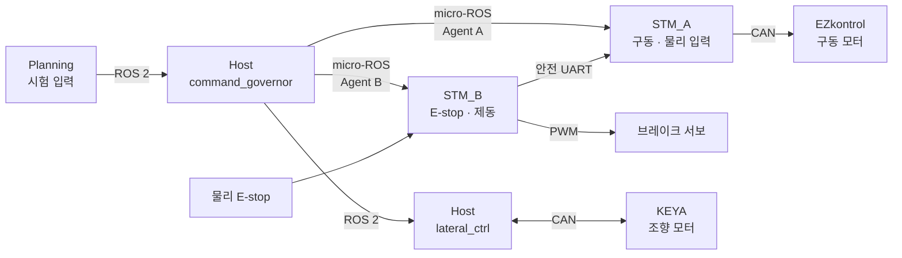

# Control

ROS 2의 차량 제어 명령을 STM32 기반 구동·제동 펌웨어와 CAN 조향 제어에 연결하는 프로젝트입니다.
Host와 MCU의 책임, 명령 유효성, 통신 단절 시 동작을 정의하고 HIL 벤치와 차량 시험 기록으로 구현을 검토합니다.
상위 Planning은 별도 시스템이며, 이 저장소는 액추에이터 제어와 상태 통합, 시험·계측 도구를 다룹니다.

## 시스템 구조

STM_A/B는 STM32G474·FreeRTOS에서 동작하며 각각 별도의 micro-ROS Agent로 Host에 연결됩니다.
위 그림은 명령과 정지 요청 경로입니다. 상태 피드백, UNO R4 계기판과 RP2350 배터리 계측의 연결은
[시스템 아키텍처](docs/ARCHITECTURE.md)에 정리했습니다.

## 핵심 설계와 구현

- **명령 유효성과 단절 처리.** Governor가 오래되거나 잘못된 명령을 거부하고, 입력이 끊기면 마지막 값을 재발행하지 않습니다. 각 소비자가 자신의 timeout과 복구 조건을 적용합니다. 속도 명령 변화율 제한은 설정에 따라 선택합니다. [명령 경로](software/src/command_governor/README.md)
- **구동과 제동의 책임 분리.** 물리 E-stop은 Host를 거치지 않고 STM_B의 브레이크와 STM_A의 구동 차단 요청으로 이어집니다. Host 명령 timeout은 AUTO 구동 차단과 조향 비활성화 조건이며, 그 자체로 STM_B 브레이크가 체결되지는 않습니다. [안전 동작과 한계](docs/SAFETY.md)
- **제어 주기와 통신 비용의 관측.** STM_A는 상위 구동 목표를 20 Hz로 갱신하며, 공통 스케줄러가 지난 실행 시점을 건너뛰어 밀린 작업의 연속 실행을 피합니다. 실행시간·지터·deadline miss와 UART 전송 영향을 계측합니다. [펌웨어 구조](firmware/README.md) · [계측 정의와 HIL 기록](firmware/common/README.md)

종방향 PI·feedforward·회생제동, 조향 PD와 선택형 MPC, 상태 통합 및 시험 도구의 구현 위치는
[소프트웨어 안내](software/README.md)에서 찾을 수 있습니다.

## 검증 범위

아래는 저장된 시험·분석 기록의 요약입니다. 각 날짜의 구성과 시험 조건에 한정됩니다.

| 환경 | 확인한 내용 | 해석 범위 |
|---|---|---|
| HIL 벤치, 2026-09-08~09 | 실제 STM_A/B와 STM_TEST로 명령·E-stop·PWM·CAN timeout 경로 확인. [기록](docs/HIL_RUNBOOK.md#15-진행-상태와-남은-작업) | EZ/KEYA 응답은 모사 값이며 실제 기구의 토크 응답 검증과 구분 |
| 바퀴 무부하, 2026-10-08~09 | PI 회생·feedforward·재인가 튜닝. 하강 언더슛 0.47 → 0.07 m/s 기록. [보고서](docs/reports/2026-10-08_rbs_tuning_report.md) | 공중 조건의 결과. 저속 회생 차단 시험과 지상 적용 검증은 별도 |
| 지상 주행, 2026-10-03 기록 분석 | 속도·전류에서 정속 오차와 가속 추종 지연을 분석하고 후속 튜닝 후보 도출. [분석·시험 계획](docs/reports/2026-10-09_ground_longitudinal_tuning_plan.md) | 문서의 개선 예측은 시뮬레이션이며 후속 실측 결과가 아님 |
| Gazebo, 2026-09-24 | 조향 PD/MPC와 경로 제어 조합 비교. [보고서](docs/reports/2026-09-24_lateral_mpc.md) | 해당 보고서에서 실차 MPC 주행은 수행하지 않음 |

현재 저장된 주행 회생 프리셋의 지상 검증과 조향 모델의 적용 범위 확대는 남아 있습니다.
시험 계획·소프트웨어 검사·실측 결과의 구분과 원본 자료 범위는 [검증 기록 안내](docs/reports/README.md)를 따릅니다.

## 시작하기와 문서

Host 환경은 Ubuntu 22.04 / ROS 2 Humble입니다. 공통 메시지 `kaiev26_msgs`와 실행 구성별 외부 패키지가 필요합니다.
빌드 환경과 의존성을 먼저 준비하고, 실차 또는 HIL에 맞는 운용 절차를 따릅니다.

| 문서 | 내용 |
|---|---|
| [Software](software/README.md) | 명령·상태 경로, 패키지별 README, 외부 의존성과 빌드 |
| [Firmware](firmware/README.md) | 보드별 README, FreeRTOS 구현, 빌드·Agent 연결 |
| [문서 지도](docs/README.md) | 아키텍처·인터페이스·안전·하드웨어 문서와 개발 규칙 |
| [실차 운용](docs/VEHICLE_RUNBOOK.md) · [HIL 운용](docs/HIL_RUNBOOK.md) | 환경 준비, 실행·관측·시험·종료 |
| [시험·분석 기록](docs/reports/README.md) | 주제별 읽기 순서와 날짜별 근거 |
