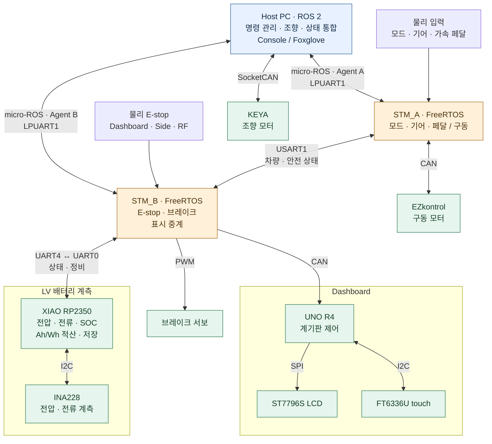

# Control

Control은 **자율주행 차량의 구동·제동·조향을 통합하는 ROS 2 기반 차량 제어 시스템**입니다.
상위 Planning이 보낸 목표속도·조향각·제동 요청을 실제 모터와 브레이크 명령으로 변환하고,
차량의 물리 입력과 액추에이터 피드백을 함께 처리합니다.

Host PC의 ROS 2 소프트웨어, STM32G474·FreeRTOS 제어 펌웨어, CAN 계기판과 저전압 배터리 계측을
하나의 저장소에서 관리합니다. 제어기뿐 아니라 보드 입출력을 모사하는 HIL 벤치, 파라미터 설정,
Web 관측, MCAP 기록·분석 도구를 포함해 **제어 구현부터 시스템 통합·시험·운용까지** 연결합니다.

상위 Planning과는 `/planning/command`로 연결하며 공통 메시지는 별도 `kaiev26_msgs`에서 관리합니다.
Host의 기준 환경은 Ubuntu 22.04 / ROS 2 Humble입니다.

## 시스템 구조

실차는 Host PC, 구동을 담당하는 STM_A, 제동을 담당하는 STM_B, UNO R4 계기판과 RP2350 배터리 적산계로 구성됩니다.
각 STM은 별도의 micro-ROS Agent를 통해 ROS 2 graph에 참여하고, 두 STM 사이에는 차량·안전 상태를 교환하는 UART 경로를 둡니다.

> 구성요소별 역할, 토픽별 연결, 운전 모드와 표시·정비 경로는 **[시스템 아키텍처](docs/ARCHITECTURE.md)**에서 자세히 설명합니다.

| 구성요소 | 담당 기능 |
|---|---|
| [**Host PC**](software/README.md) | 상위 명령 검사·전달, KEYA 조향 제어, 실험용 MPC, 차량 상태·진단 통합과 시험·관측 도구 |
| [**STM_A**](firmware/STM_A/README.md) | 물리 페달·모드·기어 입력, 종방향 제어, EZkontrol CAN 명령·피드백, 구동 차단 조건 적용 |
| [**STM_B**](firmware/STM_B/README.md) | 세 물리 E-stop 입력, 최종 브레이크 요청 결정과 서보 PWM, STM_A 안전 상태 전달, 계기판·LV 상태 중계 |
| [**UNO R4 Dashboard**](firmware/UNO_R4_DASHBOARD/README.md) | CAN 수신, SPI LCD로 차량 상태·배터리 정보 표시, I²C touch 기반 화면 탐색 |
| [**XIAO RP2350**](firmware/XIAO_RP2350_LV_GAUGE/README.md) | INA228 전압·전류 측정, Ah/Wh 적산, SOC·설정 저장, STM_B 및 USB 정비 통신 |
| [**STM_TEST — HIL 벤치**](firmware/STM_TEST/README.md) | 실제 STM_A/B에 연결해 페달·모드·기어·E-stop을 주입하고 브레이크 PWM과 EZkontrol·KEYA CAN을 모사·관측 |

### 명령과 상태의 흐름

AUTO 명령은 `Planning → command_governor → /vehicle/command` 순서로 전달됩니다.
STM_A는 구동 목표, STM_B는 제동 요청, Host의 `lateral_ctrl`은 조향 목표를 받아 각 액추에이터를 제어합니다.
MANUAL에서는 STM_A가 물리 페달·기어를 사용하고, STM_B의 물리 E-stop 경로는 두 모드에서 모두 동작합니다.

구동·제동·조향 피드백은 `/drive/status`, `/brake/status`, `/steering/status`로 돌아옵니다.
Host는 이를 `/vehicle/state`, `/vehicle/wheel_twist`, `/diagnostics`로 제공하고 Console·Foxglove에서 관측합니다.
LV 배터리 상태는 `RP2350 → STM_B → ROS / UNO 계기판`으로 전달되며,
AUTO 계기판 정보는 Host의 요약을 STM_B가 CAN으로 중계합니다.

메시지·단위·UART/CAN 형식은 [인터페이스](docs/INTERFACES.md)에 정리했습니다.

## 핵심 설계와 구현

### 구동·제동의 책임과 물리 안전 경로

구동과 제동을 별도 MCU에 나누고, 표시·계측은 전용 보드로 분리했습니다.

- **STM_A**: 구동 입력과 모터 제어를 담당합니다.
- **STM_B**: 물리 E-stop과 AUTO의 Host 제동 요청으로 최종 브레이크 요청을 만들고 서보를 제어합니다.
  같은 요청을 STM_A에 UART로 전달해 구동 차단에 반영합니다.
- **UNO R4**: 계기판 렌더링을 담당합니다.
- **RP2350**: 배터리 계측·적산·저장을 담당합니다.

물리 E-stop 처리는 Host의 ROS 통신을 거치지 않습니다.
STM_B의 표시 중계는 저우선순위 Task로 처리하고, LCD·touch·SOC 값은 차량 제어 명령을 만들지 않도록 역할을 나눴습니다.

계통별 정지 조건과 복구 동작은 [안전 설계](docs/SAFETY.md), Task·입출력 구성은
[STM_A](firmware/STM_A/README.md)와 [STM_B](firmware/STM_B/README.md)를 참고합니다.

### 명령 유효성 검사와 통신 단절 처리

명령 검사와 통신 단절 처리는 각 제어 단계에서 수행합니다.

- **Command Governor**: 상위 명령의 timestamp와 유한값을 검사하고, 통합 launch에서 `/vehicle/command`를 발행합니다.
  양수 속도 목표의 변화율 제한을 설정에 따라 적용하며, 입력이 끊기면 마지막 명령을 계속 재발행하지 않아
  하류에서 상위 명령의 단절을 감지할 수 있습니다.
- **STM_A**: AUTO 명령 timeout과 STM_B safety UART 상태로 구동 허용 여부를 판단합니다.
- **조향 노드**: 명령·차량 상태·CAN 피드백의 유효성을 확인하고, timeout 이후에는 과거 목표를 버리고 새 명령을 기다립니다.

검사·명령 전달은 [Command Governor](software/src/command_governor/README.md),
상태 전환과 복구는 [조향 제어](software/src/lateral_ctrl/README.md)에 설명했습니다.

### 종방향 속도·전류 제어와 회생제동

STM_A의 20 Hz 제어 Task는 세 가지 종방향 제어 경로를 지원합니다.

- **Speed**: EZkontrol 내부 속도 제어를 사용합니다.
- **Torque**: MCU에서 속도 PI를 계산하고, 속도 오차와 선택형 feedforward를 상전류 목표로 변환합니다.
  적분·전류 한도와 출력 변화율을 적용합니다.
- **외부 전류**: Host가 계산한 상전류 목표를 받아 STM_A의 수신·출력 한도를 거쳐 CAN으로 전달합니다.

회생제동은 음의 상전류 요청에 속도·bus 전압·충전전류 조건을 적용하며, 회생 해제 후 구동 재인가도 별도로 처리합니다.

Host의 `longitudinal_mpc`는 식별 모델을 사용하는 C++/OSQP MPC와 STM_A의 C PI 계산을 재사용하는 비교 경로를 제공합니다.

구현은 [STM_A](firmware/STM_A/README.md)와 [Longitudinal MPC](software/src/longitudinal_mpc/README.md),
설정·readback은 [Control Tuning](software/src/control_tuning/README.md)에서 확인할 수 있습니다.

### 조향 보정, PD 제어와 모델 기반 제어

`lateral_ctrl`은 KEYA encoder count를 보정식으로 차량 조향각에 변환합니다.
CAN 송수신, Enable/Disable, 피드백 만료와 출력의 peak·sustained 한도도 같은 조향 노드가 관리합니다.

- **PD 제어**: 목표각과 실제 각도·각속도를 이용해 토크 명령을 계산합니다.
- **조향 토크 MPC**: 실차 SYSID bag에서 식별한 입력 지연·각도 응답 모델을 사용하며, 기존 PD와 같은 액추에이터 경로에서 선택합니다.
- **경로 MPC**: 횡오차·방향오차·yaw rate·조향 응답을 모델에 포함해 목표 조향각을 계산합니다.
  별도 Decision 패키지가 이를 속도·제동 명령과 결합합니다.

조향·경로 MPC는 `mpc_common`의 QP 계산과 OSQP workspace를 재사용합니다.

종방향·조향·경로 MPC는 현재 실차 운용에 사용하지 않습니다. 실차 기록을 이용한 모델 식별과
Gazebo SITL 비교를 위한 구현으로 남겨두었습니다.

[Torque 제어](software/src/lateral_ctrl/TORQUE_CONTROL.md) · [Steering MPC](software/src/steering_mpc/README.md) ·
[Path MPC](software/src/path_mpc/README.md) · [모델 식별·제어 비교 기록](docs/reports/2026-09-24_lateral_mpc.md)

### FreeRTOS 주기 실행과 상태 계측

MCU의 제어·물리 입력·보드 간 UART·micro-ROS 처리를 Task로 나누고, STM_B의 E-stop과 브레이크 처리에 우선순위를 둡니다.
공통 주기 실행 코드는 최초 실행 위상을 유지하면서 이미 지난 실행 시점을 건너뛰어, 지연된 작업이 연속으로 실행되는 것을 피합니다.

Cortex-M4 DWT cycle counter와 RTOS tick으로 Task 실행시간, 지터, deadline miss, stack·heap 상태를 계측하고
별도의 runtime 토픽으로 관측합니다. UART 전송이 상태 발행과 명령 처리에 미치는 영향도 이 경로에서 확인합니다.

[펌웨어 구성](firmware/README.md) · [스케줄링·Runtime metrics](firmware/common/README.md)

## HIL과 운용·분석 도구

HIL 벤치에서는 실차와 같은 STM_A/B 펌웨어를 사용하고, STM_TEST가 물리 입력과 모터 CAN 응답을 대신합니다.
페달 DAC, 모드·기어·E-stop GPIO를 주입하고 브레이크 PWM을 읽으며, EZkontrol·KEYA emulator와 plant 모델로
명령에 대한 응답을 생성합니다. Web Console에서 입력·고장 조건·시험 시나리오를 조작하고 각 보드의 상태를 함께 관측합니다.
[STM_TEST 구성](firmware/STM_TEST/README.md) · [HIL backend](software/src/vehicle_console/HIL_BACKEND.md)

실차 관측과 HIL 시험은 `vehicle_console`의 공용 Web 화면을 사용합니다. Vehicle profile은 차량 토픽을 관측하고,
HIL profile은 벤치 입력·시나리오·가상 LCD/Touch 기능을 제공합니다.
차량의 상태·진단은 Console에서 요약하고, 상세 ROS 데이터는 Foxglove로 확인합니다.
[Vehicle Console](software/src/vehicle_console/README.md) · [Foxglove](software/src/foxglove/README.md)

시험 입력, 적용 파라미터와 차량 응답을 함께 남겨 제어 설정과 관측 결과를 연결합니다.
`control_tuning`에서 주행·공중 프리셋을 편집·저장하고, `vehicle_test_scenarios`에서 Step/Sine/Ramp 등의 입력을 생성합니다.
`control_tools`는 MCAP 녹화, 실행 파라미터·readback 수집, 속도·조향·전류 응답 분석을 담당합니다.
[시험 시나리오](software/src/vehicle_test_scenarios/README.md) · [설정 도구](software/src/control_tuning/README.md) ·
[기록·분석 도구](software/src/control_tools/README.md) · [시험·분석 기록](docs/reports/README.md)

## 시작하기와 문서

ROS 패키지는 `~/KAI_ws/src/Control`과 `~/KAI_ws/src/kaiev26_msgs`를 같은 워크스페이스에 배치해 빌드합니다.
실차 통합 launch에는 `kaiev26_description` 등 구성별 의존성과 장치 준비가 필요합니다.
[Software의 환경·빌드 안내](software/README.md#환경과-빌드)에서 시작한 뒤 실차 또는 HIL runbook을 따릅니다.

| 문서 | 내용 |
|---|---|
| [시스템 아키텍처](docs/ARCHITECTURE.md) | 전체 구성, 구성요소별 역할, 명령·상태·계측·표시 경로 |
| [인터페이스](docs/INTERFACES.md) · [안전 설계](docs/SAFETY.md) | ROS·UART·CAN 계약, 운전 모드별 정지 조건과 복구 |
| [Software](software/README.md) · [Firmware](firmware/README.md) | 패키지·보드별 README, 구현 위치와 빌드·연결 |
| [실차 운용](docs/VEHICLE_RUNBOOK.md) · [HIL 운용](docs/HIL_RUNBOOK.md) | 환경 준비, 실행·관측·시험·종료 |
| [하드웨어 자료](docs/hardware/README.md) · [배선도](docs/vehicle-wiring/README.md) | 제조사 매뉴얼·통신 프로토콜과 배선 |
| [시험·분석 기록](docs/reports/README.md) | HIL·차량·시뮬레이션 기록과 제어 분석 보고서 |
| [전체 문서 지도](docs/README.md) | 상세 문서, 과거 구현과 개발 규칙 |
