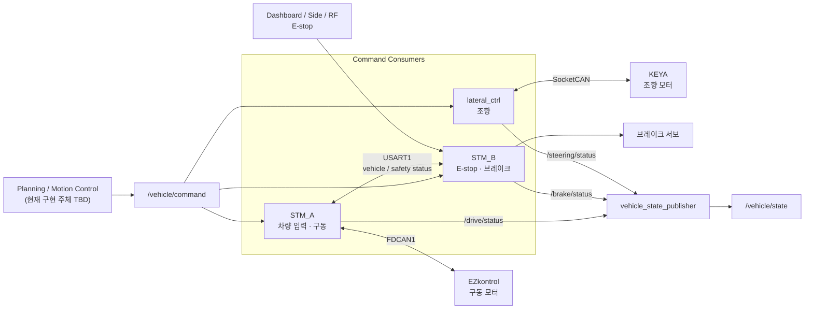
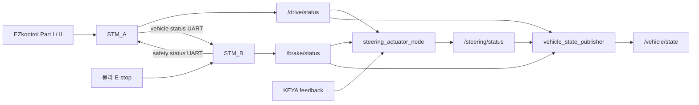

# System Architecture

> 이 문서는 현재 작업 브랜치의 소스 코드를 기준으로 작성되었습니다.
> 코드 변경 시 주기, timeout, 핀, 통신 ID와 안전 조건을 함께 갱신해야 합니다.

## 1. 문서 목적

이 문서는 현재 `Control` 코드에서 확인되는 전체 시스템 구성, 각 프로세서의
책임과 명령·상태 데이터 흐름을 설명합니다. 데이터 형식과 주기는
[`INTERFACES.md`](INTERFACES.md), 안전 조건과 복구 동작은
[`SAFETY.md`](SAFETY.md)를 기준으로 합니다.

## 2. 전체 시스템 구성



STM_A와 STM_B는 각각 별도의 LPUART1 serial transport와 micro-ROS Agent를
사용합니다. 두 Agent는 MCU의 ROS 2 endpoint를 Host의 ROS graph에 연결합니다.

> **주의:** 현재 `software/src/control_launch/launch/`에는 통합 launch가 없고,
> `software/src/longitudinal_ctrl/`에는 실행 노드가 없습니다. Planning 또는
> motion-control 명령 생성기의 구체 구현은 현재 코드에서 확인되지 않습니다.

## 3. 구성요소별 역할

### 3.1 Host / Control PC

- ROS 2 graph와 각 STM의 micro-ROS Agent를 실행합니다.
- 설계상 상위 Planning 또는 motion-control 계층에서 들어오는
  `/vehicle/command`를 STM_A, STM_B와 조향 노드에 전달합니다. 현재
  `Control` 저장소에는 production 명령 생성 노드가 없습니다.
- `lateral_ctrl/steering_actuator_node`가 KEYA 모터의 SocketCAN 소유자가 되어
  조향을 제어합니다.
- `vehicle_state_publisher`가 `/drive/status`, `/brake/status`,
  `/steering/status`를 합성해 `/vehicle/state`를 20 Hz로 발행합니다.
- software 전체 실행 구조는 현재 정리 중이며 통합 실행 절차는 아직 확정되지
  않았습니다.

### 3.2 STM_A

STM_A는 종방향 구동과 차량의 물리 모드·기어·가속 페달 입력을 담당합니다.

- PA0 ADC로 가속 페달을 읽고 0~100%로 변환합니다.
- PA8 모드 스위치와 PA9 기어 스위치를 읽습니다.
- AUTO에서는 `/vehicle/command.speed_target_mps`를 EZkontrol speed-control
  명령으로 변환합니다.
- MANUAL에서는 물리 페달과 기어를 torque-control 명령으로 변환합니다.
- EZkontrol handshake와 CAN 명령·Part I/II 상태 수신을 담당합니다.
- `/drive/status`로 모드, 기어, 속도, 명령 freshness와 모터 진단을 발행합니다.
- STM_B에 모드·기어·속도를 보내고 STM_B의 최종 브레이크 요청을 받습니다.
- STM_B safety frame 단절, STM_B 브레이크 요청, AUTO Host brake 또는 AUTO Host
  명령 timeout 조건에서 traction을 HALTED로 명령합니다.

구현 기준: `firmware/STM_A/Core/Src/app_freertos.c`

### 3.3 STM_B

STM_B는 물리 E-stop 입력과 브레이크 서보의 직접 구동을 담당합니다.

- dashboard, side, RF 세 E-stop GPIO를 active-low로 읽습니다.
- `/vehicle/command.brake_engage`를 수신합니다.
- STM_A UART frame에서 물리 모드, 기어와 속도를 받습니다.
- `물리 E-stop OR (AUTO AND Host brake)`로 최종 `BRAKE_REQUEST`를 계산합니다.
- TIM2 CH2 PWM으로 브레이크 서보를 움직입니다.
- 최종 브레이크 요청을 STM_A에 UART로 전달합니다.
- `/brake/status`로 command 상태와 정지 원인을 발행합니다.
- STM_A 상태를 LCD dashboard에 표시합니다.

브레이크 서보를 직접 구동하는 보드는 STM_B뿐입니다. STM_B의 FDCAN1은 초기화되지만
현재 application 코드에서 CAN 송수신에 사용되지 않습니다.

구현 기준: `firmware/STM_B/Core/Src/app_freertos.c`

### 3.4 조향 제어

> 이 절의 software 관련 내용은 현재 브랜치 구현을 기준으로 한 스냅샷입니다.
> software 구조와 통합 실행 방식은 아직 정리 중이며 이후 변경될 수 있습니다.

`software/src/lateral_ctrl`의 `steering_actuator_node`가 `/vehicle/command`,
`/drive/status`, `/brake/status`를 받아 KEYA 조향 모터를 제어합니다.

- AUTO, 유효한 mode·position·CAN feedback, E-stop 해제, command brake 해제
  조건에서만 새 조향 명령을 활성화합니다.
- MANUAL, E-stop, command brake, 통신 timeout 또는 모터 fault에서 KEYA를
  Disable합니다.
- `/steering/status`와 보조 진단 토픽을 발행합니다.

상세 사용법은
[`software/src/lateral_ctrl/README.md`](../software/src/lateral_ctrl/README.md)를
참고하십시오.

## 4. 명령 데이터 흐름

```text
Planning / Motion Control (TBD)
  └─ /vehicle/command: ActuatorCommand
      ├─ STM_A: speed_target_mps, brake_engage
      ├─ STM_B: brake_engage
      └─ steering_actuator_node: steering_target_rad, brake_engage
```

- STM_A는 AUTO일 때만 Host 속도 명령을 사용합니다. MANUAL의 종방향 목표는
  Host가 아니라 물리 페달과 기어에서 옵니다.
- STM_B는 AUTO일 때만 Host brake를 최종 브레이크 요청에 포함합니다.
- 조향 노드는 MANUAL에서 KEYA 모터를 Disable합니다.
- `ActuatorCommand`에는 gear나 enable 필드가 없습니다.

## 5. 상태 및 진단 데이터 흐름



`/vehicle/state`는 세 status가 모두 최소 한 번 수신된 후에만 발행됩니다. 현재
구현은 각 입력의 age나 freshness를 다시 검사하지 않고 마지막 수신값을
합성합니다.

## 6. MANUAL / AUTO 모드

물리 모드의 기준은 STM_A PA8 입력입니다.

| 구분 | MANUAL (`0`) | AUTO (`1`) |
|---|---|---|
| 종방향 목표 | STM_A의 물리 페달과 기어 | `/vehicle/command.speed_target_mps` |
| Host command timeout | traction 판단에 적용하지 않음 | 500 ms에 traction HALTED |
| Host `brake_engage` | STM_A traction과 STM_B 서보 판단에서 제외 | traction HALTED 및 서보 engage |
| 물리 E-stop | STM_B 서보 engage, STM_A traction HALTED | 동일 |
| 조향 모터 | Disable | 안전·통신 조건과 fresh pending 명령이 있으면 Enable |

Host brake가 true인 상태에서 AUTO에서 MANUAL로 바뀌면, 물리 E-stop이 없는 한
STM_B의 Host 원인 브레이크 요청은 해제됩니다. STM_A도 MANUAL에서 Host brake를
traction 차단 조건으로 사용하지 않습니다.

## 7. 실차와 시뮬레이션의 관계

- `kaiev26_hil`의 `bench` 모듈은 `vcan`에서 구동·조향 CAN 동작을 시험하는
  simulator입니다. `ros2 launch kaiev26_hil bench.launch.py`로 실행합니다.
- `gazebo/pid_gazebo`는 PID와 SILS 실험용 Python 패키지·자원을 포함합니다.
- 벤치용 `steering_bench_test_node`는 시험 `/vehicle/command`,
  `/drive/status`, `/steering/test/estop`을 선택적으로 발행합니다.
- 이 시험 입력은 실제 STM의 안전 경로를 대체하는 인증된 fail-safe로 간주할 수
  없습니다.

현재 실차와 시뮬레이션을 동일한 통합 launch로 전환하는 구조는 구현되어 있지
않습니다.

## 8. 설계 경계와 책임 분리

| 책임 | 기준 구현 |
|---|---|
| 공통 ROS 메시지 필드 | 별도 `kaiev26_msgs/msg/*.msg` |
| 물리 mode·gear·pedal 입력 | STM_A |
| EZkontrol 명령·진단 | STM_A |
| 물리 E-stop 판독과 브레이크 PWM | STM_B |
| STM 간 safety/vehicle 상태 교환 | STM_A·STM_B USART1 |
| KEYA 조향 제어와 조향 timeout | Host `lateral_ctrl` |
| 공통 `/vehicle/state` 합성 | Host `vehicle_state_publisher` |
| Planning / motion-control 명령 생성 | 현재 코드에서 확인되지 않음 |

## 9. 관련 문서

- 데이터 계약과 주기: [`INTERFACES.md`](INTERFACES.md)
- 안전 조건과 복구: [`SAFETY.md`](SAFETY.md)
- 공통 펌웨어 빌드: [`../firmware/README.md`](../firmware/README.md)
- STM_A 내부 구조: [`../firmware/STM_A/README.md`](../firmware/STM_A/README.md)
- STM_B 내부 구조: [`../firmware/STM_B/README.md`](../firmware/STM_B/README.md)
