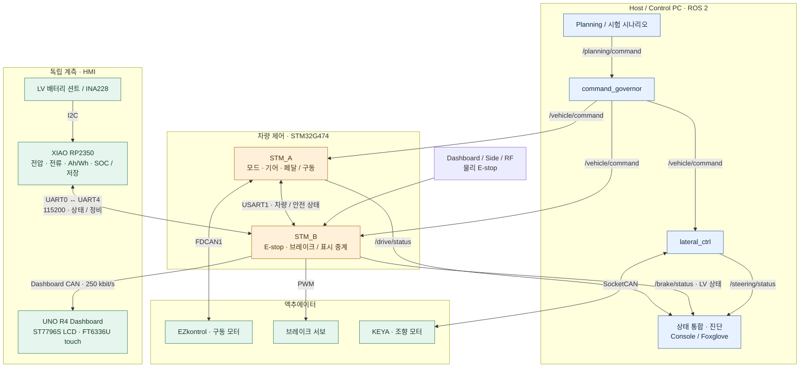
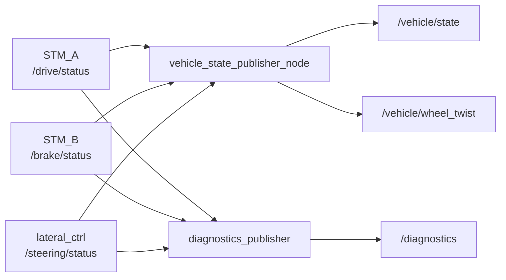
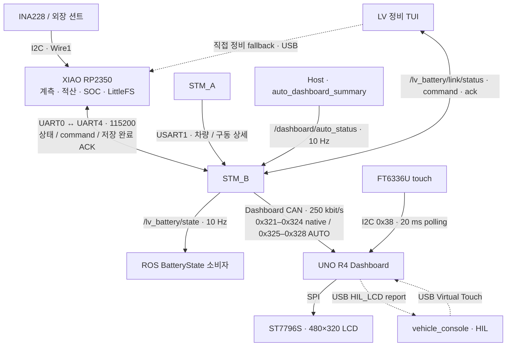

# System Architecture

> 이 문서는 현재 작업 브랜치의 소스 코드를 기준으로 작성되었습니다.
> 코드 변경 시 주기, timeout, 핀, 통신 ID와 안전 조건을 함께 갱신해야 합니다.

## 1. 문서 목적

이 문서는 현재 `Control` 코드에서 확인되는 전체 시스템 구성, 각 프로세서의
책임과 명령·상태 데이터 흐름을 설명합니다. 데이터 형식과 주기는
[`INTERFACES.md`](INTERFACES.md), 안전 조건과 복구 동작은
[`SAFETY.md`](SAFETY.md)를 기준으로 합니다.

## 2. 전체 시스템 구성

전체 흐름은 **Host 명령 → 구동·제동·조향 → 상태 통합**과
**LV 배터리 계측 → STM_B → 계기판·ROS**로 나뉩니다.
아래 그림은 실차 연결의 개요이며, ROS 토픽과 HIL 정비 경로는 뒤의 상세 그림에서 설명합니다.



| 경로 | 담당 | Host / ROS 의존성 |
|---|---|---|
| AUTO 명령 | Planning → Governor → STM_A·STM_B·조향 | Host 명령과 상태 필요 |
| MANUAL 구동 | 물리 페달·기어 → STM_A → EZkontrol | 물리 입력 경로는 ROS와 독립 |
| 물리 E-stop | E-stop → STM_B → 서보·STM_A safety UART | ROS와 독립 |
| LV 계측·적산·저장 | INA228 → RP2350 | PC·STM_B 연결 없이 수행 |
| native 계기판·LV 표시 | STM_A / RP2350 → STM_B → UNO | ROS와 독립 |
| AUTO 상세 표시 | Host 요약 → STM_B → UNO | `/dashboard/auto_status` 필요 |

공통 설정 TUI `control_tuning`은 실행값 조회와 프리셋 편집·저장을 담당합니다.
`S`로 저장한 뒤 같은 프리셋으로 구동 스택을 재시작하면 반영됩니다.
TUI는 실행 중 제어값이나 주행 명령을 발행하지 않습니다.
시나리오 입력은 `vehicle_test_scenarios`에서 편집합니다.
[파라미터 TUI 계약](../software/src/control_tuning/README.md)을 참고합니다.

STM_A와 STM_B는 각각 별도의 LPUART1 serial transport와 micro-ROS Agent를
사용합니다. 두 Agent는 MCU의 ROS 2 endpoint를 Host의 ROS graph에 연결합니다.

> **주의:** 실차 구동 스택은 `control_launch`의 `vehicle.launch.py`로
> 실행합니다(Agent 2개 + `command_governor` + 조향 + 상태·진단 발행,
> 브라우저/Foxglove 화면 제외). Production Planning(`/planning/command` 발행자)의 구체 구현은 현재
> 코드에서 확인되지 않으며 launch에도 포함되지 않습니다. 실차 시험에서는
> `vehicle_test_scenarios`, HIL에서는 `vehicle_console.hil`의 `hil_command_generator`가
> 그 자리를 대신합니다. `/vehicle/command`는 `command_governor`가 유일하게
> 발행합니다.

## 3. 구성요소별 역할

### 3.1 STM_A

STM_A는 종방향 구동과 차량의 물리 모드·기어·가속 페달 입력을 담당합니다.

- PA0 ADC로 가속 페달을 읽고 0~100%로 변환합니다.
- PA8 모드 스위치와 PA9 기어 스위치를 읽습니다.
- AUTO에서는 `/vehicle/command.speed_target_mps`를 선택한 Speed/Torque 경로로 제어합니다.
  두 경로 모두 active preset의 current/RPM envelope를 사용합니다.
- MANUAL에서는 물리 페달과 기어를 torque-control 명령으로 변환합니다.
- EZkontrol handshake와 CAN 명령·Part I/II 상태 수신을 담당합니다.
- `/drive/status`로 모드, 기어, 속도, 명령 freshness와 모터 진단을 발행합니다.
- STM_B에 모드·기어·속도를 보내고 STM_B의 최종 브레이크 요청을 받습니다.
- STM_B safety frame 단절, STM_B 브레이크 요청, AUTO Host brake 또는 AUTO Host
  명령 timeout 조건에서 traction을 HALTED로 명령합니다.

AUTO 종방향은 기존 20 Hz `StartControl`에서 다음 두 경로를 선택합니다.

```text
Speed Control: Host target speed → target motor RPM → preset current/RPM envelope
               → EZkontrol native Speed Control
Torque Control: Host target speed → STM_A 20 Hz Speed PI → anti-windup/coast/current slew
                → phase-current target → EZkontrol Torque Control
MANUAL: physical pedal/gear → 기존 direct Torque Control
```

`drive_current_limit_a`는 Speed에서 EZ 내부 속도제어 current limit, Torque에서 PI 전류 상한입니다.
`drive_motor_speed_limit_rpm`은 Speed target RPM과 Torque RPM ceiling에 공통으로 적용합니다.
최종 전진 4500 / 후진 1500 rpm 물리 clamp는 CAN 송신부에서 별도로 유지합니다.
따라서 driving Speed의 480 A/4500 rpm baseline은 동일하고 airborne는 40 A/4500 rpm입니다.
MANUAL pedal/gear는 AUTO preset envelope를 사용하지 않습니다.

Torque는 Part I freshness <500 ms와 Part II freshness <1 s를 요구하며, 상실 시 history reset·0 A/HALTED 후
feedback 복구를 확인한 다음 받은 fresh Host command로만 재개합니다.
Speed에서는 Part I/II stale이 status validity에만 반영됩니다.

구현 기준: `firmware/STM_A/Core/Src/app_freertos.c`

### 3.2 STM_B

STM_B는 물리 E-stop 입력과 브레이크 서보의 직접 구동을 담당합니다.

- dashboard, side, RF 세 E-stop GPIO를 active-low로 읽습니다.
- `/vehicle/command.brake_engage`를 수신합니다.
- STM_A UART frame에서 물리 모드, 기어와 속도를 받습니다.
- `물리 E-stop OR (AUTO AND Host brake)`로 최종 `BRAKE_REQUEST`를 계산합니다.
- TIM2 CH2 PWM으로 브레이크 서보를 움직입니다.
- 최종 브레이크 요청을 STM_A에 UART로 전달합니다.
- `/brake/status`로 command 상태와 정지 원인을 발행합니다.
- UART4로 RP2350 계측 상태를 받아 ROS BatteryState·정비 payload와 Dashboard LV 표시로 중계합니다.
- STM_A의 mode·gear·speed와 EZkontrol drive detail을 UART로 받아 250 kbit/s
  Classical CAN dashboard snapshot으로 Arduino UNO R4에 전송합니다. Arduino가
  MSP4030/ST7796S LCD를 렌더링합니다. native 표시는 ROS와 독립적이며,
  AUTO 추가 표시는 `/dashboard/auto_status`를 중계합니다.

브레이크 서보를 직접 구동하는 보드는 STM_B뿐입니다. STM_B의 FDCAN1은 dashboard
송신과 bus-off 복구에만 사용하며, Dashboard CAN/Arduino 장애는 E-stop, 브레이크 PWM,
STM_A safety UART와 micro-ROS 상태를 변경하지 않습니다.

구현 기준: `firmware/STM_B/Core/Src/app_freertos.c`,
`firmware/STM_B/Core/Src/dashboard_can.c`

### 3.3 Arduino UNO R4 Dashboard

Dashboard HMI는 **Arduino UNO R4 Minima**가 담당합니다. STM_B가 250 kbit/s
Classical Dashboard CAN으로 native `0x321`~`0x324`와 AUTO `0x325`~`0x328`을
송신합니다. UNO R4는 RA4M1 internal CAN controller와 MCP2551 transceiver로
수신합니다. 각 그룹의 네 frame은 version·alive가 맞을 때 독립적으로 적용됩니다.
native snapshot의 nominal 주기는 50 ms이며 300 ms 동안 새 완전한 native
snapshot이 없으면 `CAN LOST`입니다. AUTO 표시는 Host의 `auto_dashboard_summary`가
`/dashboard/auto_status`로 보낸 25-byte payload를 STM_B가 중계합니다.
AUTO stale과 native CAN LOST는 별도로 판정합니다.

- MSP4030/MSP4031의 ST7796S 480×320 LCD를 SPI로 렌더링합니다.
- MSP4031의 FT6336U capacitive touch를 I2C로 20 ms polling합니다. INT는 기능상
  입력 경로에 쓰지 않고 diagnostic counter만 유지합니다.
- 물리 touch와 page navigation은 ROS 없이 UNO 내부에서 동작합니다.
- HIL profile에서만 USB Serial로 Virtual LCD 보고와 Virtual Touch 입력을
  주고받으며 실제 LCD에 적용된 page 보고를 Web mirror에 반영합니다.

Dashboard 경로는 상태 표시와 local navigation 전용입니다. Dashboard CAN,
Arduino, LCD 또는 touch 장애는 gear, mode, accelerator, vehicle command를 만들지
않으며 STM_B E-stop/brake와 STM_A traction safety 판단에 들어가지 않습니다.
CAN frame과 USB/touch 계약은 [`INTERFACES.md`](INTERFACES.md#7-stm_b--uno-r4-dashboard-can),
pinout·전압·renderer 세부사항은
[`firmware/UNO_R4_DASHBOARD/README.md`](../firmware/UNO_R4_DASHBOARD/README.md)를
따릅니다.

### 3.4 XIAO RP2350 LV 배터리 적산계

XIAO RP2350은 100 A / 75 mV 션트와 INA228을 통해 LV 배터리의 전압·전류를
측정합니다. `Wire1` I2C로 센서를 읽고 CHARGE 증가량으로 Ah, 구간 평균 전압으로
Wh를 계산합니다. SOC·용량·영점·트립 상태는 LittleFS journal에 저장합니다.

- 계측·적산·저장은 ROS나 PC 연결 없이 계속 동작합니다.
- UART0(`D6/GPIO0` TX, `D7/GPIO1` RX)와 STM_B UART4(`PC11` RX, `PC10` TX)가
  3.3 V, 115200 8N1로 통신합니다. 상태는 100 ms마다 CRC32 보호 frame으로 보냅니다.
- STM_B는 `/lv_battery/state`와 정비용 `/lv_battery/link/status|command|ack`을 중계합니다.
  LV 전압·SOC는 기존 Dashboard CAN `0x324`에 포함됩니다.
- 기본 정비 TUI는 STM_B micro-ROS 경로를 사용하고, 직접 USB는 `--usb` fallback입니다.
  완충 기준점·트립 초기화·영점·용량 변경은 RP2350의 저장 완료 ACK로 확인합니다.
- RP2350 내부 전류는 방전 양수이며 ROS `BatteryState.current`는 방전 음수로 변환합니다.
- 1초간 UART 상태가 없으면 STM_B가 LV 미수신으로 표시합니다. 계측 장애나 SOC 값은
  브레이크 요청·traction 판단에 사용하지 않습니다.

배선·전원·센서 경계는 [LV 배터리 구성](rp2350/lv_battery_gauge.md),
빌드·적산·저장·정비는 [RP2350 README](../firmware/XIAO_RP2350_LV_GAUGE/README.md)를 따릅니다.

### 3.5 Host / Control PC

- ROS 2 graph와 각 STM의 micro-ROS Agent를 실행합니다.
- `command_governor`가 상위 Planning 계층의 `/planning/command`를 받아
  `/vehicle/command`로 재발행합니다. 이 노드가 `/vehicle/command`의 유일한
  발행자이며, 현재는 패스스루(정합성 게이트만, 형상 없음)입니다. Planning의
  production 구현은 이 저장소 밖에서 관리하고 실차 시험은 `vehicle_test_scenario_runner`, HIL은
  `hil_command_generator`가 대역입니다. 두 시험 발행자는 동시에 실행하지 않습니다.
- `lateral_ctrl/steering_actuator_node`가 KEYA 모터의 SocketCAN 소유자가 되어
  조향을 제어합니다.
- `vehicle_state_publisher` package가 status 3종을 처리합니다.
  `vehicle_state_publisher_node`는 `/vehicle/state`와 유효한 구동·조향 관측 기반
  `/vehicle/wheel_twist`를 20 Hz로 발행하고, 별도 `diagnostics_publisher`는
  `/diagnostics`를 1 Hz로 발행합니다. `auto_dashboard_summary`는 계기판용
  `/dashboard/auto_status`를 10 Hz로 발행합니다.
- 실차 구동 스택은 `control_launch/launch/vehicle.launch.py`로 실행합니다.
  구동 노드와 `/diagnostics` 요약을 포함하며 관측 화면은 `vehicle_console/vehicle.launch.py`와
  `foxglove/foxglove_bridge.launch.py`로 따로 켭니다. 실차 장치에서의 최종 확인은 아직이며
  HIL bench에서 동형 구조로 검증했습니다.

### 3.6 조향 제어

`software/src/lateral_ctrl`의 `steering_actuator_node`가 `/vehicle/command`,
`/drive/status`, `/brake/status`를 받아 KEYA 조향 모터를 제어합니다.

현재 launch가 읽는 YAML은 `actuation_mode=torque`,
`minimum_steering_speed_kph=0.0`입니다. 노드의 코드 기본값인 `position`, `1.0`과
구분해야 합니다. 최소속도가 0이어도 유효하고 fresh한 구동 속도 피드백이 필요합니다.

Startup-only `actuation_mode`는 `position`(기존 count 명령) 또는 `torque`(외부
calibrated wheel-angle PD)를 선택합니다. `TorqueSteeringController`는 ROS/CAN과
독립적인 제어·rate 추정·raw/time envelope를 소유하고, 노드는 CAN과 기존 안전 상태
머신을 계속 소유합니다. runtime mode 전환은 없으며 KEYA 0020은 운영자가
position=3/torque=2로 맞춥니다. [Torque 운용 계약](../software/src/lateral_ctrl/TORQUE_CONTROL.md)을
참고하십시오. 기존 HIL position 모델을 torque 응답 검증으로 간주하지 않습니다.

- AUTO, 유효한 mode·position·CAN feedback, E-stop 해제, command brake 해제
  조건에서만 새 조향 명령을 활성화합니다.
- MANUAL, E-stop, command brake, 통신 timeout 또는 모터 fault에서 KEYA를
  Disable합니다.
- `/steering/status`와 보조 진단 토픽을 발행합니다.

상세 사용법은
[`software/src/lateral_ctrl/README.md`](../software/src/lateral_ctrl/README.md)를
참고하십시오.

## 4. 명령 데이터 흐름

```text
Planning / Motion Control (별도 상위 패키지)
  또는 vehicle_test_scenario_runner (실차 TUI, ROS node /auto_sysid)
  또는 vehicle_test_scenario_node (headless, ROS node /vehicle_test_scenario_runner)
  또는 hil_command_generator (HIL)
  └─ /planning/command: ActuatorCommand
      └─ command_governor (정합성 게이트, 재-stamp; 현재 패스스루)
          └─ /vehicle/command: ActuatorCommand
              ├─ STM_A: speed_target_mps, brake_engage
              ├─ STM_B: brake_engage
              └─ steering_actuator_node: steering_target_rad, brake_engage
```

- STM_A는 AUTO일 때만 Host 속도 명령을 사용합니다. MANUAL의 종방향 목표는
  Host가 아니라 물리 페달과 기어에서 옵니다.
- STM_B는 AUTO일 때만 Host brake를 최종 브레이크 요청에 포함합니다.
- 조향 노드는 MANUAL에서 KEYA 모터를 Disable합니다.
- `ActuatorCommand`에는 gear나 enable 필드가 없습니다.

## 5. 상태 및 진단 데이터 흐름

### 5.1 차량 상태 통합



`/vehicle/state`는 세 status가 모두 최소 한 번 수신된 후에만 발행됩니다. 현재
구현은 각 입력의 age나 freshness를 다시 검사하지 않고 마지막 수신값을 합성합니다.
조향 노드도 `/drive/status`와 `/brake/status`를 직접 구독해 제어 조건을 판단합니다.
LV 배터리는 별도 `/lv_battery/state` 경로이며 이 세 status 합성에 포함되지 않습니다.

### 5.2 계기판·LV 계측·정비



실선은 기본 운용 경로, 점선은 직접 USB 정비 또는 HIL 전용 경로입니다.
STM_B→UNO native snapshot은 50 ms마다 전송하며 `0x324` byte 5–7에 LV validity,
전압·SOC를 담습니다. native·LV 표시는 ROS와 독립적이고 AUTO 상세 표시는 Host에 의존합니다.
LV UART 1초 단절, AUTO 요약 300 ms 단절, UNO native CAN 300 ms 단절은 각각 별도로 판정합니다.
FT6336U 입력은 UNO 내부 화면 탐색에만 사용합니다.

## 6. MANUAL / AUTO 모드

물리 모드의 기준은 STM_A PA8 입력입니다.

| 구분 | MANUAL (`0`) | AUTO (`1`) |
|---|---|---|
| 종방향 목표 | STM_A의 물리 페달과 기어 | `/vehicle/command.speed_target_mps` |
| Host command timeout | traction 판단에 적용하지 않음 | 500 ms에 traction HALTED |
| Host `brake_engage` | STM_A traction과 STM_B 서보 판단에서 제외 | traction HALTED 및 서보 engage |
| 물리 E-stop | STM_B 서보 engage, STM_A traction HALTED | 동일 |
| 조향 모터 | Disable | 안전·통신 조건과 fresh pending 명령이 있으면 Enable |

Host brake가 true인 상태에서 AUTO에서 MANUAL로 바뀌면, 물리 E-stop이 없는 한
STM_B의 Host 원인 브레이크 요청은 해제됩니다. STM_A도 MANUAL에서 Host brake를
traction 차단 조건으로 사용하지 않습니다.

## 7. 실차와 시뮬레이션의 관계

- `vehicle_console.hil.vcan_sim`은 `vcan`에서 구동·조향 CAN 동작을 시험하는
  software-only simulator입니다. `ros2 launch vehicle_console vcan_sim.launch.py`로
  실행합니다.
- 구형 `/cmd_vel` 기반 PID/SILS 실험과 모델은
  [`archive/software/gazebo`](../archive/software/gazebo/README.md)에 보관하며 active build에서 제외합니다.
  Gazebo SYSID 진입점은 `Simulation/kaiev26_gazebo_bringup`에서 관리합니다.
- 벤치용 `steering_bench_test_node`는 시험 `/vehicle/command`,
  `/drive/status`, `/steering/test/estop`을 선택적으로 발행합니다. STM_A/B 없이
  조향만 단독 시험할 때 쓰며, **`command_governor`를 우회해 `/vehicle/command`에
  직접 발행하므로** governor 또는 HIL bench 스택(`hil.launch.py`)과 동시에
  실행하면 `/vehicle/command` 발행자가 둘이 됩니다. 함께 켜지 않습니다.
- 이 시험 입력은 실제 STM의 안전 경로를 대체하는 인증된 fail-safe로 간주할 수
  없습니다.
- HIL bench의 KEYA emulator는 모터축을 선형으로만 모사합니다. 따라서 CAN 경로와
  안전 로직의 해당 경로를 검증하지만 실제 기구의 `count_scale`, `equivalent_k1_deg`~`equivalent_k5_deg`,
  `command_count_limit` 보정이나 `torque_direction_sign`, torque 응답까지 검증하지는
  않습니다. 이 항목들은 실제 조향 기구에서 따로 확인해야 합니다.

실차는 `control_launch/vehicle.launch.py`, HIL bench는
`vehicle_console/hil.launch.py start_bench:=true`로 실행합니다. 두 launch 모두
`command_governor` 경유의 동일한 명령 체인을 쓰지만, 하나의 launch로 실차와
시뮬레이션을 전환하는 구조는 아닙니다.

### 7.1 KAI Vehicle Console과 HIL 가상 HMI

`vehicle_console`은 유일한 React frontend, 공용 Web serving/Host·Origin 보안,
ROS 수신·runtime normalization, 독립 Vehicle 관측 backend를 제공합니다.
하나의 active ROS package 안에서 `vehicle_console.common`, `vehicle_console.vehicle`,
`vehicle_console.hil`로 책임을 나눕니다. 기존 `kaiev26_hil` 보관본은 대체 완료 후 정리했으며 Git 이력에 남아 있습니다.
Vehicle backend는 HIL backend/serial/scenario를 import하거나 초기화하지 않습니다.

```text
canonical vehicle ROS topics → vehicle_console Vehicle observer → shared frontend
canonical + HIL ROS / UNO → vehicle_console.hil → common infrastructure / frontend
canonical status topics → vehicle_state_publisher diagnostics → Console / Foxglove
canonical ROS graph → foxglove bridge
```

Profile은 server 시작 시 고정합니다. Vehicle은 Overview/Drive/Steering/Safety/Runtime/
Diagnostics만 제공하며 WebSocket 입력은 모두 거부합니다. HIL의 control/scenario/
fault/display/touch capability와 ownership은 HIL backend 책임입니다.
Foxglove는 기본 8765, Vehicle은 8766, HIL은 8767로 함께 실행할 수 있습니다.

`vehicle_console/hil.launch.py`는 같은 frontend를 HIL profile로 제공합니다.
기본 실행은 Web만 띄우며 `start_bench:=true`가 기존 headless HIL bench를 포함합니다.
Web은 구동·조향·안전 등의 관측 페이지와 전역 Control Dock을 분리합니다.
Control Dock의 운전자 입력, 고장 주입과 시나리오는 기존 `/hil/*`와 command generator parameter를
사용합니다. STM_TEST serial의 소유자는 계속 `stm_test_bridge`입니다.

`dashboard_port:=/dev/arduino_hil`을 지정하면 별도 reader가 UNO USB의 적용 표시값·
페이지·CAN LOST를 받습니다. PC renderer는 UNO의 실제 C++ drawing 코드와 preview 생성
아셋을 재사용해 480×320 이미지를 만듭니다. ROS 명령값으로 UNO 수신 성공을 추정하지
않으며, USB 보고 단절과 dashboard CAN LOST를 구분합니다. 실제 패널·SPI·터치는 별도입니다.

Web 전용 launch의 command generator는 DISARMED로 시작하고, 조작 브라우저의 명시적
ARM 이후 발행합니다. Web 조작권은 한 브라우저에만 주며 heartbeat 단절 시 해제합니다.
생성기에도 Web heartbeat watchdog을 적용하되, headless HIL launch의 generator 기본값은 유지합니다. Qt 화면은
[parity 검증](../software/src/vehicle_console/CONSOLE_PARITY.md)을 거쳐 Web으로 대체했고 보관본은 정리했습니다.
상세 실행·단위 변환·검증 결과는 [Web Console](../software/src/vehicle_console/HIL_WEB.md)에 있습니다.

## 8. 설계 경계와 책임 분리

| 책임 | 기준 구현 |
|---|---|
| 공통 ROS 메시지 필드 | 별도 `kaiev26_msgs/msg/*.msg` |
| 물리 mode·gear·pedal 입력 | STM_A |
| EZkontrol 명령·진단 | STM_A |
| 물리 E-stop 판독과 브레이크 PWM | STM_B |
| STM 간 safety/vehicle 상태 교환 | STM_A·STM_B USART1 |
| KEYA 조향 제어와 조향 timeout | Host `lateral_ctrl` |
| `/vehicle/state`·`/vehicle/wheel_twist` 합성 | Host `vehicle_state_publisher/vehicle_state_publisher_node` |
| status 3종의 `/diagnostics` 요약 | Host `vehicle_state_publisher/diagnostics_publisher` |
| `/vehicle/command` 단일 발행과 명령 정합성 게이트 | Host `command_governor` |
| 명령 형상 (속도 상한·램프·축간 협조) | Host `command_governor` (예정, 현재 패스스루) |
| Production Planning / motion-control 명령 생성 (`/planning/command`) | 현재 코드에서 확인되지 않음 |
| 시험·측정·독립 녹화·공통 기록 설정·분석 | Host `control_tools` |
| 실차 시험 `/planning/command` 생성 | Host `vehicle_test_scenarios` |
| HIL `/planning/command` 생성 | Host `vehicle_console.hil.hil_command_generator` |
| 공용 Web frontend·관측·runtime | `vehicle_console` |
| HIL 조작·scenario·가상 HMI | `vehicle_console.hil.hil_web_bridge` + 공용 Console |
| Vehicle 관측 | `vehicle_console/vehicle` |
| ROS graph 상세 분석 bridge·layout | `foxglove` |
| LV 계측·Ah/Wh·SOC·영속 저장 | `XIAO_RP2350_LV_GAUGE` |
| LV UART 수신·ROS 정비·Dashboard 중계 | STM_B `lv_battery_protocol.c` / `app_freertos.c` |
| 계기판 렌더링·local touch | `UNO_R4_DASHBOARD` |
| UNO 적용 상태 보고 / 가상 LCD | `hil_display_report.cpp` / `dashboard_display.py` + 공통 C++ renderer |

## 9. 관련 문서

- 실차 운용 절차: [`VEHICLE_RUNBOOK.md`](VEHICLE_RUNBOOK.md)
- 데이터 계약과 주기: [`INTERFACES.md`](INTERFACES.md)
- 안전 조건과 복구: [`SAFETY.md`](SAFETY.md)
- 공통 펌웨어 빌드: [`../firmware/README.md`](../firmware/README.md)
- STM_A 내부 구조: [`../firmware/STM_A/README.md`](../firmware/STM_A/README.md)
- STM_B 내부 구조: [`../firmware/STM_B/README.md`](../firmware/STM_B/README.md)
- STM_TEST HIL emulator: [`../firmware/STM_TEST/README.md`](../firmware/STM_TEST/README.md)
- 조향 패키지: [`../software/src/lateral_ctrl/README.md`](../software/src/lateral_ctrl/README.md)
- 실차 시험 시나리오: [`../software/src/vehicle_test_scenarios/README.md`](../software/src/vehicle_test_scenarios/README.md)
- HIL 운용 절차: [`HIL_RUNBOOK.md`](HIL_RUNBOOK.md)

- LV 배터리 구성: [`rp2350/lv_battery_gauge.md`](rp2350/lv_battery_gauge.md)
- RP2350 펌웨어·정비: [`../firmware/XIAO_RP2350_LV_GAUGE/README.md`](../firmware/XIAO_RP2350_LV_GAUGE/README.md)

- 시험·측정·녹화·분석: [`control_tools`](../software/src/control_tools/README.md)
