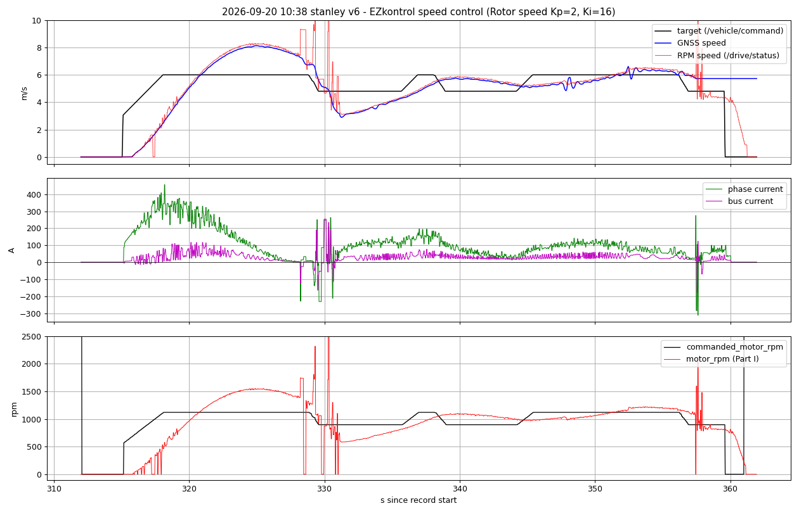
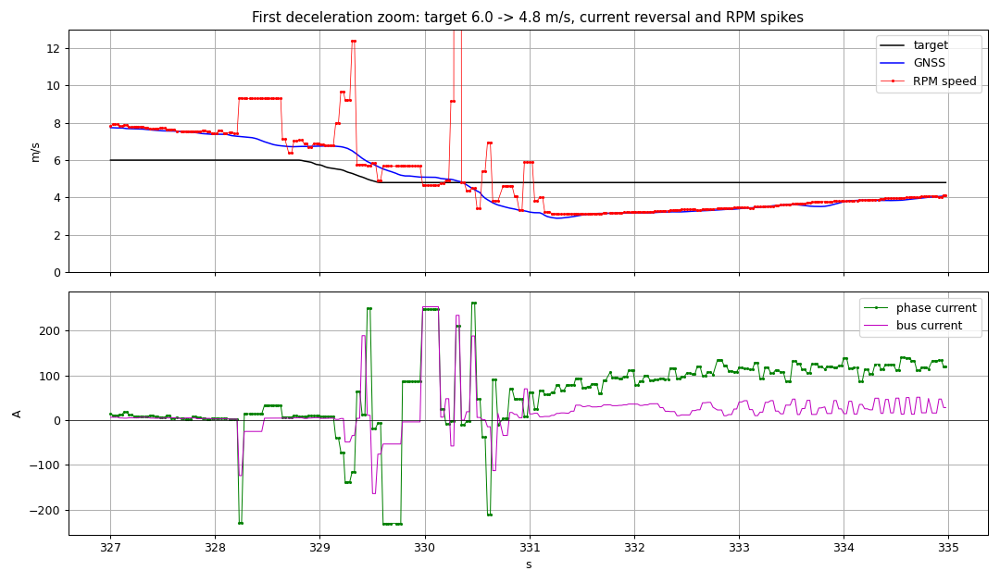

# 종방향 torque control 전환: 9월 20일 기록 분석, 설계, EZ 설정 제안, 실차 시험 케이스

분석 대상: `~/ControlRecord/260920/` 18개 기록(10:21~11:55, 예선·본선 경로, 요청속도 4~10 m/s,
모두 EZkontrol **speed control**, 앱 설정 Rotor speed Kp=2 / Ki=16 기준). 시각은 2026-09-20 KST.
범위: 기록 분석, `longitudinal_ctrl` 신규 구현, STM_A torque 명령 경로 추가, `kaiev26_msgs`
`DriveTorqueCommand` 추가. **실차·HIL에서 실행하지 않았고 STM_A는 아직 플래시하지 않았다.**
Ki=14 비교 실험(오늘 오후)은 speed control 경로에만 영향을 주며 아래 torque 경로와 독립이다.

## 1. 기록에서 확인한 현상

### 1.1 가속 후 과속: 목표 대비 +27~37 %, 모든 Run에서 재현

| Run | 요청 | GNSS 최고 | 초과 | 감속 중 상전류 최저 | bus 전류 최저 | RPM spike 샘플 수 |
|---|---:|---:|---:|---:|---:|---:|
| 10:26 stanley v4 | 4.0 | 5.36 | +1.36 (+34 %) | −1 | −20 | 0 |
| 10:38 stanley v6 | 6.0 | 8.13 | +2.13 (+35 %) | −312 | −176 | 98 |
| 10:47 pp_stanley v6 | 6.0 | 8.09 | +2.09 (+35 %) | −272 | −264 | 66 |
| 10:51 ff_stanley v6 | 6.0 | 8.03 | +2.03 (+34 %) | −361 | −110 | 84 |
| 11:00 pp_stanley v7 | 7.0 | 9.31 | +2.31 (+33 %) | −274 | −200 | 61 |
| 11:03 pp_stanley v8 | 8.0 | 10.57 | +2.57 (+32 %) | −191 | −194 | 10 |
| 11:06 pp_stanley v8 | 8.0 | 10.44 | +2.44 (+31 %) | −262 | −257 | 46 |
| 11:12 case04 v5 | 5.0 | 6.75 | +1.75 (+35 %) | −284 | −193 | 17 |
| 11:20 case01 v5 | 5.0 | 6.79 | +1.79 (+36 %) | −269 | −337 | 26 |
| 11:27 case04 v5 | 5.0 | 6.84 | +1.84 (+37 %) | −55 | −102 | 14 |
| 11:34 case04 v7 | 7.0 | 9.35 | +2.35 (+34 %) | −257 | −33 | 48 |
| 11:45 case04 v8 | 8.0 | 10.63 | +2.63 (+33 %) | −219 | −224 | 20 |
| 11:49 case04 v9 | 9.0 | 11.83 | +2.83 (+31 %) | −255 | −286 | 42 |
| 11:53 case04 v10 | 10.0 | 12.74 | +2.74 (+27 %) | −236 | −172 | 32 |

- RPM spike는 AUTO 중 `|RPM 환산 차속 − GNSS| > 1.5 m/s`인 `/drive/status` 샘플 수다.
  정속 구간에서는 두 값이 1 % 안에서 일치하므로(1541 rpm ↔ 8.2 m/s) 타이어·감속비
  상수는 맞다. 초과는 환산 오류가 아니라 EZ 내부 속도루프의 실제 overshoot다.
- 10:38 v6에서 목표 6.0 m/s(1121 rpm)를 지난 뒤에도 EZ는 **+50~70 A를 5초 넘게** 흘렸다.
  1541 rpm에서 목표보다 420 rpm 빠른데도 제동 전류가 나오지 않았다. Decision ramp
  (1 m/s²)를 따라가는 동안 쌓인 내부 적분항이 천천히 풀리는 windup 거동이다.
  Ki를 낮추면 쌓이는 양도 줄지만 풀리는 속도도 느려져, Ki 하나로 초과를 없애기 어렵다.



### 1.2 감속: 전류 반전·RPM 급변·undershoot

10:38 v6의 첫 감속(목표 6.0→4.8 m/s, 0.6 s ramp)을 `/drive/status` 원본으로 보면:

| t [s] | 목표 | GNSS | RPM 환산 | motor_rpm | 상전류 | bus 전류 |
|---:|---:|---:|---:|---:|---:|---:|
| 329.13 | 5.55 | 6.75 | 6.79 | 1270 | 9 | 4 |
| 329.22 | 5.45 | 6.69 | **9.68** | 1809 | −72 | 4 |
| 329.31 | 5.29 | 6.50 | **12.40** | 2318 | −115 | −34 |
| 329.40 | 5.10 | 6.10 | 5.78 | 1080 | 13 | **+189** |
| 329.50 | 4.90 | 5.80 | 5.85 | 1094 | −19 | **−164** |
| 329.60 | 4.80 | 5.53 | 5.68 | 1062 | **−231** | −53 |
| 329.81 | 4.80 | 5.15 | 5.68 | **0** | 87 | −4 |
| 330.01 | 4.80 | 5.09 | 4.66 | 871 | **+248** | +254 |
| 330.30 | 4.80 | 4.90 | **171.19** | **32000** | 210 | 234 |
| 330.60 | 4.80 | 3.88 | 6.95 | 1300 | **−212** | −15 |
| 331.28 | 4.80 | **2.89** | 3.11 | 582 | 78 | 15 |

- 상전류가 1초 안에 −231 → +248 → −212 A로 반전했고, 그 사이 EZ가 보고한 RPM은
  1809·2318·32000(raw 포화)·0으로 튀었다. 실제 차속(GNSS)은 새 목표 4.8 아래 **2.89 m/s**
  까지 내려간 뒤 6초에 걸쳐 회복했다.
- 브레이크 없는 감속 이벤트 27건 중 12건이 0.5 m/s 넘게 undershoot했고(최대 2.3 m/s),
  같은 12건에서 상전류 최저가 −150 A 아래였다. 11:03 v8에서는 Part II
  `fault_bits=0x100`(**Motor Sensor** 오류)이 7샘플 기록됐다.
- 해석: 회생(음의 전류) 구간에서 EZ의 Hall 기반 속도 계측이 흔들리고, 그 속도로 닫힌
  내부 속도루프가 구동/회생을 오가며 hunting한다. RPM 신호가 튀는 동안 speed control은
  본질적으로 잘못된 피드백으로 동작한다.



### 1.3 플랜트 식별: 상전류 → 가속도는 예측 가능하다

18개 Run의 AUTO·RUN·brake 없음·fault 없음·`|RPM−GNSS|<1 m/s`·전류 반전 없음 구간
35,916 샘플(40 Hz 격자, 1 Hz LPF)에 대해 `a = K·I − c0 − c1·v`를 최소제곱으로 맞췄다.

| 항목 | 값 | 비고 |
|---|---:|---|
| K (current gain) | **0.00512 m/s²/A** | 1 m/s²에 195 A. 지연 0~0.4 s 중 0 s가 최적, 0.4 s에서도 0.00502 |
| c0 (구름·구동계 저항) | **0.228 m/s²** | |
| c1 (속도 비례 저항) | **0.0288 /s** | |
| R² / RMS 잔차 | 0.81 / 0.165 m/s² | Run별 K 0.0052~0.0066 |
| 정속 유지 전류 실측 | **I = 35.9 + 6.28·v A** | 모델 환산 44.6 + 5.6·v와 일치 |

| 정속 구간 | 샘플 | 상전류 평균 | bus 전류 평균 |
|---|---:|---:|---:|
| 3~4 m/s | 1244 | 53.8 A | 8.3 A |
| 4~5 m/s | 3195 | 68.0 A | 17.3 A |
| 6~7 m/s | 1389 | 76.0 A | 27.9 A |
| 8~9 m/s | 522 | 91.2 A | 40.7 A |


- 회생 영역(음의 전류)은 hunting 구간을 제외하면 깨끗한 샘플이 적어 K를 **구동 영역에서
  외삽**한 것이다. 첫 실차 시험에서 회생 전류 대비 감속도를 별도로 확인해야 한다.
- 2026-09-03 bag 피팅(`longitudinal_mpc` README, 0.00486 m/s²/A)과 같은 자릿수다.
- 운행질량 285 kg + 운전자 기준 이론값 `η·G·Kt/(m·r)` ≈ 0.0057과도 일치한다.

## 2. 구현한 것

| 구성요소 | 변경 |
|---|---|
| `kaiev26_msgs` | `msg/DriveTorqueCommand.msg` 추가(`torque_mode`, `phase_current_target_a`, `motor_rpm_limit`). `ActuatorCommand`·`DriveActuatorStatus` 주석 갱신. **별도 저장소이며 micro-ROS 재생성이 필요하다.** |
| `firmware/STM_A` | `/drive/torque_command` 구독(executor handle 2). AUTO에서 200 ms 안의 `torque_mode=true`면 상전류 목표(±480 A clamp)와 RPM 상한(0..4500)으로 torque-control 명령, 아니면 기존 speed-control. `CURRENT_SPEED<0.3 m/s`에서 음의 전류 0. HALTED 판단 불변. |
| `software/src/longitudinal_ctrl` (신규) | `speed_torque_controller`(ROS 무관, gtest 16개) + `longitudinal_actuator_node`(gtest 5개). 식별 모델 feedforward + PI(조건부 적분), 목표 ramp·reference governor, 회생 상한·DC 충전전류 감시, RPM spike 제거, bumpless 진입, 허용 조건 12개. |
| `control_launch` | `vehicle.launch.py`가 노드를 포함(`longitudinal`, `longitudinal_torque`, `longitudinal_speed_source` 인자). 기본 **꺼짐**. |
| `vehicle_test_scenarios` | `/drive/torque_command`와 `/longitudinal/*` 21개 토픽을 녹화하고 `longitudinal_actuator_node` 파라미터를 `control_parameters.yaml`에 기록(노드가 없으면 `absent`, Run은 진행). |
| 문서 | INTERFACES·SAFETY·ARCHITECTURE·README·STM_A README·control_launch README 갱신. |

제어 구조·파라미터·허용 조건은 [`longitudinal_ctrl/README.md`](../software/src/longitudinal_ctrl/README.md)에 있다.
기본 게인은 식별 K로 ωn = 1.0 rad/s, ζ = 1.0(kp 380 A/(m/s), ki 190 A/m)이며, 식별 플랜트에
대한 폐루프 시뮬레이션(gtest)에서 3→6 m/s ramp를 overshoot 0.15 m/s 미만, 6→3 m/s를
회생 80 A 안에서 undershoot 0.15 m/s 미만으로 추종한다. 실차 지연·마찰은 시험으로 확인한다.

### 2.1 STM_A 배포 절차 (필수)

예전 펌웨어는 `/drive/torque_command`를 모른다. 노드를 켜도 speed control 그대로이므로
**아래를 마친 뒤에만 torque 시험이 의미가 있다.**

```bash
# 1) kaiev26_msgs를 새 메시지가 있는 커밋(kty 브랜치)으로 맞춘다.
# 2) micro-ROS 정적 라이브러리 재생성 (docker, 수 분). STM_B도 같은 산출물을 쓰지만
#    STM_B가 사용하는 타입은 바뀌지 않았으므로 STM_B 재플래시는 선택이다.
cd ~/KAI_ws/src/Control && KAIEV26_MSGS_DIR=~/KAI_ws/src/kaiev26_msgs bash firmware/tools/regen_microros.sh
# 3) STM_A 빌드·플래시 (docs/VEHICLE_RUNBOOK.md 5절)
cmake -S firmware/STM_A --preset Release && cmake --build firmware/STM_A/build/Release
# 4) 확인: 구독자에 stm_a_node가 보여야 한다.
ros2 topic info -v /drive/torque_command
ros2 node info /stm_a_node
```

호스트는 `colcon build --packages-select kaiev26_msgs longitudinal_ctrl control_launch vehicle_test_scenarios`
후 `si`로 다시 source한다. 이번 작업에서는 임시 워크스페이스에서 `kaiev26_msgs`와
`longitudinal_ctrl`을 빌드하고 gtest 21개를 통과시켰으며, STM_A `app_freertos.c`는 새
메시지 stub 헤더로 `arm-none-eabi-gcc` 컴파일만 확인했다(링크·플래시 미수행).

## 3. EZkontrol 앱 설정 제안

아래는 torque control 경로 기준이다. **speed PI(Kp 2 / Ki 16 → 14) 비교는 기존 speed
경로 시험이며 torque 경로에서는 RPM 상한에 닿을 때만 그 루프가 개입한다.**

| 항목 | 현재(9/8 기록) | 제안 | 이유·조건 |
|---|---:|---|---|
| Control mode | Torque control | **유지** | 앱 항목은 아날로그 스로틀용이다. CAN은 byte4 bit1로 모드를 정하므로 STM_A 명령이 우선한다. |
| Rotor speed Kp / Ki | 2 / 16 (오늘 14 시험) | **오늘 결과값 유지** | torque 경로에서는 RPM 상한 도달 시 제한기로만 동작. 상한은 노드가 `목표+2 m/s`로 보내므로 정상 추종 중에는 개입하지 않는다. |
| Acceleration / Deceleration | 100 / 100 | **T1 결과 후 결정** | 단위 미확인. torque 명령의 전류 목표에도 내부 ramp를 걸 수 있다. T1에서 명령→실측 전류 지연이 100 ms를 넘으면 Acceleration을 올리는 비교를 한다(한 번에 한 항목). |
| Max phase current | 800 A | 유지 | 노드 상한 300 A, STM_A 480 A가 먼저 걸린다. |
| Max bus current | 400 A | 유지 (팩 사양 연속 150 A / 30 s 300 A 확인 후 350 A 검토) | 이번 비교와 무관. 방전 한계이며 회생 한계가 아니다. |
| EBS reference current / EBS auto | 0 A / Disable | **T2 결과 후 결정** | T2에서 음의 전류 명령에 제동이 생기면 그대로 둔다. 제동이 전혀 없으면 EBS 설정이 CAN 회생을 막는지 확인하기 위해 EBS reference current를 40 A로 올린 비교를 한다. 배터리 충전 39 A 사양과 노드의 35 A 감시가 있으므로 그 이상은 두지 않는다. |
| EBS max voltage | 58 V | 유지 | 팩 충전 정지 58.8 V 안쪽. 관측 bus 전압 49~56 V. 높은 SOC에서 회생이 EZ에서 잘리면 노드가 아니라 이 항목이 원인이다. |
| EBS min rotor speed | 20 rpm | 유지 | 노드 `regen_min_speed` 0.5 m/s(93 rpm), STM_A 0.3 m/s가 더 보수적이다. |
| Main SPF sensor input capture filter | 8 | **우선 유지**, fault 0x100 재발 시 배선 점검 후 10 비교 | 회생 중 RPM spike와 11:03의 Motor Sensor fault는 Hall 신호 품질을 가리킨다. torque 경로는 호스트가 spike를 걸러 제어에 쓰지 않지만 EZ 커뮤테이션은 여전히 이 신호를 쓴다. |
| Phase / Bus current Kp·Ki | 4/512, 4/256 | 유지 | 내측 루프. torque 명령의 응답이 T1에서 진동하면 그때 검토. |

## 4. 실차 시험 케이스

공통: 시험 조건·MCAP 녹화 ON, `control_parameters.yaml` 캡처에 `/longitudinal_actuator_node`가
`complete`인지 확인. 판정에는 `/longitudinal/*`(명령 전류·ff/p/i·saturated·regen_cap·state),
`/drive/status`(phase/bus 전류, `controller_control_mode`, fault), GNSS 속도를 쓴다.
파라미터 변경은 MANUAL·정지 상태에서 `ros2 param set /longitudinal_actuator_node <이름> <값>`.
한 Run에 한 항목만 바꾼다. **T 시리즈를 통과하기 전에 L 시리즈로 넘어가지 않는다.**

### 4.1 T: 계약 확인 (공중 → 접지 정지)

| ID | 조건 | 사전 설정 | 입력 | 확인·판정 | 중단 조건 |
|---|---|---|---|---|---|
| T0 | 정지, MANUAL | 새 STM_A 플래시, `vehicle.launch.py` | 없음 | `ros2 topic info -v /drive/torque_command`에 `stm_a_node` 구독. `/longitudinal/state`=`off:mode_not_auto`. `/drive/torque_command` 50 Hz. | 구독자 없음 → 플래시·micro-ROS 재생성 확인 |
| T1 | **공중**(잭업), `tuning_preset:=airborne` | `longitudinal_torque:=true`, `max_drive_current_a 60`, `max_regen_current_a 0`, `speed_limit_margin_mps 1.0` | 일정 속도 직진 3 km/h | AUTO 진입 후 `/longitudinal/state`=`active`, `controller_control_mode`=0(torque), `commanded_phase_current_a`=`/longitudinal/current_command`, `commanded_motor_rpm`=RPM 상한(≈ 1.83 m/s → 342 rpm). 바퀴가 전진 회전하고 RPM 상한에서 속도가 멈춘다. 명령→`phase_current_a` 지연·ramp 측정(§3 Acceleration 판단). | 역회전, 전류 부호 반대, 상한 초과 회전 → 즉시 MANUAL. 부호 규약 재확인 |
| T2 | 공중 | T1 + `max_regen_current_a 30` | 속도 Step 3 ↔ 1 km/h, 3 s 간격, 3회 | 하강 step에서 `current_command`가 음수, `phase_current_a` 음수, 바퀴 감속. 회생 중 RPM spike 수(`speed_rejected_total`)와 `fault_bits`. bus 전류 부호(공중이라 작음). **역회전이 없어야 한다**(`regen_blocked`가 0.5 m/s 아래에서 true, STM_A 0.3 m/s 절단). | 음의 전류에 제동이 전혀 없음 → §3 EBS 비교. 역회전 → 중단, 프로토콜 부호 재확인 |
| T3 | 공중 | T2 | 일정 속도 3 km/h 중 (a) `torque_control_enabled false` (b) 노드 kill (c) S로 브레이크 | (a)(b) 200 ms 안에 `controller_control_mode`=1(speed)로 복귀, 바퀴 계속 회전. (c) `brake_engage`→ STM_A HALTED, `state`=`off:brake_engage`. 재시작·handshake 없음. | speed 복귀에 1 s 이상 → STM_A timeout 로직 확인 |
| T4 | **접지 정지→저속**, 직선 20 m, `tuning_preset:=driving` | `max_drive_current_a 150`, `max_regen_current_a 0`, `speed_limit_margin_mps 2.0` | 일정 속도 직진 3 km/h, S로 정지 | 발진이 부드럽고(전류 ramp 800 A/s 이하) 3 km/h ±0.3 유지. 정지 시 `stopped`=true, 0 A, 뒤로 굴러가지 않음. `speed_rejected_total` 증가량. | 진동·전류 ±50 A 왕복 → kp 270/ki 96로 낮춰 재시도 |

### 4.2 L: 저속 A/B 비교 (speed control vs torque control)

0920.md 3.3의 Ramp 조건을 그대로 쓰되, 같은 Run 설정에서 `torque_control_enabled`만 바꿔
짝을 만든다. EZ Ki 비교(L0/L1)와는 별도 Run이다.

| ID | 조건 | 사전 설정 | 입력(러너 TUI) | 판정 항목 | 진행 기준 |
|---|---|---|---|---|---|
| L-S0 | 직선, 주행 | `torque_control_enabled false` (EZ speed, 오늘 Ki 값) | 속도 Ramp 3↔5 km/h, 편도 5 s, 초기 2 s, 3회 | 기준: 목표 통과 후 최저/최고, 재상승량, 정착시간, 전류 반전 횟수, RPM spike 수 | 기준 기록 확보 |
| L-T0 | 동일 | `torque_control_enabled true`, 기본 게인, regen 80 A | 동일 | L-S0와 같은 항목. 추가: `saturated` 비율, `current_i` 정착값(≈ 정속 전류 − ff, 30 A 이내여야 모델이 맞음) | overshoot/undershoot < 0.3 m/s이면 L1 |
| L-T1 | 동일 | `max_regen_current_a 0` (타력) | 동일 | 하강 ramp에서 0 A 유지, 감속거리·시간, undershoot 없음 확인. 0920.md의 "타력 감속 선택" 요구 검증 | 회생 필요 여부 판단 |
| L-T2 | 동일 | `kp 270 / ki 96` (ωn 0.7) 와 `kp 580 / ki 440` (ωn 1.5) | 속도 Step 5→10 km/h, 4 s 간격, 초기 2 s, 3회 | overshoot, 상승시간, 정착 후 전류 ripple. 1.5에서 진동 시작이면 1.0 유지 | 게인 확정 |
| L-T3 | 동일 | 확정 게인, `accel_limit 1.0/decel_limit 1.5` | 속도 Ramp 10↔20 km/h, 편도 5 s, 2회 | 감속 중 `bus_current_a` 최저(−35 A 안), `regen_cap` 감소 여부, undershoot, RPM spike, `fault_bits` | bus 전류 −35 A 초과가 반복되면 regen 60 A로 |
| L-T4 | 동일 | 확정 게인, regen 80 → 120 A | 동일 Ramp | 감속도 향상 대 bus 전류·전압(58 V 근처)·`fault_bits`. 배터리 충전 39 A 사양 안에서만 유지 | 회생 상한 확정 |
| L-T5 | 동일 | `speed_source gnss` (재시작 필요) | L-T0 동일 | drive_status 대비 정착 오차·ripple·지연. GNSS 끊김 시 `off:speed_feedback_stale` 복귀 확인 | 피드백 원천 결정 |
| L-T6 | 동일 | 확정 설정 | 제동 입력: 15 km/h, 3 s 후 브레이크 | brake 순간 `off:brake_engage`, STM_A HALTED, 서보 engage. torque 경로가 제동을 늦추지 않음 | 안전 확인 |

### 4.3 R: 경로 추종 (L 시리즈 통과 후)

| ID | 조건 | 사전 설정 | 입력 | 판정 |
|---|---|---|---|---|
| R1 | K-City 예선 경로 | 확정 설정, `longitudinal_torque:=true` | 예선 경로 4 m/s | 9/20 v4(최고 5.36) 대비 목표 초과 < 0.4 m/s, 코너 감속 undershoot < 0.5 m/s, 전류 반전 없음 |
| R2 | 동일 | 동일 | 예선 경로 6 m/s | 9/20 v6(최고 8.1, 첫 감속 2.9까지 하강) 대비 비교. Decision 감속 2 m/s²를 회생 80 A로 못 따라가면 `tracking_error_limit`가 목표를 붙잡는지(`shaped_target` vs `target`) 확인하고 Decision의 코너 진입 거리 계획을 §2.5(9/19 문서)대로 재검토 |
| R3 | 동일 | 동일 | 7~10 m/s 단계 상향 | 각 단계에서 R2 판정. `fault_bits` 0x100 재발 시 §3 Hall 필터·배선 |

판정 우선순위: 안전 조건(역회전·fault·bus 전류) → undershoot/overshoot → 정착시간 → 전류 ripple.
전류만 매끄럽고 감속거리가 길어지면 개선으로 보지 않는다(0920.md 3.4와 동일 기준).

## 5. 남은 항목

- STM_A 실제 빌드·플래시와 T0 확인. micro-ROS 재생성은 docker가 필요하다.
- EZ torque control에서 음의 전류의 실제 제동 여부(T2)와 Acceleration/Deceleration의 의미(T1)는
  문서로 확정할 수 없어 시험으로만 결정된다.
- 회생 영역 K는 외삽값이다. L-T3 데이터로 회생 구간 K를 따로 피팅해 `current_gain`을
  나눌지(구동/회생) 결정한다.
- `control_tuning` TUI에는 아직 종방향 항목이 없다. 이번 시험은 `ros2 param set`으로 진행하고,
  게인이 확정되면 프리셋에 넣는다.
- `vehicle_test_scenarios` 실기 녹화 통합 테스트(`test_real_governor_and_mcap_record_mode_and_input`)는
  이 환경에 `command_governor` 설치가 없어 실행하지 못했다. 나머지 capture·recording 테스트 15개는 통과했다.
