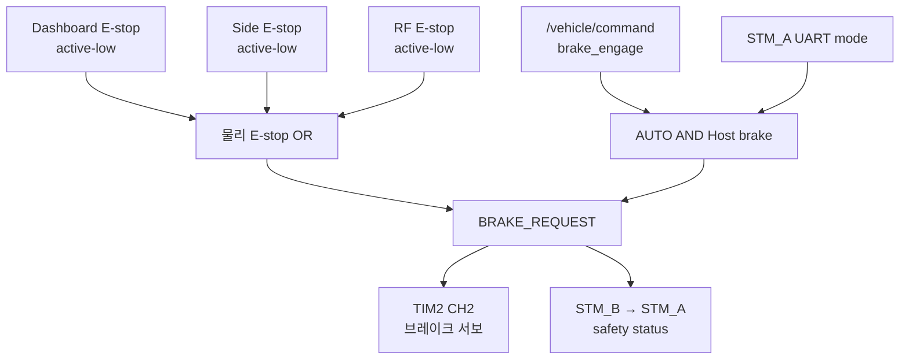

# Safety Design

> 이 문서는 현재 작업 브랜치의 소스 코드를 기준으로 작성되었습니다.
> 코드 변경 시 주기, timeout, 핀, 통신 ID와 안전 조건을 함께 갱신해야 합니다.

## 1. 문서 목적

이 문서는 현재 코드에 구현된 E-stop, brake, traction 차단, 통신 timeout과 복구
동작을 정리하는 안전 기준 문서입니다. 구현되지 않은 보호 기능을 설계 사실처럼
간주하지 않도록, 현재 동작과 확인 필요 항목을 구분합니다.

> **경고:** 이 문서는 코드 분석 결과이며 안전 인증서나 차량 운용 승인 절차가
> 아닙니다. 실차 시험 전에는 독립적인 하드웨어 E-stop, 전원 차단 수단과
> 검증된 시험 절차를 준비해야 합니다.

## 2. 안전 목표

현재 코드에서 확인되는 안전 목표는 다음과 같습니다.

- 세 물리 E-stop 중 하나라도 active이면 STM_B 브레이크를 engage합니다.
- STM_B의 최종 brake request가 active이거나 safety UART가 끊기면 STM_A traction을
  HALTED로 명령합니다.
- AUTO에서 Host brake 또는 Host command timeout이 발생하면 STM_A traction을
  HALTED로 명령합니다.
- 조향은 AUTO와 신선한 command·mode·CAN·position feedback이 모두 유효할 때만
  활성화합니다.
- 조향 Disable 사건 전에 받은 과거 목표는 폐기하고 fresh pending command만
  사용합니다.

## 3. 안전 입력과 상태

| 입력/상태 | 감지 주체 | 현재 사용 |
|---|---|---|
| Dashboard E-stop `PC0` | STM_B | active-low, final brake에 OR |
| Side E-stop `PC1` | STM_B | active-low, final brake에 OR |
| RF E-stop `PB4` | STM_B | active-low, final brake에 OR |
| Host `brake_engage` | STM_A, STM_B, 조향 노드 | AUTO traction·brake 및 조향 Disable |
| Host command age | STM_A, 조향 노드 | AUTO traction 500 ms, ACTIVE 조향 200 ms |
| STM_B→STM_A safety UART | STM_A | 100 ms timeout이면 traction stop |
| STM_A→STM_B vehicle UART | STM_B | 200 ms timeout이면 frame invalid와 dashboard 표시 fault |
| EZkontrol handshake | STM_A | ACK 성공 전 traction command 금지 |
| EZkontrol Part I/II age | STM_A | 200 ms 이후 status valid false |
| `/diagnostics` level/message | Console·Foxglove | 관측과 기록에만 사용; 제어 입력이나 차단 조건이 아님 |
| KEYA CAN·position age | 조향 노드 | 각 500 ms 이후 Disable |
| KEYA fault bits | 조향 노드 | bit 0을 제외한 fault가 있으면 Disable |
| 물리 mode | STM_A → STM_B·조향 | MANUAL/AUTO 동작 선택 |

현재 코드에는 MCU independent watchdog 초기화나 사용이 확인되지 않습니다.

## 4. 브레이크 요청 결정

STM_B가 브레이크 서보와 STM_A에 전달할 최종 요청을 결정합니다.

```text
physical_estop =
    estop_dashboard OR estop_side OR estop_rf

BRAKE_REQUEST =
    physical_estop
    OR (mode_from_stm_a == AUTO AND host_brake_engage)
```



MANUAL에서는 Host brake가 final brake에 포함되지 않습니다. 물리 E-stop은
MANUAL과 AUTO 모두에서 적용됩니다.

브레이크 서보 명령:

- engage: `1305 µs` (55°)
- release: `1665 µs` (120°)
- PWM: 50 Hz
- 부팅 초기 전역 상태와 초기 compare: engage
- 목표 변경 후 nominal `20 ms × 35 = 700 ms`에 걸쳐 ramp
- 실제 위치 feedback: 없음, `/brake/status.actual_valid=false`

구현 위치:

- `firmware/STM_B/Core/Src/app_freertos.c`
- `firmware/STM_B/Core/Src/tim.c`

## 5. Traction 차단 조건

STM_A의 UART 수신 Task가 다음 조건으로 `DRIVE_STOP_REQUEST`를 계산합니다.

```text
DRIVE_STOP_REQUEST =
    (mode == AUTO AND host_brake_engage)
    OR brake_request_from_stm_b
    OR NOT valid_safety_frame_from_stm_b
    OR stm_b_uart_timeout
```

STM_A Control task는 이 값에 더해 AUTO Host command freshness를 검사합니다.

| 조건 | STM_A 동작 |
|---|---|
| EZkontrol handshake 미완료 | traction command를 보내지 않고 10 ms마다 대기 |
| `DRIVE_STOP_REQUEST=true` | RPM 0, current 0, RUNNING 0의 HALTED command |
| AUTO command 미수신 또는 age ≥ 500 ms | 저장 속도를 0으로 지우고 HALTED |
| AUTO `brake_engage=true` | 저장 속도를 0으로 지우고 HALTED |
| MANUAL 정상 | 페달 기반 torque command |
| AUTO 정상 | Host 속도 기반 speed command. 200 ms 이내의 `/drive/torque_command(torque_mode=true)`가 있으면 Host 상전류 기반 torque command |
| AUTO torque 명령 미수신·age ≥ 200 ms·`torque_mode=false` | speed command로 복귀 (HALTED 아님) |
| AUTO torque 명령의 음의 전류, `CURRENT_SPEED` < 0.3 m/s | 전류 0으로 절단 (후진 구동 방지) |

EZkontrol Part I/II age 200 ms는 status validity에만 사용됩니다. status가 끊겨도
현재 traction stop 조건에는 들어가지 않습니다.

## 6. E-stop 동작

세 입력은 internal pull-up과 rising/falling EXTI를 사용하며, low가 active입니다.
ISR은 EStop task에 event flag만 전달하고 실제 GPIO 판독과 brake 계산은 Task가
수행합니다. edge를 놓친 경우에도 Task가 최대 10 tick wait 후 다시 읽습니다.

- software debounce: 현재 코드에서 확인되지 않음
- software latch: 현재 구현에 없음
- 물리 스위치의 기계적 latch 여부: 실제 하드웨어 구성에 따름
- software 해제 조건: 세 입력이 모두 high인 다음 safety update
- 모드 차이: 없음
- STM_A 전달: 최종 `BRAKE_REQUEST` bit로만 전달
- Host 전달: `/brake/status.stop_reason_bits`의 `STOP_REASON_ESTOP`

세 개 중 어느 E-stop이 작동했는지는 UART와 ROS 2 status에 개별적으로
노출되지 않습니다.

## 7. Host Command Timeout

### 7.1 STM_A

AUTO에서 유효한 `/vehicle/command`를 한 번도 받지 않았거나 마지막 수신 후
500 ms 이상이면 traction을 HALTED로 만들고 저장된 속도를 0으로 지웁니다.
micro-ROS entity 생성 전·실패·Agent 단절 때도 command 상태를
`미수신 + brake=true + speed=0`으로 reset하므로 AUTO는 정지합니다.

MANUAL에서는 Host command timeout을 적용하지 않고 물리 페달 경로를 유지합니다.

### 7.2 STM_B

STM_B는 command 수신 시 age를 status에 기록하지만, Host command timeout을
계산하거나 `BRAKE_REQUEST`에 반영하지 않습니다.

- 마지막 값이 `true`이면 AUTO에서 새 command가 없어도 Host 원인 브레이크가
  유지됩니다.
- 마지막 값이 `false`이면 Host command가 끊겨도 그 이유만으로 브레이크가
  engage되지 않습니다.
- micro-ROS Agent 단절 때 command 값을 fail-safe 값으로 reset하지 않습니다.

### 7.3 조향

조향은 `ACTIVE`에서 마지막 `/vehicle/command`가 200 ms를 넘으면 KEYA를
Disable하고 `WAIT_CMD`로 갑니다. 과거 target과 pending command를 폐기합니다.

## 8. STM_A ↔ STM_B UART Timeout

### 8.1 STM_B → STM_A

- safety frame 주기: 20 ms
- timeout: 100 ms
- 첫 유효 frame 전 상태: invalid/timeout
- 즉시 동작: `DRIVE_STOP_REQUEST=true`, EZkontrol HALTED
- 복구: CRC가 유효한 새 safety frame 수신

sequence gap은 진단 count만 증가시키므로 frame을 무효화하지 않습니다.

### 8.2 STM_A → STM_B

- vehicle frame 주기: 20 ms
- timeout: 200 ms
- 즉시 동작: `VEHICLE_FRAME_VALID_FROM_A=false`, UART RX restart 시도,
  Arduino LCD `A-B LOST` badge와 `STM A COMM LOST` 배너를 위한 CAN validity flag 전송
- 현재 brake 동작: timeout 자체는 `BRAKE_REQUEST`에 포함되지 않음
- mode 값: 마지막 `MODE_FROM_A` 값이 유지됨
- 100 ms drive detail은 별도 300 ms timeout을 사용하며 dashboard 진단값만 `--`로
  바꿉니다. vehicle frame validity와 brake 판단에는 사용하지 않습니다.

STM_B는 dashboard CAN 상태를 100 ms마다 감시하고 bus-off에서 1초 backoff 후
FDCAN을 재시작합니다. Arduino는 fresh complete snapshot이 300 ms 없으면 `CAN LOST`를
표시하고 1초마다 controller를 재초기화합니다. 두 복구 경로는 표시 가용성만 위한
것이며 E-stop, brake PWM, STM_A safety UART와 micro-ROS 판단에는 사용하지 않습니다.

따라서 STM_A→STM_B 통신이 끊겼을 때 브레이크가 자동 engage된다고 가정하면
안 됩니다. 이 동작은 확인 필요 항목입니다.

## 9. CAN Communication Failure

### 9.1 EZkontrol

Handshake ACK 전에는 STM_A가 traction command를 보내지 않습니다. 그러나
handshake 완료 뒤 Part I/II 수신이 중단되면 200 ms 후 진단 valid flag만
false가 되고, traction command 송신은 계속됩니다. CAN TX 실패 시 해당 호출의
`tractive_commanded`는 false로 기록되지만 별도 latch나 재시도 상태 머신은
없습니다.

### 9.2 KEYA 조향

코드 기본값 `actuation_mode=position`은 아래 보호를 사용한다. 현재 launch YAML은
`torque`이며 동일 state machine에 §9.3의 보호를 추가한다. KEYA 내부 mode는 별도 설정이며
position=0020=3, torque=0020=2다. Host가 자동 변경하거나 확인하지 않는다.

다음 조건은 조향 motor Disable 원인입니다.

- SocketCAN open 실패 또는 마지막 CAN frame age > 500 ms
- 유효 position feedback 미수신 또는 age > 500 ms
- bit 0을 제외한 KEYA fault bit 활성

조향 노드는 안전 조건이 처음 감지되면 target을 현재 추정각으로 바꾸고 그때까지의
old/pending command를 폐기합니다. 다만 Disable 상태가 유지되는 동안 들어오는
command는 다시 pending으로 저장할 수 있습니다. CAN write 실패 자체는 별도 fault
flag로 latch되지 않지만, feedback이 끊기면 timeout 경로로 Disable됩니다.

### 9.3 외부 Torque 조향

- 외부 calibrated wheel-angle PD는 Ki=0, direct target step을 사용한다. saturation은
  정상이며 실제 조향속도는 D항과 settle 판정용으로 계속 관측한다.
- 출력 arm이 허용된 경우, ACTIVE 진입은 **torque0→Enable** 후 새로운 위치 샘플로
  rate가 준비되어야 비영 torque를 보낸다. 모든 ACTIVE 종료는 **torque0→Disable**,
  제어 이력·과거 목표 폐기다. 읽기 전용에서는 이 frame들도 보내지 않는다.
- E-stop/MANUAL/brake/steering disabled/무효 drive speed는 기존 즉시 차단 callback을
  사용한다. command 200 ms, CAN500 ms, torque 위치100 ms가 기본값이다. command는
  원래 header stamp 만료시각을 넘어 사용하지 않는다. future/nonfinite 명령은 거부한다.
- Control tick 간격이100 ms를 초과하면 큐에서 fresh 위치가 나와도 safety stop한다.
  kernel 수신 timestamp를 사용하므로 오래된 수신 큐를 읽어 freshness를 갱신하지 않는다.
- 현재 calibration `±3279 count`는 검증된 측정 범위다. mechanical end-stop으로
  단정하지 않는다. 기본 soft margin1°만큼 목표를 안쪽으로 제한하고, 끝부분의 바깥
  방향 torque는 taper/차단한다. 범위 밖에서도 안쪽 recovery는 허용하며,
  각도/encoder 범위 초과만으로 `angle_limit` fault나 Disable을 발생시키지 않는다.
- 실제 조향속도만으로는 정지하지 않는다. nonfinite controller input,
  control stall/과도한 위치 샘플 간격은 즉시 zero→Disable하고 `FEEDBACK_LOST`로 이동한다.
  정상 피드백이 확인되면 `WAIT_CMD`로 자동 복귀하며 차단 뒤 받은 새 command로 재개한다.
  `/steering/torque_safety`는 활성 원인을 `invalid_input` 또는 `feedback_timeout`으로 표시하고
  정상 피드백에서 `none`으로 돌아간다.
- Torque TX 실패 시 zero와 Disable을 시도하고 `CAN_LOST`로 이동한다. stop frame이
  실패하면 다음 tick에서 재시도하며 성공 전에는 재Enable하지 않는다. 버스 단절 시
  실제 zero/Disable 수신은 보장할 수 없다. 이 보호는 하드웨어 차단을 대체하지 않는다.
- 코드 기본은 peak raw2000, sustained raw1000, peak 누적200 ms다. 현재 실차 YAML은
  peak raw10000을 최대5초 허용한 뒤 sustained raw5000으로 제한하며,
  sustained50% 이하로5초 유지해야 peak 예산이 회복된다.
  반전·새 목표·짧은 disable·gain 변경으로 예산을 초기화하지 않는다. raw/time 제한은
  전류/열 모델이 아니며 continuous10 A/peak20 A를 Host가 보장한다는 뜻이 아니다.
- Gain/limit runtime 변경은 전체 batch 검증 후 zero→Disable하고 적용한다.
  새로운 command·rate 이력으로 재시작한다. mode·방향·주기는 startup-only다.

초기 sign/전류·온도/step 검증 절차와 전체 기본값은
[`TORQUE_CONTROL.md`](../software/src/lateral_ctrl/TORQUE_CONTROL.md)에 있다.
기존 `/brake/status` timeout 부재 등 §14의 한계와 hardware E-stop 요구는 유지된다.

## 10. MANUAL / AUTO별 동작

| 입력/고장 | MANUAL traction | AUTO traction | MANUAL brake | AUTO brake | 조향 |
|---|---|---|---|---|---|
| 물리 E-stop | HALTED | HALTED | engage | engage | Disable |
| Host brake | 계속 적용 가능 | HALTED | 무시 | engage | Disable |
| Host command 500 ms 중단 | 페달 경로 유지 | HALTED | 변화 없음 | 변화 없음 | 별도 200 ms timeout |
| STM_B→STM_A UART 100 ms 중단 | HALTED | HALTED | 해당 없음 | 해당 없음 | 직접 입력 아님 |
| STM_A→STM_B UART 200 ms 중단 | 직접 영향 없음 | 직접 영향 없음 | 자동 engage 안 함 | 마지막 mode로 판단 | `/drive/status` 1500 ms 후 Disable |
| EZkontrol status 200 ms 중단 | command 계속 송신 | command 계속 송신 | 해당 없음 | 해당 없음 | 직접 입력 아님 |
| KEYA CAN 500 ms / position feedback 500 ms (torque 100 ms) 중단 | 이미 Disable | Disable | 해당 없음 | 해당 없음 | Disable |

## 11. 복구 및 재활성화

| 사건 | 복구 조건 | 과거 목표 재사용 |
|---|---|---|
| 물리 E-stop | 세 GPIO 모두 high, 다음 EStop update | brake 자동 release; MANUAL pedal 또는 inhibited 중 받은 fresh AUTO·조향 command가 있으면 별도 post-release command 없이 재활성화 가능 |
| Host brake | AUTO에서는 새 `brake_engage=false`; MANUAL 전환도 Host 원인 제거 | STM_A speed는 true command에서 0으로 지워지며 false command의 새 목표를 사용; 조향도 false command를 pending으로 사용 가능 |
| STM_A Host timeout | 새 유효 `/vehicle/command` | timeout 때 speed 0으로 지워짐 |
| STM_B→STM_A UART timeout | 새 CRC-valid safety frame | 이후 mode별 현재 command 사용 |
| STM_A→STM_B UART timeout | 새 CRC-valid vehicle frame | 마지막 mode·speed는 새 frame으로 갱신 |
| EZkontrol handshake 대기 | 새 `0x55` request에 ACK TX 성공 | 그 후 현재 mode 명령 |
| KEYA CAN·feedback·fault 복구 | CAN·position valid, fault 해제, AUTO와 safety 정상 | fault가 처음 감지된 뒤 수신한 fresh pending command가 필요; 복구 후 수신일 필요는 없음 |
| Host torque feedback stop | 정상 feedback 확인 | 차단 뒤 받은 새 command 필요; 재시작·parameter toggle 불필요 |
| MCU reboot | RTOS와 peripheral 재초기화 | STM_A는 safety frame 전 stop; STM_B는 engage에서 시작 후 입력 재계산 |

물리 E-stop, KEYA가 보고한 motor fault, §9.3의 Host torque feedback stop에는
software latch나 별도 reset command가 없습니다.
STM_A는 E-stop 중에도 fresh non-brake AUTO speed command를 저장할 수 있고,
조향도 Disable 사건 뒤 들어온 command를 pending으로 저장할 수 있습니다.
따라서 E-stop 해제만으로 MANUAL pedal이 다시 적용되거나, inhibited 상태 중 받은
fresh 명령으로 AUTO traction·조향이 재활성화될 수 있습니다.

## 12. 안전 상태표

| 상황 | 감지 주체 | 감지 조건 | 즉시 동작 | 복구 조건 | 구현 위치 |
|---|---|---|---|---|---|
| Dashboard/Side/RF E-stop | STM_B | GPIO low | 서보 engage, safety bit 1 | 세 입력 high | STM_B `app_freertos.c` |
| AUTO Host brake | 두 STM·조향 | `brake_engage=true` | traction HALTED, 서보 engage, 조향 Disable | false command 또는 MANUAL 전환; false command 목표를 즉시 pending으로 사용 가능 | 두 STM·조향 |
| STM_A Host command 중단 | STM_A | 미수신 또는 ≥500 ms | AUTO HALTED, speed=0 | 새 valid command | STM_A `app_freertos.c` |
| STM_A Host torque command 중단 | STM_A | 미수신 또는 ≥200 ms | AUTO speed control로 복귀 (traction 유지) | 새 `torque_mode=true` command | STM_A `app_freertos.c` |
| 종방향 torque 허용 조건 위반 | `longitudinal_actuator_node` | MANUAL·E-stop·stop_request·fault·brake·stale·gear·음의 목표 | `torque_mode=false`, 0 A 발행 → STM_A speed control | 조건 회복 시 실측 전류에서 bumpless 재진입 | `longitudinal_actuator_node.cpp` |
| 조향 command 중단 | 조향 | ACTIVE age >200 ms | KEYA Disable, `WAIT_CMD` | 새 command | `steering_actuator_node.cpp` |
| STM_B→STM_A UART 중단 | STM_A | invalid 또는 ≥100 ms | traction HALTED | 새 CRC-valid frame | STM_A `app_freertos.c` |
| STM_A→STM_B UART 중단 | STM_B | ≥200 ms | frame invalid, dashboard 표시 fault | 새 CRC-valid frame | STM_B `app_freertos.c` |
| Dashboard CAN/Arduino 중단 | STM_B·Arduino | bus-off 또는 fresh snapshot ≥300 ms | 표시 `CAN LOST`/stale, safety 영향 없음 | FDCAN 재시작 + 새 complete snapshot | STM_B `dashboard_can.c`, UNO firmware |
| EZkontrol status 중단 | STM_A | Part별 age ≥200 ms | status valid=false | 해당 Part 새 frame | STM_A `app_freertos.c` |
| KEYA CAN 중단 | 조향 | age >500 ms | KEYA Disable | feedback 회복 + fault 감지 뒤 받은 fresh pending command | 조향 node/driver |
| MANUAL→AUTO | 세 제어 경로 | mode 0→1 | STM_A와 조향은 MANUAL 중 수신한 fresh command를 사용할 수 있음 | 조건 충족 | STM_A·STM_B·조향 |
| AUTO→MANUAL | 세 제어 경로 | mode 1→0 | 조향 Disable, Host brake 원인 제거 | AUTO 재진입 + MANUAL 진입 뒤 받은 fresh pending command | STM_A·STM_B·조향 |
| MCU 재부팅 | 각 MCU | reset | STM_A stop 초기값, STM_B engage 초기값 | task 입력과 통신 정상화 | 각 `globals.c`, `app_freertos.c` |

### 12.1 Diagnostics의 안전 경계

`vehicle_state_publisher/diagnostics_publisher`는 status 3종을 별도 노드에서
`/diagnostics`로 요약합니다. 이 노드는 차량 명령, parameter 또는 장치 출력을
쓰지 않으며 MCU·조향 제어기의 safety state를 변경하지 않습니다.

- status topic 자체가 1초 넘게 끊기면 해당 진단을 `STALE`로 표시합니다.
- Host command 500 ms, EZkontrol 200 ms, 조향 command 200 ms, KEYA 500 ms,
  mode 1500 ms 기준은 위 실제 제어 timeout을 표시 등급으로 반영합니다.
- Brake command age 500 ms 표시는 관측용 기준입니다. STM_B에 Host timeout 기반
  자동 brake가 구현됐다는 뜻이 아닙니다.
- `/diagnostics`가 끊기거나 `ERROR`를 보고해도 그 자체로 traction, steering,
  brake를 제어하지 않습니다. 실제 차단은 앞 절에 명시한 MCU와 조향 로직이 수행합니다.

따라서 Console과 Foxglove의 진단은 고장 인지와 사후 분석에 사용하며, 물리 E-stop이나
제어기 safety feedback을 대신하지 않습니다. 진단 구현 위치는
`software/src/vehicle_state_publisher/vehicle_state_publisher/diagnostics_publisher.py`입니다.

### 12.2 Dashboard와 HIL Virtual HMI의 안전 경계

STM_B의 Dashboard CAN은 Arduino UNO R4의 LCD 표시로만 분기됩니다. FT6336U physical
touch는 UNO 내부 page navigation에만 연결되고, HIL Virtual Touch도 현재 control
owner의 USB 입력을 같은 Gesture/Navigator에 전달해 dashboard page만 변경합니다.

이 경로는 gear, mode, accelerator, brake, E-stop 또는 `/vehicle/command`를 생성하지
않습니다. Arduino·LCD·touch·USB가 끊기거나 오동작해도 STM_B의 물리 E-stop 판독과
brake PWM, STM_A safety UART/traction 차단 조건은 바뀌지 않습니다. `CAN LOST`와
Virtual LCD stale 표시는 상태 관측이며 안전 차단의 증거 또는 실행 신호가 아닙니다.
세부 연결은 [`ARCHITECTURE.md`](ARCHITECTURE.md#33-arduino-uno-r4-dashboard), wire
계약은 [`INTERFACES.md`](INTERFACES.md#7-stm_b--uno-r4-dashboard-can)를 따릅니다.

## 13. 테스트 항목

- [ ] 부팅 직후 STM_A가 첫 유효 safety frame 전 traction command를 허용하지
  않는지 확인
- [ ] 각 E-stop 입력을 개별 활성화했을 때 MANUAL/AUTO 모두에서 서보가 engage되고
  STM_A가 HALTED를 보내는지 확인
- [ ] E-stop 중 Host command를 계속 보낸 경우, 해제만으로 AUTO traction·조향이
  재활성화되는 현재 동작을 확인하고 안전 요구사항과 비교
- [ ] AUTO에서 `/vehicle/command`를 500 ms 이상 중단했을 때 STM_A가 speed를
  0으로 지우고 HALTED를 보내는지 확인
- [ ] MANUAL에서 Host brake와 Host timeout이 페달 traction에 적용되지 않는지
  설계 의도와 함께 확인
- [ ] STM_B→STM_A UART를 끊었을 때 100 ms 후 traction이 HALTED되는지 확인
- [ ] STM_A→STM_B UART를 끊었을 때 현재는 brake가 자동 engage되지 않음을 확인하고
  요구사항과 비교
- [ ] EZkontrol Part I/II를 중단했을 때 valid flag와 현재 traction 지속 동작을
  확인하고 요구사항과 비교
- [ ] KEYA CAN, position feedback, mode, command를 각각 중단해 설정 timeout 후
  Disable되는지 확인
- [ ] AUTO→MANUAL→AUTO 전환 후 과거 speed·steering target으로 재출발하지
  않는지, MANUAL 중 받은 fresh command는 어떻게 처리되는지 확인
- [ ] STM_A와 STM_B를 각각 재부팅해 초기 brake/traction 상태와 복구 순서를 확인

## 14. 확인 필요 항목

### 실차 시나리오 실행기의 현재 제한

2026-09-18 코드 검토에서 아래 항목은 미수정 상태다. 화면의 RUNNING이나 GO만으로
조향 출력·차량 정지 조건이 모두 충족됐다고 판단하지 않는다.

- TUI의 조향 실행 조건은 raw KEYA fault bits 등을 확인하지만 Host의 일시적인
  `FEEDBACK_LOST`/`disable_reason`을 직접 검사하지 않는다. 조향 출력이 차단된 동안에도
  시나리오가 계속되며 종방향 목표를 발행할 수 있다.
- `RECORD_START`·`WAIT_AUTO`·`COUNTDOWN`에서 조향 설정 응답을 기다리는 동안
  일부 tick은 mode·통신 검사 전에 반환한다. 이 구간의 MANUAL→AUTO 전환을
  놓쳐 새 `R` 없이 진행할 수 있다.
- Headless 실행기는 마지막 `/drive/status.mode`를 보관하며 수신 age에 대한
  별도 timeout이 없다. 상태 토픽이 끊겨도 마지막 AUTO를 바탕으로 명령을
  계속 생성할 수 있다. MCU·조향 자체 timeout과 실행기의 감시는 구분해야 한다.

시험 중 `/steering/status`와 `/steering/torque_safety`를 함께 확인한다.
복구·재시험은 현재 Run을 정지하고 새로 시작한다.

### 차량 제어와 펌웨어

- STM_A→STM_B UART timeout을 즉시 brake engage 조건으로 추가할지
- EZkontrol Part I/II timeout과 CAN TX 실패를 traction HALTED 조건으로 추가할지
- STM_B Host command timeout과 Agent disconnect 시 command reset 정책
- 물리 E-stop software debounce·latch 요구사항과 실제 스위치의 기계적 latch 구성
- STM32 independent watchdog 적용 여부
- `/brake/status` 단절 시 조향이 stale E-stop 값을 유지하는 문제와 timeout 정책
- E-stop/fault가 해제된 뒤 반드시 post-recovery command나 별도 enable을
  요구하도록 할지
- `/vehicle/state`가 stale subsystem status를 재발행하지 않도록 freshness를
  검증할지
- 브레이크 서보 engage/release pulse와 700 ms ramp의 실차 캘리브레이션
- KEYA fault bit 0을 안전 판단에서 제외하는 현재 정책의 근거
