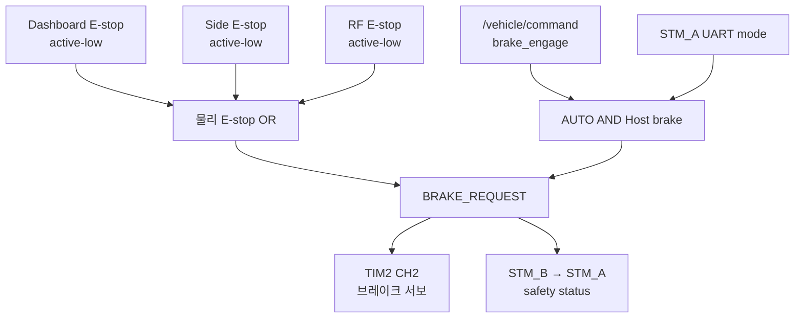

# Safety Design

## 1. 문서 목적

이 문서는 현재 코드에 구현된 E-stop, brake, traction 차단, 통신 timeout과 복구
동작을 정리하는 안전 기준 문서입니다. 구현되지 않은 보호 기능을 설계 사실처럼
간주하지 않도록, 현재 동작과 확인 필요 항목을 구분합니다.

> **경고:** 이 문서는 코드 분석 결과이며 안전 인증서나 차량 운용 승인 절차가
> 아닙니다. 실차 시험 전에는 독립적인 하드웨어 E-stop, 전원 차단 수단과
> 검증된 시험 절차를 준비해야 합니다.

## 2. 안전 목표

현재 코드에서 확인되는 안전 목표는 다음과 같습니다.

- 세 물리 E-stop 중 하나라도 active이면 STM_B 브레이크를 engage합니다.
- STM_B의 최종 brake request가 active이거나 safety UART가 끊기면 STM_A traction을
  HALTED로 명령합니다.
- AUTO에서 Host brake 또는 Host command timeout이 발생하면 STM_A traction을
  HALTED로 명령합니다.
- 조향은 AUTO와 신선한 command·mode·CAN·position feedback이 모두 유효할 때만
  활성화합니다.
- 조향 Disable 사건 전에 받은 과거 목표는 폐기하고 fresh pending command만
  사용합니다.

## 3. 안전 입력과 상태

| 입력/상태 | 감지 주체 | 현재 사용 |
|---|---|---|
| Dashboard E-stop `PC0` | STM_B | active-low, final brake에 OR |
| Side E-stop `PC1` | STM_B | active-low, final brake에 OR |
| RF E-stop `PB4` | STM_B | active-low, final brake에 OR |
| Host `brake_engage` | STM_A, STM_B, 조향 노드 | AUTO traction·brake 및 조향 Disable |
| Host command age | STM_A, 조향 노드 | AUTO traction 500 ms, ACTIVE 조향 200 ms |
| STM_B→STM_A safety UART | STM_A | 100 ms timeout이면 traction stop |
| STM_A→STM_B vehicle UART | STM_B | 200 ms timeout이면 frame invalid와 LCD fault |
| EZkontrol handshake | STM_A | ACK 성공 전 traction command 금지 |
| EZkontrol Part I/II age | STM_A | 200 ms 이후 status valid false |
| KEYA CAN·position age | 조향 노드 | 각 500 ms 이후 Disable |
| KEYA fault bits | 조향 노드 | bit 0을 제외한 fault가 있으면 Disable |
| 물리 mode | STM_A → STM_B·조향 | MANUAL/AUTO 동작 선택 |

현재 코드에는 MCU independent watchdog 초기화나 사용이 확인되지 않습니다.

## 4. 브레이크 요청 결정

STM_B가 브레이크 서보와 STM_A에 전달할 최종 요청을 결정합니다.

```text
physical_estop =
    estop_dashboard OR estop_side OR estop_rf

BRAKE_REQUEST =
    physical_estop
    OR (mode_from_stm_a == AUTO AND host_brake_engage)
```



MANUAL에서는 Host brake가 final brake에 포함되지 않습니다. 물리 E-stop은
MANUAL과 AUTO 모두에서 적용됩니다.

브레이크 서보 명령:

- engage: `1194 µs`
- release: `1388 µs`
- PWM: 50 Hz
- 부팅 초기 전역 상태와 초기 compare: engage
- 목표 변경 후 nominal `20 ms × 35 = 700 ms`에 걸쳐 ramp
- 실제 위치 feedback: 없음, `/brake/status.actual_valid=false`

구현 위치:

- `firmware/STM_B/Core/Src/app_freertos.c`
- `firmware/STM_B/Core/Src/tim.c`

## 5. Traction 차단 조건

STM_A의 UART 수신 Task가 다음 조건으로 `DRIVE_STOP_REQUEST`를 계산합니다.

```text
DRIVE_STOP_REQUEST =
    (mode == AUTO AND host_brake_engage)
    OR brake_request_from_stm_b
    OR NOT valid_safety_frame_from_stm_b
    OR stm_b_uart_timeout
```

STM_A Control task는 이 값에 더해 AUTO Host command freshness를 검사합니다.

| 조건 | STM_A 동작 |
|---|---|
| EZkontrol handshake 미완료 | traction command를 보내지 않고 10 ms마다 대기 |
| `DRIVE_STOP_REQUEST=true` | RPM 0, current 0, RUNNING 0의 HALTED command |
| AUTO command 미수신 또는 age ≥ 500 ms | 저장 속도를 0으로 지우고 HALTED |
| AUTO `brake_engage=true` | 저장 속도를 0으로 지우고 HALTED |
| MANUAL 정상 | 페달 기반 torque command |
| AUTO 정상 | Host 속도 기반 speed command |

EZkontrol Part I/II age 200 ms는 status validity에만 사용됩니다. status가 끊겨도
현재 traction stop 조건에는 들어가지 않습니다.

## 6. E-stop 동작

세 입력은 internal pull-up과 rising/falling EXTI를 사용하며, low가 active입니다.
ISR은 EStop task에 event flag만 전달하고 실제 GPIO 판독과 brake 계산은 Task가
수행합니다. edge를 놓친 경우에도 Task가 최대 10 tick wait 후 다시 읽습니다.

- software debounce: 현재 코드에서 확인되지 않음
- latch: 없음
- 해제: 세 입력이 모두 high가 된 뒤 다음 safety update에서 즉시 반영
- 모드 차이: 없음
- STM_A 전달: 최종 `BRAKE_REQUEST` bit로만 전달
- Host 전달: `/brake/status.stop_reason_bits`의 `STOP_REASON_ESTOP`

세 개 중 어느 E-stop이 작동했는지는 UART와 ROS 2 status에 개별적으로
노출되지 않습니다.

## 7. Host Command Timeout

### 7.1 STM_A

AUTO에서 유효한 `/vehicle/command`를 한 번도 받지 않았거나 마지막 수신 후
500 ms 이상이면 traction을 HALTED로 만들고 저장된 속도를 0으로 지웁니다.
micro-ROS entity 생성 전·실패·Agent 단절 때도 command 상태를
`미수신 + brake=true + speed=0`으로 reset하므로 AUTO는 정지합니다.

MANUAL에서는 Host command timeout을 적용하지 않고 물리 페달 경로를 유지합니다.

### 7.2 STM_B

STM_B는 command 수신 시 age를 status에 기록하지만, Host command timeout을
계산하거나 `BRAKE_REQUEST`에 반영하지 않습니다.

- 마지막 값이 `true`이면 AUTO에서 새 command가 없어도 Host 원인 브레이크가
  유지됩니다.
- 마지막 값이 `false`이면 Host command가 끊겨도 그 이유만으로 브레이크가
  engage되지 않습니다.
- micro-ROS Agent 단절 때 command 값을 fail-safe 값으로 reset하지 않습니다.

### 7.3 조향

조향은 `ACTIVE`에서 마지막 `/vehicle/command`가 200 ms를 넘으면 KEYA를
Disable하고 `WAIT_CMD`로 갑니다. 과거 target과 pending command를 폐기합니다.

## 8. STM_A ↔ STM_B UART Timeout

### 8.1 STM_B → STM_A

- safety frame 주기: 20 ms
- timeout: 100 ms
- 첫 유효 frame 전 상태: invalid/timeout
- 즉시 동작: `DRIVE_STOP_REQUEST=true`, EZkontrol HALTED
- 복구: CRC가 유효한 새 safety frame 수신

sequence gap은 진단 count만 증가시키므로 frame을 무효화하지 않습니다.

### 8.2 STM_A → STM_B

- vehicle frame 주기: 20 ms
- timeout: 200 ms
- 즉시 동작: `VEHICLE_FRAME_VALID_FROM_A=false`, UART RX restart 시도,
  LCD `COMM FAULT`
- 현재 brake 동작: timeout 자체는 `BRAKE_REQUEST`에 포함되지 않음
- mode 값: 마지막 `MODE_FROM_A` 값이 유지됨

따라서 STM_A→STM_B 통신이 끊겼을 때 브레이크가 자동 engage된다고 가정하면
안 됩니다. 이 동작은 확인 필요 항목입니다.

## 9. CAN Communication Failure

### 9.1 EZkontrol

Handshake ACK 전에는 STM_A가 traction command를 보내지 않습니다. 그러나
handshake 완료 뒤 Part I/II 수신이 중단되면 200 ms 후 진단 valid flag만
false가 되고, traction command 송신은 계속됩니다. CAN TX 실패 시 해당 호출의
`tractive_commanded`는 false로 기록되지만 별도 latch나 재시도 상태 머신은
없습니다.

### 9.2 KEYA 조향

다음 조건은 조향 motor Disable 원인입니다.

- SocketCAN open 실패 또는 마지막 CAN frame age > 500 ms
- 유효 position feedback 미수신 또는 age > 500 ms
- bit 0을 제외한 KEYA fault bit 활성

조향 노드는 안전 조건이 처음 감지되면 target을 현재 추정각으로 바꾸고 그때까지의
old/pending command를 폐기합니다. 다만 Disable 상태가 유지되는 동안 들어오는
command는 다시 pending으로 저장할 수 있습니다. CAN write 실패 자체는 별도 fault
flag로 latch되지 않지만, feedback이 끊기면 timeout 경로로 Disable됩니다.

## 10. MANUAL / AUTO별 동작

| 입력/고장 | MANUAL traction | AUTO traction | MANUAL brake | AUTO brake | 조향 |
|---|---|---|---|---|---|
| 물리 E-stop | HALTED | HALTED | engage | engage | Disable |
| Host brake | 계속 적용 가능 | HALTED | 무시 | engage | Disable |
| Host command 500 ms 중단 | 페달 경로 유지 | HALTED | 변화 없음 | 변화 없음 | 별도 200 ms timeout |
| STM_B→STM_A UART 100 ms 중단 | HALTED | HALTED | 해당 없음 | 해당 없음 | 직접 입력 아님 |
| STM_A→STM_B UART 200 ms 중단 | 직접 영향 없음 | 직접 영향 없음 | 자동 engage 안 함 | 마지막 mode로 판단 | `/drive/status` 1500 ms 후 Disable |
| EZkontrol status 200 ms 중단 | command 계속 송신 | command 계속 송신 | 해당 없음 | 해당 없음 | 직접 입력 아님 |
| KEYA CAN/position 500 ms 중단 | 이미 Disable | Disable | 해당 없음 | 해당 없음 | Disable |

## 11. 복구 및 재활성화

| 사건 | 복구 조건 | 과거 목표 재사용 |
|---|---|---|
| 물리 E-stop | 세 GPIO 모두 high, 다음 EStop update | brake 자동 release; MANUAL pedal 또는 inhibited 중 받은 fresh AUTO·조향 command가 있으면 별도 post-release command 없이 재활성화 가능 |
| Host brake | AUTO에서는 새 `brake_engage=false`; MANUAL 전환도 Host 원인 제거 | STM_A speed는 true command에서 0으로 지워지며 false command의 새 목표를 사용; 조향도 false command를 pending으로 사용 가능 |
| STM_A Host timeout | 새 유효 `/vehicle/command` | timeout 때 speed 0으로 지워짐 |
| STM_B→STM_A UART timeout | 새 CRC-valid safety frame | 이후 mode별 현재 command 사용 |
| STM_A→STM_B UART timeout | 새 CRC-valid vehicle frame | 마지막 mode·speed는 새 frame으로 갱신 |
| EZkontrol handshake 대기 | 새 `0x55` request에 ACK TX 성공 | 그 후 현재 mode 명령 |
| KEYA CAN·feedback·fault 복구 | CAN·position valid, fault 해제, AUTO와 safety 정상 | fault가 처음 감지된 뒤 수신한 fresh pending command가 필요; 복구 후 수신일 필요는 없음 |
| MCU reboot | RTOS와 peripheral 재초기화 | STM_A는 safety frame 전 stop; STM_B는 engage에서 시작 후 입력 재계산 |

물리 E-stop과 fault에는 software latch나 별도 reset command가 없습니다.
STM_A는 E-stop 중에도 fresh non-brake AUTO speed command를 저장할 수 있고,
조향도 Disable 사건 뒤 들어온 command를 pending으로 저장할 수 있습니다.
따라서 E-stop 해제만으로 MANUAL pedal이 다시 적용되거나, inhibited 상태 중 받은
fresh 명령으로 AUTO traction·조향이 재활성화될 수 있습니다.

## 12. 안전 상태표

| 상황 | 감지 주체 | 감지 조건 | 즉시 동작 | 복구 조건 | 구현 위치 |
|---|---|---|---|---|---|
| Dashboard/Side/RF E-stop | STM_B | GPIO low | 서보 engage, safety bit 1 | 세 입력 high | STM_B `app_freertos.c` |
| AUTO Host brake | 두 STM·조향 | `brake_engage=true` | traction HALTED, 서보 engage, 조향 Disable | false command 또는 MANUAL 전환; false command 목표를 즉시 pending으로 사용 가능 | 두 STM·조향 |
| STM_A Host command 중단 | STM_A | 미수신 또는 ≥500 ms | AUTO HALTED, speed=0 | 새 valid command | STM_A `app_freertos.c` |
| 조향 command 중단 | 조향 | ACTIVE age >200 ms | KEYA Disable, `WAIT_CMD` | 새 command | `steering_actuator_node.cpp` |
| STM_B→STM_A UART 중단 | STM_A | invalid 또는 ≥100 ms | traction HALTED | 새 CRC-valid frame | STM_A `app_freertos.c` |
| STM_A→STM_B UART 중단 | STM_B | ≥200 ms | frame invalid, LCD fault | 새 CRC-valid frame | STM_B `app_freertos.c` |
| EZkontrol status 중단 | STM_A | Part별 age ≥200 ms | status valid=false | 해당 Part 새 frame | STM_A `app_freertos.c` |
| KEYA CAN 중단 | 조향 | age >500 ms | KEYA Disable | feedback 회복 + fault 감지 뒤 받은 fresh pending command | 조향 node/driver |
| MANUAL→AUTO | 세 제어 경로 | mode 0→1 | STM_A와 조향은 MANUAL 중 수신한 fresh command를 사용할 수 있음 | 조건 충족 | STM_A·STM_B·조향 |
| AUTO→MANUAL | 세 제어 경로 | mode 1→0 | 조향 Disable, Host brake 원인 제거 | AUTO 재진입 + MANUAL 진입 뒤 받은 fresh pending command | STM_A·STM_B·조향 |
| MCU 재부팅 | 각 MCU | reset | STM_A stop 초기값, STM_B engage 초기값 | task 입력과 통신 정상화 | 각 `globals.c`, `app_freertos.c` |

## 13. 테스트 항목

- [ ] 부팅 직후 STM_A가 첫 유효 safety frame 전 traction command를 허용하지
  않는지 확인
- [ ] 각 E-stop 입력을 개별 활성화했을 때 MANUAL/AUTO 모두에서 서보가 engage되고
  STM_A가 HALTED를 보내는지 확인
- [ ] E-stop 중 Host command를 계속 보낸 경우, 해제만으로 AUTO traction·조향이
  재활성화되는 현재 동작을 확인하고 안전 요구사항과 비교
- [ ] AUTO에서 `/vehicle/command`를 500 ms 이상 중단했을 때 STM_A가 speed를
  0으로 지우고 HALTED를 보내는지 확인
- [ ] MANUAL에서 Host brake와 Host timeout이 페달 traction에 적용되지 않는지
  설계 의도와 함께 확인
- [ ] STM_B→STM_A UART를 끊었을 때 100 ms 후 traction이 HALTED되는지 확인
- [ ] STM_A→STM_B UART를 끊었을 때 현재는 brake가 자동 engage되지 않음을 확인하고
  요구사항과 비교
- [ ] EZkontrol Part I/II를 중단했을 때 valid flag와 현재 traction 지속 동작을
  확인하고 요구사항과 비교
- [ ] KEYA CAN, position feedback, mode, command를 각각 중단해 설정 timeout 후
  Disable되는지 확인
- [ ] AUTO→MANUAL→AUTO 전환 후 과거 speed·steering target으로 재출발하지
  않는지, MANUAL 중 받은 fresh command는 어떻게 처리되는지 확인
- [ ] STM_A와 STM_B를 각각 재부팅해 초기 brake/traction 상태와 복구 순서를 확인

## 14. 확인 필요 항목

- STM_A→STM_B UART timeout을 즉시 brake engage 조건으로 추가할지
- EZkontrol Part I/II timeout과 CAN TX 실패를 traction HALTED 조건으로 추가할지
- STM_B Host command timeout과 Agent disconnect 시 command reset 정책
- 물리 E-stop software/hardware debounce와 latch 요구사항
- STM32 independent watchdog 적용 여부
- `/brake/status` 단절 시 조향이 stale E-stop 값을 유지하는 문제와 timeout 정책
- E-stop/fault가 해제된 뒤 반드시 post-recovery command나 별도 enable을
  요구하도록 할지
- `/vehicle/state`가 stale subsystem status를 재발행하지 않도록 freshness를
  검증할지
- 브레이크 서보 engage/release pulse와 700 ms ramp의 실차 캘리브레이션
- KEYA fault bit 0을 안전 판단에서 제외하는 현재 정책의 근거
