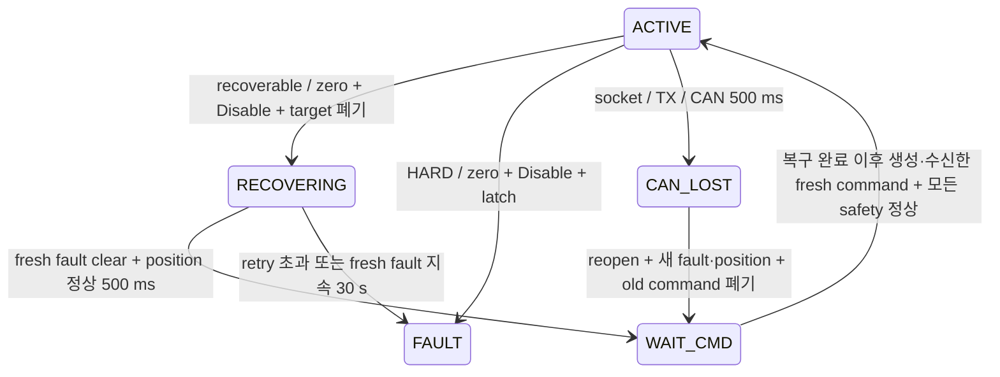

# Competition steering availability (2026-09-21)

기준: `origin/main e0cc6b9`에서 시작한 소스 변경. 실차·CAN·MCU 조작 없이
호스트 테스트와 펌웨어 빌드로 검증한다. 종방향 PI, speed→torque, regen/EBS,
Governor shaping은 포함하지 않는다.

## KEYA decode와 policy

근거: [제조사 V1.1](hardware/KEYA_KY170DJD01005-08G-V1_User_Manual_V1.1.pdf)
§5.1–5.2, PDF 19–20쪽. `keyaFaultDefinitions`는 이름/reset 설명,
`keyaFaultClass`/`KeyaRecoveryPolicy`는 Host 정책이다. 원본 16비트는
`SteeringActuatorStatus.fault_bits`와 진단에 그대로 보존한다.

| Bit / mask | 이름 | 정책 | 매뉴얼 reset / Host 복구 |
|---|---|---|---|
| 0 / 0001 | Disable | INFO | 고장 아님 |
| 1 / 0002 | Over voltage | RECOVERABLE | self-reset; 전압 정상·fault clear 대기 |
| 2 / 0004 | Hardware overcurrent | HARD | power-cycle; Host 자동 Enable 금지 |
| 3 / 0008 | EEPROM error | HARD | power-cycle; Host 자동 Enable 금지 |
| 4 / 0010 | Under voltage | RECOVERABLE | Disable reset; clear 확인 |
| 5 / 0020 | Reserved | INFO | 원본 보존 |
| 6 / 0040 | Software overcurrent | RECOVERABLE | Disable reset; clear 확인 |
| 7 / 0080 | Control mode error | HARD | power-cycle; 설정 점검 |
| 8 / 0100 | Phase failure | HARD | power-cycle; 배선/모터 점검 |
| 9 / 0200 | Stall | RECOVERABLE | Disable reset; clear 확인 |
| 10 / 0400 | Temperature | RECOVERABLE | self-reset; 매뉴얼 85°C 정지/75°C 해제 |
| 11 / 0800 | Hall failure | HARD | 매뉴얼은 Disable reset이나 센서 고장이므로 Host 자동복구 금지 |
| 12 / 1000 | Current sensor failure | HARD | power-cycle; 센서/드라이버 점검 |
| 13 / 2000 | Spare | INFO | 원본 보존 |
| 14 / 4000 | CAN disconnected | RECOVERABLE | Enable reset; 아래 제한된 zero/hold probe |
| 15 / 8000 | RS232 disconnected | INFO | `Control Ways=CAN (0019=2)` 운용에서 무관 |

복수 bit는 모두 표시하고 HARD가 있으면 항상 자동복구 금지다. bit0은 실제
Enable 확인 신호로 사용하지 않는다. `enabled_feedback_valid=false` 계약은 유지한다.
KEYA mode `0020`과 CAN 선택은 기존처럼 장치 사전 설정 조건이며 Host가 확인하거나
변경하지 않는다. §5.1의 과전류 Enable 설명과 §5.2 Disable 표기는 불일치한다.
Host는 §5.2의 Disable을 사용하고 bit6이 지워지지 않으면 무작정 Enable하지 않는다.
장치 firmware별 reset 확인이 필요한 이유다.

## 복구 전이와 제한



- wire enum과 메시지 필드는 변경하지 않는다. `WAIT_CMD(2) + MOTOR_FAULT(10)`는
  recovery hold이고 `/diagnostics`의 `steering/safety`가 `RECOVERING`으로 설명한다.
- 첫 fault episode의 Disable을 attempt 1로 센다. 최대 3 attempts이며 새 episode와
  추가 Enable reset probe가 같은 budget을 소비한다. 건강한 fault·position 피드백이
  연속 60초 유지되어야 budget이 초기화된다. lifetime total은 별도로 보존한다.
- 신선한 recoverable fault(bit14 단독 제외)가 연속 30초 지속되면 `persistent_fault` latch.
  bit14 단독은 MANUAL/명령 대기를 영구고장으로 만들지 않고 실제 reset attempt budget으로 제한한다.
  CAN 단절로 cached fault만 남은 시간은 persistence 근거가 아니다. clear 확인에는
  fault age ≤500 ms, CAN ≤500 ms, position ≤100 ms(torque)/500 ms(position)가 필요하다.
- bit14 **단독 recoverable**일 때만 1초 간격, budget 내에서 reset probe를 허용한다.
  AUTO, fresh drive speed/mode/command, fresh fault·position, E-stop/brake 해제,
  output armed가 모두 필요하다. torque0(또는 현재 position)→Enable이며 실제 목표를
  보내지 않는다. clear, 다른 고장, 명령 만료/안전조건 상실 또는 500 ms 후 zero/Disable한다.
  probe 중에는 `enabled_commanded=true`, state는 WAIT_CMD, `enable_reset_probe=true`로 관측한다.
  초기 Disable + 최대 두 probe다. HARD가 있으면 probe를 보내지 않는다.
- clear가 500 ms 유지되면 다시 pending target을 폐기하고 Host stamp barrier를 갱신한다.
  recovery 중 받았거나 완료 전에 생성된 command는 ACTIVE에 사용하지 않는다.
- HARD와 retry/persistence 승격은 bit 해제·MANUAL 전환·`steering_enabled` toggle로
  풀리지 않는다. 원인 조사/장치 reset 후 운영자가 Host를 재시작해야 한다.
- SocketCAN open/receive/write 실패 또는 CAN timeout은 close 후 reopen한다.
  backoff 100→200→400…최대 5000 ms, 시도 횟수는 기록한다. 오래 기다려도
  interface가 돌아오면 발견하도록 reopen 자체는 계속한다. sleep/busy loop 없이
  기존 control timer에서 deadline을 확인한다. 정상 링크에는 추가 대기시간이 없다.
  bus 설정/up 명령은 수행하지 않는다. 장치가 다시 연결된 뒤 새 fault·position을
  받아야 하고, 그 확인 이후 새 command가 필요하다.
- 실제 TX 실패 처리와 zero/Disable 재시도를 유지한다. CAN 단절 중 장치가 stop frame을
  받았다고 보장할 수 없으며 재Enable은 stop TX 성공 뒤에만 가능하다.

복구 관련 startup parameters는 `keya_recovery_max_attempts=3`,
`keya_recovery_clear_hold_ms=500`, `keya_recovery_retry_ms=1000`,
`keya_recovery_persistence_ms=30000`, `keya_recovery_healthy_reset_ms=60000`이다.
실차에서 검증된 최적값이 아니라 무한 reset을 방지하는 보수적인 초기 정책이다.

## 유지/개선한 안전과 brake release

물리 E-stop, STM_A AUTO host 500 ms, STM_B safety UART 100 ms, EZ handshake,
nonfinite/corrupt data 차단, 실제 CAN TX 실패 차단, target clamp/바깥방향 torque 차단,
peak/sustained 제한은 유지한다. timeout 수치는 변경하지 않는다.
HARD는 이전의 단순 bit-clear 복귀보다 강하게 latch한다. INFO 오인 차단을 없애고
recoverable/CAN 재연결에 명시적인 복구 경로를 추가한다.

`brake=true`는 그대로 STM_A HALT/속도0, STM_B engage, steering Disable/BRAKE다.
false의 새 속도/조향 목표를 사용하고 MCU·노드 재시작은 필요 없다. STM_B safety
frame이 다시 release를 전달한 뒤 STM_A traction이 재허용된다. 서보는 기존 ramp를
따르며 실측 위치 피드백은 없다.

두 MCU의 `CommandBrakeOrder_Accept`와 Host는 stamped brake보다 오래되거나 같은
시각의 release를 거부한다. 브레이크 명령은 항상 수용한다. MCU는 Host와 clock sync가
없으므로 이것은 **명령 순서 검증**이며 end-to-end age 검증은 아니다. STM_A의 수신 후
500 ms watchdog과 Governor의 입력 200 ms 검사를 유지한다. Host stamp의 역행 시
이전 brake 시각을 넘어서는 새 명령이 필요하며 epoch를 되돌리는 운용은 피해야 한다.

## Timeout audit

| 경로 | 유지값 | 실제 동작 / 판단 |
|---|---:|---|
| steering command | 200 ms | ACTIVE→WAIT_CMD, 목표 폐기; MANUAL 무명령은 정상 |
| torque feedback/control stall | 100 ms | FEEDBACK_LOST, healthy feedback+새 command로 복귀 |
| KEYA CAN | 500 ms | CAN_LOST, reopen backoff; 새 feedback 이후 새 command |
| drive status | 500 ms | speed gate 해제, WAIT_CMD, 목표 폐기 |
| mode | 1500 ms | DISABLED/MODE_TIMEOUT; drive gate가 먼저 차단할 수 있음 |
| governor input | 200 ms | invalid/stale input 거부; shaping 없음 |
| STM_A AUTO host | 500 ms | traction HALT, COMMAND_SPEED=0 |
| STM_B→STM_A safety UART | 100 ms | DRIVE_STOP_REQUEST, HALT; CRC-valid 새 frame으로 복구 |

[9/19 분석](CONTROL_TUNING_REGEN_FAULT_REVIEW_20260919.md)은 저전압 후 통신 단절의
근거이며 이 timeout들의 false-trip 근거가 아니다. 따라서 숫자를 늘리지 않았다.
Host timeout과 새 recovery parameters는 startup 설정으로 가능하지만 `control_tuning`
UI 노출은 아직 없다. 향후 수신 지터/최악 제어주기 MCAP 근거와 범위를 정한 뒤
노출해야 한다. MCU timeout은 기존 compile-time 값으로 유지한다.

## Console / MCAP

Vehicle Console → Steering → **Host safety policy** 또는 Diagnostics → `steering/safety`:
state(MANUAL/WAITING FOR COMMAND/RECOVERING/HARD FAULT), raw hex, 활성 bit별 이름/등급,
recovery reason/budget/total/latch 원인, reset probe, CAN reconnect 상태/횟수,
command/CAN/position/fault age, 마지막 Disable 원인을 확인한다.
stale 진단은 STALE/마지막 보고로 표시한다. UI는 정책을 결정하지 않는다.

`steering_actuator_node`가 기존 `/diagnostics`에 control tick 5회마다 발행한다
(기본 100 ms). 기존 logger는 이 토픽을 기록하므로 MCAP allowlist 변경은 없다.
`/steering/status` 원본은 유지하고 `/steering/torque_safety`는 Host PD 원인으로 구별한다.
Dashboard는 Host state를 사용하고 INFO raw bit만으로 MOTOR_FAULT를 만들지 않는다.
SYSID는 HARD/RECOVERING에서 시험을 중단하며 자동으로 시험을 재개하지 않는다.

## 실차 확인과 다음 작업 blocker

- 장치 설정/firmware에 따른 Disable reset(bit4/6/9), bit14 zero/Enable reset,
  mixed faults, 전압/온도 회복 확인. 고장 유발은 안전한 bench 절차로 별도 수행한다.
- can0 지연 부팅/interface down-up/USB 분리, 실제 zero/Disable 수신과 재연결 지연.
- brake true→false에서 STM_A RUN, STM_B 서보·UART, steering의 동시 회복 및
  지연된 pre-brake command 거부. 빌드·호스트 테스트가 실제 기구 release를 증명하지 않는다.
- E-stop 회귀, 실차 지터/CPU 부하에서 기존 timeout 유지가 적절한지 MCAP 관찰.
- **Decision 연동**: 현재 별도 저장소 `test_readiness.py`는 조향 state=FAULT/
  MOTOR_FAULT recovery를 직접 검사하지 않는다. 조향이 차단되어도 position이 valid이면
  상위 속도 목표가 계속될 가능성이 있다. 이 Control 변경은 traction 정책을 임의로
  추가하지 않는다. 종방향 Torque 실차 운용 전에 상위 정지/재개 계약을 정해야 한다.
- 기존 미해결 항목: `/brake/status` stale E-stop, EZ Part I/II 손실 시 traction 정책,
  STM_B Host timeout, 9/19 KEYA 저전압 전원 원인. Torque PI 코드 작성과 별개로
  실차 전환 전에 해결/운용 결정을 내려야 한다.

## 이번 변경의 검증 결과

- `lateral_ctrl`: CMake Debug build, CTest 6 suites / GTest 95 cases 통과.
  실제 SocketCAN 대신 기존 RecordingKeyaDriver로 fault·reconnect·brake·E-stop 경로 실행.
- Python: vehicle_state_publisher, Vehicle Console, SYSID/advice 관련 87 tests 통과.
  새 복수 fault/RECOVERING 패널 assertion을 포함한 기존 Chrome browser test도 별도 통과.
- Vehicle Console: TypeScript/Vite production build, Node tests 4개 통과.
- STM_A/STM_B: 기존 Release target ARM 빌드·링크 성공. 플래시하지 않았다.
  `_gettimeofday` 미구현 linker warning과 Python 라이브러리 deprecation warning은 남는다.
- ROS 테스트는 localhost domain 223/224에서만 실행했다. 실차 CAN, 기존 차량 프로세스,
  실제 차량 command publisher에 접근하지 않았다. 종료 뒤 해당 domain 프로세스 없음 확인.
- `git diff --check` 통과. 실차 reset/재연결/서보 해제와 MCU task timing은 미검증이다.

## 변경 파일 목록

저장소 루트 기준 30개 파일. 새 파일은 정책, 공통 brake ordering, 이 문서다.

```text
docs/CONTROL_TUNING_REGEN_FAULT_REVIEW_20260919.md
docs/SAFETY.md
docs/STEERING_AVAILABILITY.md
firmware/STM_A/Core/Src/app_freertos.c
firmware/STM_B/Core/Src/app_freertos.c
firmware/common/command_brake_order.h
software/src/lateral_ctrl/CMakeLists.txt
software/src/lateral_ctrl/config/steering_actuator.yaml
software/src/lateral_ctrl/include/lateral_ctrl/keya_can_driver.hpp
software/src/lateral_ctrl/include/lateral_ctrl/keya_fault_policy.hpp
software/src/lateral_ctrl/include/lateral_ctrl/steering_actuator_node.hpp
software/src/lateral_ctrl/include/lateral_ctrl/steering_types.hpp
software/src/lateral_ctrl/package.xml
software/src/lateral_ctrl/src/keya_can_driver.cpp
software/src/lateral_ctrl/src/steering_actuator_node.cpp
software/src/lateral_ctrl/test/test_keya_can_driver.cpp
software/src/lateral_ctrl/test/test_steering_actuator_node.cpp
software/src/lateral_ctrl/test/test_steering_safety_logic.cpp
software/src/vehicle_console/CONSOLE_PARITY.md
software/src/vehicle_console/test/test_vehicle.py
software/src/vehicle_console/web/package.json
software/src/vehicle_console/web/src/components/VehicleTelemetry.tsx
software/src/vehicle_console/web/src/domain/presentation.ts
software/src/vehicle_console/web/src/domain/vehicle.ts
software/src/vehicle_console/web/test/observations.test.cjs
software/src/vehicle_state_publisher/test/test_diagnostics_publisher.py
software/src/vehicle_state_publisher/vehicle_state_publisher/auto_dashboard_summary.py
software/src/vehicle_state_publisher/vehicle_state_publisher/diagnostics_publisher.py
software/src/vehicle_test_scenarios/vehicle_test_scenarios/steering_fault_advice.py
software/src/vehicle_test_scenarios/vehicle_test_scenarios/sysid_runtime.py
```
