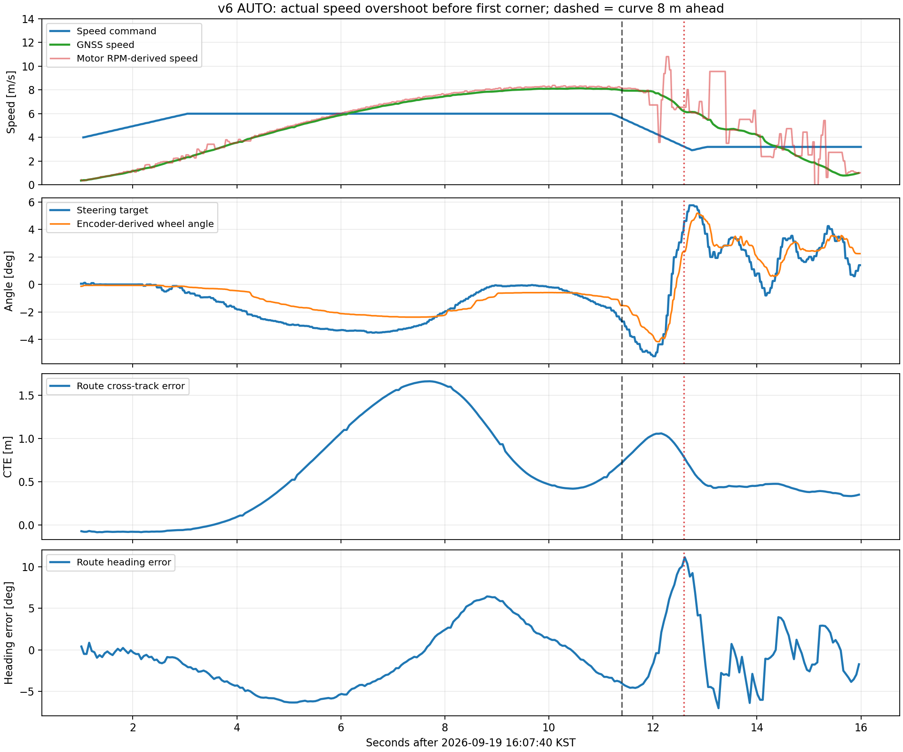
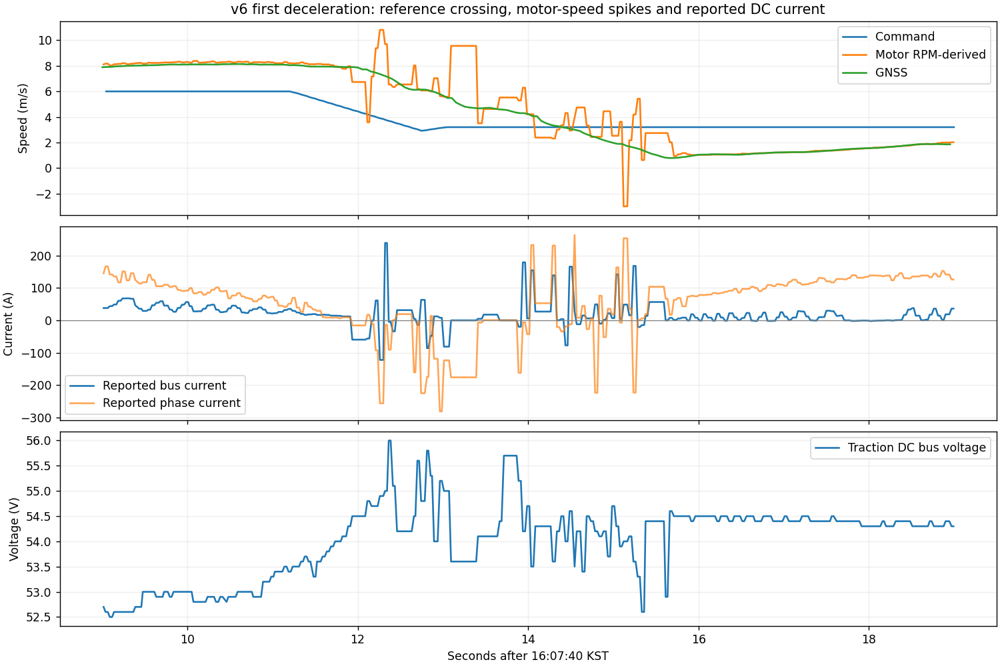
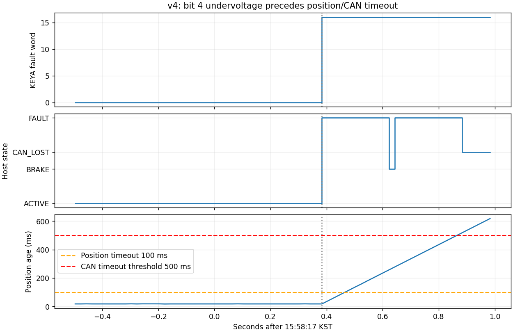

# 2026-09-19 실주행 제어 분석: 조향 튜닝, 종방향 감속·회생, 조향 fault

> Decision 소스 참조는 작성 당시 별도 checkout 기준입니다. 현재 Control 저장소에는 포함되지 않습니다.

분석 대상: `~/KAI_ws/records/260919/quali_succeed_run/` 4개 기록과 `~/KAI_ws/records/260919/afternoon_sysid/` 14개 기록.
분석 기준: AUTO 구간, 조향 응답은 그중 ACTIVE 구간. 시각은 **2026-09-19 KST**.
범위: 기록·현재 작업 트리·제공된 제조사 문서의 분석과 변경 제안. **제어 코드, 펌웨어, 운용 파라미터, 원본 MCAP는 변경하지 않았다. 차량 노드도 실행하지 않았다.**

> 후속 구현(2026-09-21): §3의 Host mask/복구/Console 설명은 분석 당시 기록이다.
> 현재 정책은 [조향 복구 정책·구현 기록](2026-09-21_steering_availability.md)와 [SAFETY.md](../SAFETY.md)를 따른다. MCAP 관측 사실은 변경하지 않았다.

## 결론과 우선순위

1. **조향 P를 더 올리는 것은 권하지 않는다.** SYSID에서 P=2.3~2.6, D=0.08의 큰 Step에 약 6 Hz 지속 진동이 나타난다. 현재 저장된 주행 프리셋 P=2.4를 기준으로 **P=2.0 / D=0.08**부터 단일변수 비교하고, D는 다음 단계에서 비교한다. 확정 최적값이 아니다.
2. **6 m/s 회전 현상을 조향 PD만으로 설명하면 안 된다.** 해당 기록에서 명령 6 m/s에 GNSS 속도 **8.14 m/s**까지 상승했고, 코너에 가까워진 뒤 감속과 조향 방향 전환이 겹쳤다. 우선 종방향 속도 초과와 실제 차속 기준 감속거리 문제를 다뤄야 한다.
3. **종방향은 EZkontrol 내부 속도루프를 사용한다.** STM_A/command_governor에 속도 PI/PD가 있는 구조가 아니다. 감속 중 새 목표 아래로 크게 내려가는 현상, 전류 반전, RPM 피드백 급변이 함께 보인다. 내부 PI와 속도계측/구동계 문제를 분리해서 튜닝해야 한다.
4. **회생이 전혀 없다고 단정할 수 없다.** AUTO 감속 중 음의 DC bus current가 기록되어 있다. Host의 명시적 회생 명령 경로가 없다는 사실과 드라이버가 실제로 에너지를 돌려보내는지는 다른 문제다. 팩/BMS 전류와 CAN 원본으로 확인해야 한다.
5. **이번 남은 조향 fault의 직접 기록은 KEYA 저전압 bit 4다.** 4 m/s 기록의 15:58:17.383에 `fault_bits=16(0x0010)`과 `FAULT`가 먼저 발생하고, 이후 위치 피드백·CAN이 끊긴다. 앞서 제거한 Host `rate_limit`과 다르다. 아래 조건 목록만 정리했으며 보호 로직은 수정하지 않았다.

---

## 0. 자료의 범위와 해석 방법

### 0.1 예선 실주행 요약

표의 v1.3/v3/v4/v6는 `scenario.yaml`의 **요청속도 m/s**다. 오후 SYSID 폴더의 v5/v7/v10은 **km/h**다. 특히 **6 m/s=21.6 km/h**이므로 오후의 6~7 km/h 시험을 같은 속도 검증으로 취급하지 않는다.

| 기록 시작 / 요청속도 | AUTO 지속 | GNSS 이동속도 중앙값 / 최대 | 경로 횡오차 절댓값 p95 / 최대 | ACTIVE 조향오차 절댓값 p95 | 관측된 조향 이상 |
|---|---:|---:|---:|---:|---|
| 15:35:05 / 1.3 m/s | 408.32 s | 1.26 / 1.81 m/s | 0.473 / 0.697 m | 1.45° | KEYA 실제 fault 없음; 끝에서 경로점 부족으로 종료 |
| 15:45:38 / 3 m/s | 158.06 s | 2.95 / 4.04 m/s | 0.855 / 1.050 m | 1.49° | AUTO에서 실제 fault 없음 |
| 15:55:17 / 4 m/s | 141.69 s | 3.67 / 5.45 m/s | 0.963 / 1.176 m | 1.55° | 저전압 bit 4 → 피드백 단절 → CAN_LOST |
| 16:02:06 / 6 m/s | 107.00 s | 4.51 / 8.14 m/s | 1.268 / 1.663 m | 1.52° | AUTO에서 실제 fault 없음 |

- AUTO 지속은 첫/마지막 AUTO 상태 시각 차이다. 대기·출발·정지가 포함되므로 이동시간과 다르다. GNSS 속도 통계는 AUTO 중 0.2 m/s 초과 샘플만 사용했다.
- Run마다 통과한 경로 범위와 출발 조건이 다르다. 위 표만으로 차속 증가가 오차 증가의 유일한 원인이라거나 속도별 PD가 필요하다고 결론내리지 않는다.
- 조향오차는 노드의 `target_wheel_angle_rad`와 `actual_wheel_angle_rad`의 차이다. 실제각은 **KEYA 엔코더 보정식으로 환산한 중앙등가 바퀴각**이며, 독립적인 타이어각 센서 측정이 아니다. 경로 횡오차는 `/planning/route_context.cross_track_error`로 별도 집계했다.
- MCAP 수신 시각으로 토픽을 정렬했다. `/drive/status`의 header가 0인 경우에도 수신 시각은 사용할 수 있다. EZ 피드백보다 ROS 발행이 빠르므로 반복 샘플 수를 독립 CAN 측정 횟수로 해석하지 않는다.
- 3 m/s 파일은 reader에서 message index 부재 경고가 발생했고, 추출된 조향 상태에 **15:48:19.966 이후 약 63.97초 공백**이 있었다. 이는 AUTO 시작 15:50:37 이전이며 표의 AUTO 집계에는 겹치지 않는다. metadata보다 추출 메시지가 적어 해당 공백을 차량 통신 단절로 판정하지 않았다.
- 이 네 기록에는 `/steering/torque_safety`, P/D 기여, torque command, saturation/peak-limited 토픽과 조향 시작 파라미터 snapshot이 없다. 조향 노드의 parameter event도 기록되지 않았다. 따라서 **실주행 당시 PD·출력제한값을 확정할 수 없다.** 현재 저장 프리셋이나 앞선 SYSID 값으로 대신 단정하지 않는다.
- v6의 Decision 시작 parameter events와 `/diagnostics`는 있어, 고수준 PP·속도계획 설정은 기록에서 확인했다. v4의 parameter event는 0개다.

### 0.2 현재 파일과 당시 설정의 구분

현재 [주행 프리셋](../../software/src/control_tuning/config/control_tuning.presets/driving.yaml)은 15:29:06 저장값으로 **P=2.4, D=0.08, filter=10 Hz, peak/sustained=16/8 A, peak=1 s, recovery=5 s**다. 이 파일이 실주행 전에 저장됐다는 사실만으로 이미 실행 중이던 노드에 적용됐다고 증명할 수는 없다.

[기본 actuator YAML](../../software/src/lateral_ctrl/config/steering_actuator.yaml)은 프리셋과 일부 값이 다르다. 튜닝 판단의 순서는 **해당 Run의 snapshot/parameter event → 실제 readback → 저장 프리셋 → 코드 기본값**이다. 이 분석에서 live parameter read나 차량 조작은 하지 않았다.

---

## 1. 현재 조향 토크제어와 튜닝 가이드

### 1.1 제어 구조와 파라미터 의미

현재 torque 경로는 약 50 Hz로 다음을 계산한다.

`u_raw = Kp_raw × (target − angle) − Kd_raw × filtered_angle_rate`

- 입력 target은 직접 사용하고 `target_rate=0`이다. D는 실측 각속도 감쇠이며 목표각 변화율 feedforward가 아니다.
- `Kp_raw = torque_peak_limit_raw / torque_full_scale_error_rad`다. native 설정에서 peak만 바꾸면 P도 바뀐다. `control_tuning` UI는 전류 단위 P를 유지하도록 변환한다.
- `Parameter 0003=20 A` 환산 기준에서 `1 raw=0.0016 A`의 **명령 전류 제한값**이다. 실측 전류·확정 토크 N·m와 구분한다.
- 출력에는 peak/sustained 한도, 누적 peak 시간, soft margin의 바깥방향 제한, settle 판정이 적용된다.
- `max_steering_rate_deg_s=60`은 **position 모드 전용**이다. Torque Step 채터링을 이 값으로 조절할 수 없다. Decision의 조향 명령 slew 제한은 이와 별개의 상위 기능이다.
- 새 조향비는 현재 엔코더→등가각 보정식과 실제 응답을 기준으로 판단한다. 이전의 `100/58` 비율을 P/D에 다시 일괄 곱하는 방식은 피한다. 관성·마찰·속도·지연의 변화까지 한 비율로 설명할 수 없다.

근거: [steering_actuator_node.cpp](../../software/src/lateral_ctrl/src/steering_actuator_node.cpp) 622–644행, [torque_steering_controller.cpp](../../software/src/lateral_ctrl/src/torque_steering_controller.cpp) 91–165행, [튜닝 단위 변환](../../software/src/control_tuning/control_tuning/schema.py).

### 1.2 SYSID로 확인한 채터링과 작은 각도 지연

아래 P 단위는 A/deg, D 단위는 A/(deg/s)다. 표의 속도는 조향 입력 구간의 실제 속도다. 전기적·기계적 조건이 완전히 같은 A/B 실험은 아니므로 P 변화만으로 결과 차이를 설명하지 않는다.

| Run 시작 | P / D | 입력 / 실제 속도 | 핵심 관측 |
|---|---:|---|---|
| 15:09:06 | 2.3 / 0.08 | −1→+6° Step / 중앙 5.91 km/h | rise 약 0.24 s, 최고 5.65°, 끝부분 잔류 약 0.41° |
| 15:10:54 | 2.3 / 0.08 | 중심 −1°, 진폭 ±7° / 4.08–6.41 km/h | 중심 복귀 방향에 따라 약 0.18–1.54° 잔류 |
| 15:13:06 | 2.3 / 0.08 | 중심 −1°, 진폭 ±10° / 중앙 6.26 km/h | +9° 목표에 11.44°, 약 6.25 Hz·4.26° p-p 지속 진동; 실제 Step 구간 saturation 12.4%, peak-limited 0% |
| 15:17:29 | 2.6 / 0.08 | 중심 −1°, 진폭 ±10° / 중앙 7.26 km/h | +9°에서 11.81°, −11°에서 −13.95°; tail 4.43–6.68° p-p, 약 5.4–6.1 Hz; saturation 26.4%, peak-limited 68.9% |
| 15:22:37 | 2.4 / 0.08 | ±3° Sine, 4 s / 중앙 5.01 km/h | 6주기 완료, 진폭비 0.742, 위상지연 환산 336 ms, fit 잔차 RMS 0.183° |
| 15:24:50 | 2.4 / 0.08 | ±10° Sine, 4 s / 중앙 4.93 km/h | 약 5.4주기, 진폭비 0.957, 지연 164 ms, 잔차 RMS 0.395° |
| 15:27:05 | 2.5 / 0.08 | ±13° Sine, 4 s / 중앙 5.91 km/h | 약 2.15주기, 진폭비 0.984, 지연 122 ms, 잔차 RMS 0.912°, 약 6.2 Hz 채터링 |

Sine 진폭비·지연은 초기 hold를 제외한 target/actual의 0.25 Hz 사인 최소제곱 fit이다. 표의 지연은 이 주파수의 위상지연을 시간으로 나타낸 것으로 모든 입력에 공통인 순수 dead time이 아니다.

**관측에 따른 판단**

- 큰 Step은 빠르게 도달하지만 정착하지 못한다. P를 높여 작은 잔류오차를 없애는 방식은 큰 각도의 진동을 악화시킬 수 있다.
- 동일 P=2.4의 작은 Sine와 큰 Sine가 서로 다른 진폭비·지연을 보인다. 마찰·유격·히스테리시스 같은 비선형 영향이 후보이며, 이를 PD 수치만으로 확정할 수는 없다.
- 3–15 Hz bandpass 조향각 RMS는 ±3° Sine **0.038°**, ±10° **0.102°**, ±13° **0.709°**다. ±13°에서 D항 전류 환산값도 **−8.51~+6.20 A**로 출렁인다. D를 올리면 무조건 좋아진다는 근거가 없다.
- ±13° Sine의 settle 상태는 0.4%, 전환 2회뿐이다. 큰 채터링의 주원인을 settle on/off로 보고 deadband부터 넓히는 것은 근거가 약하다.
- 14개 Run 모두 D=0.08이었다. **D의 최적값·증감 방향은 이번 실험에서 직접 비교되지 않았다.**
- 15:17 Step의 peak 제한은 원인과 결과가 섞인다. 진동으로 고출력 예산이 소모될 수 있으므로 peak 시간을 늘려 진동을 유지시키지 않는다.

**게인 순위 비교에서 제외한 기록**

- 14:37:21: 삭제 이전 `rate_limit` fault로 중단. 현재 소프트웨어의 재발 증거가 아니다.
- 15:05:33 straight: ACTIVE 샘플 없음.
- 15:15:49: 초기 hold 중 종료, 첫 Step 이전.
- 15:19:13 step_v10, 15:20:49 step_v9, 15:29:12 sine_v10: 조향 시험 파형 시작 전 정속 준비 중 종료.
- 15:07:30: +7° 목표에서 처음 +7.37°에 도달한 후, +16 A→+8 A 명령인데도 −12.68°까지 반대 방향으로 이동했다. 외부 조작·부하·출력 전달 문제를 구분할 자료가 없어 일반적인 PD Step으로 순위화하지 않았다.

### 1.3 제안하는 조향 파라미터 비교 순서

**첫 후보는 현재 저장 프리셋 기준 P=2.0 / D=0.08이다.** 이전 P=2.3 단일 Run에 대한 P=1.8 제안과 같은 'P를 낮춰 진동부터 분리'하는 방향이다. 여러 오후 기록을 함께 보면 2.0을 먼저 비교하고 필요할 때 1.8로 내려갈 수 있다. 어떤 값도 실차 최적값으로 검증된 것은 아니다.

| 항목 | 기준/제안 | 판단 기준 |
|---|---|---|
| P | 적용 중인 값을 확인한 뒤 약 10–20% 감소. 기준 2.4이면 **2.0**, 진동이 남으면 별도 시험으로 1.8 | 약 6 Hz 성분·overshoot가 줄어드는지 확인. 작은 각도 잔류가 커지는 tradeoff도 기록 |
| D | 처음 **0.08 유지**. P 비교 후 빠른 전류 반전이 남으면 **0.06** 별도 비교 | D를 낮춰 overshoot가 커지면 원복. 감쇠 부족과 지연·잡음 영향을 구별한 후 증감 방향 결정 |
| rate LPF | **10 Hz 유지** | P/D를 먼저 분리. 이후 잡음 영향이 남으면 8 Hz 별도 비교; 지연 증가로 악화될 수 있음 |
| peak/sustained 명령 | **16/8 A 유지** | 포화로 목표를 못 쫓는지, 진동 때문에 포화하는지 구분. 현재 전류 상향 근거 없음 |
| peak budget/recovery | **1 s / 5 s 유지** | 짧은 disable·gain 변경에도 예산 보존. sustained 절반 이하 출력 연속 유지 후 회복 |
| settle angle/rate | **0.1° / 0.5°/s 유지** | 큰 진동 해소 후 중앙 미세 on/off만 남을 때 angle 0.15~0.2°를 별도 비교 |
| soft margin / 방향 / 보정식 | **1° margin, 방향·보정식 유지** | 물리 영점과 바퀴각 측정 없이 offset·조향비를 다시 조절하지 않음 |
| control/feedback 주기 | **20 ms / 100 ms 유지** | timeout을 늘려 저전압·통신 이상을 감추는 방향은 튜닝이 아님 |
| 마찰보상 / I | 아직 추가하지 않음 | 진동 해소 후 방향별 breakaway·중심복귀 잔류가 반복되면 별도 설계 검토 |

전류 환산 기준 20 A 및 peak raw 10000을 유지한다면 **P=2.0 ↔ `torque_full_scale_error_deg=8.0`**, P=1.8 ↔ 8.8889°다. D=0.08 ↔ `torque_kd=2864.789`, D=0.06 ↔ 2148.592이다. peak raw나 환산 기준이 바뀌면 이 대응도 달라진다.

비교 시험은 실제 약 **5~7 km/h**에서 중심→±2~3°→중심, 2초 hold, 양방향 3회 이상으로 시작한다. 같은 waveform·실제 차속·하중에서 한 항목씩 바꾼다. 작은 입력에서 진동을 줄인 후 ±5°, ±10°로 확대한다. 0.25 Hz Sine로 작은 각도 지연도 함께 비교한다. 이 절차는 오후 SYSID 비교용이며 곧바로 6 m/s에서 큰 Step을 하라는 제안이 아니다.

속도 스케줄링은 현재 데이터만으로 확정하지 않는다. 고정 게인으로 낮은 속도에서 안정화하고 종방향 속도 초과를 정리한 뒤, 실제 3/4/6 m/s에서 같은 작은 경로·곡률 조건을 비교한다. 특정 속도에서만 반복적으로 악화될 때 연속적인 P/D 전환을 검토한다.

### 1.4 6 m/s 인가 시 회전 현상: PD와 분리해서 볼 부분

v6 AUTO에서 최대 경로 횡오차 **1.663 m**, 최대 heading error **11.14°**, 조향 추종오차 p95 **1.52°**였다. 경로 progress는 약 5.49→473.16 m로 진행했다. 이 기록에서는 큰 보정과 방향 전환을 확인할 수 있지만 **차량이 한 바퀴 스핀했다거나 타이어가 미끄러졌다고 확정할 근거는 부족하다.**

| 시각 | 경로 상태 | 속도 명령 / GNSS | 조향 목표 / 엔코더 환산각 |
|---|---|---:|---:|
| 16:07:50.553 | 직선 | 6.00 / **8.14 m/s** | 속도 초과 최대 |
| 16:07:51.399 | turn_approach, 코너까지 8 m | 5.64 / 7.97 m/s | −2.66 / −1.54° |
| 16:07:51.999 | turning, 코너까지 3 m | 4.44 / 7.87 m/s | −5.20 / −3.72° |
| 16:07:52.399 | turning | 3.64 / 6.99 m/s | +1.76 / −1.09° |
| 16:07:52.599 | turning | 3.24 / 6.20 m/s | +4.47 / +2.37° |

약 0.6초에 **목표 조향 자체가 −5.20→+4.47°**로 반전했다. 따라서 조향 모터가 고정 목표에서 독자적으로 회전한 현상으로 해석할 수 없다. 과속 상태의 경로 보정과 실제 조향 지연이 겹친 것으로 보는 것이 기록에 부합한다.

v6 parameter event에서 PP adaptive lookahead `base=4.0 m`, `gain=0.9 s`, `max=9.5 m`, 곡률 preview=12 m, curve speed floor=3.2 m/s, 명령 가속/감속 한도=1/2 m/s²를 확인했다. 이 속도계획은 곡률 강도에 따라 목표를 낮추고 **명령** 변화율을 제한한다. 실제 감속이 그 값을 달성하는지 보장하는 루프는 아니다.

명목 감속 2 m/s²에서 이상적인 필요거리는 `d=(v²−v_curve²)/(2a)`다.

- 6→3.2 m/s: **6.44 m**.
- 8→3.2 m/s: **13.44 m**.
- 관측된 접근 감지 시점의 잔여거리: **8 m**. 지연을 포함하면 요구거리는 더 커진다.

**수정 제안만 제시:** 실제 차속과 확보 가능한 감속도를 기준으로 코너 진입속도/제동거리 envelope를 만들고, 종방향 속도 초과를 먼저 줄인다. preview나 `max_decel_mps2` 숫자만 올려 실제 제동력을 늘렸다고 보지 않는다. PP lookahead 조정은 그다음에 곡선 안쪽 잘림·진입 지연·직선 보정을 비교하며 시행한다.

추가로 GNSS>4 m/s, 0.5초 평활 IMU yaw rate 절댓값<2°/s인 직진 후보 구간에서 엔코더 환산각 중앙값이 **−1.17°**였다. 영점·토우·링크 유격·센서 정렬·노면 횡경사를 확인할 이유가 있다. 이 값만으로 offset을 −1.17° 보정해서는 안 된다.

진단 토픽의 `steering_feedback_guard_active`는 AUTO 535개 샘플 모두 false였다. 이번 현상을 1.5° lead guard가 계속 조향을 막았기 때문이라고 해석하지 않는다. tracking slowdown은 7개 진단 샘플에서 활성화됐다.

근거: Decision motion_control_node.py (`Decision/kaiev26_motion_control/kaiev26_motion_control/motion_control_node.py`) 590–714, 1286–1312, 1405–1442행 및 설정 (`Decision/kaiev26_motion_control/config/motion_control.yaml`). 진단·parameter events로 주요 값은 해당 Run에서도 확인했다.

---

## 2. 종방향 감속 오버슛·채터링, 회생제동과 토크제어

### 2.1 현재 제어 구조

`Decision 속도계획/명령 ramp → command_governor → STM_A 목표 RPM·전류한도 → EZkontrol 내부 속도루프`

- AUTO는 50 ms마다 목표 RPM과 **상전류 한도 480 A**를 전송한다. 6 m/s는 현재 타이어 직경 0.47 m·감속비 4.60 기준 약 **1122 motor rpm**이다.
- `commanded_phase_current_a=480`은 실제 모터가 480 A를 계속 소비한다는 뜻이 아니다. 속도모드의 전류 제한 명령값이다.
- MANUAL은 페달을 signed phase-current 명령으로 바꾸는 torque 경로를 이미 사용한다.
- `brake_engage=true` 또는 기존 정지 조건은 RPM=0, current=0, RUN=0/HALTED와 기계식 브레이크 경로다. 이것을 정상 회생 감속 명령으로 재해석하면 기존 정지 의미가 바뀐다.
- governor 자체는 유효시각/입력 검사를 통과한 명령을 중계한다. 다만 **상위 Decision에는 이미 가속·감속 ramp가 있다.** 따라서 “시스템 어디에도 ramp가 없다”거나 governor에 중복 ramp를 넣는 것이 첫 해결책이라는 설명은 맞지 않는다.
- `/drive/status.controller_control_mode=1`은 분석한 AUTO 주행에서 일관됐다. 앱의 과거 Torque control 표시와 구분해야 한다.

근거: [STM_A app_freertos.c](../../firmware/STM_A/Core/Src/app_freertos.c) 71–78, 370–436, 1201–1239행; [command_governor_node.cpp](../../software/src/command_governor/src/command_governor_node.cpp) 80–109행.

### 2.2 실제 관측: 단순 감속 지연을 넘는 현상이 있다

| 현상 | 기록 근거 | 해석 |
|---|---|---|
| 가속 후 목표 초과 | 16:07:50.553, 명령 6.0에 GNSS **8.142 m/s** | 실제 차량 속도 overshoot 약 **+2.14 m/s, +35.7%**. motor RPM만의 artifact는 아님 |
| 감속 후 새 목표 아래로 하강 | 16:07:55.653, 명령 3.2에 GNSS **0.786 m/s** | 약 **−2.41 m/s undershoot**. 낮아진 목표에 늦게 접근하는 단순 coast만으로 설명되지 않음 |
| 후속 감속에도 목표 아래로 내려감 | 16:08:43.603 약 2.481 m/s, 16:09:01.853 약 2.053 m/s; 각 명령 3.2 | 한 번만의 시작 과도현상으로 한정할 수 없음 |
| 정지상태 토글 여부 | 첫 감속 16:07:51–16:08:00: command brake=false, brake commanded=false, stop_request=false, tractive_commanded=true | 이 구간은 RUN/HALTED나 기계 브레이크 on/off가 반복된 현상으로 설명되지 않음 |
| motor RPM 급변 | 16:08:41.478, RPM 환산속도 **12.46 m/s**, 같은 시각 직전 GNSS 약 **6.14 m/s** | 실제 차량 최고속도 12.46 m/s로 보고하면 오류. RPM 추정/센싱/통신 또는 구동륜 거동을 따로 확인해야 함 |
| 음의 전류 보고 | AUTO 감속 중 bus current 최저 약 **−310 A**, phase current 최저 약 **−387 A** | 전류 부호 반전 보고는 확인됨. 정량 충전전류·회수에너지는 독립 측정 없이 확정하지 않음 |

피드백 `speed_mps`는 RPM이 순간 0이면 최대 두 CAN 샘플을 유지하는 보정이 있고, raw `motor_rpm`은 보존한다. 이 기능은 큰 양의 RPM spike를 제거하지 않는다. raw RPM·환산속도·GNSS·IMU를 함께 비교해야 한다. 부하 변화나 슬립과 RPM 계측 이상 중 어느 쪽인지는 raw CAN/Hall 측정 없이 분리할 수 없다.

현재 STM_A 전류 복호는 unsigned little-endian 값에 `raw×0.1−3200`을 적용하며 제공 CAN 규약과 일치한다. 예를 들어 −310 A는 raw 28900으로 정상 표현범위다. 소스의 단순 signed-wrap/부호반전 오류로 이 보고값을 설명할 근거는 찾지 못했다. 다만 원본 CAN과 실제 장치 firmware의 값 생성까지 검증한 것은 아니다.

### 2.3 원인 분석의 확실성

| 원인/요인 | 근거와 확실성 | 우선 조치 방향 |
|---|---|---|
| 실제 속도루프의 과도응답 문제 | 일정 6 m/s 목표 위로 실제 GNSS 속도가 상승하고 3.2 m/s 아래 undershoot. **현상 확인** | 내장 speed PI, current limit 진입/이탈, 적분 잔류를 분리시험 |
| 내부 speed PI의 과한 I/적분 잔류 | 가속 overshoot와 감속 undershoot에 부합. EZ 내부 항은 기록되지 않아 **원인 후보** | 실제 readback 확인 후 Ki를 낮춘 단일변수 비교 |
| 속도 feedback 급변과 전류 hunting | 감속에서 GNSS와 동떨어진 RPM spike·전류 반전 확인. **동시 관측 확인, 인과방향 미확정** | Hall/커넥터/차폐·CAN raw·독립 회전수 대조. 필터나 PI만으로 덮지 않기 |
| 상위 코너 감속 진입이 실제 과속을 충분히 반영하지 못함 | 8 m 앞에서 접근 처리, 실제 약 8 m/s. 이상적 3.2 m/s 감속거리 약 13.44 m. **구조와 기록 일치** | 실제속도·지연·유효 감속도 기반 거리 계획 |
| 기계 브레이크/RUN 반복 전환 | 첫 감속 구간에는 해당 플래그 전환 없음 | 이 구간의 주원인으로 채택하지 않음 |
| 회생 불가능으로 인한 순수 coast | 음의 bus current와 큰 undershoot가 함께 있음 | **현 자료로 주원인 확정 불가**. 회생 상태를 독립 확인 |
| 높은 전압에서 EBS on/off 반복 | 과거 EBS max=58 V지만 첫 감속의 관측 DC 전압 약 52.6–56.0 V | 현재 threshold도 미확인. 이번 채터링의 직접 원인으로 확정하지 않음 |

내부 적분기가 출력 포화 중 쌓일 수 있다는 일반적 설명은 [TI의 PI 제어 기술 문서](https://www.ti.com/document-viewer/lit/html/SSZTCG3/GUID-ADE5B47E-C38D-410F-87C8-C6C6DA09E1F1)를 참고할 수 있다. 이것은 EZkontrol 펌웨어 내부의 anti-windup 유무나 이번 원인을 확인한 증거는 아니다.

### 2.4 종방향 파라미터 조정 가이드라인

2026-09-20 추가 확인: [EZkontrol 감속 추종과 내부 파라미터 비교안](2026-09-20_ezkontrol_decel_tuning.md)에 앱에서 조정할 항목, 공개 설정표의 범위, 조건부 Ki 16→14→12 비교안을 정리했다. 현재 실기 readback을 수행하거나 설정을 적용한 것은 아니다.

[EZkontrol 설정 기록](../hardware/EZKONTROL_SETTINGS_NOTES.md#2026-09-08-설정-기록)의 해당 절은 **20260908 설정 기록**이다. Rotor speed Kp/Ki=2/16, Phase current Kp/Ki=4/512, Bus current Kp/Ki=4/256, Acceleration/Deceleration=100/100, EBS current=0, EBS auto=Disable이 적혀 있다. **오늘 드라이버에서 읽은 값으로 취급하지 않는다.**

| 항목 | 권장 비교 방향 | 이유/제약 |
|---|---|---|
| Rotor speed Ki | 실제 현재값 기준 **10–20% 감소**부터 | 가속 잔류·감속 undershoot와 느린 hunting 비교. 제조사 추천 숫자가 아닌 실험 간격 |
| Rotor speed Kp | Ki 비교 후 빠른 전류·속도 왕복이 남으면 **10–20% 감소** 별도 비교 | Kp와 Ki 동시 변경 금지. 앱이 정수만 지원한다면 Kp=2→1은 50% 변화이므로 작은 조정으로 부르면 안 됨 |
| Phase current / Bus current PI | 우선 유지 | 내측 전류루프까지 동시에 바꾸면 speed-loop 원인 구분이 어려움 |
| Acceleration / Deceleration 100 | 숫자 증감 방향을 현재 자료로 지정하지 않음 | 단위·증가방향·CAN 운전 적용 여부 불명확. 100→50이 부드러워진다고 단정 불가 |
| AUTO phase current limit 480 A | overshoot 해결을 위한 상향 금지. 줄이는 비교는 필요한 가속·오르막 여유와 함께 별도 수행 | 전류한도는 PI가 아니며, 제동권한 확보와 별개 |
| Hall filter / 약계자 | 우선 유지 | 실제 RPM spike의 원인이 확인되기 전 여러 내부 루프를 동시에 바꾸지 않음 |
| 상위 명령 ramp | 현행 1/2 m/s²와 실제 응답을 먼저 대조 | jerk 제한 및 실제 감속 가능한 envelope를 제안. 이미 있는 ramp를 확인하고 중복하지 않기 |

실험은 동일 하중·노면·SOC에서 낮은 속도의 일정 목표와 감속 ramp를 나눠 비교한다. `새 목표 도달시간`, `새 목표 아래 최저값`, `재상승량`, `정착 후 speed/current ripple`, `RPM–GNSS 불일치`, `RUN/brake 전환`을 따로 본다. 주행 중 앱 파라미터를 바꾸는 방식은 사용하지 않는다. 제조사 매뉴얼은 설정 변경 시 자동 재시작을 명시한다.

### 2.5 오버슛에 대해 향후 수정할 수 있는 방향 — 이번에는 미적용

1. **실제 차속 기반 코너 감속거리:** 계획 속도가 아니라 관측속도와 지연을 포함한 감속 여유거리로 진입 제한을 계산한다.
2. **정상 목표의 jerk 제한/연속 전환:** 현행 Decision ramp에 필요한 범위에서 추가한다. 긴급 brake/HALTED를 부드럽게 만들 목적으로 지연시키지 않는다.
3. **RPM 급변 원인 해결:** CAN 원본·Hall/회전센서·GNSS를 대조한다. 통신값 오류이면 경계에서 고치고, 실제 구동륜 문제면 제어/구동계를 다룬다.
4. **구동↔회생 중재:** 0 torque 근처에 hysteresis, 전류 변화율 제한, 저속 종료/기계 브레이크 전환을 설계한다.
5. **외부 speed→current PI를 선택할 경우:** current 포화, 회생 제한, 정지/모드 변경을 반영하는 anti-windup과 출력의 연속 전환을 포함한다. 현재 STM_A에 이미 있는 기능이라고 보지 않는다.

### 2.6 회생제동 구현 방향과 종방향 torque control 가능성

**종방향 전류/토크 명령 운전은 가능하다.** 제조사 프로토콜과 현재 MANUAL 구현에 근거가 있다. 다만 AUTO는 현재 speed 기반이므로 **외부 속도루프에서 전류명령을 만드는 변경**이 필요하다. 정확한 N·m 제어를 하려면 모터 torque constant, 전류 정의, 전달효율이 추가로 필요하다.

#### 제공 CAN 문서가 일치하지 않는 부분

| 문서 | 명시된 내용 | 설계상 의미 |
|---|---|---|
| [EZkontrol CANBUS MCU to VCU V1.0.pdf](<../hardware/GoldenMotor_EZkontrol_MCU_to_VCU_CAN_Protocol_V1.0.pdf>), PDF 3쪽 | byte4 bit1: 0=Torque, 1=Speed; current/RPM target; 주기 50 ms | 현재 STM_A의 mode bit 사용 근거 |
| [GoldenMotor_EZkontrol_CAN_Protocol_Instruction_V1.0.pdf](../hardware/GoldenMotor_EZkontrol_CAN_Protocol_Instruction_V1.0.pdf), PDF 5쪽 | current target+speed limit / speed target+current limit, mode bit1 변경 불필요 설명 | 펌웨어 버전별 계약 확인 필요 |
| 같은 PDF 5쪽 | 정상 forward +/+, reverse −/− 예시; current/RPM 부호 일치 설명 | **양RPM+음전류=회생이라는 4사분면 명령 계약을 확정하지 못함** |

signed current 필드가 있다는 사실만으로 원하는 회생 CAN 명령이 확인된 것은 아니다. 특히 음의 `speed_target_mps`는 현재 코드에서 후진 목표이므로 회생 대신 사용하면 안 된다.

#### 구현 후보

- **A. 드라이버 EBS 입력 사용:** [EZkontrol Users Manual](<../hardware/GoldenMotor_EZkontrol_User_Manual.pdf>) PDF 9쪽의 BrakeH+/BrakeH−/BrakeL 입력을 확인하고, 실제 배선·trigger·CAN 동시운전·회생 종료조건을 검증한다. 현재 STM_A에서 해당 입력을 직접 제어하는 경로는 찾지 못했으며 실제 배선 여부는 소스만으로 확정할 수 없다. EBS auto Enable 하나로 AUTO 정상감속 제어가 완성되지는 않는다.
- **B. CAN 전류명령 기반 외부 속도제어:** 실제 firmware에서 회전 반대 torque/회생 계약이 확인된 경우, speed PI가 구동·회생 current를 요청하도록 설계한다. 요청 토크와 배터리 충전 허용량을 구분하고 전압·SOC·온도·저속 조건으로 제한한다.
- **공통:** 회생이 제한되는 상황에서도 필요한 감속을 달성할 기계 브레이크 중재가 필요하다. 현재 bool 브레이크로 어느 정도 연속 감속 제어가 가능한지는 별도 제약이다.

현재 [ActuatorCommand.msg](../../../kaiev26_msgs/msg/ActuatorCommand.msg)는 speed/steering/bool brake만 있다. 구현 위치에 따라 두 가지 변경 범위가 가능하다.

1. 기존 speed 명령을 유지하고 **STM_A 안에 외부 speed→current 루프**를 구현하면, 반드시 새 torque 명령 필드를 만들 필요는 없다. 대신 feedback 품질, current 제한, 모드 전환, 상태 관측 계약을 설계해야 한다.
2. **Host가 torque/감속도를 직접 요청**하려면 새 명령 필드나 별도 계약이 필요하다. 이 경우 `kaiev26_msgs`·발행자·governor·STM_A 소비자와 STM_A/B generated micro-ROS 산출물의 호환 rollout을 함께 다룬다.

두 경우 모두 기존 `brake_engage=true`의 정지 의미는 유지하고 정상 회생 요청과 구분한다. 이번 분석에서는 어느 경로도 구현하지 않았다.

#### 전기적 한도와 실제 회생 확인

- 설정 메모의 EBS 0 A / auto Disable은 9월 8일 기록이다. 오늘 AUTO의 음의 bus current와 함께 보면, 그것만으로 오늘 회생 비활성을 단정할 수 없다.
- 제공 문서가 참조하는 [51.8V 78Ah 팩 사양서](<../hardware/51.8V78Ah(14S30P)더블류웍스향배터리팩사양서.pdf>) PDF 6쪽은 최대 연속 충전 **39 A**, 충전 정지 **58.8 V**, 충전 온도 **0~45°C**를 제시한다. **실차가 이 팩과 같은 구성일 때만 적용**하며, BMS의 순간 충전허용량은 별도 확인해야 한다.
- PDF 7쪽의 100 A/1초 보호 검출값은 정상 충전 운전값이 아니다. EBS 설정전류와 DC 충전전류의 관계가 확인되지 않아 `EBS current=39 A`로 그대로 옮길 수 없다.
- 기록의 −310 A는 부호와 크기를 독립 검증할 필요가 있는 **컨트롤러 보고값**이다. 같은 팩에 실제로 이 수준이 지속된다면 허용 충전량을 크게 벗어날 수 있으므로, 원인 확인 전 회생 강도를 높이는 근거로 사용하지 않는다. 신호의 진위·지속시간·실제 BMS 제한은 아직 확인되지 않았다.
- 회생 충전은 검증된 부호의 DC 전류, 배터리/BMS 전류, DC 전압, 회전수·감속을 함께 확인한다. 음의 phase current만으로 충전이나 회수에너지를 확정하지 않는다.
- 9월 8일 기록의 75 V overvoltage shutdown은 이 14S 팩의 회생 충전 보호값으로 사용할 수 없다. 과거 EBS max=58 V 역시 현재 장치 readback이나 적정값 검증을 대신하지 못한다.

표시기용 [MCU to METER V1.1](<../hardware/GoldenMotor_EZkontrol_MCU_to_Meter_CAN_Protocol_V1.1.pdf>) PDF 3–4쪽과 [新思维-高标100513.pdf](../hardware/新思维-高标100513.pdf) 1–2쪽은 표시·상태 전송 자료다. 회생 torque 명령의 근거로 쓰지 않았다.

---

## 3. 현재 조향 FAULT 조건 — 하드웨어/소프트웨어 분리

### 3.1 이번 실주행에서 실제로 발생한 fault

대상: `20260919_155517_534099_decision_case_01_pure_pursuit_v4`.

| KST | 관측 |
|---|---|
| 15:58:17.343까지 | ACTIVE, fault_bits=0, 위치 age 약 18 ms |
| **15:58:17.383** | **state=8 FAULT, reason=10 MOTOR_FAULT, fault_bits=16(0x0010)**; 위치 feedback 아직 valid, age 약 18 ms |
| 15:58:17.483 | 위치 age 약 118 ms, feedback_valid=false. KEYA fault 우선순위로 state는 FAULT |
| 15:58:17.572 | Decision이 조향 피드백 무효로 경로추종 BLOCKED 기록 |
| 15:58:17.623 | 상위 brake 요청으로 잠시 BRAKE 표시; fault bit는 계속 16 |
| **15:58:17.883** | **CAN_LOST**, position age 약 518 ms. cached fault_bits=16 유지 |

**확인된 직접 조건은 KEYA 저전압 비트다.** 어느 부품이 전압을 떨어뜨렸는지는 미확정이다. KEYA 전원/DC-DC, 릴레이·커넥터·접지, 의도적인 전원 차단 등을 구분해야 한다. 이번 이벤트를 Host PD 과속이나 스톨로 다시 명명하면 안 된다.

고장 전후 status의 KEYA bus voltage는 12 V, 온도는 46°C로 남았다. 전압 조회는 encoder보다 느리고 통신이 끊기면 값이 캐시되므로, 이 12 V가 순간 저전압이 없었다는 증거는 아니다. 전원 단자에서의 빠른 전압 측정/원본 CAN이 필요하다. 관측되지 않은 전압 최저치를 숫자로 추정하지 않았다.

### 3.2 Host의 실제 `FAULT` 진입 조건

현재 작업 트리에서 **`motor.fault_bits & 0xFFFE != 0`이 실제 `SteeringState::FAULT` 진입 조건**이다. `state=8`, `disable_reason=10`이다. bit0인 Disable만 제외한다.

일반 우선순위: **E-stop → CAN timeout → KEYA fault → command brake → feedback invalid → mode 문제 → command timeout**. 다만 callback 등의 `requested_disable_reason_`가 설정된 tick은 그 요청이 우선하므로 위 이벤트처럼 잠시 BRAKE가 보일 수 있다.

근거: [steering_actuator_node.cpp](../../software/src/lateral_ctrl/src/steering_actuator_node.cpp) 576–585행, [steering_types.hpp](../../software/src/lateral_ctrl/include/lateral_ctrl/steering_types.hpp) 62–90행.

### 3.3 하드웨어/KEYA 내부 보호 비트 전체

근거: [KEYA User Manual V1.1](../hardware/KEYA_KY170DJD01005-08G-V1_User_Manual_V1.1.pdf), §5.1–5.2, **PDF 19–20쪽**. 아래 reset 표현은 §5.2 표 기준이며 일부 항목은 §5.1 설명과 표현 차이가 있다. 장치 firmware별 실제 복구 동작은 미검증이다.

| Bit | Mask | KEYA가 보고하는 상태 | Host FAULT 포함 | 매뉴얼 reset 표기 |
|---|---:|---|---|---|
| 0 | 0x0001 | Disable 상태 | **제외** | 고장 아님 |
| 1 | 0x0002 | 과전압 | 포함 | Self-reset |
| 2 | 0x0004 | 하드웨어 과전류 | 포함 | 전원 재시작 |
| 3 | 0x0008 | EEPROM 오류 | 포함 | 전원 재시작 |
| 4 | 0x0010 | **저전압 — 이번 v4 발생** | 포함 | Disabling reset |
| 5 | 0x0020 | Reserved | 현재 mask상 포함 | 미정 |
| 6 | 0x0040 | KEYA 내부 software overcurrent | 포함 | Disabling reset |
| 7 | 0x0080 | 제어모드 선택 오류 | 포함 | 전원 재시작 |
| 8 | 0x0100 | 모터 결상 | 포함 | 전원 재시작 |
| 9 | 0x0200 | Stall protection | 포함 | Disabling reset |
| 10 | 0x0400 | 드라이버 과열 | 포함 | Self-reset |
| 11 | 0x0800 | Hall 센서 오류/분리 | 포함 | Disabling reset |
| 12 | 0x1000 | 내부 전류센서 오류 | 포함 | 전원 재시작 |
| 13 | 0x2000 | Spare | 현재 mask상 포함 | 미정 |
| 14 | 0x4000 | CAN 제어 신호 단절 | 포함 | Enable reset |
| 15 | 0x8000 | RS232 제어 신호 단절 | 포함 | Enable reset |

- 매뉴얼의 과전압 32 V·저전압 7 V는 설정 가능한 기준 설명이다. 현재 장치 저장값을 읽어 확인한 수치가 아니다. 과열은 85°C 중단/75°C 회복 설명이 있다.
- bit6의 software는 **KEYA 내부 펌웨어**를 뜻한다. 이번에 제거한 ROS Host `rate_limit`과 다르다.
- bit9의 영문 속도 판정 설명은 모호해 정확한 stall 판정식을 확정하지 않았다.
- `fault_bits=1`은 Disable이고 `fault_bits=513(0x0201)`은 Disable+Stall이다.

### 3.4 남아 있는 Host 소프트웨어 차단 — `FAULT`와 구분

| 조건 | 표시 상태/사유 | 현재 기준 |
|---|---|---|
| STM_B E-stop bit 또는 허용된 test E-stop | ESTOP | 입력 조건 활성 동안 |
| CAN socket open 실패, 마지막 CAN 수신 age 초과 | CAN_LOST / CAN_TIMEOUT | 500 ms |
| ACTIVE torque CAN TX 실패 | CAN_LOST / CAN_TIMEOUT | 즉시 zero/Disable 시도 |
| position 미확보, invalid, 변환각 nonfinite, position age 초과 | FEEDBACK_LOST / FEEDBACK_INVALID | torque에서 min(일반 feedback 500, torque feedback 100)=100 ms |
| 위치 샘플 간격 초과 | FEEDBACK_LOST / torque_safety=feedback_timeout | 100 ms |
| ACTIVE control tick 지연 | FEEDBACK_LOST / torque_safety=feedback_timeout | 100 ms 초과 |
| angle/sample time nonfinite·시간 역행·동일 시각의 상이한 각도·계산 rate nonfinite | FEEDBACK_LOST / invalid_input | 해당 계산 불가 조건 |
| controller target/target_rate/현재시각 nonfinite·출력시간 역행·P+D nonfinite | FEEDBACK_LOST / invalid_input | 해당 계산 불가 조건 |
| controller update 시 샘플 없음·미래시각 샘플·stale | FEEDBACK_LOST / feedback_timeout | 100 ms |
| command brake=true | BRAKE | 새 유효 false 명령 등 기존 해제 조건 |
| mode 미수신·MANUAL·잘못된 mode·mode timeout | DISABLED | mode timeout 1500 ms |
| 초기 명령 대기 | WAIT_CMD / NONE 가능 | 다른 차단 원인이 없고 아직 ACTIVE가 아닌 경우 |
| ACTIVE 명령 만료, stamp 없음·미래·stale, target nonfinite | WAIT_CMD / STEER_COMMAND_TIMEOUT | 200 ms; brake 조건이 동반되면 BRAKE 우선 가능 |
| 최저 차속 미달·차속 nonfinite·part1 invalid·drive status stale | WAIT_CMD가 기본; 다른 차단 사유가 있으면 해당 상태 | 주행 프리셋 최저 0.5 km/h, drive status 500 ms. 기본 YAML의 0.0 km/h와 구별 |
| steering_enabled=false, 출력 미armed | ACTIVE 진입 금지 / WAIT_CMD | 별도 FAULT 생성 없음 |
| 진입 시 zero/Enable TX 실패, stop TX 재시도 미완료 | ACTIVE 진입 금지 | 별도 FAULT 생성 없음 |

Host feedback stop은 zero→Disable하고 과거 명령·제어이력을 버린다. 정상 피드백과 차단 뒤 수신한 유효한 새 명령, AUTO 및 나머지 조건이 충족되면 복귀한다. **새 명령은 반드시 복구 후에 수신된 것일 필요는 없고, 차단 후 수신해 복구 시점에도 fresh한 pending 명령일 수 있다.**

근거: [node](../../software/src/lateral_ctrl/src/steering_actuator_node.cpp) 231–241, 295–336, 371–484, 499–666행 및 [torque controller](../../software/src/lateral_ctrl/src/torque_steering_controller.cpp) 58–88, 107–139행.

### 3.5 제거된 조건, 표시의 한계, 하드웨어 복구의 한계

- `rate_limit` fault 생성은 제거됐다. `ANGLE_LIMIT` enum은 호환성 때문에 남았으나 발생 경로는 없다.
- 목표 clamp, 바깥방향 torque taper/block, peak/sustained 제한, settle은 출력 제한이며 FAULT 생성 조건이 아니다.
- tracking error warning/fault 필드는 현재 항상 false로 발행한다. 단, 상위 Decision의 tracking slowdown은 별도로 남아 있다.
- KEYA fault word는 heartbeat/query 응답으로 갱신되고 별도 fault-age가 없다. 갱신이 끊기면 이전 비트가 남을 수 있다. node가 비트를 실제로 수신했다는 사실과 현재 하드웨어 상태가 갱신됐다는 사실을 구분해야 한다.
- 대시보드는 `state=FAULT OR fault_bits & ~1`을 통신 상태보다 먼저 검사한다. 따라서 **Host가 CAN_LOST여도 cached 저전압 bit로 STEER_MOTOR_FAULT 문구가 남을 수 있다.** 이번 v4가 그 조건에 해당한다.
- `/steering/torque_safety=none`은 KEYA 고장이 없다는 뜻이 아니다. 이 토픽은 Host controller 원인만 표시한다. 이번 예선 Run에는 해당 토픽 자체가 녹화되지 않았다.
- `feedback_valid`는 encoder age/CAN 상태 기준이어서 control-stall에 의한 FEEDBACK_LOST와 동시에 true일 수 있다. 상태와 flag를 함께 봐야 한다.
- Host latch 제거는 **KEYA 내부 고장 reset까지 자동화했다는 뜻이 아니다.** 전원/Disable/Enable reset이 필요한 고장이 있다. 특히 bit14/15를 장치가 Enable까지 유지한다면 Host는 fault 때문에 Enable을 못 보내는 순환 조건이 가능하다. 실제 장치에서 이 조건이 발생했다고 확인한 것은 아니다.
- SYSID는 state8/고장 비트와 CAN·feedback 이상을 각각 중단 조건으로 사용한다. **현재 Decision readiness는 CAN·feedback 이상·E-stop 등을 검사하지만 state8/고장 비트를 직접 검사하지 않는다.** 이번 v4에서 KEYA fault 발생 직후가 아니라 feedback invalid 이후 BLOCKED된 순서와도 일치한다. 이는 상위 소비자에 남은 별도 확인 사항이며 이번에는 수정하지 않았다. 화면에서 시험이 중단됐다는 사실만으로 Host FAULT로 판정하지 않는다.

근거: [keya_can_driver.cpp](../../software/src/lateral_ctrl/src/keya_can_driver.cpp) 41행 이후, [auto_dashboard_summary.py](../../software/src/vehicle_state_publisher/vehicle_state_publisher/auto_dashboard_summary.py) 246행 이후, [sysid_runtime.py](../../software/src/vehicle_test_scenarios/vehicle_test_scenarios/sysid_runtime.py) 189행 이후, Decision readiness (`Decision/kaiev26_decision/kaiev26_decision/test_readiness.py`) 312–329행.

---

## 4. 다음 판단을 위해 남겨야 할 데이터

새로운 기반시설 없이 기존 MCAP 토픽과 파라미터 캡처 기능을 사용한다.

- 예선 기록에도 `/sysid/control_parameters` 또는 시작 시 파라미터 dump, `/parameter_events`, 조향 P/D/raw/current-limit/filtered rate/raw rate/saturation/peak-limited/settled/torque_safety를 포함하면 실제 적용 게인과 진동·출력제한을 직접 연결할 수 있다.
- 종방향은 현재 앱 PI/EBS 설정과 firmware version, raw motor RPM, 명령 RPM/current limit, phase/bus current, brake/RUN, GNSS 속도를 함께 기록한다. 가능하면 CAN 원본과 BMS 전류·충전허용량으로 전류 부호/크기를 대조한다.
- 조향 저전압 이벤트는 모터 12 V 공급단의 빠른 전압 관측과 fault 원본을 확보한다. 0.5초 수준의 조회값만으로 짧은 전원 강하를 배제하지 않는다.
- 종방향 속도 초과·감속 undershoot와 조향 저전압 원인을 먼저 분리한 다음 고속 PD/PP 변경을 평가한다. 이번에 제시한 게인·PI 변경은 모두 **향후 비교 제안이며 적용되지 않았다.**

이 문서의 현재 코드 분석은 분석 시점 작업 트리 기준이다. 기록을 생성한 모든 바이너리가 동일한 commit이라는 증명, KEYA/EZ 내부 설정 live readback, 독립 바퀴각 측정, 실차 회생 충전 검증은 수행하지 않았다.
