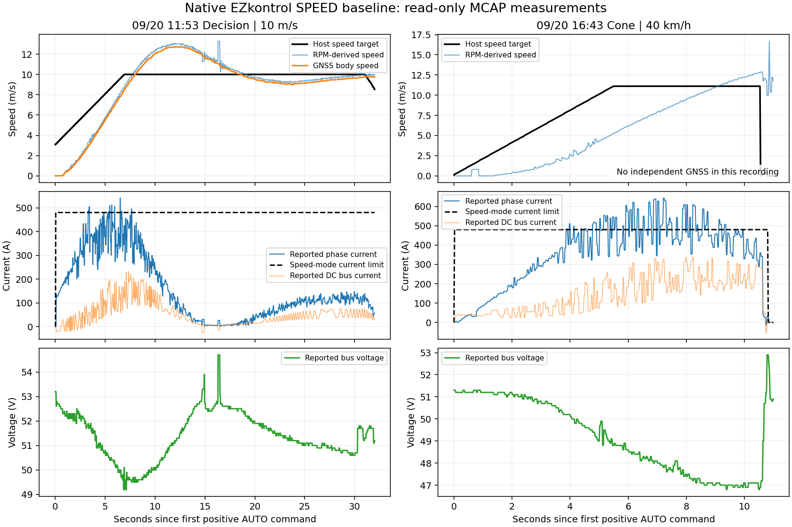

# 9/20 MCAP 종방향 추가 분석 — 2026-09-21

**9/20에서도 native Speed Control의 빠른 가속과 overshoot/hunting을 확인했다.**
9/19에 근거한 driving Kp=180, Ki=12, max=480 A, slew=2400/4800 A/s를
바로 바꿀 근거는 부족하다. 이 값들은 계속 first-test candidate다.
반면 **fresh/valid로 표시된 32,000 RPM 값**은 새 STM_A Torque PI가 그대로 받아들일 수 있는
구체적인 입력 문제다. Torque 실차 시험 전 이 경로를 점검해야 한다.

이번에는 MCAP 읽기·소스 확인·보고서/그림 작성만 수행했다.
펌웨어·calibration·차량 명령·운용 프로세스를 변경하지 않았다.

## 1. 전체 조사 범위

`~/KAI_ws/records/260920`의 **44 MCAP 전체**를 조사했다.
38개에서 `/drive/status`와 `/vehicle/command` 메시지를 함께 읽었다.
나머지 6개도 직접 읽어 누락 내용을 확인했다. 파일 손상이라고 단정하지 않는다.

- 43개에 `/drive/status` 메시지가 존재하며 합계 **307,796개**였다. 1개는 관련 메시지가 없다.
- command와 함께 읽은 38개 중 AUTO·Part I/II valid 표본이 있는 것은 32개.
- AUTO, driver SPEED(1), Part I/II valid, stop_request=false,
  command brake=false, brake_commanded=false, target>0.1 m/s를 만족하는 것은 **30개**.
- 이 중 **Decision 19개는 GNSS 독립 속도도 기록**, **cone 11개는 GNSS가 없다**.
- GNSS가 있는 조건 충족 구간은 약 **1,325.9 s**다. 단절을 제외한 관측 시간의 합이다.

Cone recorder는 `/gnss/fix_velocity`를 기록하지 않았다. `/vehicle/state.speed_mps`도
현재 fusion 코드에서 drive speed를 복사하므로 독립 속도계가 아니다. 이 때문에 cone의
RPM 가속도를 GNSS 기반 차량 가속도나 PI plant 추정값과 합치지 않았다.

관측 기준은 [기존 분석](2026-09-21_longitudinal_torque_pi.md)과 동일하다.
수신 시각으로 직전 250 ms 이내 command/GNSS/brake를 결합하고,
가속도는 GNSS 10 Hz 재표본화 후 0.5 s 차분이다. 그 창 전체가 valid여야 한다.
직선/current→acceleration 추정은 |command steering|<3°, |RPM speed−GNSS|<0.5 m/s,
실제 phase>20 A, acceleration>0.2 m/s²인 연속 창을 사용한다.
조향 명령 각도로 직선을 선별한 것이며 실제 타이어각/노면 경사가 일정함을 보장하지 않는다.

Part I/II valid는 주로 freshness 표시다. **값의 물리적 정확성까지 보증하지 않는다.**

## 2. 가속 성능과 overshoot

첫 positive AUTO command를 각 run의 t=0으로 둔다. 초기 command가 이미 약 3 m/s인
경우가 있어 순수한 동일 0→target step으로 취급하지 않는다. peak는 아래 지정 창의 값이다.
9/20 Decision 명령은 확인 가능한 parameter event에서 accel=1, decel=2 m/s²,
signal-release accel=2 m/s²였다. 모든 run에서 parameter event를 확보한 것은 아니다.

| Run 시작 / 목표 | 창 s | GNSS 10–90% s | 목표 첫 통과 s | 창 내 목표 초과 m/s | GNSS 가속도 peak m/s² |
|---|---|---:|---:|---:|---:|
| 9/19 16:02:06 / 6 m/s | 0–10.5 | 4.5 | 6.1 | +2.136 | 1.397 |
| **9/20 10:47:04 / 6 m/s** | **0–10.5** | **3.8** | **5.9** | **+2.092** | **1.522** |
| 9/20 11:00:44 / 7 m/s | 0–12 | 4.2 | 6.4 | +2.307 | 1.675 |
| 9/20 11:03:20 / 8 m/s | 0–10.5 | 4.5 | 6.9 | +2.507 | 1.734 |
| 9/20 14:52:06 / 9 m/s | 0–10 | 5.6 | 8.2 | +1.441 | 1.578 |
| **9/20 11:53:06 / 10 m/s** | **0–31** | **5.4** | **8.1** | **+2.740** | **1.731** |
| 9/20 14:54:14 / 10 m/s | 0–11 | 6.0 | 8.8 | +1.767 | 1.591 |

9/20 14:52/14:54는 첫 감속 전 창까지만 비교해 후속 peak가 포함되지 않을 수 있다.
각 창에서 ±0.2 m/s를 남은 시간 동안 2 s 이상 유지하는 settling은 확인되지 않았다.
9/20 6 m/s의 첫 가속이 9/19보다 빨랐다고 해서 날짜 자체나 특정 steering controller가
원인이라고 판정하지 않는다. 출발 조건, SOC, 경로와 실제 target 파형이 다르다.

### 목표를 바꾸지 않아도 생긴 hunting

`20260920_115306_249080_decision_case_04_pp_stanley_v10`에서 목표 **10 m/s**를 유지한 채:

| KST | 목표 | GNSS | 실제 phase | Speed current limit | 관측 |
|---|---:|---:|---:|---:|---|
| **11:54:04.652** | 10.0 | **12.740 m/s** | 77.9 A | 480 A | +27.4% overshoot |
| **11:54:16.253** | 10.0 | **8.989 m/s** | 94.1 A | 480 A | 약 −1.011 m/s undershoot |

이 사이 brake는 해제 상태였고 명령 목표도 10 m/s였다.
전체 파형은 실제 current가 큰 값에서 거의 0으로 내려가 coast하고, 속도가 목표 아래로
내려간 뒤 current가 재증가하는 모습이다. **목표 변경/ramp만으로 설명할 수 없는
native speed-loop/current/구동계 과도응답**이 있다. EZ 내부 P/I 상태는 기록되지 않아
특정 Ki 값이 원인이라고 확정할 수는 없다.

그림은 전체 신호 흐름을 보여주며, 오른쪽 마지막 target=0은 종료 명령이다.
통계는 별도의 AUTO/brake-off/fresh 조건으로 선별했다. 오른쪽 속도는 RPM 환산값이다.

## 3. 목표 하향과 재인가

| Run / 창 | 하향 목표 | 목표 첫 통과(창 시작 이후) | undershoot | actual current 재인가 관측 |
|---|---:|---:|---:|---:|
| 10:47:04 / t=11.5–17.5 s | 4.8 m/s | 2.4 s | 0.317 m/s | 2회 |
| 11:00:44 / t=12–18 s | 5.6 m/s | 3.1 s | **1.346 m/s** | 2회 |
| 14:52:06 / t=10–19 s | 7.2 m/s | 6.6 s | 0.267 m/s | 2회 |
| 11:53:06 / t=31–36 s | 8.0 m/s | 3.8 s | 0.210 m/s | 1회 |

재인가 횟수는 actual |phase|<5 A를 관측한 뒤 actual phase>20 A로 돌아온 횟수다.
이는 저전류/구동 전환을 비교하기 위한 정의이지 chain shock 측정값이 아니다.
감속 창 안에 작은 target 변화가 포함된 run도 있어 단일 이상적 step의 응답으로 해석하지 않는다.
저속 target에서 전류가 다시 올라가는 패턴은 확인되지만 독립적인 소리/충격 센서가 없어
chain 충격 크기나 감소량을 수치로 산정할 수 없다.

재가속도 확인했다. 아래는 낮은 목표에서 원래 cruise 목표로 복귀하는 창이며
출발속도가 달라 정지 출발과 직접 비교하지 않는다.

| Run / 창 | 복귀 목표 | 10–90% s | 목표 첫 통과 s | actual phase median / p95 A |
|---|---:|---:|---:|---:|
| 10:47:04 / t=26–38 s | 6 m/s | 2.7 | 7.3 | 98 / 132 |
| 11:00:44 / t=26–36 s | 7 m/s | 4.5 | 5.6 | 112 / 147 |
| 14:52:06 / t=19–27 s | 9 m/s | 4.4 | 7.4 | 146 / 184 |

## 4. 643.5 A는 단일 오래된 표본인가

**그렇게 볼 수 없다.** 16:43:37 cone run에서 AUTO/SPEED/brake-off/fresh 조건의
actual phase>600 A는 9개 짧은 구간으로 반복됐다.
수신 간격으로 계산한 관측 합계는 약 **0.636 s**, >480 A는 약 **2.752 s**다.
600 A를 넘는 서로 다른 Part I 값 묶음(current/voltage/RPM)은 12개였다.
동일 CAN 표본이 여러 ROS 메시지에 반복되므로 ROS 메시지 수를 독립 측정 횟수로 세지 않았다.
관측 시간은 다음 status까지의 hold를 합한 근사값이며 실제 analog waveform 폭은 아니다.

최대값 시각 **2026-09-20 16:43:54.976 KST**:

| 값 | 기록 |
|---|---:|
| driver feedback mode | SPEED(1) |
| commanded_phase_current_a | 480.0 A (한도) |
| phase_current_a | **643.5 A** |
| bus_current_a | **327.5 A** |
| bus_voltage_v | **47.8 V** |
| motor_rpm | 1549 RPM |
| RPM 환산 속도 / 목표 | 8.287 / 11.111 m/s |
| Part I age | 0 ms |
| command/actual brake | false / false |

643.5 A는 두 ROS 메시지에 약 22 ms 간격으로 보이고 다음 report는 628.1 A다.
이 일대의 >600 A 연속 관측은 첫~마지막 timestamp 약 87 ms, 다음 sample까지 약 107 ms다.
이 run의 clean bus voltage 범위는 46.8–51.3 V, actual phase p95는 605.7 A다.
단순한 한 점 peak보다 반복 전류 변동과 전압 하강을 함께 봐야 한다.

다른 cone run에서도 >600 A가 있었다. 특히 **15:51:43.330**에 phase **644.7 A**,
bus 314.3 A, bus voltage 48.5 V, limit command 480 A가 기록됐다.
전체 clean cone 11개 중 >600 A 보고가 있는 것은 7개다.

다만 이는 **EZkontrol이 보고한 전류**다. 독립 전류 probe, raw CAN bytes, EZ 내부 current-loop
설정/readback이 없어 실제 limit tracking overshoot, target/measurement 정의 차이,
계측·송신 문제를 분리할 수 없다. **643 A가 나왔다는 이유로 새 Torque max current를
643 A로 올리면 안 된다.** 480 A command capability는 유지하되 Torque 명령→실제 current
tracking을 airborne/ground에서 별도로 확인해야 한다.

## 5. 새 Torque PI에 직접 영향을 주는 RPM 이상

두 run에서 다음 값이 있었다. 모두 AUTO, driver SPEED, Part I/II valid, brake off이며
GNSS는 약 5 m/s로 연속적이었다.

| Run / KST | RPM 보고 | RPM 환산 차속 | GNSS | Part I age |
|---|---:|---:|---:|---:|
| 10:38:07 run / **10:43:38.182** | **32000** | **171.194 m/s** | **4.886 m/s** | 32 ms |
| 10:51:57 run / **10:59:08.454** | **32000** | **171.194 m/s** | **4.799 m/s** | 34 ms |

각 사건은 두 ROS 메시지에 나타나며 약 50 ms 뒤 정상적인 수백~천 RPM대로 복귀한다.
전체 19개 GNSS clean run 중 두 run에서 확인됐다는 뜻이며 미래 발생 확률 추정은 아니다.
몇몇 다른 run에도 RPM–GNSS 차이가 수 m/s에 이르는 짧은 변동이 있다.

32,000 RPM의 의미가 controller sentinel인지 측정 오류인지는 확인하지 못했다.
현재 decoder는 raw uint16−32000으로 복호하고, zero-dropout만 제한적으로 hold한다.
이번 기록만으로 전체 phase/bus current도 같은 이유로 틀렸다고 확대 해석하지 않는다.

**현재 추가한 Torque PI는 freshness만 검사하므로 이 값도 입력으로 받는다.**
코드상 이 값이 오면 큰 overspeed로 판단해 coast/I reset으로 들어가고,
정상 RPM이 돌아온 뒤 hysteresis 조건에 따라 current를 재인가할 수 있다.
이는 새 Torque를 실제 주행한 관측이 아니라 **현재 코드와 기록을 결합한 동작 추론**이다.

관측 빈도는 낮지만, 차량의 잘못된 current 차단/재인가로 이어질 수 있어
**Torque 실차 적용 전에 처리할 필요가 있다.** 다음 순서는:

1. 원본 CAN/드라이버 상태와 독립 회전 측정으로 32000 보고의 의미를 확인한다.
2. 실제 motor/EZ feedback 계약에 근거한 physical-range/비정상 feedback 처리 경계를 정한다.
   단순히 이번 숫자 하나만 blacklist하거나 새 임의 smoothing gain으로 덮지 않는다.
3. invalid feedback으로 다룰 때의 current=0·history reset·fresh recovery를 기존 inhibit와 통합한다.
   이 보고서에서는 해당 코드나 안전 정책을 바꾸지 않았다.

## 6. 9/19 PI candidate에 대한 결론

GNSS가 있는 19개 run의 조건 선별 window에서 얻은 exploratory fit:

`acceleration ≈ b × actual_phase_current + offset`

- b 중앙값 **0.00429 (m/s²)/A**.
- run별 b의 p10–p90 약 **0.00394–0.00483**, 전체 범위 **0.00372–0.00563**.
- 기존 9/19 첫 가속의 약 **0.0042–0.0046**와 크게 모순되지 않는다.
- 중첩된 0.5 s 창을 쓰므로 independent repeated experiments나 정확한 plant identification이 아니다.
  실제 speed, load, SOC, 경사, drivetrain과 EZ 내부 응답이 섞여 있다.

따라서 **Kp180/Ki12/max480/slew2400·4800을 candidate로 유지**하는 판단이다.
이 분석만으로 더 낮추거나 높이지 않았다. Ki, anti-windup/zero-region, slew의 최종값은
새 Torque 실측 없이는 확정할 수 없다. 9/20의 더 빠른 baseline(예: 6 m/s rise 3.8 s)도
A/B 성능 비교 대상에 포함해야 하며 9/19보다만 빠르면 완료라고 판단하지 않는다.

지금 우선순위는 gain 재조정보다 **RPM 입력 이상 처리와 Torque current tracking 확인**이다.
또한 cone에도 GNSS/독립 velocity를 함께 기록해야 새 제어기의 실제 가속 보존 여부를 비교할 수 있다.

## 부록: 44개 bag 목록

각 run 이름은 `records/260920/<run>/rosbag/rosbag_0.mcap` 기준이다. Cone은 중간에 `cone_trials/`가 있고, 마지막 standalone bag은 해당 디렉터리의 동일 이름 MCAP이다. 전류 peak는 **clean 조건**이며 `—`는 0 A라는 뜻이 아니라 비교 대상 구간 없음이다.

| Run | clean s | 독립 GNSS | clean phase peak A / 제외 사유 |
|---|---:|---|---|
| `20260920_102134_932170_decision_case_01_pure_pursuit_v4` | 0.0 | 있음 | 조건 충족 주행 없음 |
| `20260920_102428_450013_decision_case_01_stanley_v4` | 0.0 | 있음 | 조건 충족 주행 없음 |
| `20260920_102616_316245_decision_case_01_stanley_v4` | 127.0 | 있음 | 378.3 |
| `20260920_103206_374038_decision_case_01_stanley_v4` | 0.0 | 있음 | 조건 충족 주행 없음 |
| `20260920_103807_752825_decision_case_01_stanley_v6` | 44.2 | 있음 | 456.2 |
| `20260920_104640_576312_decision_case_01_pure_pursuit_v3p2` | 0.0 | 있음 | 조건 충족 주행 없음 |
| `20260920_104704_184663_decision_case_01_pp_stanley_v6` | 83.3 | 있음 | 477.9 |
| `20260920_105157_832177_decision_case_01_ff_stanley_v6` | 18.4 | 있음 | 451.1 |
| `20260920_110044_045348_decision_case_01_pp_stanley_v7` | 74.5 | 있음 | 500.6 |
| `20260920_110320_747788_decision_case_01_pp_stanley_v8` | 12.9 | 있음 | 499.8 |
| `20260920_110621_531079_decision_case_01_pp_stanley_v8` | 65.9 | 있음 | 539.5 |
| `20260920_111211_946066_decision_case_04_pp_stanley_v5` | 14.7 | 있음 | 429.8 |
| `20260920_112058_540994_decision_case_01_pp_stanley_v5` | 99.2 | 있음 | 398.1 |
| `20260920_112710_129230_decision_case_04_pp_stanley_v5` | 134.7 | 있음 | 444.6 |
| `20260920_113419_616881_decision_case_04_pp_stanley_v7` | 94.8 | 있음 | 532.5 |
| `20260920_114516_534954_decision_case_04_pp_stanley_v8` | 70.4 | 있음 | 497.8 |
| `20260920_114942_585576_decision_case_04_pp_stanley_v9` | 74.4 | 있음 | 531.0 |
| `20260920_115306_249080_decision_case_04_pp_stanley_v10` | 68.2 | 있음 | 541.0 |
| `20260920_141446_381120_decision_case_01_pp_stanley_v8` | 48.2 | 있음 | 487.4 |
| `20260920_144943_450763_decision_case_01_pp_stanley_v8` | 65.2 | 있음 | 505.1 |
| `20260920_145206_894265_decision_case_01_pp_stanley_v9` | 57.9 | 있음 | 481.8 |
| `20260920_145414_015234_decision_case_01_pp_stanley_v10` | 28.7 | 있음 | 520.3 |
| `20260920_160518_237071_decision_case_04_pure_pursuit_v4p5` | 0.0 | 있음 | 조건 충족 주행 없음 |
| `20260920_160532_847694_decision_case_01_pp_stanley_v4p5` | 0.0 | 있음 | 조건 충족 주행 없음 |
| `20260920_160546_435956_decision_case_04_pp_stanley_v4p5` | 143.3 | 있음 | 343.7 |
| `20260920_151919_057857_cone_scenario_01_v5mps` | 0.0 | 없음 | drive 61 / command 0 |
| `20260920_152015_994304_cone_scenario_01_v5mps` | 0.0 | 없음 | drive 71 / command 0 |
| `20260920_152835_409727_cone_scenario_05_v15` | 13.5 | 없음 | 359.6 |
| `20260920_153057_163049_cone_scenario_06_v30` | 0.0 | 없음 | 조건 충족 주행 없음 |
| `20260920_154138_981234_cone_scenario_02_v40` | 0.0 | 없음 | 조건 충족 주행 없음 |
| `20260920_154203_984779_cone_scenario_05_v40` | 9.9 | 없음 | 643.7 |
| `20260920_154526_141057_cone_scenario_05_v40` | 10.9 | 없음 | 639.4 |
| `20260920_154704_648533_cone_scenario_06_v10` | 23.8 | 없음 | 216.1 |
| `20260920_154959_092384_cone_scenario_06_v40` | 10.5 | 없음 | 617.6 |
| `20260920_155116_544693_cone_scenario_05_v40` | 10.5 | 없음 | 644.7 |
| `20260920_155339_608386_cone_scenario_05_v40` | 10.6 | 없음 | 631.5 |
| `20260920_162440_567075_cone_scenario_05_v40` | 0.0 | 없음 | 관련 메시지 0 |
| `20260920_162601_240272_cone_scenario_05_v40` | 0.0 | 없음 | drive 4 / command 0 |
| `20260920_162650_400493_cone_scenario_05_v40` | 0.0 | 없음 | drive 10 / command 0 |
| `20260920_163441_459895_cone_scenario_05_v40` | 11.1 | 없음 | 588.0 |
| `20260920_163811_462809_cone_scenario_05_v40` | 12.9 | 없음 | 499.7 |
| `20260920_164232_348049_cone_scenario_05_v40` | 10.5 | 없음 | 627.5 |
| `20260920_164337_904099_cone_scenario_05_v40` | 10.7 | 없음 | 643.5 |
| `rosbag2_2026_09_20-14_07_38` | 0.0 | 있음 | drive 8227 / command 0 |
