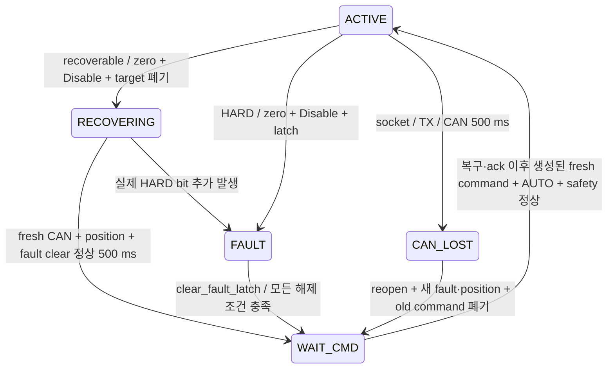

# Competition steering availability (2026-09-21)

기준: `origin/main e0cc6b9`에서 시작한 소스 변경. 실차·CAN·MCU 조작 없이
호스트 테스트와 펌웨어 빌드로 검증한다. 종방향 PI, speed→torque, regen/EBS,
Governor shaping은 포함하지 않는다.

## KEYA decode와 policy

근거: [제조사 V1.1](../hardware/KEYA_KY170DJD01005-08G-V1_User_Manual_V1.1.pdf)
§5.1–5.2, PDF 19–20쪽. `keyaFaultDefinitions`는 이름/reset 설명,
`keyaFaultClass`/`KeyaRecoveryPolicy`는 Host 정책이다. 원본 16비트는
`SteeringActuatorStatus.fault_bits`와 진단에 그대로 보존한다.

| Bit / mask | 이름 | 정책 | 매뉴얼 reset / Host 복구 |
|---|---|---|---|
| 0 / 0001 | Disable | INFO | 고장 아님 |
| 1 / 0002 | Over voltage | RECOVERABLE | self-reset; 전압 정상·fault clear 대기 |
| 2 / 0004 | Hardware overcurrent | HARD | power-cycle; Host 자동 Enable 금지 |
| 3 / 0008 | EEPROM error | HARD | power-cycle; Host 자동 Enable 금지 |
| 4 / 0010 | Under voltage | RECOVERABLE | Disable reset; clear 확인 |
| 5 / 0020 | Reserved | INFO | 원본 보존 |
| 6 / 0040 | Software overcurrent | RECOVERABLE | Disable reset; clear 확인 |
| 7 / 0080 | Control mode error | HARD | power-cycle; 설정 점검 |
| 8 / 0100 | Phase failure | HARD | power-cycle; 배선/모터 점검 |
| 9 / 0200 | Stall | RECOVERABLE | Disable reset; clear 확인 |
| 10 / 0400 | Temperature | RECOVERABLE | self-reset; 매뉴얼 85°C 정지/75°C 해제 |
| 11 / 0800 | Hall failure | HARD | 매뉴얼은 Disable reset이나 센서 고장이므로 Host 자동복구 금지 |
| 12 / 1000 | Current sensor failure | HARD | power-cycle; 센서/드라이버 점검 |
| 13 / 2000 | Spare | INFO | 원본 보존 |
| 14 / 4000 | CAN disconnected | RECOVERABLE | Enable reset; 아래 제한된 zero/hold probe |
| 15 / 8000 | RS232 disconnected | INFO | `Control Ways=CAN (0019=2)` 운용에서 무관 |

복수 bit는 모두 표시하고 HARD가 있으면 항상 자동복구 금지다. bit0은 실제
Enable 확인 신호로 사용하지 않는다. `enabled_feedback_valid=false` 계약은 유지한다.
KEYA mode `0020`과 CAN 선택은 기존처럼 장치 사전 설정 조건이며 Host가 확인하거나
변경하지 않는다. §5.1의 과전류 Enable 설명과 §5.2 Disable 표기는 불일치한다.
Host는 §5.2의 Disable을 사용하고 bit6이 지워지지 않으면 무작정 Enable하지 않는다.
장치 firmware별 reset 확인이 필요한 이유다.

## 최종 fault 정책과 복구 전이

```text
INFO → observation only
RECOVERABLE → rate-limited automatic recovery indefinitely → no permanent Host latch
HARD → Host HARD FAULT latch → explicit operator acknowledgment after actual fault clear
```



- wire enum과 메시지 필드는 변경하지 않는다. `WAIT_CMD(2) + MOTOR_FAULT(10)`는
  recovery hold이며 `steering/safety`는 `RECOVERING`으로 설명한다.
- RECOVERABLE의 반복 횟수, retry 실패, 지속시간은 영구 latch 원인이 아니다.
  실제 조건이 남아 있으면 Disable을 유지한다. 전압/온도/소프트웨어 과전류/stall은
  장치의 self/Disable reset으로 fault가 사라지는 것을 기다린다.
- episode 최초 zero/Disable을 attempt 1로 센다. 추가 Enable probe마다 증가한다.
  `recovery_attempts`는 현재/마지막 episode의 통계이며 새 episode에서 1부터 시작한다.
  `recovery_total_attempts`는 프로세스 lifetime 누적이다. 성공 시각은 ROS time의
  `last_recovery_time_sec`에 기록한다(0은 성공 기록 없음). 상한/남은 기회가 아니다.
- bit14 **단독 recoverable**일 때만 reset probe를 보낸다. 기본 간격은 1→2→4→5초이며
  이후 5초로 유지한다. 설정된 초기 간격이 5초보다 크면 그 간격을 cap으로 사용한다.
  MANUAL/무명령 대기, 장기 단절 및 수천 번의 반복도 HARD로 승격하지 않는다.
- probe에는 AUTO, fresh drive speed/mode/command, fresh CAN·position·fault,
  E-stop/brake 해제, output armed가 필요하다. torque0(또는 현재 position)→Enable이며
  목표 조향 명령을 보내지 않는다. clear, 다른 fault, 명령 만료/안전조건 상실 또는
  500 ms 후 zero/Disable한다. HARD가 동반되면 즉시 latch하고 probe를 금지한다.
- probe 중 `enabled_commanded=true`, state는 WAIT_CMD, `enable_reset_probe=true`다.
- fault clear와 신선한 CAN·position·fault evidence가 500 ms 유지되면 pending target을
  다시 폐기하고 stamp barrier를 갱신한다. 복구 중 받은 command 또는 복구 완료 전에
  생성된 command는 ACTIVE에 사용하지 않는다.
- SocketCAN은 기존 100 ms~5 s backoff reopen을 유지한다. 새 fault·position 확인 후
  pending 폐기와 새 command가 필요하다. 정상 링크에 추가 대기시간을 넣지 않는다.
- 실제 TX 실패와 zero/Disable 재시도를 유지한다. stop TX 성공 전에는 재Enable하지 않는다.
  버스가 끊긴 동안 장치가 stop frame을 받았다고 보장할 수는 없다.

startup 설정은 `keya_recovery_clear_hold_ms=500`, `keya_recovery_retry_ms=1000`이다.
기존 `keya_recovery_max_attempts`, `keya_recovery_persistence_ms`,
`keya_recovery_healthy_reset_ms`는 제거했다. 기존 command/CAN/position/mode timeout은 유지한다.

## HARD latch acknowledgment

`/steering/clear_fault_latch`는 `std_srvs/srv/Trigger` 서비스다. **실제 KEYA fault를
강제로 reset하는 서비스가 아니라 Host의 HARD latch를 운영자가 확인·해제하는 기능**이다.
자동 호출하지 않는다. 다음 조건을 lateral node가 호출 시점에 모두 다시 검사한다.

| 조건 | 근거/기준 |
|---|---|
| 물리/test E-stop inactive | 최신 `/brake/status` 수신이 필요하며 age ≤ drive status timeout(기본 500 ms) |
| Host command brake inactive | stamped brake ordering으로 수용한 상태 |
| MANUAL + fresh drive/mode | `/drive/status` age ≤ 기존 500 ms |
| 정지 | part1_valid, finite speed, abs(speed) ≤ 0.05 m/s; control_tuning의 0.18 km/h 기준과 동일 |
| CAN fresh | open, communication_ok, CAN age ≤ 기존 500 ms |
| position fresh/valid | torque min(500,100) ms / position 500 ms; 환산각 finite |
| fault fresh + active HARD bits 0 | fault_valid, fault age ≤ 기존 500 ms; raw word 보존 |
| reconnect 미진행 | 새 링크의 evidence 확인이 완료되어야 함 |
| movement/probe 미실행 | ACTIVE, enabled_commanded, movement_target_valid, reset probe 모두 false |
| stop TX 완료 + HARD latch 존재 | 미완료 stop 또는 이미 해제된 latch 요청은 거부 |

실패하면 `rejected: active HARD fault hall_failure (0x0800)` 등 구체적 원인을 반환한다.
진단의 `hard_fault_clearable`과 서비스는 같은 조건 함수를 사용한다. 서비스는 CAN 수신
큐의 최신 evidence도 반영하므로 UI에서 YES였어도 실제 요청은 거절될 수 있다.

성공 시 zero/Disable TX를 다시 확인하고 HARD/recovery 내부 상태, old/pending target,
torque controller 이력을 지운다. target=current position, WAIT_CMD까지만 이동한다.
Enable/non-zero torque를 보내지 않는다. lifetime 통계와 마지막 복구 이유/시각은 보존한다.
MANUAL이 유지되면 다음 정상 tick의 표시가 MANUAL로 바뀔 수 있다. 이후 AUTO와 ack 이후
생성된 fresh command 및 모든 safety 조건이 있어야 정상 ACTIVE 절차를 따른다.
RECOVERABLE bit가 남아 있으면 다음 tick에서 RECOVERING으로 대기한다.

## 유지/개선한 안전과 brake release

물리 E-stop, STM_A AUTO host 500 ms, STM_B safety UART 100 ms, EZ handshake,
nonfinite/corrupt data 차단, 실제 CAN TX 실패 차단, target clamp/바깥방향 torque 차단,
peak/sustained 제한은 유지한다. timeout 수치는 변경하지 않는다.
HARD는 실제 fault가 사라져도 operator acknowledgment까지 latch한다. INFO 오인 차단을 없애고
recoverable/CAN 재연결에 명시적인 복구 경로를 추가한다.

`brake=true`는 그대로 STM_A HALT/속도0, STM_B engage, steering Disable/BRAKE다.
false의 새 속도/조향 목표를 사용하고 MCU·노드 재시작은 필요 없다. STM_B safety
frame이 다시 release를 전달한 뒤 STM_A traction이 재허용된다. 서보는 기존 ramp를
따르며 실측 위치 피드백은 없다.

두 MCU의 `CommandBrakeOrder_Accept`와 Host는 stamped brake보다 오래되거나 같은
시각의 release를 거부한다. 브레이크 명령은 항상 수용한다. MCU는 Host와 clock sync가
없으므로 이것은 **명령 순서 검증**이며 end-to-end age 검증은 아니다. STM_A의 수신 후
500 ms watchdog과 Governor의 입력 200 ms 검사를 유지한다. Host stamp의 역행 시
이전 brake 시각을 넘어서는 새 명령이 필요하며 epoch를 되돌리는 운용은 피해야 한다.

## Timeout audit

| 경로 | 유지값 | 실제 동작 / 판단 |
|---|---:|---|
| steering command | 200 ms | ACTIVE→WAIT_CMD, 목표 폐기; MANUAL 무명령은 정상 |
| torque feedback/control stall | 100 ms | FEEDBACK_LOST, healthy feedback+새 command로 복귀 |
| KEYA CAN | 500 ms | CAN_LOST, reopen backoff; 새 feedback 이후 새 command |
| drive status | 500 ms | speed gate 해제, WAIT_CMD, 목표 폐기 |
| mode | 1500 ms | DISABLED/MODE_TIMEOUT; drive gate가 먼저 차단할 수 있음 |
| governor input | 200 ms | invalid/stale input 거부; shaping 없음 |
| STM_A AUTO host | 500 ms | traction HALT, COMMAND_SPEED=0 |
| STM_B→STM_A safety UART | 100 ms | DRIVE_STOP_REQUEST, HALT; CRC-valid 새 frame으로 복구 |

[9/19 분석](2026-09-19_control_tuning_regen_fault_review.md)은 저전압 후 통신 단절의
근거이며 이 timeout들의 false-trip 근거가 아니다. 따라서 숫자를 늘리지 않았다.
Host timeout과 새 recovery parameters는 startup 설정으로 가능하지만 `control_tuning`
UI 노출은 아직 없다. 향후 수신 지터/최악 제어주기 MCAP 근거와 범위를 정한 뒤
노출해야 한다. MCU timeout은 기존 compile-time 값으로 유지한다.

## Console / MCAP

Vehicle Console → Steering → **Host safety policy** 또는 Diagnostics → `steering/safety`:
state(MANUAL/WAITING FOR COMMAND/RECOVERING/HARD FAULT), raw hex, 활성 bit별 이름/등급,
recovery reason/attempts/total/성공 시각/latch 원인, reset probe, CAN reconnect 상태/횟수,
command/CAN/position/fault age, 마지막 Disable 원인을 확인한다.
stale 진단은 STALE/마지막 보고로 표시한다. UI는 정책을 결정하지 않는다.
`hard_fault_latched`, `hard_fault_clearable`, `hard_fault_clear_reason`과
**CLEAR HARD FAULT LATCH** 버튼으로 해제 요청 결과를 확인한다. 버튼은 live/clearable일
때만 활성화되지만 최종 판단은 서비스다. 응답 성공만으로 UI의 상태를 바꾸지 않는다.

Vehicle backend는 고정된 `POST /api/steering/clear-fault-latch`만 ROS 서비스로 연결한다.
기존 Host allowlist 및 same-origin 검사를 적용하고, 동시 중복 요청은 거부한다.
3초 응답 timeout에는 결과 불명으로 표시하며 자동 재요청하지 않는다. 주행 명령·parameter
변경은 제공하지 않고 WebSocket은 계속 관측 전용이다. trusted local/tailnet 운영 경계는
기존과 같으며 별도 사용자 로그인 시스템을 추가하지 않는다.

공용 ObserverNode는 `(hardware_id, name)`별 DiagnosticStatus를 병합하고 각 수신 시각으로
freshness를 계산한다. 다른 publisher의 array로 기존 항목을 지우거나 freshness를
연장하지 않는다. Vehicle은 기존 3초, HIL은 기존 기본 1초의 진단 freshness를 유지한다.

`steering_actuator_node`가 기존 `/diagnostics`에 control tick 5회마다 발행한다
(기본 100 ms). 기존 logger는 이 토픽을 기록하므로 MCAP allowlist 변경은 없다.
`/steering/status` 원본은 유지하고 `/steering/torque_safety`는 Host PD 원인으로 구별한다.
Dashboard는 Host state를 사용하고 INFO raw bit만으로 MOTOR_FAULT를 만들지 않는다.
SYSID는 HARD/RECOVERING에서 시험을 중단하며 자동으로 시험을 재개하지 않는다.

## 실차 확인과 다음 작업 blocker

- 장치 설정/firmware에 따른 Disable reset(bit4/6/9), bit14 zero/Enable reset,
  mixed faults, 전압/온도 회복 확인. 고장 유발은 안전한 bench 절차로 별도 수행한다.
- can0 지연 부팅/interface down-up/USB 분리, 실제 zero/Disable 수신과 재연결 지연.
- brake true→false에서 STM_A RUN, STM_B 서보·UART, steering의 동시 회복 및
  지연된 pre-brake command 거부. 빌드·호스트 테스트가 실제 기구 release를 증명하지 않는다.
- E-stop 회귀, 실차 지터/CPU 부하에서 기존 timeout 유지가 적절한지 MCAP 관찰.
- **Decision 연동**: 현재 별도 저장소 `test_readiness.py`는 조향 state=FAULT/
  MOTOR_FAULT recovery를 직접 검사하지 않는다. 조향이 차단되어도 position이 valid이면
  상위 속도 목표가 계속될 가능성이 있다. 이 Control 변경은 traction 정책을 임의로
  추가하지 않는다. 종방향 Torque 실차 운용 전에 상위 정지/재개 계약을 정해야 한다.
- 기존 미해결 항목: `/brake/status` stale E-stop, EZ Part I/II 손실 시 traction 정책,
  STM_B Host timeout, 9/19 KEYA 저전압 전원 원인. Torque PI 코드 작성과 별개로
  실차 전환 전에 해결/운용 결정을 내려야 한다.

## 초기 구현의 검증 기록 (ddcce1d 기준)

- `lateral_ctrl`: CMake Debug build, CTest 6 suites / GTest 95 cases 통과.
  실제 SocketCAN 대신 기존 RecordingKeyaDriver로 fault·reconnect·brake·E-stop 경로 실행.
- Python: vehicle_state_publisher, Vehicle Console, SYSID/advice 관련 87 tests 통과.
  새 복수 fault/RECOVERING 패널 assertion을 포함한 기존 Chrome browser test도 별도 통과.
- Vehicle Console: TypeScript/Vite production build, Node tests 4개 통과.
- STM_A/STM_B: 기존 Release target ARM 빌드·링크 성공. 플래시하지 않았다.
  `_gettimeofday` 미구현 linker warning과 Python 라이브러리 deprecation warning은 남는다.
- ROS 테스트는 localhost domain 223/224에서만 실행했다. 실차 CAN, 기존 차량 프로세스,
  실제 차량 command publisher에 접근하지 않았다. 종료 뒤 해당 domain 프로세스 없음 확인.
- `git diff --check` 통과. 실차 reset/재연결/서보 해제와 MCU task timing은 미검증이다.

## 초기 구현의 변경 파일 목록 (ddcce1d 기준)

저장소 루트 기준 30개 파일. 새 파일은 정책, 공통 brake ordering, 이 문서다.

```text
docs/reports/2026-09-19_control_tuning_regen_fault_review.md
docs/SAFETY.md
docs/reports/2026-09-21_steering_availability.md
firmware/STM_A/Core/Src/app_freertos.c
firmware/STM_B/Core/Src/app_freertos.c
firmware/common/command_brake_order.h
software/src/lateral_ctrl/CMakeLists.txt
software/src/lateral_ctrl/config/steering_actuator.yaml
software/src/lateral_ctrl/include/lateral_ctrl/keya_can_driver.hpp
software/src/lateral_ctrl/include/lateral_ctrl/keya_fault_policy.hpp
software/src/lateral_ctrl/include/lateral_ctrl/steering_actuator_node.hpp
software/src/lateral_ctrl/include/lateral_ctrl/steering_types.hpp
software/src/lateral_ctrl/package.xml
software/src/lateral_ctrl/src/keya_can_driver.cpp
software/src/lateral_ctrl/src/steering_actuator_node.cpp
software/src/lateral_ctrl/test/test_keya_can_driver.cpp
software/src/lateral_ctrl/test/test_steering_actuator_node.cpp
software/src/lateral_ctrl/test/test_steering_safety_logic.cpp
software/src/vehicle_console/CONSOLE_PARITY.md
software/src/vehicle_console/test/test_vehicle.py
software/src/vehicle_console/web/package.json
software/src/vehicle_console/web/src/components/VehicleTelemetry.tsx
software/src/vehicle_console/web/src/domain/presentation.ts
software/src/vehicle_console/web/src/domain/vehicle.ts
software/src/vehicle_console/web/test/observations.test.cjs
software/src/vehicle_state_publisher/test/test_diagnostics_publisher.py
software/src/vehicle_state_publisher/vehicle_state_publisher/auto_dashboard_summary.py
software/src/vehicle_state_publisher/vehicle_state_publisher/diagnostics_publisher.py
software/src/vehicle_test_scenarios/vehicle_test_scenarios/steering_fault_advice.py
software/src/vehicle_test_scenarios/vehicle_test_scenarios/sysid_runtime.py
```

## 정책 마감 검증 (2026-09-21)

- lateral_ctrl Debug 빌드 및 CTest 6 suites / GTest 113 cases 통과.
  HARD clear의 조건별 거부, 실제 Trigger 호출, 성공 후 zero/Disable·WAIT_CMD·새 명령,
  1000회 이상 recoverable 반복/지속·retry backoff, brake ordering과 E-stop을 포함한다.
- Vehicle Console production frontend build + Node tests 4개 통과; Python 패키지 빌드 성공.
- Vehicle/vehicle_state_publisher/control_tuning/scenario 관련 Python 263개 통과.
  기본 실행에서 제외된 실제 launch 통합 테스트 1개도 CAN/output disabled, domain 219에서
  별도 실행해 통과했다. 추가 Console/HIL 회귀 121개도 통과했다(일부 재실행 포함).
- Chrome에서 HARD/RECOVERING, clearable/no, service 거부/성공, stale 시 버튼 차단,
  성공 응답만으로 관측 latch를 바꾸지 않는 동작을 확인했다.
- clear POST의 Host/Origin, 서비스 unavailable, 동시 요청, 응답 timeout/자동재시도 금지,
  diagnostics 항목별 병합·독립 freshness를 검증했다.
- 실차 CAN/액추에이터, MCU flash, Decision 변경은 수행하지 않았다. 격리 도메인의 테스트
  프로세스는 종료했다. 실차 reset 동작과 물리 feedback은 위 실차 확인 항목으로 남는다.

### 정책 마감 변경 파일

이전 reports/hardware 정리는 별도 커밋으로 분리한다. 아래는 이번 정책·Console 변경이다.

```text
docs/ARCHITECTURE.md
docs/SAFETY.md
docs/reports/2026-09-21_steering_availability.md
software/src/control_launch/README.md
software/src/lateral_ctrl/CMakeLists.txt
software/src/lateral_ctrl/TORQUE_CONTROL.md
software/src/lateral_ctrl/config/steering_actuator.yaml
software/src/lateral_ctrl/include/lateral_ctrl/keya_fault_policy.hpp
software/src/lateral_ctrl/include/lateral_ctrl/steering_actuator_node.hpp
software/src/lateral_ctrl/package.xml
software/src/lateral_ctrl/src/steering_actuator_node.cpp
software/src/lateral_ctrl/test/test_steering_actuator_node.cpp
software/src/lateral_ctrl/test/test_steering_safety_logic.cpp
software/src/vehicle_console/CONSOLE_PARITY.md
software/src/vehicle_console/README.md
software/src/vehicle_console/package.xml
software/src/vehicle_console/setup.py
software/src/vehicle_console/test/test_vehicle.py
software/src/vehicle_console/vehicle_console/common/profiles.py
software/src/vehicle_console/vehicle_console/common/telemetry.py
software/src/vehicle_console/vehicle_console/common/web.py
software/src/vehicle_console/vehicle_console/vehicle.py
software/src/vehicle_console/web/src/app/VehicleApp.tsx
software/src/vehicle_console/web/src/components/VehicleTelemetry.tsx
software/src/vehicle_test_scenarios/vehicle_test_scenarios/steering_fault_advice.py
```
