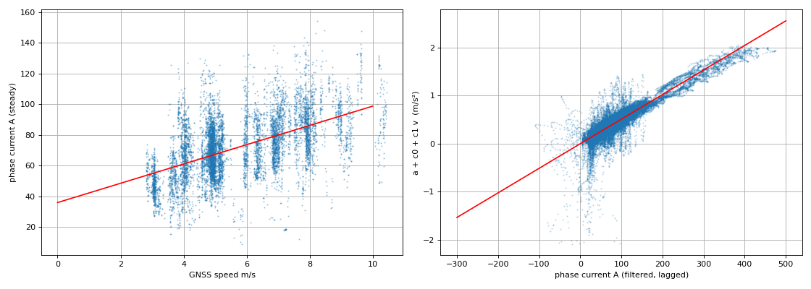

# AUTO Torque feedforward와 MANUAL 페달 envelope — 2026-09-29

[2026-09-21 AUTO Torque PI](2026-09-21_longitudinal_torque_pi.md)의 STM_A 20 Hz
positive-current PI를 기준으로 삼고, 그 위에 세 가지를 더한다.

1. 식별한 플랜트의 역함수를 쓰는 feedforward. PI는 모델 오차만 담당한다.
2. MANUAL 페달도 Torque calibration의 전류·회전수·전류 변화율 envelope를 쓴다.
3. 구동 속도 PI 게인을 **Kp 380 A/(m/s), Ki 190 A/(m/s·s)** 후보로 교체한다.

**세 항목 모두 first-test candidate다. 실차·HIL에서 실행하지 않았고 STM_A를 flash하지
않았다. 가속 성능, overshoot/undershoot, chain shock 변화는 아직 측정하지 않았다.**
기존 Speed 기록이나 이전 보고서의 수치를 새 제어기의 결과로 해석하지 않는다.
계산 주기, 안전 gate, freshness 200 ms, coast/reapply 정책, calibration 적용 gate,
revision compare-and-swap, preset schema v3는 2026-09-21 기준 그대로다.

## 1. Feedforward

### 1.1 플랜트

2026-09-20 오전 18개 기록(`~/ControlRecord/260920/`, 10:21~11:55, 모두 EZkontrol
speed control)의 AUTO·RUN·brake 없음·fault 없음·`|RPM 환산 차속 − GNSS| < 1 m/s`·
전류 반전 없음 구간 35,916 샘플(40 Hz 격자, 1 Hz LPF)에 `a = K·I − c0 − c1·v`를
최소제곱으로 맞춘 결과를 사용한다.

| 항목 | 값 | 비고 |
|---|---:|---|
| K 전류당 가속도 | 0.00512 m/s²/A | 1 m/s²에 약 195 A. 지연 0~0.4 s 중 0 s가 최적 |
| c0 구름·구동계 저항 | 0.228 m/s² | 정속 유지 전류 ≈ 45 + 5.6·v A |
| c1 속도 비례 저항 | 0.0288 /s | |
| R² / RMS 잔차 | 0.81 / 0.165 m/s² | Run별 K는 0.0052~0.0066 |



2026-09-21 보고서의 9/19 예선 기록 회귀는 `a ≈ (0.0042~0.0046)·I − (0.15~0.27)`이었다.
두 추정의 K 차이는 약 10~20 %다. 이는 서로 다른 날, 노면, SOC, 적재와 창 선택의 차이이며
어느 쪽도 rolling resistance·경사·전류 응답 지연을 분리한 시스템 동정이 아니다.
**따라서 feedforward 상수는 검증된 차량 물성이 아니라 재식별 대상 파라미터다.**

### 1.2 제어식

`error`, `P`, `I`, anti-windup, deadband, coast/hysteresis, reapply, slew는 그대로 두고
출력에 feedforward 항을 더한다. 단위는 상전류 A다.

```
I_ff   = clamp((a_target + c0 + c1·v_meas) / K, 0, max_drive_current)
a_target = clamp((target − target_prev) / dt, −ff_accel_limit, +ff_accel_limit)
출력   = clamp(I_ff + P + I, 0, max_drive_current)  → slew → CAN
```

- `a_target`은 상위 목표의 변화율에서 얻는다. Decision이 이미 accel 1 m/s²,
  decel 2 m/s² ramp를 내므로 별도 ramp를 새로 만들지 않는다. 대신
  `ff_accel_limit`로 잘라, 목표가 step으로 바뀌어도 `1/dt` 배로 증폭되지 않게 한다.
  driving 후보 1.0 m/s²는 약 195 A에 해당한다.
- 첫 주기에는 이전 목표가 없으므로 가속 항을 0으로 둔다. 정상주행 항만 나온다.
- `K = 0`이면 feedforward 전체를 끈다. wire 검사에서 0 또는 0.0005~0.05만 받으므로
  0에 가까운 제수로 큰 명령이 만들어질 수 없다.
- feedforward는 음수가 되지 않고 `max_drive_current`를 넘지 않는다. 회생·EBS는 추가하지
  않았다. 과속으로 coast latch가 걸리면 적분과 함께 feedforward도 0으로 내린다.
  타력 주행 중 구동 토크를 유지하지 않는다.
- 조건부 적분은 feedforward를 포함한 합으로 판정한다. feedforward가 이미 상한이나
  상승률 한계에 닿아 있으면 적분을 더 쌓지 않는다.

### 1.3 게인

`K = 0.00512`에서 `ω_n = 1.0 rad/s`, `ζ = 1.0`을 목표로 하면
`Kp = 2ζω_n/K ≈ 380 A/(m/s)`, `Ki = ω_n²/K ≈ 190 A/(m/s·s)`다. 이 두 값을 사용한다.
feedforward가 정상주행 전류를 담당하므로 적분이 큰 값을 오래 들고 있을 필요가 없고,
적분 상한은 기존 120 A를 유지한다. 20 Hz 이산화에서 `ω_n·T = 0.05`다.
**MCAP에서 이 게인의 실차 응답을 확인한 것은 아니다.** 실차에서 진동이 보이면
`Kp`부터 낮추고, 정상 오차가 남으면 feedforward 상수를 먼저 재식별한다.

Airborne은 feedforward를 끈다(`K = 0`). 구동륜을 띄우면 보상할 노면 하중이 없다.
airborne의 Kp15/Ki2, 20 A/600 rpm은 2026-09-21 후보 그대로다.

| 항목 | driving | airborne |
|---|---:|---:|
| control_mode | torque | torque |
| Kp A/(m/s) | 380 | 15 |
| Ki A/(m/s·s) | 190 | 2 |
| 전류당 가속도 m/s²/A | 0.00512 | 0 (사용 안 함) |
| 주행저항 m/s² | 0.228 | 0 |
| 속도저항 1/s | 0.0288 | 0 |
| feedforward 가속 한도 m/s² | 1.0 | 0 |

나머지 driving 값(480 A, 적분 120 A, slew 2400/4800 A/s, deadband 0.05,
coast 해제 0.12 m/s, 재인가 20 A/200 A/s, RPM 4500)은 2026-09-21 기준 그대로다.

## 2. MANUAL 페달 envelope

MANUAL은 이전에도 EZkontrol **torque control**(`bit1=0`)로 페달 0~100 %를 상전류
0~480 A에 매핑했다. 바뀐 것은 한도와 변화율의 출처다.

- Torque calibration에서는 페달 요구를 `drive_current_limit_a`로 환산하고,
  EZ 회전수 상한에 `drive_motor_speed_limit_rpm`을, 변화율에 전류 상승/하강률을 쓴다.
- Speed calibration에서는 기존 0~480 A 매핑과 4500 rpm을 그대로 쓴다. A/B 시험의
  Speed 쪽 MANUAL 거동을 바꾸지 않기 위한 선택이다.
- 페달은 **여전히 토크 요구다.** MANUAL에서 속도 PI와 feedforward는 동작하지 않는다.
  운전자가 페달을 밟지 않는데 host 목표로 차량이 움직이는 경로를 만들지 않았다.
- 페달 명령은 PI 이력과 분리된 별도 상태다. AUTO의 feedback 단절·정지 reset이
  페달 출력을 건드리지 않고, 반대로 페달이 PI 적분을 오염시키지도 않는다.
- 안전 정지(STM_B brake, E-stop, safety frame 무효)는 slew를 거치지 않고 즉시
  0 A·RUN 해제다. 페달 이력도 함께 0으로 지운다. AUTO 진입과 handshake 상실에서도 지운다.
- 후진 기어는 기존처럼 크기를 유지한 뒤 부호를 바꾼다. CAN 송신부의 전진 4500 /
  후진 1500 rpm 물리 clamp는 그대로다.
- `/drive/longitudinal_status`의 inhibit는 AUTO 속도 루프 기준이므로, MANUAL 주행 중에는
  `비활성`으로 보인다. MANUAL 페달 출력은 `/drive/status`의 실제 명령·상전류로 확인한다.

**주의: airborne 프리셋을 적용한 상태에서는 MANUAL 페달도 20 A/600 rpm으로 제한된다.**
벤치 시험에는 이 편이 안전하지만, 그 상태로 차량을 운전하려 하면 페달이 거의 듣지 않는다.
실차 주행 전에 driving 프리셋을 적용하고 readback을 확인한다.

## 3. Wire 계약 v2와 이관

[정확한 계약](../INTERFACES.md#longitudinal-calibration-v2)을 따른다. 기존
`std_msgs/Float32MultiArray`를 계속 쓰므로 `kaiev26_msgs` 변경과 micro-ROS 재생성은
필요하지 않다. STM_B firmware도 변경하지 않았다.

| 항목 | v1 | v2 |
|---|---:|---:|
| config 요청 float 수 | 15 | 19 |
| status float 수 | 27 | 32 |
| config 항목 수 | 12 | 16 |

- v1 payload는 양방향에서 거부된다. **STM_A firmware와 host 패키지를 함께 갱신해야 한다.**
  예전 STM_A는 status가 v1이므로 launch calibration helper가 적용 실패로 보고한다.
- status에 feedforward 전류(index 24)가 추가됐다. Console은 `FF / P / I`로 표시하고
  MCAP 분석 도구도 같은 열을 읽는다.
- 기존 사용자 프리셋 파일에는 feedforward 4개 값이 없다. 종방향 값을 기본값으로 숨겨
  채우지 않는 기존 정책을 유지하므로, 불러올 때 오류가 나고 값을 명시해 다시 저장해야 한다.
  checked-in `driving`/`airborne` 두 파일을 양식으로 쓴다.
- MCU reboot는 DEFAULT(speed, Kp380/Ki190, driving feedforward 상수)로 돌아간다.
  `Long_DefaultConfig()`의 mode는 계속 speed다. Host override는 RAM에만 남는다.

## 4. 검증 결과

이 환경에서 실행한 것만 적는다.

- **STM_A host C 테스트 통과.** feedforward 정상주행 전류·목표 램프 가속 항·step에서의
  `ff_accel_limit` clamp·`max_drive_current` 상한·음수 불가·coast에서 0·`K=0` 비활성,
  MANUAL 페달의 전류 한도·상승/하강률·페달 범위 밖 입력 처리, v2 wire 범위 검사를
  추가했다. 기존 PI·anti-windup·coast/reapply·slew·reset·calibration 원자성 검사는
  feedforward를 끈 설정으로 그대로 통과한다. Speed envelope와 CAN encoder 검사도 통과한다.
- **STM_A Release clean build 성공.** FLASH 116856 B / 512 KiB (22.29 %),
  RAM 118160 B / 128 KiB (90.15 %). 2026-09-21 기록(116336 B / 118072 B) 대비
  FLASH +520 B, RAM +88 B다. 기존 newlib `_gettimeofday` 경고 외 다른 경고·오류는 없다.
- **Host ABI v2 확인.** driving/airborne 후보의 config_wire → float32 → `decode_status`
  왕복, v1 payload와 길이 불일치 거부, feedforward 범위 위반 거부, checked-in 프리셋이
  후보값과 일치하는지, launch override가 같은 native 값을 내는지 확인했다.
- **control_tuning 프리셋·이름 테스트 17개 통과.** v2 preset 읽기와 v3 저장 이관,
  alias 충돌, 프리셋 저장·불러오기를 포함한다.
- **실행하지 못한 것**: `kaiev26_msgs`가 이 워크스페이스에 빌드돼 있지 않아
  rclpy·메시지가 필요한 테스트(control_tuning longitudinal/launch/runtime,
  vehicle_console, control_tools recording)는 실행하지 못했다. TUI 렌더링 테스트는
  `pyte`가 없어 실행하지 못했다. 해당 파일의 v2 payload 픽스처는 갱신했지만
  **실행으로 확인하지 않았다.**
- **하지 않은 것**: STM_A flash, HIL, 실차 주행, 실제 CAN 송신, micro-ROS entity 생성,
  serial 부하 확인. 실차 movement command를 발행하지 않았다.

## 5. 첫 시험 순서

2026-09-21 보고서의 airborne 절차와 A/B 절차를 그대로 쓰고, 다음을 추가로 확인한다.

1. 갱신한 STM_A를 flash한 뒤 `/drive/longitudinal_status`가 **32 float·version 2**로
   오는지, boot readback이 speed/DEFAULT·Kp380/Ki190·feedforward 0.00512인지 확인한다.
   예전 host 패키지와 섞어 쓰지 않는다.
2. MANUAL 정지·무전류에서 airborne을 저장·적용하고 HOST_OVERRIDE readback을 확인한다.
   이 상태에서 **페달을 아주 조금** 밟아 20 A/600 rpm 한도와 상승률이 걸리는지,
   놓았을 때 하강률대로 0으로 가는지 본다. 구동륜은 띄운 상태다.
3. AUTO에서 낮은 목표 0.3→0.6 m/s로 `FF / P / I`의 분담을 본다. 정속에서 적분이
   0 근처에 머물면 feedforward 상수가 맞는 방향이다. 적분이 계속 커지면 `c0`·`c1`을
   재식별한다.
4. 목표를 계단으로 바꿔 feedforward 가속 항이 `ff_accel_limit` 안에서 잘리는지,
   전류 명령이 slew 안에서 오르는지 확인한다.
5. driving A/B에서는 A=Speed, B=Torque를 같은 노면·적재·SOC에서 번갈아 비교한다.
   설정 전환은 매번 MANUAL 정지·무전류에서 한다. Torque 쪽만 feedforward가 동작한다.
   실차 주행 전에 driving 프리셋 적용과 readback을 확인한다.
6. 원본 RPM, RPM 환산 차속, GNSS, PI/FF 전류를 함께 비교한다. 2026-09-21 후속 분석의
   32,000 RPM 보고 문제는 그대로 남아 있다. **freshness만으로는 걸러지지 않으므로
   실차 Torque 적용 전에 RPM 입력 이상 처리를 반드시 점검한다.** 이번 변경에서 새 RPM
   필터를 추가하지 않았다.
