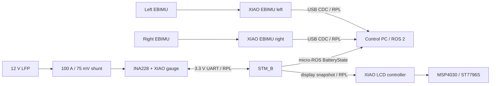

# XIAO RP2350 프로젝트

> 이 디렉터리는 부품 입고 전 설계 기준을 기록합니다. 실제 핀 전압, 모듈 회로,
> 케이블 길이와 발열을 확인하기 전에는 제작 완료 또는 실차 검증으로 간주하지 않습니다.

## 1. 목적

Seeed Studio XIAO RP2350을 공통 MCU로 사용해 다음 세 프로젝트를 진행합니다.

1. EBIMU-9DOFV6 두 대용 지능형 UART-USB 인터페이스
2. 기존 MSP4030/ST7796S 차량 LCD용 표시 전담 컨트롤러
3. 12 V급 LFP LV 배터리용 전류·전력·SOC 적산계

각 프로젝트는 독립적으로 동작하되, byte-stream framing과 빌드 방식을 공유합니다.
차량의 traction, brake, E-stop과 같은 안전 판단은 기존 STM_A/STM_B가 계속 소유하며
RP2350 보드는 이를 제어하지 않습니다.

## 2. 보드 배정

| 용도 | XIAO 수량 | 비고 |
|---|---:|---|
| 좌측 EBIMU 인터페이스 | 1 | 전용 USB 장치, role=`left` |
| 우측 EBIMU 인터페이스 | 1 | 전용 USB 장치, role=`right` |
| 차량 LCD 컨트롤러 | 1 | STM_B의 display snapshot 수신 |
| LV 배터리 적산계 | 1 | INA228 계측과 SOC 보존 |
| 예비·복구용 | 1 | 동일 보드 유지보수용 |

총 계획 수량은 5개입니다.

## 3. 구매 부품과 역할

| 부품 | 주 용도 | 입고 후 첫 확인 |
|---|---|---|
| XIAO RP2350 | 세 프로젝트 공통 MCU | 보드 revision, 2 MiB flash, USB, 3.3 V I/O |
| Adafruit 5832 계열 INA228 module | LV 전압·션트 전압·charge/energy 측정 | 원본/복제 회로와 15 mΩ 온보드 션트 확인 |
| 100 A, 75 mV, Class 0.5 shunt | LV 주전류 측정 | 단자 방향, Kelvin 단자, 체결과 정격 발열 |
| ACS758LCB-100B | INA228 비교 측정 | 공급 전압과 0 A 출력, ADC 입력 범위 |
| LM2596 DC-DC module | 배터리 전압을 5 V 전자장치 전원으로 변환 | 무부하/부하 전압, ripple, 발열, USB 역급전 방지 |
| MSP4030/ST7796S LCD | 차량 상태 표시 | 전원·logic level, connector pinout, backlight 전류 |

주요 기준 자료는 다음과 같습니다.

- [XIAO RP2350 pin map과 hardware resources](https://wiki.seeedstudio.com/xiao_rp2350_arduino/)
- [XIAO RP2350 schematic](https://files.seeedstudio.com/wiki/XIAO-RP2350/res/Seeed-Studio-XIAO-RP2350-v1.0.pdf)
- [TI INA228 product page와 datasheet](https://www.ti.com/product/INA228)
- [Adafruit 5832 INA228 guide](https://learn.adafruit.com/adafruit-ina228-i2c-power-monitor?view=all)
- [Allegro ACS758 product page](https://www.allegromicro.com/en/products/sense/current-sensor-ics/integrated-current-sensors/acs758)
- [TI LM2596 datasheet](https://www.ti.com/lit/ds/symlink/lm2596.pdf)
- [STM32G474RE datasheet](https://www.st.com/resource/en/datasheet/stm32g474re.pdf)
- [NUCLEO-G474RE user manual UM2505](https://www.st.com/resource/en/user_manual/um2505-getting-started-with-stm32g4-series-nucleo64-board-stmicroelectronics.pdf)

## 4. 전체 구성



`RPL`은 아래에서 정의하는 새 RP2350 byte-stream envelope입니다. EBIMU USB,
배터리 UART와 디스플레이 UART는 payload는 다르지만 같은 framing을 사용합니다.

## 5. 공통 펌웨어 기준

### 5.1 Toolchain

- Raspberry Pi Pico SDK C/C++와 CMake를 사용합니다.
- XIAO RP2350의 2 MiB flash 정의 수정이 포함된 Pico SDK release를 선택하고
  tag 또는 commit을 고정합니다.
- USB device는 TinyUSB를 사용합니다.
- 세 application은 공통 protocol, CRC, logging, device identity 코드만 공유하고
  센서·표시·SOC logic은 각각 분리합니다.
- 이 저장소에 firmware를 추가할 때는 ROS `colcon` 대상에 들어가지 않도록 별도
  CMake project와 `COLCON_IGNORE`를 사용합니다.

현재 Host에는 Pico SDK와 `picotool`이 설치되어 있지 않습니다. 설치와 toolchain
pinning은 첫 firmware bring-up 단계에서 수행합니다.

### 5.2 RP Link v0.1

RP Link(RPL)는 USB CDC와 UART처럼 packet 경계가 없는 byte stream에서 공통으로
쓰는 초안 protocol입니다.

```text
COBS_ENCODE(
  magic            u16 LE   = 0x5052
  version          u8       = 1
  message_type     u8
  flags            u16 LE
  payload_length   u16 LE
  sequence         u32 LE
  device_time_us   u64 LE
  payload          byte[payload_length]
  crc32c           u32 LE
) + 0x00 delimiter
```

- CRC32C 범위는 decoded `magic`부터 payload 끝까지입니다.
- `sequence`는 송신자가 frame을 보낼 때마다 증가하며 gap은 유실 진단에 씁니다.
- `device_time_us`는 송신 MCU의 부팅 후 monotonic time입니다. 절대 UTC나 ROS time이
  아닙니다.
- 수신자는 COBS delimiter에서 다시 동기화하며 CRC가 틀린 frame은 적용하지 않습니다.
- 상태를 바꾸는 request는 payload에 별도 `transaction_id`를 포함하고 ACK가 같은 ID를
  돌려줍니다. 같은 transaction 재수신은 마지막 결과를 다시 응답하고 중복 적용하지
  않습니다.
- v0.1 wire layout은 firmware 구현 전에 host/STM/RP 세 소비자가 함께 검토한 뒤
  version 1로 동결합니다.

USB 자체와 EBIMU 원본 checksum이 이미 오류 검출을 하더라도 RPL CRC는 framing 손상,
불완전 write와 잘못된 message 적용을 막는 새 경계 검증입니다.

## 6. 전원과 신호 원칙

- XIAO GPIO와 UART는 3.3 V logic을 기준으로 합니다.
- XIAO의 `5V` 핀은 USB VBUS와 같은 rail이므로 외부 5 V와 USB를 동시에 연결할 때
  외부 전원 쪽에 Schottky diode 또는 power mux를 둬 PC로 역급전하지 않게 합니다.
- LM2596 output은 XIAO나 LCD에 연결하기 전에 multimeter로 조정하고 부하 상태에서
  ripple과 발열을 확인합니다.
- EBIMU는 XIAO와 직접 연결할 때 3.3 V로 공급해 UART logic도 3.3 V로 맞춥니다.
- 주전류, Kelvin sense, logic harness는 물리적으로 분리하고 signal ground를 생략하지
  않습니다.

## 7. 커넥터와 기구

- Dupont jumper는 bench 임시 연결에만 사용합니다.
- EBIMU는 `3V3/GND/TX/RX` 4핀 잠금식 소신호 connector를 사용합니다.
- STM_B↔battery gauge는 `TX/RX/GND` 3핀, STM_B→display는 `TX/GND` 2핀 locking
  connector를 사용합니다.
- Molex Micro-Fit, JST-GH처럼 진동에 빠지지 않는 crimp connector를 우선합니다.
- Anderson connector는 선택한 housing·contact·wire가 실제 연속 전류를 만족할 때만
  배터리 주전류 경로에 사용합니다. UART나 Kelvin sense connector로는 쓰지 않습니다.
- 3D printed enclosure에는 strain relief, PCB standoff와 USB 접근구를 둡니다. 션트
  busbar는 환기시키되 공구나 금속물이 닿지 않도록 별도 finger guard를 둡니다.

## 8. 진행 순서

1. 부품 식별, 전원과 logic level 확인
2. XIAO 공통 Pico SDK blink/USB/UART/SPI/I2C bring-up
3. EBIMU 한 대 protocol과 Host node 완성 후 두 대 identity 시험
4. LCD test pattern과 STM_B snapshot 표시
5. INA228 저전류 bench calibration 후 외장 shunt 단계적 부하 시험
6. STM_B BatteryState와 LCD LV 영역 통합
7. locking harness와 enclosure 제작 후 차량 noise·온도 시험

## 9. 프로젝트 문서

- [EBIMU 지능형 인터페이스](ebimu_interface.md)
- [차량 LCD 컨트롤러](display_controller.md)
- [LV 배터리 SOC 적산계](lv_battery_gauge.md)
- [CAD·기구 자료 모음](cad/README.md)
