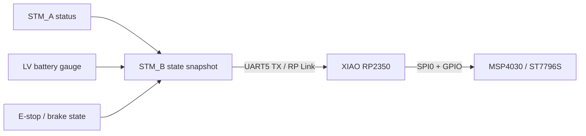

# XIAO RP2350 차량 LCD 컨트롤러

## 1. 목표

기존 STM_B가 직접 수행하던 MSP4030/ST7796S 초기화와 화면 rendering을 XIAO
RP2350으로 분리합니다. STM_B는 표시할 상태의 owner로 남고, XIAO는 display snapshot을
받아 LCD만 구동합니다.

이 분리는 화면이 멈추거나 XIAO가 reset되어도 STM_B의 E-stop, brake servo,
STM_A↔STM_B UART와 micro-ROS가 계속 동작하게 하는 것이 목적입니다.

## 2. 기존 LCD 기준

현재 구현에서 확인된 panel 기준은 다음과 같습니다.

| 항목 | 값 |
|---|---|
| module | MSP4030 |
| controller | ST7796S |
| 해상도 | 480×320 landscape |
| interface | 4-wire SPI, write-only로 취급 |
| 기존 UI | 흰 배경, 검은 글자, AUTO 청색, MANUAL 주황색 |
| 기존 갱신 | fixed-width dirty cell + 4-scanline rolling refresh |
| 기존 복구 근거 | 실제 SPI HAL/DMA 실패와 timeout |

기존 차량 harness의 MISO/SDO는 안정적인 readback 근거가 없으므로 `RDDPM(0x0A)` 값은
부팅 또는 주기적 health gate로 사용하지 않습니다.

## 3. 시스템 구성

STM_B는 기존 차량 status와 새 LV battery status를 하나의 표시 snapshot으로
조립합니다. XIAO는 ROS node나 micro-ROS Agent 없이 이 stream만으로 동작합니다.

## 4. STM_B 연결

LCD가 XIAO로 이관되면 STM_B의 기존 SPI2 LCD 핀을 더 이상 panel에 연결하지 않습니다.
새 표시 link는 현재 미사용인 UART5 TX를 사용합니다.

| 역할 | STM_B | NUCLEO connector | XIAO |
|---|---|---|---|
| display TX | `PC12 / UART5_TX` | `CN7-3` | `D7 / GPIO1 / UART0_RX` |
| signal ground | GND | `CN7-8` 등 | GND |

- 3.3 V UART, 115200 baud, 8-N-1
- 20 Hz display snapshot
- `TX/GND`를 한 pair로 꼬아 2핀 locking connector에 배선
- STM_B의 `PD2/UART5_RX`는 사용하지 않음

STM_B와 XIAO가 동시에 같은 LCD signal을 구동하지 않도록 기존 SPI harness를 물리적으로
분리한 뒤 이관합니다.

## 5. XIAO LCD 핀 초안

| LCD signal | XIAO pin | RP2350 function |
|---|---|---|
| SCK | D8 / GPIO2 | SPI0_SCK |
| MOSI | D10 / GPIO3 | SPI0_TX |
| CS | D3 / GPIO5 | GPIO / SPI0_CSn |
| DC | D0 / GPIO26 | GPIO |
| RST | D1 / GPIO27 | GPIO |
| BL | D2 / GPIO28 | GPIO 또는 PWM |
| MISO/SDO | 연결하지 않음 | readback health 판정 금지 |

실제 module connector의 VCC, LED/backlight 입력과 logic level은 입고·분해 측정 후
확정합니다. LCD power와 XIAO 5 V power를 공유할 경우 backlight 부하 상태에서
LM2596 전압과 ripple을 확인합니다.

## 6. Display snapshot protocol

전송 envelope는 [공통 RP Link v0.1](README.md#52-rp-link-v01)을 사용합니다.

| Type | 이름 | 방향 | 주기 |
|---:|---|---|---:|
| `0x30` | `DISPLAY_SNAPSHOT` | STM_B→XIAO | 50 ms |

payload는 float 대신 명시적 fixed-point 단위를 사용합니다.

| 필드 그룹 | 주요 필드 | 단위 |
|---|---|---|
| freshness | vehicle, drive detail, brake, LV battery valid/age | flag, ms |
| 차량 | mode, gear, speed | enum, 0.01 m/s |
| HV 구동 | bus voltage/current, phase current | 0.1 V, 0.1 A |
| motor | controller/motor temperature, fault bits | 0.1 °C, bitmask |
| command | traction command/feedback, timeout | flag |
| brake | final brake, E-stop, STM_A link | flag |
| LV | voltage, current, SOC | mV, mA, 0.01% |

XIAO는 snapshot의 CRC와 version을 한 번 확인한 뒤 canonical display state로 변환합니다.
다음 snapshot이 올 때까지 같은 state를 사용하고, 각 source age에 따라 해당 widget만
`--` 또는 stale badge로 바꿉니다.

제안 timeout은 display link 300 ms, LV battery field 1 s입니다. 이 timeout은 표시
유효성만 바꾸며 brake나 traction 판단에 들어가지 않습니다.

## 7. Rendering 구조

### 7.1 초기화

- 현재 `msp4030_init` command sequence를 controller 기준 자료로 port합니다.
- reset, sleep-out, pixel format, MADCTL과 display-on 순서를 유지합니다.
- XIAO firmware는 STM32 HAL wrapper를 그대로 옮기지 않고 Pico SDK SPI/GPIO 호출로
  다시 구성합니다.
- boot splash는 SPI write가 성공한 뒤에만 완료 상태로 바꿉니다.

### 7.2 갱신

- RGB565를 사용합니다.
- 고정 폭 숫자는 바뀐 glyph cell만 배경 포함 덮어씁니다.
- 작은 DMA band buffer로 rolling refresh를 수행해 장기적으로 화면 전체를 복원합니다.
- full-screen clear 후 redraw를 반복하지 않습니다.
- backlight PWM은 향후 밝기 조절용이며 첫 bring-up에서는 일정 밝기로 시작합니다.

### 7.3 복구

- SPI DMA 시작 실패, completion timeout 또는 SDK가 보고한 전송 오류만 recovery
  trigger로 사용합니다.
- recovery는 backlight off → panel reset → init → 최종 state redraw → backlight on
  순서로 수행합니다.
- panel recovery 중에도 UART snapshot 수신은 계속하고 가장 최신 state만 보존합니다.
- MISO readback이나 우연한 GPIO level을 health 판정으로 사용하지 않습니다.

## 8. 화면 구성 초안

기존 주간 dashboard의 우선순위를 유지합니다.

1. 상단: 속도, gear, MANUAL/AUTO
2. 중앙 HV card: bus voltage, bus current, phase current
3. 상태 영역: brake, E-stop, STM_A link, drive fault
4. LV card: LV voltage, charge/discharge current, SOC

LV link가 stale이면 마지막 SOC를 정상값처럼 유지하지 않고 숫자를 `--`로 바꾸고 작은
`LV LOST` badge를 표시합니다. 전체 화면을 경고색으로 덮거나 안전 명령을 생성하지
않습니다.

## 9. 단계별 완료 기준

1. XIAO 단독 test pattern과 색상·방향·backlight 확인
2. SPI 오류와 timeout을 주입해 panel만 복구되고 UART 수신은 지속
3. STM_B synthetic snapshot으로 모든 fixed-point 필드와 stale 표시 확인
4. 기존 STM_B 화면과 주요 수치·mode/gear/brake 표시 비교
5. LV battery status 추가 후 `/lv_battery/state`와 LCD 값 비교
6. STM_B safety task timing과 STM_A UART가 display 연결·분리의 영향을 받지 않음 확인
