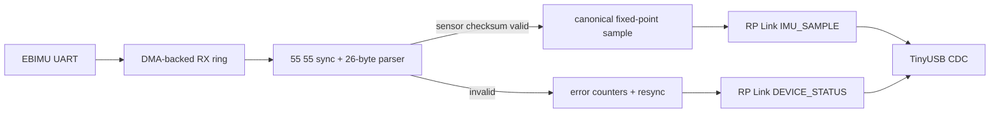

# EBIMU 지능형 UART-USB 인터페이스

## 1. 목표

고장 난 USB-UART adapter를 단순 교체하는 대신 EBIMU-9DOFV6 바로 옆에 XIAO
RP2350을 한 대씩 배치합니다. XIAO가 sensor UART의 framing, checksum, buffer와 오류
복구를 책임지고 Host에는 검증된 sample과 진단 상태를 전용 USB protocol로 보냅니다.

두 장치는 같은 firmware를 사용하며 persistent role만 `left`와 `right`로 다릅니다.

## 2. 확인된 센서 상태

NUCLEO-G474RE를 이용한 bench 시험에서 두 EBIMU에 대해 다음을 확인했습니다.

| 항목 | 값 |
|---|---|
| version 응답 | `<imu9dofv612d>` |
| UART | 460800 baud, 8-N-1 |
| 출력 | binary, 2 ms, 500 Hz |
| frame | `55 55` + 11×signed int16 + 16-bit additive checksum |
| frame 길이 | 26 byte |
| 2초 aligned capture | checksum-valid frame 1000개 |

현재 11개 값은 quaternion 4, gyro 3, acceleration 3, sensor timestamp 1입니다.
500 Hz에서 payload는 13 kB/s이고 UART 8-N-1 wire 점유는 약 130 kbit/s로 460800
baud의 약 28%입니다. 1000 Hz로 올려도 약 56%이므로 RP2350이나 USB 성능 때문에
baud를 변경할 필요는 없습니다.

기존 진단 firmware와 packet 근거는 별도 `ebimu_ros2_driver/ebimu_serial` project를
참고합니다. 이 문서에는 machine-specific 절대 경로를 고정하지 않습니다.

## 3. 하드웨어 구성

| EBIMU | XIAO RP2350 | 설명 |
|---|---|---|
| VCC | 3V3 | 센서 UART logic도 3.3 V로 고정 |
| GND | GND | 공통 signal ground |
| TX | D7 / GPIO1 / UART0_RX | sensor stream 수신 |
| RX | D6 / GPIO0 / UART0_TX | version·설정 명령 |

Host 연결은 XIAO의 USB-C를 사용합니다. 센서와 XIAO 사이에는 `3V3/GND/TX/RX`
4핀 locking connector를 쓰며 TX/RX label은 각 장치 기준 방향을 함께 표기합니다.

## 4. Firmware data flow

### 4.1 UART 수신

- UART0은 460800 baud, 8-N-1로 시작합니다.
- 수신 시작 전에 FIFO와 overrun/framing/parity 상태를 지우고 DMA-backed ring을 먼저
  준비합니다.
- IRQ/DMA 오류가 나면 unread byte 수와 오류 원인을 기록하고 수신을 재시작합니다.
- USB가 연결되지 않아도 UART 수신과 진단 counter는 계속 동작합니다.
- USB backpressure가 ring 용량을 넘기면 오래된 sample을 조용히 덮지 않고
  `usb_tx_drop_count`를 증가시킵니다.

### 4.2 Sensor frame parser

외부 장치에서 들어오는 EBIMU frame은 이 경계에서 한 번 검증합니다.

1. `55 55` sync를 찾습니다.
2. 현재 설정에서 고정된 26 byte를 모읍니다.
3. 앞 24 byte의 16-bit additive checksum과 마지막 big-endian checksum을 비교합니다.
4. 실패하면 첫 sync byte 하나를 버리고 다음 `55 55`를 찾습니다.
5. 성공한 frame만 canonical sample로 변환합니다.

정상 sample을 downstream function마다 다시 checksum 검사하지 않습니다.

## 5. USB protocol

전송 envelope는 [공통 RP Link v0.1](README.md#52-rp-link-v01)을 사용합니다.

### 5.1 Message type 초안

| Type | 이름 | 방향 | 역할 |
|---:|---|---|---|
| `0x01` | `IMU_SAMPLE` | XIAO→Host | checksum-valid sensor sample |
| `0x02` | `DEVICE_STATUS` | XIAO→Host | UART·parser·USB 누적 상태, 1 Hz |
| `0x10` | `MAINTENANCE_REQUEST` | Host→XIAO | read/config command 요청 |
| `0x11` | `MAINTENANCE_RESPONSE` | XIAO→Host | sensor 응답과 적용 결과 |

### 5.2 `IMU_SAMPLE` payload

모든 정수는 little-endian signed int16이며 XIAO가 EBIMU의 특이한 quaternion 순서를
정규화합니다.

| 필드 | 단위/scale | 설명 |
|---|---:|---|
| `q_x`, `q_y`, `q_z`, `q_w` | value / 10000 | canonical xyzw quaternion |
| `gyro_x`, `gyro_y`, `gyro_z` | 0.1 deg/s | EBIMU raw angular velocity |
| `accel_x`, `accel_y`, `accel_z` | 0.001 g | EBIMU raw acceleration |
| `sensor_timestamp_ms` | 1 ms, uint16 | 약 65.536초마다 wrap |

RPL header의 `device_time_us`는 XIAO가 checksum-valid frame 수신을 완료한 시각입니다.
이는 센서 내부 측정 시각이 아니며 `sensor_timestamp_ms`와 Host receipt time 사이의
jitter를 비교하는 데 사용합니다.

### 5.3 `DEVICE_STATUS` payload

- firmware version과 device role
- uptime
- valid sensor frame count
- sensor checksum error와 resync discarded byte count
- UART overrun, framing, parity error count
- RX ring overflow와 USB TX drop count
- 마지막 valid sample age
- detected sensor baud/mode/rate와 version 응답
- 마지막 오류 코드

counter는 누적값으로 보내며 Host는 이전 값과의 차이로 rate를 계산합니다.

## 6. 설정과 복구 정책

### 6.1 자동 쓰기 금지

부팅 시 표준 460800/binary/500 Hz stream이 없더라도 XIAO는 센서 설정을 자동으로
바꾸지 않습니다. bounded baud scan과 read-only `<ver>` 조회로 상태를 식별한 뒤
`NO_VALID_STREAM`, `BAUD_MISMATCH`, `MODE_MISMATCH`처럼 진단하고 대기합니다.

### 6.2 유지보수 도구

기존 `ebimu_tui.py`와 같은 별도 Host tool을 새 RPL protocol에 맞춰 만듭니다.

- 장치·role·sensor version 조회
- baud/mode/rate passive scan
- raw read-only command
- 사용자가 선택한 경우에만 460800/binary/500 Hz 설정 적용
- 명령 전 sample stream pause, 응답 후 parser/FIFO 정리와 stream 재검증

지속 설정을 바꾸는 command는 화면에서 변경 내용을 보여주고 사용자 입력 뒤에만
전송합니다.

## 7. USB identity와 plug-and-play

- Pico SDK의 unique board ID를 USB serial string으로 사용합니다.
- 유지보수 tool로 `left` 또는 `right` role을 한 번 저장하고 status에 노출합니다.
- Host driver는 `/dev/ttyACM0` 순서가 아니라 USB serial과 device role로 장치를 찾습니다.
- 같은 role 두 대가 연결되면 임의로 하나를 선택하지 않고 conflict를 diagnostics로
  보고합니다.
- development VID/PID와 배포 VID/PID는 분리해 기록하며 권한 없는 임의 VID/PID를
  release identity로 고정하지 않습니다.

## 8. ROS 2 Host 계약

새 Host node는 RPL frame과 canonical fixed-point sample을 받아 다음을 수행합니다.

- gyro를 deg/s에서 rad/s로 변환
- acceleration을 g에서 m/s²로 변환
- 기존 EBIMU attitude convention을 ROS ENU/frame convention으로 변환
- mounting transform과 covariance 적용
- reconnect 시 USB identity와 role 재확인

| Topic | Type | 설명 |
|---|---|---|
| `/left/imu/data` | `sensor_msgs/msg/Imu` | 좌측 IMU |
| `/right/imu/data` | `sensor_msgs/msg/Imu` | 우측 IMU |
| `/diagnostics` | `diagnostic_msgs/msg/DiagnosticArray` | 각 bridge·sensor 상태 |

초기 `header.stamp`는 Host가 valid RPL frame을 받은 시각입니다. MCU clock과 ROS clock의
offset을 측정하기 전에는 `device_time_us`를 절대시각처럼 사용하지 않습니다.

## 9. 실패 시 동작

| 조건 | XIAO 동작 | Host에서 보이는 결과 |
|---|---|---|
| sensor checksum error | sample 폐기, byte-wise resync | rate 저하와 checksum counter 증가 |
| UART overrun/error | counter 기록, FIFO/DMA 재시작 | warning, stream 자동 복귀 |
| USB 분리 | sensor 수신·counter 유지 | device disconnect |
| Host가 느림 | bounded queue, drop counter | sequence gap과 diagnostic warning |
| 설정 불일치 | 자동 변경 없이 대기 | 상태와 유지보수 안내 |
| 중복 left/right role | 장치는 계속 송신 | Host가 conflict로 publish 차단 |

## 10. 단계별 완료 기준

1. 한 센서에서 500 Hz valid sample과 오류 counter를 USB로 지속 수신
2. frame 중간 접속·임의 byte 손실 뒤 다음 valid frame에서 재동기화
3. USB 분리·재연결과 UART error 뒤 수동 reset 없이 복구
4. 유지보수 tool이 read-only 조회와 명시적 설정을 구분
5. 두 장치 연결 순서를 바꿔도 left/right topic과 frame이 유지
6. ROS `sensor_msgs/msg/Imu` rate, axis와 단위가 기존 driver 결과와 일치
