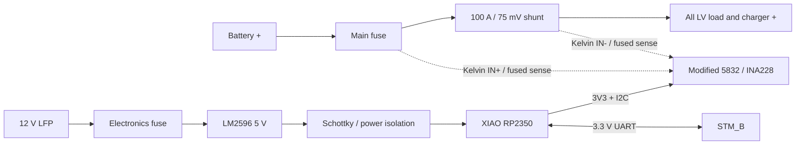

# 12 V LFP LV 배터리 SOC 적산계

## 1. 현재 구성과 경계

이 문서는 현재 코드의 계측·통신 구성과 장착 시 확인할 전기 조건을 정리합니다.
빌드·업로드·정비와 적산 알고리즘의 상세는
[RP2350 펌웨어 README](../../firmware/XIAO_RP2350_LV_GAUGE/README.md)를 따릅니다.

LV 배터리 옆에 100 A shunt, INA228, XIAO RP2350과 local DC-DC를 장착해 전압,
충·방전 전류, 전력, Ah/Wh와 SOC를 계산합니다. 상태는 STM_B로 보내고 STM_B가
ROS `sensor_msgs/msg/BatteryState`와 차량 LCD snapshot으로 중계합니다.

이 장치는 계측기입니다. 다음 기능은 포함하지 않습니다.

- cell balancing 또는 cell별 전압 측정
- charger 제어
- contactor, fuse 또는 battery disconnect 제어
- 인증된 BMS·과전류·과충전 보호 대체

## 2. 전기 구성



충전기와 모든 부하는 shunt의 load 쪽에 연결해 충전·방전 전류가 모두 shunt를
통과하게 합니다. 배터리 음극은 끊지 않는 high-side 측정입니다.

## 3. Shunt 계산과 배선

100 A에서 75 mV인 shunt의 nominal resistance와 정격점 발열은 다음과 같습니다.

```text
Rshunt = 0.075 V / 100 A = 0.00075 ohm = 0.75 mOhm
P100A  = 100 A × 0.075 V = 7.5 W
```

- 주전류는 INA breakout, breadboard, Dupont wire나 소형 terminal block을 통과시키지
  않습니다.
- shunt의 큰 terminal은 정격 cable과 crimp ring lug로 체결합니다.
- INA `IN+`와 `IN-`는 shunt의 Kelvin point에서 별도 가는 선으로 가져옵니다.
- sense wire가 battery positive에 닿으므로 tap 가까이에 소형 fuse 또는 적절한
  current-limiting protection을 둡니다.
- shunt 발열이 XIAO, INA228과 plastic enclosure에 직접 전달되지 않도록 간격과
  환기를 둡니다.
- Class 0.5 shunt 오차가 전체 전류 정확도의 상한이 될 수 있으므로 known-current
  calibration으로 실제 scale을 기록합니다.

## 4. Adafruit 5832 호환성 gate

Adafruit product 5832는 INA228과 정밀 15 mΩ shunt가 한 PCB에 있으며 원래 약 10 A급
사용을 전제로 합니다. 구매한 AliExpress module이 같은 layout을 복제했다면 외장
0.75 mΩ shunt에 그대로 병렬 또는 직렬 연결하지 않습니다.

입고 후 다음 순서로 판정합니다.

1. PCB 앞뒤 사진과 continuity로 `R015`, `VIN+`, `VIN-`, `VBUS` 연결을 확인합니다.
2. 온보드 shunt를 제거할 수 있고 INA input pad가 독립적으로 남는지 확인합니다.
3. 가능하면 `R015`를 제거하고 `VIN+`/`VIN-`를 외장 shunt Kelvin sense 전용으로
   사용합니다.
4. high-side bus 측정을 위해 `VBUS`를 shunt battery 쪽에 연결합니다.
5. 개조가 불가능하거나 trace가 불명확하면 이 board는 저전류 bench용으로만 두고
   외장 shunt 입력용 INA228 board를 사용합니다.

100 A 주전류가 breakout terminal이나 PCB trace로 흐르는 구성은 허용하지 않습니다.

## 5. 현재 INA228 설정

| 설정 | 구현값 |
|---|---|
| I2C | XIAO `Wire1`, D4/GPIO6 SDA, D5/GPIO7 SCL, 400 kHz, 3.3 V |
| shunt resistance | 0.00075 Ω |
| ADC range | ±163.84 mV (`ADCRANGE=0`) |
| current scale / calibration | `0.0002 A/bit`, `SHUNT_CAL=1966` |
| conversion | VBUS/VSHUNT/DIETEMP 각 50 µs, averaging 1회, `ADC_CONFIG=0xF000` |
| address | 시작 시 `0x40`–`0x4F` 검색 후 manufacturer/device ID 확인 |
| 외부 status | 100 ms (10 Hz), 실제 완료 변환 수집과 별개 |

`CNVRF` 변환 완료와 설정 레지스터를 확인한 샘플만 사용합니다. 화면의 전압·전류·전력은
100 ms 시정수 LPF를 적용하며, 적산은 INA228 CHARGE 증가량을 사용합니다.
실제 샘플 수집률은 I2C 읽기 시간에 제한되므로 10 Hz status를 ADC 측정률로 해석하지 않습니다.

## 6. ACS758 비교 측정

ACS758LCB-100B는 ±100 A bidirectional Hall sensor이고 5 V 조건에서 nominal
20 mV/A, 0 A 출력은 VCC/2입니다. INA228 설치·교정 단계에서만 비교 sensor로
사용합니다.

- bare sensor가 3.3 V로 동작하면 ratiometric output이 약 0.33–2.97 V 범위가 되어
  XIAO ADC에 적합합니다.
- 구매 module이 5 V 전용 회로라면 출력이 최대 약 4.5 V까지 갈 수 있으므로 XIAO
  ADC에 직접 연결하지 않습니다.
- 입고 후 module supply path, zero-current output과 full-scale output을 확인한 뒤
  divider/buffer 또는 별도 ADC 필요 여부를 결정합니다.
- ACS758은 v1 차량 적산계의 상시 이중 sensor나 safety voter로 사용하지 않습니다.

## 7. 전원

LM2596 adjustable module은 LV battery에서 전자장치용 5 V를 만듭니다.

- 배터리 tap 가까이에 electronics fuse를 둡니다.
- XIAO를 연결하기 전에 output을 multimeter로 5 V에 맞춥니다.
- XIAO와 INA228, UART를 연결한 실제 부하에서 ripple과 발열을 측정합니다.
- LM2596 output과 XIAO `5V/VBUS` 사이에 Schottky diode 또는 power mux를 둬 USB
  연결 시 PC VBUS로 역급전하지 않게 합니다.
- USB 정비 중 외부 전원을 제거할 수 있는 connector 또는 switch도 함께 고려합니다.
- LM2596은 LFP charger가 아니며 배터리 충전 경로에 사용하지 않습니다.

## 8. STM_B 양방향 UART

STM_B UART4를 LV 적산계 전용으로 사용합니다.

| 방향 | STM_B | NUCLEO connector | Battery XIAO |
|---|---|---|---|
| STM_B→gauge | `PC10 / UART4_TX` | `CN7-1` | `D7 / GPIO1 / UART0_RX` |
| gauge→STM_B | `PC11 / UART4_RX` | `CN7-2` | `D6 / GPIO0 / UART0_TX` |
| reference | GND | `CN7-8` 등 | GND |

- 3.3 V, 115200 baud, 8-N-1
- `TX/RX/GND` 3핀 locking connector
- signal과 ground를 가까이 배치하고 motor phase cable과 분리
- CRC, sequence, timeout counter로 실제 harness 오류를 계측

직결 UART 오류가 실제 차량에서 반복되면 payload와 message type은 유지하고 물리층만
RS-485로 바꾸는 것을 다음 단계로 합니다. 이 위험의 영향은 LV 표시·SOC telemetry
stale이며 brake나 traction safety logic에는 연결하지 않습니다.

## 9. Battery UART protocol

USB CDC와 UART는 같은 version 1 binary frame을 사용합니다.

```text
A5 5A | version:u8 | type:u8 | length:u16 LE | sequence:u32 LE | payload | CRC32:u32 LE
```

CRC32 범위는 version부터 payload 끝까지입니다. byte layout의 기준 구현은
[`lv_battery_protocol.h`](../../firmware/STM_B/Core/Inc/lv_battery_protocol.h)와
[`lv_battery_protocol.c`](../../firmware/STM_B/Core/Src/lv_battery_protocol.c)입니다.

| Type | 이름 | Payload | 방향 |
|---:|---|---:|---|
| `0x01` | status | 136 byte | RP2350 → STM_B / USB, 100 ms |
| `0x10` | command | 12 byte | STM_B / USB → RP2350 |
| `0x11` | 저장 결과 ACK | 16 byte | RP2350 → STM_B / USB |

### 9.1 Status 주요 필드

| 필드 | 단위 / 의미 |
|---|---|
| `bus_voltage_uV`, `shunt_voltage_nV` | µV, nV; LPF 적용 |
| `current_uA`, `power_mW` | µA, mW; 방전 양수·충전 음수, LPF 적용 |
| `remaining_uAs`, `capacity_mAh` | µA·s, mAh; remaining 미설정은 `-1` |
| `soc_centi_percent` | 0.01%; 미설정은 `-1` |
| `charge_trip_uAs`, `discharge_trip_uAs` | 방향별 트립 전하량 µA·s |
| `charge_trip_mWs`, `discharge_trip_mWs` | 방향별 트립 에너지 mW·s |
| `active_time_ms` | 유효 계측 가동 누적시간; 전원 OFF 시간 제외 |
| `die_temperature_mC` | INA die 온도 m°C; 배터리 온도 아님 |
| `flags`, raw register, error counters | 센서·설정·저장·계측 유효성 진단 |

### 9.2 정비 명령

| Command | TUI 키 | 의미 |
|---|---|---|
| `0x01` SET_FULL | `f` | 실제 완충 확인 후 SOC 100% 기준점 설정 |
| `0x02` RESET_TRIP | `t` | 충전·방전 트립 Ah/Wh 및 계측 가동시간 초기화 |
| `0x03` ZERO_CURRENT | `z` | 무부하·충전기 분리 상태에서 영점 보정 |
| `0x04` SET_CAPACITY | `c` | 배터리 용량 설정 |

command는 `request_id`를 포함하고 저장·읽기 검증이 완료된 성공 ACK를 받은 뒤에만
TUI가 성공으로 표시합니다. 성공한 동일 request의 재수신은 ACK만 재전송하며
상태 변경을 중복 적용하지 않습니다. 별도 lifetime 적산 필드나 GET_CONFIG 명령은 없고,
현재 설정과 적산 상태는 주기 status에서 확인합니다.

## 10. SOC와 persistence

### 10.1 계산

```text
discharge current > 0  -> remaining charge 감소
charge current    < 0  -> remaining charge 증가
SOC = clamp(remaining_charge_Ah / capacity_Ah, 0, 1)
```

- 초기 capacity는 100 Ah이고 SOC·remaining은 미설정입니다. 실제 명판 용량을 정비 TUI에서 설정합니다.
- 전압만으로 SOC를 강제 보정하지 않습니다. `SET_FULL`은 실제 완충 확인 후 실행합니다.
- 영점 보정은 새 변환 완료 current raw count 64개를 평균합니다. 자동 영점이나 임의 deadband는 없습니다.
- CHARGE 증가량에 영점을 보정해 Ah를 계산하고 구간 양끝 평균 전압으로 Wh를 계산합니다.
- 센서 무효·연결 단절 구간은 0 A로 채우거나 적산하지 않습니다.

### 10.2 Flash 저장

LittleFS 256 KB 영역의 두 journal에 CRC/generation을 가진 84-byte record를
각각 최대 512개씩 append합니다. 상태가 변경되면 60초 주기로 저장하고,
정비 변경은 저장과 읽기 검증을 마친 뒤 ACK를 보냅니다. 부팅 시 최신 유효 record를
복원하며 전원 차단 시 마지막 저장 이후 최대 60초의 적산이 손실될 수 있습니다.
저장 구조와 정전 손실 계산은 [펌웨어 README](../../firmware/XIAO_RP2350_LV_GAUGE/README.md#적산과-저장-의미)를 참고합니다.

## 11. STM_B와 ROS 2

STM_B는 `sensor_msgs/msg/BatteryState`를 `/lv_battery/state`에 100 ms마다
발행합니다. 유효 계측이 없으면 전압·전류는 NaN이고, SOC 미설정이면 charge와
percentage는 NaN입니다.

| `BatteryState` field | 값 |
|---|---|
| `voltage` | V |
| `current` | ROS convention에 따라 방전 음수, 충전 양수 |
| `charge` | remaining Ah |
| `capacity` | 설정된 last-full capacity Ah |
| `design_capacity` | 설정 정격 용량 Ah |
| `percentage` | 0–1 SOC |
| `power_supply_status` | 유효 전류의 부호 기준 charging/discharging/not charging |
| `power_supply_health` | cell/BMS 정보가 없으므로 unknown |
| `power_supply_technology` | LiFe (`LIFE`) |
| `present` | fresh CRC-valid battery status 수신 여부 |
| `temperature` | cell 온도 sensor가 없으므로 NaN |
| `cell_voltage` | cell별 측정이 없으므로 비움 |

STM_B는 `BATTERY_STATUS`가 1초 이상 없으면 `present=false`로 발행하고 LCD snapshot의
LV valid flag를 내립니다. 이 상태는 brake request나 traction 판단에 사용하지 않습니다.

PC TUI는 `/lv_battery/link/status`, `/lv_battery/link/command`,
`/lv_battery/link/ack`의 `std_msgs/msg/UInt8MultiArray` payload로 기존 RP transaction을
그대로 사용합니다. STM_B는 12-byte command payload에 UART frame/CRC를 붙이고,
16-byte ACK를 다시 ROS로 발행합니다. 한 번에 command 하나만 처리하고 TUI는 같은
request ID를 1초마다 재전송하므로 ACK 유실에도 RP journal mutation은 중복 적용되지
않습니다. `/lv_battery/state`는 일반 ROS 소비자용 단순 상태를 계속 제공합니다.

## 12. 기구와 harness

- shunt와 전자 PCB는 배터리 옆에 설치하되 shunt 열이 PCB로 직접 전달되지 않게 합니다.
- open enclosure는 환기를 제공하되 busbar와 bolt에는 절연 cover를 둡니다.
- LM2596, XIAO, INA228은 standoff로 고정하고 cable strain이 solder joint에 전달되지
  않게 합니다.
- switching regulator와 UART cable을 Kelvin sense pair에서 떨어뜨립니다.
- UART는 3핀 locking connector, I2C는 enclosure 내부 짧은 harness, 주전류는 정격
  ring lug/connector를 사용합니다.
- USB-C 정비 포트는 배터리 옆에서 접근 가능하게 하고 금속 이물 유입을 막는 cap을
  고려합니다.

## 13. 단계별 완료 기준

1. 5832 회로 식별과 온보드 shunt 제거 가능 여부 판정
2. 저전류 bench에서 multimeter 대비 voltage/current/zero offset 확인
3. 외장 0.75 mΩ shunt 연결 후 단계적 부하에서 scale과 발열 측정
4. power cycle 뒤 SOC journal 복원과 interrupted write 복구 확인
5. STM_B UART status, command ACK와 stale timeout 확인
6. `/lv_battery/state`의 단위·전류 부호·SOC와 gauge 상태 비교
7. LCD LV card와 ROS 값 일치 확인
8. 실제 harness routing에서 CRC/sequence error와 LM2596 ripple·온도 기록

## 12. 계기판과 검증 범위

STM_B는 UART 상태를 ROS와 독립적으로 Dashboard CAN `0x324` byte 5–7에 담습니다.
각각 LV flags, 0.1 V 단위 전압, 0–100% SOC이며 미설정 SOC는 `0xFF`입니다.
UNO는 전압과 SOC의 validity를 별도로 확인합니다. UART가 1초간 끊기면 LV flags를
내리며 브레이크·traction 제어에는 사용하지 않습니다.

코드 연결과 실제 차량 검증을 구분합니다. 센서 ID/통신 확인 외에 known-current 비교,
극성·영점, 충·방전 적산, 저장 중 정전 복구, UART 분리 시 ROS·LCD 무효 표시를
실장 상태에서 확인해야 합니다. 이 문서는 해당 실차 시험의 완료 기록이 아닙니다.
