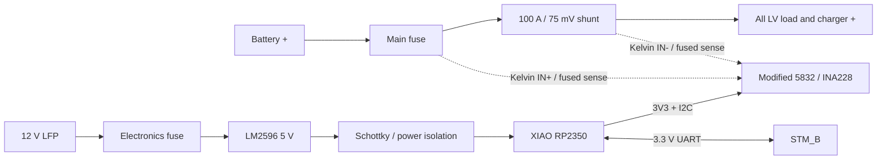

# 12 V LFP LV 배터리 SOC 적산계

## 1. 목표와 경계

LV 배터리 옆에 100 A shunt, INA228, XIAO RP2350과 local DC-DC를 장착해 전압,
충·방전 전류, 전력, Ah/Wh와 SOC를 계산합니다. 상태는 STM_B로 보내고 STM_B가
ROS `sensor_msgs/msg/BatteryState`와 차량 LCD snapshot으로 중계합니다.

이 장치는 계측기입니다. 다음 기능은 포함하지 않습니다.

- cell balancing 또는 cell별 전압 측정
- charger 제어
- contactor, fuse 또는 battery disconnect 제어
- 인증된 BMS·과전류·과충전 보호 대체

## 2. 전기 구성



충전기와 모든 부하는 shunt의 load 쪽에 연결해 충전·방전 전류가 모두 shunt를
통과하게 합니다. 배터리 음극은 끊지 않는 high-side 측정입니다.

## 3. Shunt 계산과 배선

100 A에서 75 mV인 shunt의 nominal resistance와 정격점 발열은 다음과 같습니다.

```text
Rshunt = 0.075 V / 100 A = 0.00075 ohm = 0.75 mOhm
P100A  = 100 A × 0.075 V = 7.5 W
```

- 주전류는 INA breakout, breadboard, Dupont wire나 소형 terminal block을 통과시키지
  않습니다.
- shunt의 큰 terminal은 정격 cable과 crimp ring lug로 체결합니다.
- INA `IN+`와 `IN-`는 shunt의 Kelvin point에서 별도 가는 선으로 가져옵니다.
- sense wire가 battery positive에 닿으므로 tap 가까이에 소형 fuse 또는 적절한
  current-limiting protection을 둡니다.
- shunt 발열이 XIAO, INA228과 plastic enclosure에 직접 전달되지 않도록 간격과
  환기를 둡니다.
- Class 0.5 shunt 오차가 전체 전류 정확도의 상한이 될 수 있으므로 known-current
  calibration으로 실제 scale을 기록합니다.

## 4. Adafruit 5832 호환성 gate

Adafruit product 5832는 INA228과 정밀 15 mΩ shunt가 한 PCB에 있으며 원래 약 10 A급
사용을 전제로 합니다. 구매한 AliExpress module이 같은 layout을 복제했다면 외장
0.75 mΩ shunt에 그대로 병렬 또는 직렬 연결하지 않습니다.

입고 후 다음 순서로 판정합니다.

1. PCB 앞뒤 사진과 continuity로 `R015`, `VIN+`, `VIN-`, `VBUS` 연결을 확인합니다.
2. 온보드 shunt를 제거할 수 있고 INA input pad가 독립적으로 남는지 확인합니다.
3. 가능하면 `R015`를 제거하고 `VIN+`/`VIN-`를 외장 shunt Kelvin sense 전용으로
   사용합니다.
4. high-side bus 측정을 위해 `VBUS`를 shunt battery 쪽에 연결합니다.
5. 개조가 불가능하거나 trace가 불명확하면 이 board는 저전류 bench용으로만 두고
   외장 shunt 입력용 INA228 board를 사용합니다.

100 A 주전류가 breakout terminal이나 PCB trace로 흐르는 구성은 허용하지 않습니다.

## 5. INA228 설정 초안

INA228은 2.7–5.5 V로 동작하고 최대 85 V common-mode를 지원하므로 XIAO 3.3 V I2C와
12 V급 LFP high-side 측정 범위에 들어옵니다.

| 설정 | 초기값 | 근거 |
|---|---:|---|
| I2C supply/logic | 3.3 V | XIAO logic과 일치 |
| shunt resistance | 0.00075 Ω | 100 A / 75 mV shunt |
| ADC range | ±163.84 mV | 75 mV가 ±40.96 mV range를 초과 |
| sample output | 10 Hz | SOC와 dashboard에 충분, averaging 조정 여유 |
| I2C address | 입고 후 확인 | original 5832 default는 `0x40` |

conversion time과 averaging은 bench에서 zero-current noise와 load step을 측정한 뒤
선택합니다. INA228의 charge/energy accumulator를 사용하되 XIAO가 주기적으로 읽어
전원 차단 전후의 persistent SOC state와 결합합니다.

## 6. ACS758 비교 측정

ACS758LCB-100B는 ±100 A bidirectional Hall sensor이고 5 V 조건에서 nominal
20 mV/A, 0 A 출력은 VCC/2입니다. INA228 설치·교정 단계에서만 비교 sensor로
사용합니다.

- bare sensor가 3.3 V로 동작하면 ratiometric output이 약 0.33–2.97 V 범위가 되어
  XIAO ADC에 적합합니다.
- 구매 module이 5 V 전용 회로라면 출력이 최대 약 4.5 V까지 갈 수 있으므로 XIAO
  ADC에 직접 연결하지 않습니다.
- 입고 후 module supply path, zero-current output과 full-scale output을 확인한 뒤
  divider/buffer 또는 별도 ADC 필요 여부를 결정합니다.
- ACS758은 v1 차량 적산계의 상시 이중 sensor나 safety voter로 사용하지 않습니다.

## 7. 전원

LM2596 adjustable module은 LV battery에서 전자장치용 5 V를 만듭니다.

- 배터리 tap 가까이에 electronics fuse를 둡니다.
- XIAO를 연결하기 전에 output을 multimeter로 5 V에 맞춥니다.
- XIAO와 INA228, UART를 연결한 실제 부하에서 ripple과 발열을 측정합니다.
- LM2596 output과 XIAO `5V/VBUS` 사이에 Schottky diode 또는 power mux를 둬 USB
  연결 시 PC VBUS로 역급전하지 않게 합니다.
- USB 정비 중 외부 전원을 제거할 수 있는 connector 또는 switch도 함께 고려합니다.
- LM2596은 LFP charger가 아니며 배터리 충전 경로에 사용하지 않습니다.

## 8. STM_B 양방향 UART

현재 STM_B에서 비어 있는 UART4를 사용합니다.

| 방향 | STM_B | NUCLEO connector | Battery XIAO |
|---|---|---|---|
| STM_B→gauge | `PC10 / UART4_TX` | `CN7-1` | `D7 / GPIO1 / UART0_RX` |
| gauge→STM_B | `PC11 / UART4_RX` | `CN7-2` | `D6 / GPIO0 / UART0_TX` |
| reference | GND | `CN7-8` 등 | GND |

- 3.3 V, 115200 baud, 8-N-1
- `TX/RX/GND` 3핀 locking connector
- signal과 ground를 가까이 배치하고 motor phase cable과 분리
- CRC, sequence, timeout counter로 실제 harness 오류를 계측

직결 UART 오류가 실제 차량에서 반복되면 payload와 message type은 유지하고 물리층만
RS-485로 바꾸는 것을 다음 단계로 합니다. 이 위험의 영향은 LV 표시·SOC telemetry
stale이며 brake나 traction safety logic에는 연결하지 않습니다.

## 9. Battery UART protocol

전송 envelope는 [공통 RP Link v0.1](README.md#52-rp-link-v01)을 사용합니다.

| Type | 이름 | 방향 | 설명 |
|---:|---|---|---|
| `0x01` | `BATTERY_STATUS` | XIAO→STM_B | 10 Hz 계측·SOC·상태 |
| `0x10` | `BATTERY_COMMAND` | STM_B→XIAO | 설정·보정 request |
| `0x11` | `BATTERY_COMMAND_ACK` | XIAO→STM_B | transaction 결과와 적용값 |

### 9.1 `BATTERY_STATUS` 주요 필드

| 필드 | type/단위 | 설명 |
|---|---|---|
| `bus_voltage_mv` | uint32, mV | pack bus voltage |
| `current_ma` | int32, mA | gauge 내부는 방전 양수 |
| `power_mw` | int32, mW | 부호는 current와 동일 |
| `remaining_charge_mah` | int32, mAh | SOC 계산 상태 |
| `capacity_mah` | uint32, mAh | 설정 용량 |
| `soc_centi_percent` | uint16, 0.01% | 0–10000 |
| `charge_total_mah` | uint64, mAh | lifetime 충전 누적 |
| `discharge_total_mah` | uint64, mAh | lifetime 방전 누적 |
| `ina_die_temperature_dc` | int16, 0.1 °C | module 진단, cell 온도 아님 |
| `status_flags` | uint32 | sensor, config, persistence 상태 |
| error counters | uint32[] | I2C, UART CRC, persistence 오류 |

### 9.2 Command 초안

- `GET_CONFIG`: 현재 용량, shunt scale과 offset 조회
- `SET_FULL`: remaining charge를 capacity로 설정
- `SET_CAPACITY`: 정격 용량 Ah 변경
- `ZERO_CURRENT`: 무부하 상태에서 current offset 갱신
- `RESET_TRIP`: trip Ah/Wh만 초기화하고 lifetime 값은 유지

상태 변경 command는 `transaction_id`를 포함하고 ACK를 받은 뒤에만 PC에 성공으로
보고합니다. CRC가 틀리거나 지원하지 않는 command는 적용하지 않습니다.

## 10. SOC와 persistence

### 10.1 계산

```text
discharge current > 0  -> remaining charge 감소
charge current    < 0  -> remaining charge 증가
SOC = clamp(remaining_charge_Ah / capacity_Ah, 0, 1)
```

- 초기 capacity는 배터리 명판 확인 후 설정합니다.
- LFP의 평탄한 voltage curve만으로 운행 중 SOC를 강제 보정하지 않습니다.
- `SET_FULL`은 사용자가 실제 완충을 확인한 뒤 실행하는 v1 기준점입니다.
- zero-current deadband와 charge/discharge efficiency는 bench 결과로 결정하고 설정값으로
  보존합니다.

### 10.2 Flash 저장

- 설정과 SOC state는 CRC와 generation을 가진 순환 journal에 저장합니다.
- 한 sample마다 flash를 쓰지 않고 누적 charge 변화량 또는 최대 저장 주기를 넘을 때만
  새 record를 append합니다.
- 부팅 시 CRC-valid record 중 가장 최신 generation을 복원합니다.
- 쓰기 도중 전원이 꺼져도 직전 valid record가 남도록 in-place overwrite를 하지
  않습니다.
- 저장 간격과 flash 영역 크기는 실제 capacity, 최대 전류와 SDK flash endurance를
  대조해 firmware 구현 때 고정합니다.

## 11. STM_B와 ROS 2

STM_B의 현재 정적 micro-ROS library에는 `sensor_msgs/msg/BatteryState` type support가 이미
포함되어 있습니다. 새 message generation 없이 `/lv_battery/state` publisher를 추가할
수 있습니다.

| `BatteryState` field | 값 |
|---|---|
| `voltage` | V |
| `current` | ROS convention에 따라 방전 음수, 충전 양수 |
| `charge` | remaining Ah |
| `capacity` | 설정된 last-full capacity Ah |
| `design_capacity` | 설정 정격 용량 Ah |
| `percentage` | 0–1 SOC |
| `power_supply_status` | current deadband 기준 charging/discharging/not charging |
| `power_supply_health` | cell/BMS 정보가 없으므로 unknown |
| `power_supply_technology` | LiFe (`LIFE`) |
| `present` | fresh CRC-valid battery status 수신 여부 |
| `temperature` | cell 온도 sensor가 없으므로 NaN |
| `cell_voltage` | cell별 측정이 없으므로 비움 |

STM_B는 `BATTERY_STATUS`가 1초 이상 없으면 `present=false`로 발행하고 LCD snapshot의
LV valid flag를 내립니다. 이 상태는 brake request나 traction 판단에 사용하지 않습니다.

PC TUI는 `/lv_battery/link/status`, `/lv_battery/link/command`,
`/lv_battery/link/ack`의 `std_msgs/msg/UInt8MultiArray` payload로 기존 RP transaction을
그대로 사용합니다. STM_B는 12-byte command payload에 UART frame/CRC를 붙이고,
16-byte ACK를 다시 ROS로 발행합니다. 한 번에 command 하나만 처리하고 TUI는 같은
request ID를 1초마다 재전송하므로 ACK 유실에도 RP journal mutation은 중복 적용되지
않습니다. `/lv_battery/state`는 일반 ROS 소비자용 단순 상태를 계속 제공합니다.

## 12. 기구와 harness

- shunt와 전자 PCB는 배터리 옆에 설치하되 shunt 열이 PCB로 직접 전달되지 않게 합니다.
- open enclosure는 환기를 제공하되 busbar와 bolt에는 절연 cover를 둡니다.
- LM2596, XIAO, INA228은 standoff로 고정하고 cable strain이 solder joint에 전달되지
  않게 합니다.
- switching regulator와 UART cable을 Kelvin sense pair에서 떨어뜨립니다.
- UART는 3핀 locking connector, I2C는 enclosure 내부 짧은 harness, 주전류는 정격
  ring lug/connector를 사용합니다.
- USB-C 정비 포트는 배터리 옆에서 접근 가능하게 하고 금속 이물 유입을 막는 cap을
  고려합니다.

## 13. 단계별 완료 기준

1. 5832 회로 식별과 온보드 shunt 제거 가능 여부 판정
2. 저전류 bench에서 multimeter 대비 voltage/current/zero offset 확인
3. 외장 0.75 mΩ shunt 연결 후 단계적 부하에서 scale과 발열 측정
4. power cycle 뒤 SOC journal 복원과 interrupted write 복구 확인
5. STM_B UART status, command ACK와 stale timeout 확인
6. `/lv_battery/state`의 단위·전류 부호·SOC와 gauge 상태 비교
7. LCD LV card와 ROS 값 일치 확인
8. 실제 harness routing에서 CRC/sequence error와 LM2596 ripple·온도 기록
