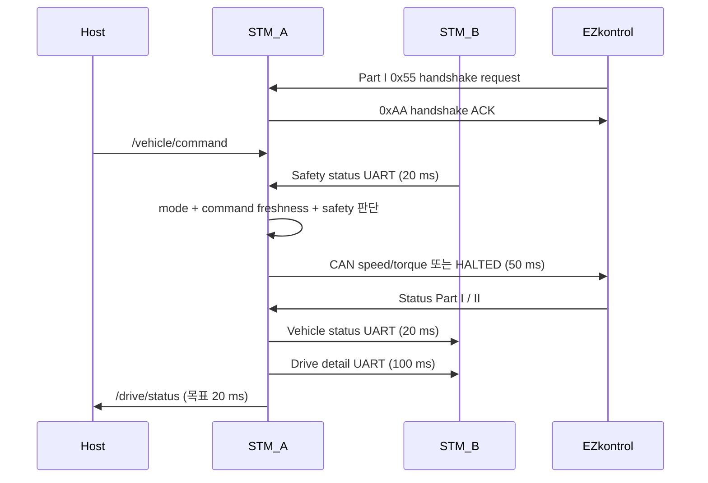

# STM_A Firmware

> 이 문서는 현재 작업 브랜치의 소스 코드를 기준으로 작성되었습니다.
> 코드 변경 시 핀, 주기, timeout, 통신 ID와 안전 조건을 함께 갱신해야 합니다.

## 1. 역할

STM_A는 STM32G474 기반의 차량 입력·종방향 구동 보드입니다. 물리 페달·모드·기어를
읽고, AUTO에서는 ROS 2 속도 명령을 받아 EZkontrol 모터 드라이버에 CAN command를
보냅니다. STM_B와 safety 상태를 교환하며 구동 정지 여부를 최종 적용합니다.

## 2. 담당 기능

- 가속 페달 ADC 입력과 0~100% 변환
- 물리 MANUAL/AUTO 모드와 FORWARD/REVERSE 기어 입력
- EZkontrol handshake, speed/torque command, Part I/II status 수신
- STM_B에 mode·gear·현재 속도 전송
- STM_B의 final brake request 수신과 UART timeout 감시
- `/vehicle/command` 구독과 `/drive/status` 발행
- AUTO Host command timeout과 traction HALTED 처리

## 3. 보드와 MCU

| 항목 | 값 |
|---|---|
| 보드 | NUCLEO-G474RE |
| MCU | STM32G474RETx, Cortex-M4F |
| 시스템 clock | HSI 16 MHz → PLL(M=4, N=85, R=2) → 170 MHz, FLASH latency 4 |
| FLASH | origin `0x08000000`, 512 KB |
| RAM | origin `0x20000000`, 128 KB |
| 고정 장치 이름 | 실차 `/dev/stm_a`, HIL bench `/dev/hil_a` |
| CubeMX 프로젝트 | `STM_A.ioc` |

## 4. 핀맵

핀 이름 정의는 `Core/Inc/main.h`, 초기화는 `Core/Src/gpio.c`와 각 Peripheral
파일에 있습니다. 아래 표는 두 곳을 대조해 정리한 것입니다.

보드 커넥터 번호는 NUCLEO-G474RE(MB1367)의 ST morpho 헤더 기준입니다. `CN7`과
`CN10`은 각각 2×19 헤더이고 홀수 번호와 짝수 번호가 각각 한 열을 이룹니다.
괄호 안의 `A0`·`D7`은 같은 신호가 나오는 Arduino Uno 헤더 실크스크린 이름이며,
표기가 없는 핀은 morpho 헤더에서만 나옵니다. 물리적 배치는 보드 매뉴얼 UM2505를
확인하십시오. GND는 `CN7-8`, `CN7-19`, `CN7-20`, `CN7-22`, `CN10-9`, `CN10-20`에
있습니다.

### 4.1 신호 핀

| MCU 핀 | 보드 커넥터 | 신호 이름 | 방향 | 전기적 설정 | 의미 |
|---|---|---|---|---|---|
| `PA0` | `CN7-28` (A0) | 가속 페달 (`ADC1_IN1`) | 입력 (analog) | 12-bit, single-ended, software trigger | raw `560`=0%, raw `3000`=100% |
| `PA8` | `CN10-23` (D7) | `SW_MODE` | 입력 (digital) | internal pull-up | LOW=AUTO(`1`), HIGH=MANUAL(`0`) |
| `PA9` | `CN10-21` (D8) | `SW_GEAR` | 입력 (digital) | internal pull-up | LOW=REVERSE(`1`), HIGH=FORWARD(`0`) |

모드·기어 스위치는 internal pull-up이므로 접점을 GND에 붙였을 때 AUTO와 REVERSE가
됩니다. 두 신호에는 EXTI를 걸지 않고 `Inputs` Task가 주기적으로 polling합니다.

### 4.2 통신·주변장치 핀

| MCU 핀 | 보드 커넥터 | Peripheral | 용도 | 설정 | 관련 파일 |
|---|---|---|---|---|---|
| `PA11` | `CN10-14` | `FDCAN1_RX` | EZkontrol CAN | Classic CAN, extended ID, 250 kbit/s | `Core/Src/fdcan.c` |
| `PA12` | `CN10-12` | `FDCAN1_TX` | EZkontrol CAN | 동일 bus | `Core/Src/fdcan.c` |
| `PA2` | `CN10-35` | `LPUART1_TX` | micro-ROS transport | 460800 8N1, DMA1 CH2 | `Core/Src/usart.c` |
| `PA3` | `CN10-37` | `LPUART1_RX` | micro-ROS transport | 460800 8N1, DMA1 CH1 | `Core/Src/usart.c` |
| `PC4` | `CN10-34` | `USART1_TX` | STM_B 보드 간 UART | 115200 8N1, DMA1 CH4 | `Core/Src/usart.c` |
| `PC5` | `CN10-6` | `USART1_RX` | STM_B 보드 간 UART | Receive-to-Idle circular DMA, DMA1 CH3 | `Core/Src/usart.c` |

`ADC1`에는 DMA1 CH5가 설정돼 있지만 현재 Inputs는 polling으로 변환합니다. FDCAN 핀은 반드시 CAN transceiver를 거쳐야 하며
MCU 핀을 CANH/CANL에 직접 연결하면 안 됩니다. `PA2`/`PA3`은 NUCLEO의 ST-LINK
virtual COM port와 연결된 핀이므로 morpho 자리에 다른 신호를 물리면 micro-ROS
transport와 충돌합니다.

### 4.3 디버그·예약 핀

| MCU 핀 | 보드 커넥터 | 신호 | 비고 |
|---|---|---|---|
| `PA13` | `CN7-13` | `SWDIO` | ST-LINK SWD |
| `PA14` | `CN7-15` | `SWCLK` | ST-LINK SWD |
| `PB3` | `CN10-31` (D3) | `SWO` | trace 출력 |
| `PF0`/`PF1` | `CN7-29`/`CN7-31` | `RCC_OSC_IN`/`RCC_OSC_OUT` | `.ioc`에만 잡혀 있고 실제 clock은 HSI PLL |
| `PC14`/`PC15` | `CN7-25`/`CN7-27` | `RCC_OSC32_IN`/`RCC_OSC32_OUT` | application 미사용 |

### 4.4 배선 상대

| STM_A 핀 | 실차 연결 | HIL bench 연결 |
|---|---|---|
| `PA0` `CN7-28` | 가속 페달 포텐쇼미터 출력 | STM_TEST `PA4` `CN7-32` (`DAC1_OUT1`) |
| `PA8` `CN10-23` | MANUAL/AUTO 모드 스위치 | STM_TEST `PC0` `CN7-38` (`HIL_MODE_OUT`) |
| `PA9` `CN10-21` | FORWARD/REVERSE 기어 스위치 | STM_TEST `PC1` `CN7-36` (`HIL_GEAR_OUT`) |
| `PA11`/`PA12` `CN10-14`/`CN10-12` | CAN transceiver → EZkontrol | CAN transceiver → STM_TEST `FDCAN1` (`CN10-14`/`CN10-12`) |
| `PC4` `CN10-34` | STM_B `PC5` `CN10-6` (TX→RX) | 동일 |
| `PC5` `CN10-6` | STM_B `PC4` `CN10-34` (RX←TX) | 동일 |
| `PA2`/`PA3` `CN10-35`/`CN10-37` | ST-LINK virtual COM port → micro-ROS Agent | 동일 |

모든 상대 보드와 signal ground를 공유해야 합니다. 아날로그·GPIO 신호는 3.3 V
logic 기준입니다.

## 5. 소프트웨어 구조

| 파일 | 역할 |
|---|---|
| `Core/Src/main.c` | clock·Peripheral·RTOS 초기화 |
| `Core/Src/app_freertos.c` | 전체 Task, ROS 2, CAN protocol, UART parser와 안전 로직 |
| `Core/Src/globals.c` | Task·ISR 공유 상태와 fail-safe 초기값 |
| `Core/Src/fdcan.c` | FDCAN timing, 핀과 interrupt 설정 |
| `Core/Src/usart.c` | micro-ROS LPUART1과 보드 간 USART1 설정 |
| `Core/Src/adc.c`, `gpio.c` | 페달·스위치 입력 하드웨어 설정 |
| `Middlewares/micro_ros/` | 정적 micro-ROS library, headers와 custom transport |

Queue, semaphore, mutex, software timer는 생성하지 않습니다. ISR→Task UART 전달은
원형 buffer, E-stop과 shared 상태 snapshot은 FreeRTOS critical section을
사용합니다. CAN status parsing은 FDCAN ISR callback에서 수행합니다.

인터럽트 우선순위는 `FDCAN1_IT0_IRQn`과 `USART1_IRQn` 모두 5입니다.

## 6. FreeRTOS Task

| Task | 역할 | 주기/Trigger | 우선순위 (CMSIS 값) | Stack (words) |
|---|---|---|---|---:|
| `Control` | EZkontrol command / HALTED | absolute 50 ms; handshake 대기 10 ms | `Realtime` (48) | 512 |
| `Inputs` | 페달 ADC 8회 평균, mode·gear GPIO | absolute 50 ms | `High` (40) | 256 |
| `uROS` | Agent 상태, command 수신, status 발행 | 상태 머신; running 후 5 ms delay, status 목표 20 ms | `Normal` (24) | 1536 |
| `BRx` | safety frame parse, timeout·stop 계산 | 작업 후 1 ms delay | `High1` (41) | 256 |
| `BTx` | vehicle status / drive detail 송신 | absolute 20 ms / detail 100 ms | `Low` (8) | 256 |
| `PerfMon` | runtime snapshot 집계 | 약 1 Hz | `Low` (8) | 256 |

모두 `.ioc` baseline의 Dynamic task이며 1 word는 4 bytes입니다. MotorRx는
CubeMX에서 제거됐습니다. 실제 CAN RX는 기존 `HAL_FDCAN_RxFifo0Callback()`이
그대로 담당하며 CAN 수신 기능은 바꾸지 않았습니다.

Control/Inputs/BTx는 최초 scheduled release phase를 유지하는 `vTaskDelayUntil()`
기반입니다. 늦게 시작하거나 작업이 길어져도 actual/completion에 re-anchor하지 않고,
완료 tick 이하의 release를 period 단위로 건너뛰어 첫 미래 scheduled release를
기다립니다. 밀린 release를 재실행하지 않습니다. 정상 EZkontrol 50 ms cadence와 safety UART
100 ms / AUTO host 500 ms timeout 상수 및 판단 로직은 유지합니다.

Inputs의 task-alive LED toggle은 제거했습니다. ADC는 software-trigger single
conversion 8회 polling을 유지합니다. DMA1 CH5는 초기화·연결만 되어 있고,
`HAL_ADC_Start_DMA()`를 호출하지 않습니다. 현재 sampling time은 247.5 cycles입니다.
ADC 실패 시 기존 10 ms polling timeout이 8회 발생할 수 있으므로 observed wall time과
miss를 확인해야 합니다. 페달 필터·실패 처리·DMA 수집 방식 재설계는 이번 범위에서
수행하지 않았습니다.

BRx 1 ms polling은 수신이 없어도 timeout/stop/restart를 평가합니다. BTx의 local
frame buffer와 blocking UART TX(10 ms timeout)도 유지합니다. DMA/notification 전환
판단과 계측 정의·snapshot API는 [공통 runtime metrics 문서](../common/README.md)를
참고하십시오. PerfMon은 ROS publish를 하지 않습니다.

## 7. 외부 인터페이스

LPUART1(`PA2`/`PA3`) custom transport가 별도의 micro-ROS Agent에 연결됩니다. Agent
발견은 500 ms마다 시도하고 ping call timeout은 100 ms입니다. node 이름은
`/stm_a_node`이며 publisher와 subscriber는 micro-ROS default QoS를 사용합니다.
메시지 원본은 별도 `kaiev26_msgs` 저장소를 따릅니다.

### Subscribers

| Topic | Type | Callback | 설명 |
|---|---|---|---|
| `/vehicle/command` | `kaiev26_msgs/msg/ActuatorCommand` | `cb_cmd` | `speed_target_mps`, `brake_engage` 사용 |

### Publishers

| Topic | Type | 주기 | 설명 |
|---|---|---:|---|
| `/drive/status` | `kaiev26_msgs/msg/DriveActuatorStatus` | 목표 20 ms | mode·gear·속도, command·CAN status freshness와 진단 |

## 8. 동작 상세

### 8.1 EZkontrol CAN (`PA11`/`PA12`)

STM_A는 handshake ACK가 CAN TX FIFO에 들어가기 전에는 traction command를 보내지
않습니다. 완료 후 `Control` Task가 AUTO speed-control 또는 MANUAL torque-control
command를 50 ms nominal 주기로 보냅니다.

- command: `0x0C01EFD0`
- status Part I: `0x1801D0EF`
- status Part II: `0x1802D0EF`
- 전진 motor RPM 한계: `4500`
- 후진 motor RPM 한계: `-1500`
- AUTO phase-current 한계: `480 A`
- MANUAL torque-current 한계: `480 A`

Part I의 motor RPM 원본은 `/drive/status.motor_rpm`에 그대로 발행합니다. 차량 속도는
움직이던 중 정확히 `0 rpm`인 Part I 샘플을 직전 nonzero RPM으로 최대 2회 hold한
값에서 계산하며, 세 번째 연속 `0 rpm`부터 정지로 반영합니다. 따라서 일반 nonzero
RPM에는 LPF나 고정 지연이 추가되지 않습니다.

byte layout, 물리 단위와 handshake frame은
[`../../docs/INTERFACES.md`](../../docs/INTERFACES.md#6-ezkontrol-can)를
기준으로 합니다.

### 8.2 STM_B UART (`PC4`/`PC5`)

USART1으로 다음 frame을 교환합니다.

- STM_A → STM_B vehicle status: 20 ms, mode·gear·speed
- STM_A → STM_B drive detail: 100 ms, bus 전압·bus/phase 전류, 모터/컨트롤러 온도,
  fault와 command 상태
- STM_B → STM_A safety status: 20 ms, final brake request
- STM_B safety timeout: 100 ms

frame은 SOF `AA 55`, type, payload length, sequence, payload, CRC-8로 구성됩니다.
상세 layout은
[`../../docs/INTERFACES.md`](../../docs/INTERFACES.md#5-stm_a--stm_b-uart)를
참고하십시오.

### 8.3 입력 처리

가속 페달 (`PA0`):

- ADC raw 8회 평균
- raw clamp: `560`~`3000`
- 선형 변환: `0`~`100%`
- 계산 결과 2% 미만은 0%

현재 raw clamp 값은 코드 상수이며 실차 calibration revision이나 측정 근거 파일은
현재 코드에서 확인되지 않습니다.

모드와 기어 스위치, 두 입력 모두 pull-up입니다.

| 입력 | MCU 핀 | 보드 커넥터 | GPIO low | GPIO high |
|---|---|---|---|---|
| `SW_MODE` | `PA8` | `CN10-23` (D7) | AUTO (`1`) | MANUAL (`0`) |
| `SW_GEAR` | `PA9` | `CN10-21` (D8) | REVERSE (`1`) | FORWARD (`0`) |

### 8.4 제어 흐름



AUTO 속도는 `speed_target_mps`를 타이어 지름 `0.47 m`, 감속비 `4.60`으로
motor RPM에 변환합니다. MANUAL에서는 pedal percentage를 torque current로
변환하고 물리 gear로 부호를 정합니다.

### 8.5 안전 동작

STM_A는 다음 중 하나이면 EZkontrol에 RPM 0, current 0, RUNNING 0의 HALTED
command를 보냅니다.

- STM_B final brake request
- STM_B safety frame invalid 또는 100 ms timeout
- AUTO Host `brake_engage`
- AUTO Host command 미수신 또는 500 ms timeout

상세 논리와 복구 조건은
[`../../docs/SAFETY.md`](../../docs/SAFETY.md)를 기준으로 합니다.

## 9. 빌드

권장 워크스페이스인 `~/KAI_ws` 루트에서 STM_A만 Release로 빌드합니다.

```bash
cd ~/KAI_ws
cmake -S src/Control/firmware/STM_A --preset Release
cmake --build src/Control/firmware/STM_A/build/Release
```

결과물은 `src/Control/firmware/STM_A/build/Release/STM_A.elf`입니다. STM_A preset은
`/opt/st/stm32cubeclt_1.20.0/`의 `arm-none-eabi` compiler 경로를 명시합니다. 공통
toolchain과 micro-ROS Agent 빌드는 [`../README.md`](../README.md)를 참고하십시오.

## 10. 플래시 및 실행

`STM32_Programmer_CLI`로 probe SN을 지정해 flash합니다. 절차 전체(빌드,
SN 확인, flash, 고정 이름·역할 확인)는
[`../../docs/VEHICLE_RUNBOOK.md`](../../docs/VEHICLE_RUNBOOK.md#5-보드-교체-시)를
따르고, 여러 보드가 꽂힌 상태라면 먼저
[`../../docs/HIL_RUNBOOK.md`](../../docs/HIL_RUNBOOK.md#플래시-전-swd-target-확인)의
SWD target 확인을 거칩니다.

Agent는 STM_A의 LPUART1 장치에 하나 붙입니다.

```bash
cd ~/KAI_ws
si
ros2 run micro_ros_agent micro_ros_agent serial --dev /dev/stm_a -b 460800
```

> **경고:** STM_B와 혼동하지 않도록 보드, serial device와 연결된 액추에이터를
> 먼저 확인하십시오. serial symlink는 virtual COM port 식별일 뿐 SWD target
> 확인을 대신하지 않습니다.

## 11. 상태 확인

Agent 연결 후 다음을 확인합니다.

```bash
ros2 node info /stm_a_node
ros2 topic info -v /vehicle/command
ros2 topic echo /drive/status
```

`/drive/status`에서 `command_timeout`, `stop_request`, `part1_valid`,
`part2_valid`, 각 age와 `fault_bits`를 함께 확인하십시오.

## 12. 알려진 제한사항

- EZkontrol Part I/II 200 ms timeout은 진단 valid flag만 내리고 traction을
  HALTED로 만들지 않습니다.
- CAN TX 실패를 latch하는 fault 상태 머신은 없습니다. `tractive_commanded`는 매
  주기 덮어써지므로 순간적인 TX 실패는 흔적 없이 사라집니다.
- STM_A 자신의 FDCAN controller 상태를 알 수 없습니다. `part1_valid=false`는
  EZkontrol 전원이 나간 경우와 STM_A CAN이 오류 상태로 송신을 못 하는 경우에
  똑같이 나타납니다.
- MCU independent watchdog 사용은 현재 코드에서 확인되지 않습니다.
- pedal calibration 값은 코드 상수이고 별도 calibration metadata가 없습니다.
- `SW_MODE`·`SW_GEAR`에 software debounce가 없습니다.
- 실차 connector pinout은 문서화 필요 상태입니다. 위 핀맵은 MCU 핀
  기준이며 실차 하네스 connector 번호는 아직 정리되지 않았습니다.

### 다음 `kaiev26_msgs` 개정에 함께 넣을 후보

위 두 CAN 관련 항목은 `DriveActuatorStatus`에 field를 추가해야 해결됩니다. 지금
단독으로 착수하지 않는 이유는 펌웨어 변경이 작은 데 비해 배포 비용이 크기
때문입니다. 메시지가 바뀌면 STM_A와 STM_B의 micro-ROS type support를 함께
재생성·재빌드하고 **두 보드를 모두 재플래시**해야 합니다
([`../../docs/HIL_RUNBOOK.md`](../../docs/HIL_RUNBOOK.md#topic-traffic은-있는데-typed-message가-깨짐)).

그 비용은 field를 몇 개 넣든 한 번만 내면 되므로, 다른 이유로 `kaiev26_msgs`를
개정할 때 아래를 함께 넣는 것이 가장 저렴합니다.

```
uint32 can_tx_fail_count      # TX 실패 누적. latch 대용
bool   can_bus_off
bool   can_error_passive
uint8  can_tx_error_count     # TEC. 배선·종단 열화의 조기 지표
```

`tractive_commanded` 자체를 latch시키는 방식은 쓰지 마십시오.
`diagnostics_publisher`가 `tractive_commanded != tractive_feedback`을 불일치
오류로 판정하므로, 한 번의 순간적 실패가 영구 고장으로 표시됩니다.

STM_TEST에는 같은 값이 이미 `protocol=3` STATUS로 노출되어 있어
([`../STM_TEST/README.md`](../STM_TEST/README.md#fdcan-bus-status-field)) field 이름과
의미를 그대로 따르면 됩니다. 2026-08-14 bench 실측에서 `can0` 단절은
error-passive이고 상대가 돌아오면 자동 복구되는 것으로 확인됐으므로, 이 field는
복구 조치를 위한 것이 아니라 원인 구분과 배선 건전성 추세를 보기 위한 것입니다.

## 13. 관련 문서

- 펌웨어 공통 빌드·Agent: [`../README.md`](../README.md)
- 상대 보드: [`../STM_B/README.md`](../STM_B/README.md)
- HIL emulator: [`../STM_TEST/README.md`](../STM_TEST/README.md)
- 시스템 구조: [`../../docs/ARCHITECTURE.md`](../../docs/ARCHITECTURE.md)
- 통신 계약: [`../../docs/INTERFACES.md`](../../docs/INTERFACES.md)
- 안전 설계: [`../../docs/SAFETY.md`](../../docs/SAFETY.md)

## Runtime diagnostics ROS interface

`/stm_a/runtime_stats`는 `kaiev26_msgs/msg/RuntimeStats`를 약 1 Hz,
best-effort로 발행합니다. 기존 uROS task만 publisher를 소유하고 PerfMon은
aggregate/snapshot만 수행합니다. 진단 실패는 safety fault나 연결 teardown 조건이
아닙니다. 고정 `TaskRuntimeStats[9]`, board/task ID, µs/ms/bytes 단위와 누적값,
1 ms jitter 해상도, CPU load 미지원 및 E-stop callback→task latency 경계는
[공통 runtime 문서](../common/README.md#host-tests--ros-연결)를 따릅니다.

```bash
ros2 topic type /stm_a/runtime_stats
ros2 topic hz /stm_a/runtime_stats
ros2 topic echo /stm_a/runtime_stats --once --qos-reliability best_effort
```

RuntimeStats 적용 firmware의 LPUART1과 Agent는 모두 **460800 baud**를 사용합니다.
이전 115200 firmware를 사용할 때만 launch에 `agent_baud:=115200`을 지정하십시오.
보드 간 USART1과 STM_TEST/Arduino serial은 115200으로 유지합니다.
