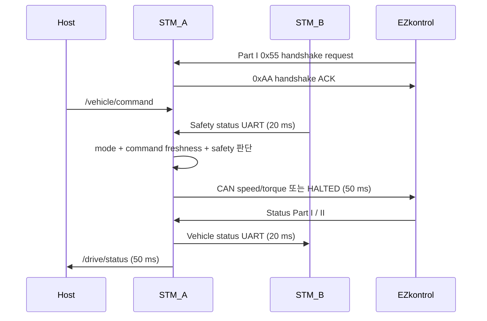

# STM_A Firmware

> 이 문서는 현재 작업 브랜치의 소스 코드를 기준으로 작성되었습니다.
> 코드 변경 시 주기, timeout, 핀, 통신 ID와 안전 조건을 함께 갱신해야 합니다.

## 1. 역할

STM_A는 STM32G474 기반의 차량 입력·종방향 구동 보드입니다. 물리 페달·모드·기어를
읽고, AUTO에서는 ROS 2 속도 명령을 받아 EZkontrol 모터 드라이버에 CAN command를
보냅니다. STM_B와 safety 상태를 교환하며 구동 정지 여부를 최종 적용합니다.

## 2. 담당 기능

- 가속 페달 ADC 입력과 0~100% 변환
- 물리 MANUAL/AUTO 모드와 FORWARD/REVERSE 기어 입력
- EZkontrol handshake, speed/torque command, Part I/II status 수신
- STM_B에 mode·gear·현재 속도 전송
- STM_B의 final brake request 수신과 UART timeout 감시
- `/vehicle/command` 구독과 `/drive/status` 발행
- AUTO Host command timeout과 traction HALTED 처리

## 3. 하드웨어 및 Peripheral

| Peripheral | 용도 | 설정 | 관련 파일 |
|---|---|---|---|
| `FDCAN1` | EZkontrol CAN | `PA11 RX`, `PA12 TX`, Classic CAN, extended ID, 250 kbit/s | `Core/Src/fdcan.c` |
| `LPUART1` | micro-ROS transport | `PA2 TX`, `PA3 RX`, 115200 8N1, RX/TX DMA | `Core/Src/usart.c` |
| `USART1` | STM_B UART | `PC4 TX`, `PC5 RX`, 115200 8N1, Receive-to-Idle circular DMA | `Core/Src/usart.c` |
| `ADC1 IN1` | 가속 페달 | `PA0`, 12-bit, single-ended, software trigger | `Core/Src/adc.c` |
| GPIO input | mode·gear | `PA8`, `PA9`, pull-up | `Core/Inc/main.h`, `Core/Src/gpio.c` |
| FDCAN IRQ | Part I/II 수신 | `FDCAN1_IT0_IRQn`, priority 5 | `Core/Src/fdcan.c` |
| USART IRQ/DMA | STM_B frame 수신 | `USART1_IRQn`, priority 5, DMA1 CH3/4 | `Core/Src/usart.c` |

시스템 clock은 HSI+PLL 170 MHz이며 MCU target과 linker script는
STM32G474 Cortex-M4F를 기준으로 합니다.

## 4. 소프트웨어 구조

| 파일 | 역할 |
|---|---|
| `Core/Src/main.c` | clock·Peripheral·RTOS 초기화 |
| `Core/Src/app_freertos.c` | 전체 Task, ROS 2, CAN protocol, UART parser와 안전 로직 |
| `Core/Src/globals.c` | Task·ISR 공유 상태와 fail-safe 초기값 |
| `Core/Src/fdcan.c` | FDCAN timing, pin과 interrupt 설정 |
| `Core/Src/usart.c` | micro-ROS LPUART1과 보드 간 USART1 설정 |
| `Core/Src/adc.c`, `gpio.c` | 페달·스위치 입력 하드웨어 설정 |
| `Middlewares/micro_ros/` | 정적 micro-ROS library, headers와 custom transport |

Queue, semaphore, mutex, software timer는 생성하지 않습니다. ISR→Task UART 전달은
원형 buffer, E-stop과 shared 상태 snapshot은 FreeRTOS critical section을
사용합니다. CAN status parsing은 FDCAN ISR callback에서 수행합니다.

## 5. FreeRTOS Task

| Task | 역할 | 주기/Trigger | 우선순위 | 관련 파일 |
|---|---|---:|---|---|
| `Control` | mode별 EZkontrol command와 HALTED 적용 | nominal 50 ms; handshake 대기는 10 ms | `Realtime` | `app_freertos.c` |
| `Inputs` | 페달 8회 ADC 평균, mode·gear GPIO | blocking ADC 처리 후 50 ms delay | `High` | `app_freertos.c` |
| `MotorRx` | 현재는 대기만 수행; 실제 RX는 FDCAN callback | 20 ms | `AboveNormal` | `app_freertos.c` |
| `uROS` | Agent 연결 상태 머신, command callback, status publish | running loop 5 ms; status 50 ms | `Normal` | `app_freertos.c` |
| `BRx` | STM_B safety frame parse와 timeout·stop 계산 | continuous loop, 1 ms delay | `High1` | `app_freertos.c` |
| `BTx` | STM_B로 vehicle status 송신 | 20 ms | `Low` | `app_freertos.c` |

`osDelay()` 값은 nominal delay이며 Task 수행 시간은 별도로 더해집니다.

## 6. micro-ROS 인터페이스

LPUART1 custom transport가 별도의 micro-ROS Agent에 연결됩니다. Agent 발견은
500 ms마다 시도하고 ping call timeout은 100 ms입니다.

### Subscribers

| Topic | Type | Callback | 설명 |
|---|---|---|---|
| `/vehicle/command` | `kaiev26_msgs/msg/ActuatorCommand` | `cb_cmd` | `speed_target_mps`, `brake_engage` 사용 |

### Publishers

| Topic | Type | 주기 | 설명 |
|---|---|---:|---|
| `/drive/status` | `kaiev26_msgs/msg/DriveActuatorStatus` | 50 ms | mode·gear·속도, command·CAN status freshness와 진단 |

node 이름은 `/stm_a_node`이며 publisher와 subscriber는 micro-ROS default QoS를
사용합니다. 메시지 원본은 별도 `kaiev26_msgs` 저장소를 따릅니다.

## 7. EZkontrol CAN

STM_A는 handshake ACK가 CAN TX FIFO에 들어가기 전에는 traction command를 보내지
않습니다. 완료 후 Control task가 AUTO speed-control 또는 MANUAL torque-control
command를 50 ms nominal 주기로 보냅니다.

- command: `0x0C01EFD0`
- status Part I: `0x1801D0EF`
- status Part II: `0x1802D0EF`
- 전진 motor RPM 한계: `4500`
- 후진 motor RPM 한계: `-1500`
- AUTO phase-current 한계: `300 A`
- MANUAL torque-current 한계: `175 A`

byte layout, 물리 단위와 handshake frame은
[`../../docs/INTERFACES.md`](../../docs/INTERFACES.md#6-ezkontrol-can)를
기준으로 합니다.

## 8. STM_B UART

USART1으로 다음 두 frame을 교환합니다.

- STM_A → STM_B vehicle status: 20 ms, mode·gear·speed
- STM_B → STM_A safety status: 20 ms, final brake request
- STM_B safety timeout: 100 ms

frame은 SOF `AA 55`, type, payload length, sequence, payload, CRC-8로 구성됩니다.
상세 layout은
[`../../docs/INTERFACES.md`](../../docs/INTERFACES.md#5-stm_a--stm_b-uart)를
참고하십시오.

## 9. 입력 처리

### 가속 페달

- ADC raw 8회 평균
- raw clamp: `560`~`3100`
- 선형 변환: `0`~`100%`
- 계산 결과 2% 미만은 0%

현재 raw clamp 값은 코드 상수이며 실차 calibration revision이나 측정 근거 파일은
현재 코드에서 확인되지 않습니다.

### mode와 gear

두 입력 모두 pull-up입니다.

| 입력 | GPIO low | GPIO high |
|---|---|---|
| `SW_MODE` (`PA8`) | AUTO (`1`) | MANUAL (`0`) |
| `SW_GEAR` (`PA9`) | REVERSE (`1`) | FORWARD (`0`) |

## 10. 제어 흐름



AUTO 속도는 `speed_target_mps`를 타이어 지름 `0.47 m`, 감속비 `4.60`으로
motor RPM에 변환합니다. MANUAL에서는 pedal percentage를 torque current로
변환하고 물리 gear로 부호를 정합니다.

## 11. 안전 동작

STM_A는 다음 중 하나이면 EZkontrol에 RPM 0, current 0, RUNNING 0의 HALTED
command를 보냅니다.

- STM_B final brake request
- STM_B safety frame invalid 또는 100 ms timeout
- AUTO Host `brake_engage`
- AUTO Host command 미수신 또는 500 ms timeout

상세 논리와 복구 조건은
[`../../docs/SAFETY.md`](../../docs/SAFETY.md)를 기준으로 합니다.

## 12. 빌드

권장 워크스페이스인 `~/KAI_ws` 루트에서 STM_A만 Release로 빌드합니다.

```bash
cd ~/KAI_ws
cmake -S src/Control/firmware/STM_A --preset Release
cmake --build src/Control/firmware/STM_A/build/Release
```

결과물은 `src/Control/firmware/STM_A/build/Release/STM_A.elf`입니다. 공통 toolchain과
micro-ROS Agent 빌드는 [`../README.md`](../README.md)를 참고하십시오.

## 13. 플래시 및 실행

현재 저장소에는 ST-Link flash command나 board-specific flash script가 없습니다.
사용하는 ST-Link 환경에서 `STM_A.elf`를 대상 STM_A 보드에 flash하십시오.

> **경고:** STM_B와 혼동하지 않도록 보드, serial device와 연결된 액추에이터를
> 먼저 확인하십시오. linker script의 FLASH origin은 `0x08000000`이지만, 사용하는
> 도구의 flash·reset 명령은 현재 저장소에 없어 TBD입니다.

## 14. 상태 확인

Agent 연결 후 다음을 확인합니다.

```bash
ros2 node info /stm_a_node
ros2 topic info -v /vehicle/command
ros2 topic echo /drive/status
```

`/drive/status`에서 `command_timeout`, `stop_request`, `part1_valid`,
`part2_valid`, 각 age와 `fault_bits`를 함께 확인하십시오.

## 15. 알려진 제한사항

- EZkontrol Part I/II 200 ms timeout은 진단 valid flag만 내리고 traction을
  HALTED로 만들지 않습니다.
- CAN TX 실패를 latch하는 fault 상태 머신은 없습니다.
- MCU independent watchdog 사용은 현재 코드에서 확인되지 않습니다.
- pedal calibration 값은 코드 상수이고 별도 calibration metadata가 없습니다.
- `MotorRx` Task는 실제 수신 작업을 하지 않으며 CAN callback이 처리합니다.
- flash 절차와 실차 connector pinout은 문서화 필요 상태입니다.

## 16. 관련 문서

- 펌웨어 공통 빌드·Agent: [`../README.md`](../README.md)
- 시스템 구조: [`../../docs/ARCHITECTURE.md`](../../docs/ARCHITECTURE.md)
- 통신 계약: [`../../docs/INTERFACES.md`](../../docs/INTERFACES.md)
- 안전 설계: [`../../docs/SAFETY.md`](../../docs/SAFETY.md)
