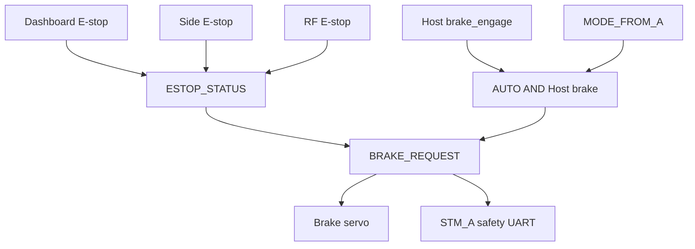

# STM_B Firmware

## 1. 역할

STM_B는 STM32G474 기반의 물리 E-stop·브레이크 보드입니다. 세 E-stop 입력과 AUTO
Host brake를 조합해 최종 `BRAKE_REQUEST`를 만들고, 브레이크 서보를 직접
구동하며 같은 요청을 STM_A에 전달합니다.

## 2. 담당 기능

- dashboard, side, RF 세 active-low E-stop 판독
- `/vehicle/command.brake_engage` 수신
- STM_A UART에서 mode·gear·speed 수신
- 최종 brake request 계산과 STM_A 전달
- TIM2 PWM brake servo 직접 구동
- `/brake/status` 발행
- LCD에 속도·기어·mode·brake·통신 fault 표시

## 3. 하드웨어 및 Peripheral

| Peripheral | 용도 | 설정 | 관련 파일 |
|---|---|---|---|
| GPIO `PC0` | Dashboard E-stop | pull-up, both-edge EXTI, active-low | `Core/Inc/main.h`, `Core/Src/gpio.c` |
| GPIO `PC1` | Side E-stop | pull-up, both-edge EXTI, active-low | `Core/Inc/main.h`, `Core/Src/gpio.c` |
| GPIO `PB4` | RF E-stop | pull-up, both-edge EXTI, active-low | `Core/Inc/main.h`, `Core/Src/gpio.c` |
| `TIM2 CH2` | brake servo PWM | `PB3`, 50 Hz, 1 µs timer tick | `Core/Src/tim.c` |
| `LPUART1` | micro-ROS transport | `PA2 TX`, `PA3 RX`, 115200 8N1, RX/TX DMA | `Core/Src/usart.c` |
| `USART1` | STM_A UART | `PC4 TX`, `PC5 RX`, 115200 8N1, Receive-to-Idle circular DMA | `Core/Src/usart.c` |
| `SPI2`·GPIO | LCD dashboard | SPI LCD와 CS/RST/DC/BL GPIO | `Core/Src/spi.c`, `lcd.c`, `display_app.c` |
| `FDCAN1` | 현재 application 미사용 | 초기화는 수행되나 송수신 로직 없음 | `Core/Src/main.c`, `fdcan.c` |
| GPIO `PC13` | green LED | push-pull output | `Core/Src/gpio.c` |

E-stop EXTI IRQ priority는 5이며 ISR은 EStop Task에 event flag만 전달합니다.
시스템 clock은 170 MHz입니다.

## 4. 소프트웨어 구조

| 파일 | 역할 |
|---|---|
| `Core/Src/main.c` | clock·Peripheral·RTOS 초기화 |
| `Core/Src/app_freertos.c` | Task, brake 결정, PWM 목표, ROS 2와 UART protocol |
| `Core/Src/globals.c` | 공유 상태와 brake-engaged 초기값 |
| `Core/Src/tim.c` | 50 Hz brake PWM |
| `Core/Src/gpio.c` | E-stop input과 EXTI 설정 |
| `Core/Src/display_app.c` | 100 ms dashboard update |
| `Core/Src/usart.c` | micro-ROS LPUART1과 STM_A USART1 |
| `Middlewares/micro_ros/` | 정적 micro-ROS library, headers와 custom transport |

Queue, semaphore, mutex, software timer는 생성하지 않습니다. E-stop ISR→Task 전달은
thread flag, UART ISR→Task 전달은 원형 buffer, 공유 snapshot은 critical section을
사용합니다.

## 5. FreeRTOS Task

| Task | 역할 | 주기/Trigger | 우선순위 | 관련 파일 |
|---|---|---:|---|---|
| `Brake` | brake target에 따라 servo pulse ramp | 5 ms loop, 20 ms step | `High1` | `app_freertos.c` |
| `EStop` | GPIO 재판독과 final brake 계산 | edge flag 또는 최대 10 tick | `Realtime` | `app_freertos.c` |
| `uROS` | Agent 연결, command callback, status publish | 5 ms running loop, 50 ms status | `Normal` | `app_freertos.c` |
| `Display` | LCD dashboard | 내부 update 100 ms | `Low` | `display_app.c` |
| `ARx` | STM_A vehicle frame parse와 timeout | continuous loop, 1 ms delay | `AboveNormal` | `app_freertos.c` |
| `ATx` | STM_A로 safety frame 송신 | 20 ms | `High` | `app_freertos.c` |

## 6. micro-ROS 인터페이스

LPUART1 custom transport는 보드 전용 micro-ROS Agent에 연결됩니다. Agent ping
period는 500 ms, ping call timeout은 100 ms입니다.

### Subscribers

| Topic | Type | Callback | 설명 |
|---|---|---|---|
| `/vehicle/command` | `kaiev26_msgs/msg/ActuatorCommand` | `cb_cmd` | `brake_engage`만 사용 |

### Publishers

| Topic | Type | 주기 | 설명 |
|---|---|---:|---|
| `/brake/status` | `kaiev26_msgs/msg/BrakeActuatorStatus` | 50 ms 및 reason 변경 시 | commanded brake, reason bits, command age |

node 이름은 `/stm_b_node`입니다. brake servo에는 feedback signal이 없으므로
`actual_valid=false`를 고정 발행합니다.

## 7. E-stop 입력

| 이름 | Pin | Active | 최종 상태 |
|---|---|---|---|
| Dashboard | `PC0` | low | `ESTOP_DASHBOARD` |
| Side | `PC1` | low | `ESTOP_SIDE` |
| RF | `PB4` | low | `ESTOP_RF` |

```text
ESTOP_STATUS = dashboard OR side OR rf
```

- internal pull-up 사용
- rising/falling edge interrupt 사용
- Task가 10 tick timeout마다 다시 읽음
- software debounce 없음
- latch 없음
- 세 입력이 모두 high이면 다음 update에서 해제
- MANUAL/AUTO 모두 동일하게 brake에 적용

UART와 ROS 2에는 합쳐진 E-stop 원인만 전달하고 개별 입력은 전달하지 않습니다.

## 8. 브레이크 서보

TIM2는 170 MHz clock, prescaler 169, period 19999로 1 MHz counter와 50 Hz PWM을
만듭니다.

| 상태 | Compare/pulse | 의미 |
|---|---:|---|
| Engage | `1194 µs` | 기존 35° 위치, 실차 calibration 필요 |
| Release | `1388 µs` | 기존 70° 위치, 실차 calibration 필요 |

부팅 초기 `BRAKE_REQUEST`, `BRAKE_COMMAND_APPLIED`와 TIM2 compare는 engage
상태입니다. Brake Task가 PWM을 시작하고, EStop Task가 현재 GPIO·mode·Host
command를 읽어 최종 상태를 갱신합니다.

목표가 바뀌면 pulse travel `194 µs`를 35번의 20 ms update로 나누므로 nominal
이동 시간은 700 ms입니다. 실제 서보 위치 feedback이나 stall/fault 검출은
없습니다.

## 9. STM_A UART

- STM_A vehicle status 수신: mode, gear, speed, nominal 20 ms
- vehicle frame timeout: 200 ms
- STM_B safety status 송신: final brake request, nominal 20 ms

vehicle timeout은 frame validity와 LCD `COMM FAULT`에는 반영되지만 현재 final
brake 판단에는 들어가지 않습니다. frame byte layout은
[`../../docs/INTERFACES.md`](../../docs/INTERFACES.md#5-stm_a--stm_b-uart)를
기준으로 합니다.

## 10. 안전 상태 결정



```text
BRAKE_REQUEST =
    ESTOP_STATUS
    OR (MODE_FROM_A == AUTO AND COMMAND_BRAKE_REQUEST)
```

STM_A vehicle UART validity, Host command age, micro-ROS Agent 연결과 FDCAN 상태는
현재 이 식에 포함되지 않습니다.

## 11. 모드별 동작

| 입력 | MANUAL | AUTO |
|---|---|---|
| 물리 E-stop | brake engage | brake engage |
| Host `brake_engage=true` | final brake에서 제외 | brake engage |
| Host command 중단 | 마지막 command 값 유지, timeout 없음 | 마지막 command 값 유지, timeout 없음 |
| STM_A UART 중단 | 마지막 mode 값으로 계속 판단 | 마지막 mode 값으로 계속 판단 |

AUTO에서 Host brake가 active인 채 MANUAL로 전환되면 물리 E-stop이 없는 한
Host 원인의 brake는 해제됩니다.

## 12. 빌드

저장소 루트에서 STM_B만 Release로 빌드합니다. `arm-none-eabi-gcc`가 `PATH`에
있어야 합니다.

```bash
cmake -S firmware/STM_B --preset Release
cmake --build firmware/STM_B/build/Release
```

결과물은 `firmware/STM_B/build/Release/STM_B.elf`입니다. 공통 Agent 빌드는
[`../README.md`](../README.md)를 참고하십시오.

## 13. 플래시 및 실행

현재 저장소에는 ST-Link flash command나 board-specific flash script가 없습니다.
사용하는 ST-Link 환경에서 `STM_B.elf`를 대상 STM_B 보드에 flash하십시오.

> **경고:** flash와 전원 인가 전에 brake servo 방향, E-stop 배선과 초기 engage
> pulse를 확인하십시오. linker script의 FLASH origin은 `0x08000000`이지만,
> 사용하는 도구의 flash·reset 명령은 현재 저장소에 없어 TBD입니다.

## 14. 상태 확인

Agent 연결 후 다음을 확인합니다.

```bash
ros2 node info /stm_b_node
ros2 topic info -v /vehicle/command
ros2 topic echo /brake/status
```

`brake_commanded`, `stop_reason_bits`, `actual_valid=false`와
`command_age_ms`를 함께 확인하십시오. STM_A UART 단절은 `/brake/status`에 별도
field가 없으므로 LCD 또는 debugger의 `VEHICLE_FRAME_VALID_FROM_A`로 확인해야
합니다.

## 15. 알려진 제한사항

- STM_A vehicle UART 200 ms timeout이 final brake에 포함되지 않습니다.
- Host brake command timeout과 Agent disconnect reset이 없습니다.
- E-stop debounce와 latch가 없습니다.
- brake servo actual position, stall과 fault feedback이 없습니다.
- engage/release pulse와 ramp는 실차 calibration이 필요합니다.
- FDCAN1은 초기화되지만 application에서 사용되지 않습니다.
- MCU independent watchdog 사용은 현재 코드에서 확인되지 않습니다.
- flash 절차와 실차 connector pinout은 문서화 필요 상태입니다.

## 16. 관련 문서

- 펌웨어 공통 빌드·Agent: [`../README.md`](../README.md)
- 시스템 구조: [`../../docs/ARCHITECTURE.md`](../../docs/ARCHITECTURE.md)
- 통신 계약: [`../../docs/INTERFACES.md`](../../docs/INTERFACES.md)
- 안전 설계: [`../../docs/SAFETY.md`](../../docs/SAFETY.md)
