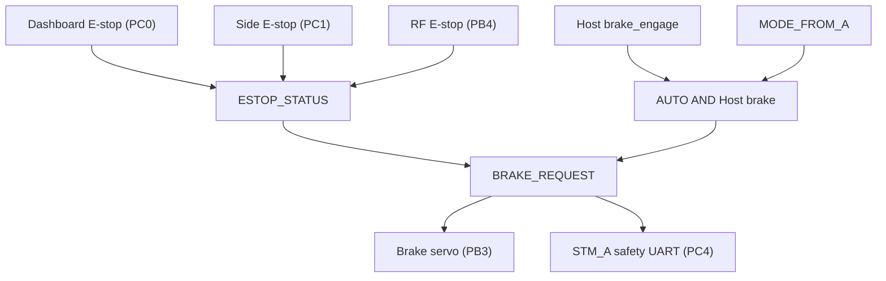

# STM_B Firmware

> 이 문서는 현재 작업 브랜치의 소스 코드를 기준으로 작성되었습니다.
> 코드 변경 시 핀, 주기, timeout, 통신 ID와 안전 조건을 함께 갱신해야 합니다.

## 1. 역할

STM_B는 STM32G474 기반의 물리 E-stop·브레이크 보드입니다. 세 E-stop 입력과 AUTO
Host brake를 조합해 최종 `BRAKE_REQUEST`를 만들고, 브레이크 서보를 직접
구동하며 같은 요청을 STM_A에 전달합니다.

## 2. 담당 기능

- dashboard, side, RF 세 active-low E-stop 판독
- `/vehicle/command.brake_engage` 수신
- STM_A UART에서 mode·gear·speed 수신
- 최종 brake request 계산과 STM_A 전달
- TIM2 PWM brake servo 직접 구동
- `/brake/status` 발행
- LCD에 속도·기어·mode·brake·통신 fault 표시

## 3. 보드와 MCU

| 항목 | 값 |
|---|---|
| 보드 | NUCLEO-G474RE |
| MCU | STM32G474RETx, Cortex-M4F |
| 시스템 clock | HSI 16 MHz → PLL(M=4, N=85, R=2) → 170 MHz, FLASH latency 4 |
| FLASH | origin `0x08000000`, 512 KB |
| RAM | origin `0x20000000`, 128 KB |
| 고정 장치 이름 | 실차 `/dev/stm_b`, HIL bench `/dev/hil_b` |
| CubeMX 프로젝트 | `STM_B.ioc` |

## 4. 핀맵

핀 이름 정의는 `Core/Inc/main.h`, 초기화는 `Core/Src/gpio.c`와 각 Peripheral
파일에 있습니다. 아래 표는 두 곳을 대조해 정리한 것입니다.

보드 커넥터 번호는 NUCLEO-G474RE(MB1367)의 ST morpho 헤더 기준입니다. `CN7`과
`CN10`은 각각 2×19 헤더이고 홀수 번호와 짝수 번호가 각각 한 열을 이룹니다.
괄호 안의 `A5`·`D5`는 같은 신호가 나오는 Arduino Uno 헤더 실크스크린 이름이며,
표기가 없는 핀은 morpho 헤더에서만 나옵니다. 물리적 배치는 보드 매뉴얼 UM2505를
확인하십시오. GND는 `CN7-8`, `CN7-19`, `CN7-20`, `CN7-22`, `CN10-9`, `CN10-20`에
있습니다.

### 4.1 신호 핀

| MCU 핀 | 보드 커넥터 | 신호 이름 | 방향 | 전기적 설정 | 의미 |
|---|---|---|---|---|---|
| `PC0` | `CN7-38` (A5) | `ESTOP_DASH` | 입력 (digital) | internal pull-up, rising/falling EXTI0 | LOW=Active(정지), HIGH=Normal |
| `PC1` | `CN7-36` (A4) | `ESTOP_SIDE` | 입력 (digital) | internal pull-up, rising/falling EXTI1 | LOW=Active(정지), HIGH=Normal |
| `PB4` | `CN10-27` (D5) | `ESTOP_RF` | 입력 (digital) | internal pull-up, rising/falling EXTI4 | LOW=Active(정지), HIGH=Normal |
| `PB3` | `CN10-31` (D3) | brake servo PWM (`TIM2_CH2`) | 출력 (AF) | 50 Hz, 1 µs timer tick | pulse `1194 µs`=Engage, `1388 µs`=Release |
| `PC13` | `CN7-23` | `LED_GREEN` | 출력 | push-pull, 부팅 시 LOW | 상태 표시 |

`PC13`은 NUCLEO-64의 사용자 버튼 B1이 붙어 있는 핀이고, 보드에 실장된 LD2 녹색
LED는 `PA5`입니다(vendored BSP `stm32g4xx_nucleo.h`의 `USER_BUTTON_PIN`,
`LED2_PIN`). 즉 이 펌웨어의 `LED_GREEN` 출력은 보드 LD2가 아니라 `PC13`에 따로
연결한 LED를 가정합니다.

세 E-stop은 모두 internal pull-up의 active-low 입력이므로 배선이 끊기면 HIGH가
아니라 pull-up으로 Normal로 읽힙니다. EXTI IRQ priority는 세 채널 모두 5이고 ISR은
`EStop` Task에 event flag만 전달합니다.

### 4.2 통신·주변장치 핀

| MCU 핀 | 보드 커넥터 | Peripheral | 용도 | 설정 | 관련 파일 |
|---|---|---|---|---|---|
| `PA2` | `CN10-35` | `LPUART1_TX` | micro-ROS transport | 115200 8N1, DMA1 CH2 | `Core/Src/usart.c` |
| `PA3` | `CN10-37` | `LPUART1_RX` | micro-ROS transport | 115200 8N1, DMA1 CH1 | `Core/Src/usart.c` |
| `PC4` | `CN10-34` | `USART1_TX` | STM_A 보드 간 UART | 115200 8N1, DMA1 CH4 | `Core/Src/usart.c` |
| `PC5` | `CN10-6` | `USART1_RX` | STM_A 보드 간 UART | Receive-to-Idle circular DMA, DMA1 CH3 | `Core/Src/usart.c` |
| `PB13` | `CN10-30` | `SPI2_SCK` | LCD dashboard | master, CPOL=1/CPHA=2edge, prescaler 128, TX DMA1 CH5 | `Core/Src/spi.c` |
| `PB15` | `CN10-26` | `SPI2_MOSI` | LCD dashboard | 동일 | `Core/Src/spi.c` |
| `PB14` | `CN10-28` | `SPI2_MISO` | LCD dashboard | 초기화만 되고 데이터는 TX 방향만 사용 | `Core/Src/spi.c` |
| `PB0` | `CN7-34` (A3) | `LCD_CS` | LCD chip select | push-pull 출력, 부팅 시 HIGH | `Core/Src/lcd.c` |
| `PB1` | `CN10-24` | `LCD_RST` | LCD reset | push-pull 출력, 부팅 시 HIGH | `Core/Src/lcd.c` |
| `PB2` | `CN10-22` | `LCD_DC` | LCD data/command | push-pull 출력, LOW=command, HIGH=data | `Core/Src/lcd.c` |
| `PB10` | `CN10-25` (D6) | `LCD_BL` | LCD backlight | push-pull 출력 | `Core/Src/lcd.c` |
| `PA11` | `CN10-14` | `FDCAN1_RX` | 현재 application 미사용 | 초기화만 수행, 송수신 로직 없음 | `Core/Src/fdcan.c` |
| `PA12` | `CN10-12` | `FDCAN1_TX` | 현재 application 미사용 | 동일 | `Core/Src/fdcan.c` |

LCD는 ST7796S 컨트롤러 패널이며 SPI2 단방향 전송으로만 구동합니다. `PA2`/`PA3`은
NUCLEO의 ST-LINK virtual COM port와 연결된 핀이므로 morpho 자리에 다른 신호를
물리면 micro-ROS transport와 충돌합니다.

### 4.3 디버그·미사용 핀

| MCU 핀 | 보드 커넥터 | 신호 | 비고 |
|---|---|---|---|
| `PA13` | `CN7-13` | `SWDIO` | ST-LINK SWD |
| `PA14` | `CN7-15` | `SWCLK` | ST-LINK SWD |
| `PA7` | `CN10-15` (D11) | `SPI1_MOSI` | `gpio.c`가 AF5로 설정하지만 SPI1은 초기화되지 않는 잔여 설정 |
| `PA11`/`PA12` | `CN10-14`/`CN10-12` | `FDCAN1_RX`/`TX` | 초기화만 되고 application에서 사용되지 않음 |

`PB3`(`CN10-31`, D3)은 다른 두 보드에서 SWO로 쓰지만 STM_B에서는 brake servo PWM
출력입니다. SWD 디버깅 시 trace 출력을 기대하지 마십시오.

### 4.4 배선 상대

| STM_B 핀 | 실차 연결 | HIL bench 연결 |
|---|---|---|
| `PC0` `CN7-38` | Dashboard E-stop 스위치 | STM_TEST `PC2` `CN7-35` (`HIL_ESTOP_DASH_OUT`) |
| `PC1` `CN7-36` | Side E-stop 스위치 | STM_TEST `PC3` `CN7-37` (`HIL_ESTOP_SIDE_OUT`) |
| `PB4` `CN10-27` | RF E-stop 수신기 출력 | STM_TEST `PC4` `CN10-34` (`HIL_ESTOP_RF_OUT`) |
| `PB3` `CN10-31` | 브레이크 서보 신호선 | STM_TEST `PA6` `CN10-13` (`TIM3_CH1` PWM 입력) |
| `PC4` `CN10-34` | STM_A `PC5` `CN10-6` (TX→RX) | 동일 |
| `PC5` `CN10-6` | STM_A `PC4` `CN10-34` (RX←TX) | 동일 |
| `PA2`/`PA3` `CN10-35`/`CN10-37` | ST-LINK virtual COM port → micro-ROS Agent | 동일 |
| `PB0`/`PB1`/`PB2`/`PB10`/`PB13`/`PB15` | LCD 모듈 | bench에서도 동일하게 보드에 부착 |

모든 상대 보드와 signal ground를 공유해야 합니다. 서보 전원은 MCU 3.3 V가 아니라
별도 전원에서 공급하고, 신호선만 `PB3`에 연결합니다.

## 5. 소프트웨어 구조

| 파일 | 역할 |
|---|---|
| `Core/Src/main.c` | clock·Peripheral·RTOS 초기화 |
| `Core/Src/app_freertos.c` | Task, brake 결정, PWM 목표, ROS 2와 UART protocol |
| `Core/Src/globals.c` | 공유 상태와 brake-engaged 초기값 |
| `Core/Src/tim.c` | 50 Hz brake PWM |
| `Core/Src/gpio.c` | E-stop input과 EXTI 설정 |
| `Core/Src/display_app.c`, `lcd.c` | dirty-cell update, rolling band refresh와 SPI DMA 복구 |
| `Core/Src/usart.c` | micro-ROS LPUART1과 STM_A USART1 |
| `Core/Src/spi.c` | LCD SPI2와 TX DMA |
| `Middlewares/micro_ros/` | 정적 micro-ROS library, headers와 custom transport |

Queue, semaphore, mutex, software timer는 생성하지 않습니다. E-stop ISR→Task 전달은
thread flag, UART ISR→Task 전달은 원형 buffer, 공유 snapshot은 critical section을
사용합니다.

## 6. FreeRTOS Task

| Task | 역할 | 주기/Trigger | 우선순위 | 관련 파일 |
|---|---|---:|---|---|
| `Brake` | brake target에 따라 servo pulse ramp | 5 ms loop, 20 ms step | `High1` | `app_freertos.c` |
| `EStop` | GPIO 재판독과 final brake 계산 | edge flag 또는 최대 10 tick | `Realtime` | `app_freertos.c` |
| `uROS` | Agent 연결, command callback, status publish | 5 ms running loop, 50 ms status | `Normal` | `app_freertos.c` |
| `Display` | LCD dashboard | 50 ms rolling refresh, gear gesture recovery | `Low` | `display_app.c` |
| `ARx` | STM_A vehicle frame parse와 timeout | continuous loop, 1 ms delay | `AboveNormal` | `app_freertos.c` |
| `ATx` | STM_A로 safety frame 송신 | 20 ms | `High` | `app_freertos.c` |

## 7. 외부 인터페이스

LPUART1(`PA2`/`PA3`) custom transport는 보드 전용 micro-ROS Agent에 연결됩니다.
Agent ping period는 500 ms, ping call timeout은 100 ms입니다. node 이름은
`/stm_b_node`입니다. brake servo에는 feedback signal이 없으므로
`actual_valid=false`를 고정 발행합니다.

### Subscribers

| Topic | Type | Callback | 설명 |
|---|---|---|---|
| `/vehicle/command` | `kaiev26_msgs/msg/ActuatorCommand` | `cb_cmd` | `brake_engage`만 사용 |

### Publishers

| Topic | Type | 주기 | 설명 |
|---|---|---:|---|
| `/brake/status` | `kaiev26_msgs/msg/BrakeActuatorStatus` | 50 ms 및 reason 변경 시 | commanded brake, reason bits, command age |

## 8. 동작 상세

### 8.1 E-stop 입력 (`PC0`, `PC1`, `PB4`)

| 이름 | MCU 핀 | 보드 커넥터 | EXTI | Active | 최종 상태 |
|---|---|---|---|---|---|
| Dashboard | `PC0` | `CN7-38` (A5) | `EXTI0_IRQn` | low | `ESTOP_DASHBOARD` |
| Side | `PC1` | `CN7-36` (A4) | `EXTI1_IRQn` | low | `ESTOP_SIDE` |
| RF | `PB4` | `CN10-27` (D5) | `EXTI4_IRQn` | low | `ESTOP_RF` |

```text
ESTOP_STATUS = dashboard OR side OR rf
```

- internal pull-up 사용
- rising/falling edge interrupt 사용
- Task가 10 tick timeout마다 다시 읽음
- software debounce 없음
- software latch는 현재 구현에 없음
- 물리 스위치의 기계적 latch 여부는 실제 하드웨어 구성에 따름
- 세 입력이 모두 high인 다음 safety update에서 software 상태 해제
- MANUAL/AUTO 모두 동일하게 brake에 적용

UART와 ROS 2에는 합쳐진 E-stop 원인만 전달하고 개별 입력은 전달하지 않습니다.

### 8.2 브레이크 서보 (`PB3`)

TIM2는 170 MHz clock, prescaler 169, period 19999로 1 MHz counter와 50 Hz PWM을
만듭니다. 출력은 `TIM2_CH2`, 즉 `PB3` 핀입니다.

| 상태 | Compare/pulse | 의미 |
|---|---:|---|
| Engage | `1194 µs` | 기존 35° 위치, 실차 calibration 필요 |
| Release | `1388 µs` | 기존 70° 위치, 실차 calibration 필요 |

부팅 초기 `BRAKE_REQUEST`, `BRAKE_COMMAND_APPLIED`와 TIM2 compare는 engage
상태입니다. `Brake` Task가 PWM을 시작하고, `EStop` Task가 현재 GPIO·mode·Host
command를 읽어 최종 상태를 갱신합니다.

목표가 바뀌면 pulse travel `194 µs`를 35번의 20 ms update로 나누므로 nominal
이동 시간은 700 ms입니다. 실제 서보 위치 feedback이나 stall/fault 검출은
없습니다.

### 8.3 STM_A UART (`PC4`/`PC5`)

- STM_A vehicle status 수신: mode, gear, speed, nominal 20 ms
- vehicle frame timeout: 200 ms
- STM_A drive detail 수신: bus 전압·전류, 온도, fault와 command 상태, nominal 100 ms
- drive detail timeout: 300 ms, LCD 관련 값만 invalid
- STM_B safety status 송신: final brake request, nominal 20 ms

vehicle timeout은 frame validity와 LCD `A-B LOST` badge에는 반영되지만 현재
final brake 판단에는 들어가지 않습니다. frame byte layout은
[`../../docs/INTERFACES.md`](../../docs/INTERFACES.md#5-stm_a--stm_b-uart)를
기준으로 합니다.

LCD는 주간용 흰 배경을 사용하고 AUTO는 청색, MANUAL은 주황색으로 표시합니다.
SPI2는 1.328125 Mbit/s를 사용하며 4 scanline 고정 buffer와 TX DMA로 변경 영역만
전송합니다. 평상시 숫자 갱신은 고정 폭 문자열에서 바뀐 character cell만 배경을
포함한 최종 glyph로 덮어써, 카드 전체 clear 뒤 redraw하는 플리커를 피합니다. 동시에
매 50 ms마다 다음 4개 scanline의 배경·테두리·문자를 RAM에서 최종 합성한 뒤 한 번의
DMA로 전송합니다. 약 5초마다 화면 전체가 순환 복원되며 중간 clear 화면은 전송하지
않습니다. 유효한 gear stream에서 `F-R-F-R-F` 전환이 첫 `F-R`부터 1초 안에 끝나면
backlight-off, panel reset·초기화, 최종 화면 band 합성, backlight-on 순서로 LCD
controller만 재기동합니다. STM_B의 brake·E-stop·UART task는 재시작하지 않으며,
gesture detector는 차량 명령을 차단하거나 추가 안전 조건을 적용하지 않습니다. 부팅
표시는 SPI write 성공만으로 완료합니다. 현재 실차 하네스의 SDO/MISO readback은
부동값으로 정상 bit를 오인할 수 있어 주기적 `RDDPM` health gate에 사용하지 않습니다.
실제 SPI HAL 실패나 DMA timeout을 감지해도 같은 LCD 전용 복구를 수행합니다. 복구
실패 시 1초마다 다시 시도하며 brake 판단에는 관여하지 않습니다.

### 8.4 안전 상태 결정



```text
BRAKE_REQUEST =
    ESTOP_STATUS
    OR (MODE_FROM_A == AUTO AND COMMAND_BRAKE_REQUEST)
```

STM_A vehicle UART validity, Host command age, micro-ROS Agent 연결과 FDCAN 상태는
현재 이 식에 포함되지 않습니다.

### 8.5 모드별 동작

| 입력 | MANUAL | AUTO |
|---|---|---|
| 물리 E-stop | brake engage | brake engage |
| Host `brake_engage=true` | final brake에서 제외 | brake engage |
| Host command 중단 | 마지막 command 값 유지, timeout 없음 | 마지막 command 값 유지, timeout 없음 |
| STM_A UART 중단 | 마지막 mode 값으로 계속 판단 | 마지막 mode 값으로 계속 판단 |

AUTO에서 Host brake가 active인 채 MANUAL로 전환되면 물리 E-stop이 없는 한
Host 원인의 brake는 해제됩니다.

## 9. 빌드

권장 워크스페이스인 `~/KAI_ws` 루트에서 STM_B만 Release로 빌드합니다.
`arm-none-eabi-gcc`가 `PATH`에 있어야 합니다.

```bash
cd ~/KAI_ws
cmake -S src/Control/firmware/STM_B --preset Release
cmake --build src/Control/firmware/STM_B/build/Release
```

결과물은 `src/Control/firmware/STM_B/build/Release/STM_B.elf`입니다. 공통 Agent
빌드는 [`../README.md`](../README.md)를 참고하십시오.

## 10. 플래시 및 실행

`STM32_Programmer_CLI`로 probe SN을 지정해 flash합니다. 절차 전체(빌드,
SN 확인, flash, 고정 이름·역할 확인)는
[`../../docs/VEHICLE_RUNBOOK.md`](../../docs/VEHICLE_RUNBOOK.md#5-보드-교체-시)를
따르고, 여러 보드가 꽂힌 상태라면 먼저
[`../../docs/HIL_RUNBOOK.md`](../../docs/HIL_RUNBOOK.md#플래시-전-swd-target-확인)의
SWD target 확인을 거칩니다.

Agent는 STM_B의 LPUART1 장치에 하나 붙입니다.

```bash
source /opt/ros/humble/setup.bash
source ~/KAI_ws/install/setup.bash
ros2 run micro_ros_agent micro_ros_agent serial --dev /dev/stm_b -b 115200
```

> **경고:** flash와 전원 인가 전에 brake servo 방향, E-stop 배선과 초기 engage
> pulse를 확인하십시오. serial symlink는 virtual COM port 식별일 뿐 SWD target
> 확인을 대신하지 않습니다.

## 11. 상태 확인

Agent 연결 후 다음을 확인합니다.

```bash
ros2 node info /stm_b_node
ros2 topic info -v /vehicle/command
ros2 topic echo /brake/status
```

`brake_commanded`, `stop_reason_bits`, `actual_valid=false`와
`command_age_ms`를 함께 확인하십시오. STM_A UART 단절은 `/brake/status`에 별도
field가 없으므로 LCD 또는 debugger의 `VEHICLE_FRAME_VALID_FROM_A`로 확인해야
합니다.

## 12. 알려진 제한사항

- STM_A vehicle UART 200 ms timeout이 final brake에 포함되지 않습니다.
- Host brake command timeout과 Agent disconnect reset이 없습니다.
- E-stop software debounce와 software latch가 없습니다. 물리 스위치의 기계적
  latch 여부는 실제 하드웨어 구성을 확인해야 합니다.
- E-stop 입력은 active-low pull-up이므로 신호선 단선을 Normal로 읽습니다.
- brake servo actual position, stall과 fault feedback이 없습니다.
- engage/release pulse와 ramp는 실차 calibration이 필요합니다.
- FDCAN1(`PA11`/`PA12`)은 초기화되지만 application에서 사용되지 않습니다.
- `PA7`은 `gpio.c`에서 SPI1 AF로 설정되지만 SPI1이 초기화되지 않는 잔여 설정입니다.
- `LED_GREEN`(`PC13`)은 NUCLEO 사용자 버튼 B1과 같은 핀을 push-pull 출력으로
  구동합니다. 보드 LD2(`PA5`)가 아니므로 실제 표시 LED 배선을 확인해야 합니다.
- MCU independent watchdog 사용은 현재 코드에서 확인되지 않습니다.
- 실차 connector pinout은 문서화 필요 상태입니다. 위 핀맵은 MCU 핀
  기준이며 실차 하네스 connector 번호는 아직 정리되지 않았습니다.

## 13. 관련 문서

- 펌웨어 공통 빌드·Agent: [`../README.md`](../README.md)
- 상대 보드: [`../STM_A/README.md`](../STM_A/README.md)
- HIL emulator: [`../STM_TEST/README.md`](../STM_TEST/README.md)
- 시스템 구조: [`../../docs/ARCHITECTURE.md`](../../docs/ARCHITECTURE.md)
- 통신 계약: [`../../docs/INTERFACES.md`](../../docs/INTERFACES.md)
- 안전 설계: [`../../docs/SAFETY.md`](../../docs/SAFETY.md)
