# 주행 기록에서 모델 예측 제어까지: KAIEV26 SYSID와 MPC 세 가지

작성일: 2026-09-26  
대상: `Control/software/src/`의 [`longitudinal_mpc`](../../longitudinal_mpc)(종방향 전류 MPC), [`steering_mpc`](../../steering_mpc)(조향 토크 MPC), [`path_mpc`](../../path_mpc)(경로 MPC), 세 제어기가 함께 쓰는 QP 라이브러리 [`mpc_common`](..)  
데이터: 실차 bag (09-03 건국대 수동 토크 주행, 09-06 K-City AUTO 주행, 09-19 조향 SYSID 주행, 09-20 K-City 주행)  
결과 원본: `~/Storage/ROS2_Workspace_offload/{longitudinal_mpc, lateral_mpc, vehicle_sysid_analysis}/`, `ros2_ws/src/vehicle_sysid_analysis/results/260919/`  
관련 문서: [`docs/reports/2026-09-24_lateral_mpc.md`](../../../../docs/reports/2026-09-24_lateral_mpc.md), [`docs/reports/2026-09-21_longitudinal_torque_pi.md`](../../../../docs/reports/2026-09-21_longitudinal_torque_pi.md), Gazebo에서 제어기를 연결해 돌린 결과는 [Gazebo-in-the-loop](../../../../../../docs/gazebo_in_the_loop.md)

차량 주행 기록에서 모델을 뽑는 시스템 식별(SYSID)과, 그 모델로 미래를 예측해 입력을 고르는 모델 예측 제어(MPC)를 다룬다. 1부는 실차 기록으로 종방향, 조향, 경로 모델을 식별한 과정이고, 2부는 그 모델을 쓰는 MPC 세 가지의 설계다. Gazebo에서 제어기를 폐루프로 돌린 결과는 실차 성능의 근거가 아니므로 별도 문서로 뺐다. 마지막 장에는 면접에서 나올 만한 질문과 답을 모았다.

---

## 목차

0. [한눈에 보기](#0-한눈에-보기)
1. [왜 이 작업을 했나](#1-왜-이-작업을-했나)

**1부. SYSID**

2. [SYSID 기초: 기록에서 모델을 뽑는 법](#2-sysid-기초-기록에서-모델을-뽑는-법)
3. [종방향 모델: 전류와 속도](#3-종방향-모델-전류와-속도)
4. [조향 모델: 토크와 조향각](#4-조향-모델-토크와-조향각)
5. [경로 모델: 조향각과 경로 오차](#5-경로-모델-조향각과-경로-오차)

**2부. MPC**

6. [MPC 기초와 공용 QP 라이브러리](#6-mpc-기초와-공용-qp-라이브러리)
7. [종방향 MPC](#7-종방향-mpc)
8. [조향 MPC](#8-조향-mpc)
9. [경로 MPC](#9-경로-mpc)
10. [계산시간](#10-계산시간)
11. [파라미터 사전](#11-파라미터-사전)

**정리**

12. [나쁜 결과는 왜 나빴나](#12-나쁜-결과는-왜-나빴나)
13. [약점과 한계](#13-약점과-한계)
14. [다음에 할 일](#14-다음에-할-일)
15. [재현 방법과 산출물](#15-재현-방법과-산출물)
16. [면접 대비 문답](#16-면접-대비-문답)
17. [용어 정리](#17-용어-정리)

---

## 0. 한눈에 보기

**한 일.** 실차 주행 기록에서 세 가지 모델을 식별했다. 모터 전류가 차 속도를 어떻게 바꾸는지, 조향 모터 토크가 조향각을 어떻게 바꾸는지, 조향각이 yaw와 경로 오차를 어떻게 바꾸는지다. 각 모델을 YAML 파일로 저장하고, C++와 OSQP로 만든 MPC가 그 파일을 읽어 20~50 Hz로 입력을 계산한다. 조향각 자체를 믿을 수 없어서 앞바퀴 허브에 IMU를 달아 조향 보정부터 새로 했다.

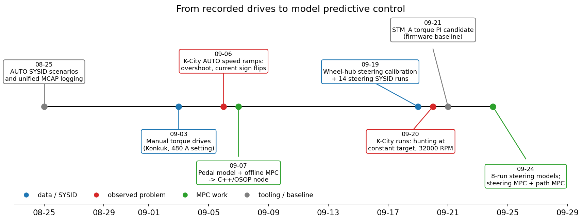

**읽는 법**: 가로축은 날짜다. 파랑은 데이터 수집과 식별, 빨강은 실차에서 본 문제, 초록은 MPC 작업, 회색은 도구와 비교 기준이다.

**해석**: 09-06과 09-20 K-City 주행에서 모터 컨트롤러의 Speed 모드가 목표를 넘고 흔들리는 것을 봤고, 전류를 PC가 직접 정하는 구조와 MPC로 넘어갔다. 조향은 09-19 하루에 보정과 SYSID 주행을 함께 했다.

**모델 검증** (모두 학습에 쓰지 않은 실차 기록)

| 모델 | 데이터 | 예측 길이 | 예측 오차 | 비교 기준 |
|---|---|---|---:|---:|
| 종방향 수동 토크 모델 | 09-03 같은 날 다른 주행 | 2초 | 0.145 m/s | |
| 종방향 수동 토크 모델 | 09-06 다른 날, 다른 장소 | 2초 | 0.399 m/s | 가속도 유지 기준을 못 이김 |
| 조향 보정 (엔코더 → 바퀴 각도) | 09-19, run 하나씩 빼고 검증 | 0.5초 증분 | 왼쪽 0.458°, 오른쪽 0.429° | |
| 조향 보정으로 계산한 곡률 | 09-19 | | 0.032 1/m | 기존 변환 133 1/m |
| yaw 모델 | 09-19 검증 bag 3개 | | 0.019 / 0.0275 / 0.018 rad/s | |
| 조향 MPC 모델 | 09-19 검증 run 3개 | 0.6초 | 1.57 / 2.88 / 0.60° | 현재값 유지 2.63 / 3.93 / 3.35° |

**세 MPC**

| 제어기 | 입력 | 상태 | 주기, 지평 | 주요 제약 | 계산 p95 |
|---|---|---|---|---|---:|
| 종방향 | 상전류 | 속도, 상전류 | 20 Hz, 2초 | 0~300 A, 상승 2400 A/s, 하강 4800 A/s | 0.10~0.20 ms |
| 조향 | KEYA 토크(정규화) | 조향각, 조향 속도 | 50 Hz, 1초 | ±1, 시간 제한 16 ms | 0.75~1.80 ms |
| 경로 | 목표 조향각 | 횡오차, 방향 오차, yaw rate, 조향각 | 20 Hz, 2초 | 조향각과 조향 속도를 식별 범위로 제한 | 1.55 ms |

**꼭 기억할 것 다섯 가지**

1. **모델은 파일이고 제어 코드는 하나다.** 식별 결과는 YAML로 저장하고, 제어 노드는 시작할 때 파일의 입력 토픽 이름과 상태 이름을 확인한다. 모델을 바꿀 때 코드를 고치지 않는다([2.8절](#28-모델-yaml이-두-쪽을-잇는다)).
2. **모델은 현재값 유지 기준을 이겨야 쓴다.** 이전 조향 모델은 한 검증 run에서 RMSE 3.81°로 "지금 각도가 그대로 간다"는 예측(3.64°)보다 나빠서 버렸다([4.4절](#44-검증-현재값-유지보다-나은가)).
3. **조향각부터 고쳤다.** 기존 엔코더-각도 변환으로 계산한 곡률은 실측과 RMSE 133 1/m로 어긋났다. 허브 IMU로 새로 보정하자 0.032 1/m가 됐고, 기존 변환으로 맞춘 조향 모델은 모두 버렸다([4.1절](#41-조향각을-믿을-수-있게-만들기)).
4. **식별 범위 밖에서 MPC는 해가 된다.** ±3° 사인에서 식별한 경로 모델로 ±25°까지 허용하자 경로 MPC가 좌우로 흔들려 횡오차 1.871 m가 나왔다([9.4절](#94-식별-범위를-지킨다)).
5. **실차에서 MPC로 달린 적은 아직 없다.** 종방향 실차 모델은 수동 토크 주행에서 얻은 것 하나이고, 날짜가 바뀌자 맞지 않았다. PC가 전류를 정하는 외부 전류 모드로 실차를 식별하는 것이 다음 순서다([13장](#13-약점과-한계)).

---

## 1. 왜 이 작업을 했나

### 1.1 차량의 구동 구조

```text
            ROS 2 PC                                   STM_A (MCU)                 구동계
┌──────────────────────────┐   micro-ROS   ┌────────────────────────┐   CAN   ┌──────────────┐
│ Decision → governor      │──────────────▶│ Speed 모드: 목표속도 전달  │───────▶│ EZkontrol    │
│ longitudinal_controller  │               │ 외부 전류 모드: 토크 모드   │        │ 모터 컨트롤러 │
│ lateral_ctrl (조향)       │───────── CAN ─┼────────────────────────┼───────▶│ KEYA 조향 모터│
└──────────────────────────┘               └────────────────────────┘        └──────────────┘
```

구동 모터는 EZkontrol 모터 컨트롤러가 돌린다. 기존 AUTO 주행은 STM_A가 목표속도를 CAN으로 보내고, 컨트롤러 안의 속도 제어기가 모터 전류를 정하는 **Speed 모드**였다. 그 속도 제어기의 구조와 게인은 바꿀 수 없다. 조향은 PC의 `lateral_ctrl`이 KEYA 조향 모터에 raw 토크 명령(±10000)을 CAN으로 보내며, 기존 제어기는 PD였다.

### 1.2 기존 제어기에서 본 문제

**종방향: Speed 모드가 목표를 넘고 흔들렸다.**


**읽는 법**: 왼쪽은 09-20 오전 10 m/s 목표 주행, 오른쪽은 오후 40 km/h 목표 주행이다. 위에서부터 속도, 전류, 배터리 전압이다. 검은 선이 PC가 보낸 목표, 파란 선이 모터 RPM으로 계산한 속도, 주황 선이 GNSS 속도다.

**해석**: 왼쪽에서 목표는 10 m/s인데 차는 12.74 m/s까지 올라갔다가 8.99 m/s까지 내려가며 출렁였다. 오른쪽에서는 목표를 따라가지 못하다가 전류 한계(480 A 점선)를 넘는 643 A가 보고됐고, 정지 직전 RPM 속도가 튀었다. 같은 날 32000 RPM이라는 물리적으로 불가능한 값도 기록됐다.


09-19 감속 구간이다. 목표(파란 선)는 6 m/s에서 3 m/s로 내려가는데 차(초록 GNSS)는 8 m/s에서 출발해 목표보다 최대 2.14 m/s 빨랐다. 주황 RPM 속도는 −3 m/s와 10.8 m/s 사이를 오가고, 상전류는 ±250 A로 부호가 뒤집혔다.

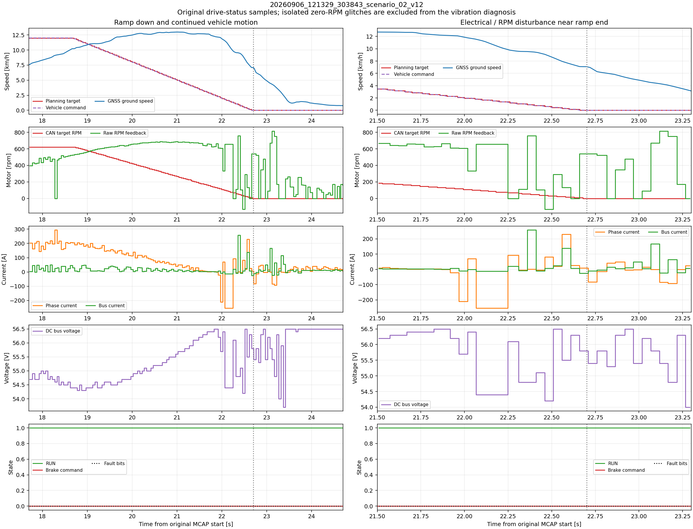

09-06 K-City에서 목표를 12 km/h에서 0으로 선형으로 내린 기록이다. 목표가 내려가기 시작한 뒤에도 차는 약 2초 더 가속해 13 km/h에 닿았다(왼쪽 위). 목표가 0에 가까워지자 상전류가 −254 A와 +228 A 사이를 오갔다(왼쪽 셋째 줄). 브레이크 명령과 fault 비트는 모두 0이었다(맨 아래).

세 기록 모두 PC가 보낸 목표는 매끄러웠고, 흔들림은 컨트롤러 안에서 생겼다. 원인을 내부 PI 게인 하나로 단정할 수는 없었다. 그래서 전류를 PC가 직접 정하는 **외부 전류 모드**를 만들었다. PC는 0 A 이상의 상전류를 보내고, STM_A는 이를 토크 모드 CAN 프레임으로 바꿔 모터 컨트롤러에 넘긴다. 전류를 직접 정하려면 전류가 속도를 어떻게 바꾸는지 알아야 하고, 그 관계를 쓰는 제어기로 MPC를 골랐다.

**조향: PD가 스텝마다 떨었다.** 09-19 조향 스텝 시험에서 PD는 목표에 닿은 뒤 약 6 Hz로 진동했다([4.2절 그림](#42-조향-sysid-데이터-09-19의-8개-run)의 151306, 151729 run).

### 1.3 목표

1. **주행 기록 → 모델 파일 → 제어기**의 흐름을 세 제어기에 똑같이 만든다. 모델을 바꿀 때 코드는 건드리지 않는다.
2. 모델은 학습에 쓰지 않은 실차 기록과 가장 단순한 예측 기준으로 검증한다.
3. 제어기는 실차와 같은 토픽과 CAN 경로로 Gazebo SITL에서 먼저 연결을 확인하고([Gazebo-in-the-loop](../../../../../../docs/gazebo_in_the_loop.md)), HIL 보드를 거쳐 실차로 간다.

---

# 1부. SYSID

## 2. SYSID 기초: 기록에서 모델을 뽑는 법

### 2.1 회색 상자 모델

모델은 물리식의 **꼴**을 정해 두고 계수만 데이터로 맞추는 회색 상자(grey-box) 방식으로 만들었다.

| 모델 | 물리식의 꼴 | 맞추는 계수 |
|---|---|---|
| 종방향 | 전류는 명령을 1차 지연으로 따라가고, 가속도는 전류와 속도의 1차식 | 전류 응답, 전류당 가속, 속도 비례 저항, 상수 저항 |
| 조향 | 조향각은 토크를 받는 질량-감쇠-스프링 | 감쇠, 강성, 토크 이득, 중심 어긋남 |
| 경로 | 실제 조향각은 목표 조향각을 1차 지연으로 따라가고, yaw rate는 자전거 모델 | 시정수, 이득, 치우침 |

신경망 같은 검은 상자 모델보다 데이터가 적어도 되고, 계수에 물리적 의미가 남아 값이 이상하면 알아챌 수 있다. 식이 선형이라 그대로 선형 MPC에 넣을 수 있다.

### 2.2 다단계 출력 오차로 맞춘다

가장 쉬운 방법은 한 스텝 앞 예측 오차 $x_{k+1} - (Ax_k + Bu_k + c)$를 최소제곱으로 줄이는 것이다(식 오차, equation error). 그런데 MPC는 1~2초 앞까지 예측을 **자기 예측 위에 쌓는다**. 한 스텝 오차가 작아도 쌓이면 크게 틀릴 수 있다. 또 속도나 조향각을 수치 미분한 값이 들어가면 잡음이 계수를 한쪽으로 끌고 간다.

그래서 **구간의 첫 상태만 실측으로 넣고, 그 뒤로는 기록된 입력만으로 모델을 굴려서**, 굴린 궤적과 실측의 차이를 줄였다(다단계 출력 오차, multi-step output error). 구간 길이는 MPC가 실제로 보는 길이에 맞췄다.

| 모델 | 구간 길이 | 최적화 |
|---|---|---|
| 종방향 | 2초 (40 스텝) | 전류식은 `lsq_linear`, 속도 계수는 `least_squares`(soft L1 손실) |
| 조향 MPC용 | 0.6초 (30 스텝) | 지연 0~10 스텝을 격자로 보고 계수는 비선형 최소제곱 |
| 조향 플랜트용 | 구간 전체 연속 재생 | 학습 bag마다 같은 가중치 |
| 경로 | 30 스텝 1차 응답 | 조향과 yaw를 따로 맞춤 |

### 2.3 연속 모델을 정확히 이산화한다

조향 모델은 연속시간 식 $\ddot\delta = g u - d\dot\delta - s\delta + b$로 계수를 두고, 행렬 지수함수로 정확히 이산화한다.

$$\exp\left(\begin{bmatrix} A_c & B_c \\ 0 & 0 \end{bmatrix} \Delta t\right) = \begin{bmatrix} A & B \\ 0 & I \end{bmatrix}$$

입력이 한 주기 동안 일정하다는(ZOH) 가정 아래 오차 없는 변환이다. 오일러 근사 $A \approx I + A_c\Delta t$는 감쇠가 크거나 주기가 길면 틀린다.

### 2.4 학습과 검증은 주행 단위로 나눈다

같은 주행의 앞뒤 구간은 노면, 배터리 전압, 운전 패턴이 같아 서로 닮았다. 한 주행을 잘게 잘라 섞으면 검증 점수가 실제보다 좋게 나온다. 그래서 **bag(주행) 단위로** 학습용과 검증용을 나눴다. 조향은 파일 이름순 매 세 번째 run을, 종방향은 같은 날 다른 주행과 다른 날 주행을 검증용으로 남겼다.

### 2.5 이길 대상: 현재값 유지 기준

예측 RMSE가 1.5°라는 숫자만으로는 좋은지 알 수 없다. 그래서 **"지금 값이 그대로 유지된다"** 는 가장 단순한 예측(persistence)과 비교했다. 모델이 이 기준보다 나빠야 할 이유는 없으므로, 기준을 못 이기면 모델이 쓸모없다는 뜻이다. 종방향에서는 "속도 유지" 또는 "지금 가속도 유지"가 이 기준이다.

### 2.6 폐루프 데이터의 함정

기록은 대부분 PD나 PI가 돌고 있을 때 얻었다. 제어기가 켜져 있으면 입력이 출력 오차에 따라 정해진다. 입력과 잡음이 서로 얽히므로, 최소제곱으로 맞춘 계수가 참값에서 한쪽으로 치우칠 수 있다(폐루프 식별의 편향). 또 제어기가 조향각을 목표 근처에 묶어 두므로 **정상상태 이득 같은 저주파 성질이 잘 드러나지 않는다**. 이 문서의 조향 모델은 "그 PD 주행을 잘 재현하는 경험 모델"이며 물리 계수의 참값은 아니다([4.3절](#43-모델을-두-개-만든-이유)).

### 2.7 시각 맞추기

명령과 피드백은 서로 다른 노드가 발행한다. 메시지 헤더 시각은 노드마다 기준이 달라서, 한 MCAP 파일에 **기록된 시각(수신 시각)** 으로 신호를 정렬했다. AUTO가 아니거나, 피드백이 끊겼거나, 보정 범위를 벗어난 구간은 잘라 냈다.

### 2.8 모델 YAML이 두 쪽을 잇는다

식별 결과는 YAML로 저장한다. 제어 노드는 시작할 때 이 파일을 읽고 **입력 토픽 이름과 상태 이름**을 확인한다. 예를 들어 조향 모델의 `input`이 `/steering/torque_command_raw`가 아니거나 상태가 `[steering_rad, steering_rate_rad_s]`가 아니면 노드가 뜨지 않는다. 다른 단위로 식별한 모델이 조용히 들어가는 사고를 막는다.

```yaml
# longitudinal_mpc/config/identified_host_current.yaml
dt: 0.05
states: [speed_mps, phase_current_a]
input: /vehicle/drive_current_command.phase_current_a
A: [[0.99753, 0.000175], [0.0, 0.39130]]
B: [0.000163, 0.60799]
c: [-0.004843, 0.0]
```

위 파일은 지금 종방향 MPC 설정에 들어 있는 모델이다. 실차 외부 전류 모드 기록이 아직 없어서 Gazebo 차량에서 같은 식별 프로그램으로 뽑은 것이며, 실차 모델로 쓰지 않는다([3.3절](#33-아직-없는-것-외부-전류-모드-실차-모델)).

---

## 3. 종방향 모델: 전류와 속도

### 3.1 수동 토크 주행 모델 (09-03 기록, 09-07 식별)

외부 전류 모드를 만들기 전, 09-03 건국대에서 사람이 페달로 토크를 준 주행(480 A 설정)으로 첫 모델을 만들었다. 학습 bag 4개, 같은 날 검증 bag 2개, 날짜가 다른 09-06 bag 2개를 썼다. 상태는 [GNSS 속도, 실제 상전류], 입력은 페달이 만든 전류 명령이다.

유효 가속도식의 상수항 0.356 m/s²에는 구름 저항, 경사, 측정하지 못한 사람의 브레이크가 섞여 있다.

$$a \approx 0.004858\,I - 0.0428\,v - 0.3555$$

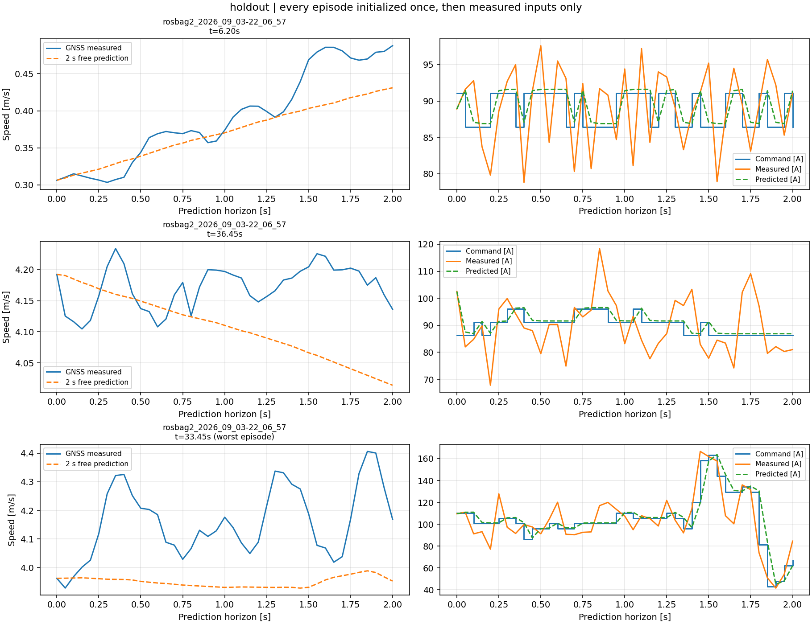

**읽는 법**: 왼쪽이 2초 동안 모델만으로 굴린 속도(주황 점선)와 실측(파란 선), 오른쪽이 전류 명령(파랑 계단), 실측 전류(주황), 모델 전류(초록 점선)다. 세 줄은 같은 검증 bag의 다른 구간이며, 맨 아래가 가장 나쁜 구간이다.

**해석**: 전류는 잘 맞는다(오른쪽). 속도는 첫 줄처럼 추세를 따라가는 구간도 있지만, 맨 아래처럼 실측이 0.3 m/s씩 출렁이는 동안 모델은 평평하다. 사람이 페달을 짧게 밟았다 떼는 동안 차에서 일어난 일을 전류만으로는 설명하지 못한다.

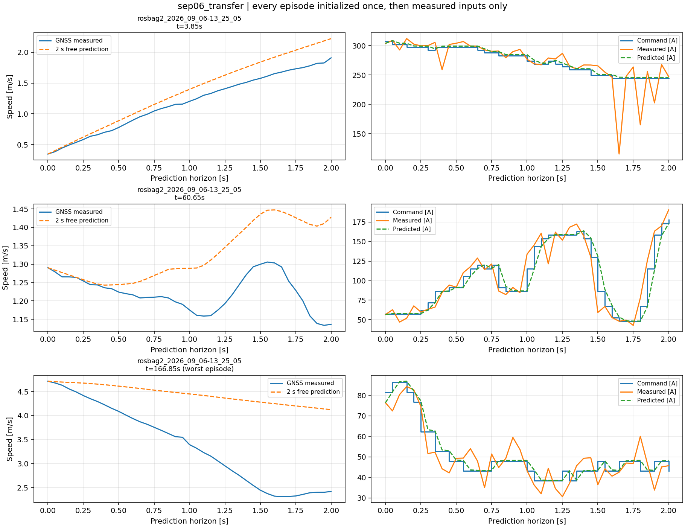

사흘 뒤 다른 장소의 주행에 그대로 적용한 결과다. 맨 아래 구간에서 실측은 2초 동안 4.7 m/s에서 2.3 m/s로 떨어지는데 모델은 4.1 m/s까지만 내려간다. 사람이 브레이크를 밟은 것으로 보이며, 브레이크는 기록되지 않았다.

| 예측 길이 | 09-03 검증 bag | 09-06 |
|---|---:|---:|
| 0.05 s | 0.026 m/s | 0.018 m/s |
| 0.5 s | 0.075 m/s | 0.089 m/s |
| 1 s | 0.091 m/s | 0.189 m/s |
| 2 s | 0.145 m/s | 0.399 m/s |

09-06의 2초 예측은 "지금 가속도 유지" 기준보다 나아지지 않았다. 같은 날 다른 주행에는 통했지만 날짜가 바뀌면 통하지 않는 모델이었다.

### 3.2 전류 1 A가 만드는 가속

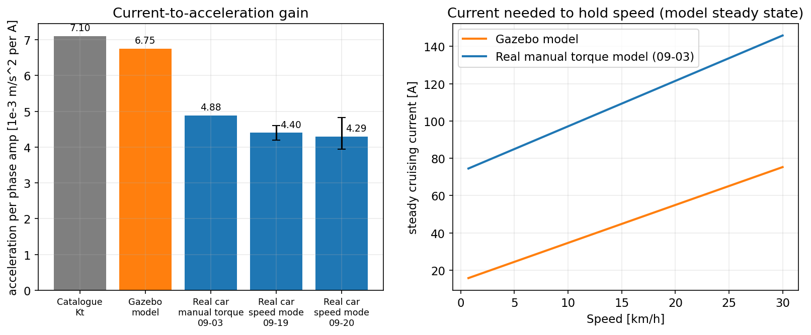

**읽는 법**: 왼쪽은 정상상태 상전류 1 A가 만드는 가속도다. 회색은 모터 토크 상수와 기어비로 계산한 값, 파랑 세 개는 실차 기록에서 추정한 값이다. 주황은 Gazebo 차량 모델로, 참고로 함께 그렸다. 오른쪽은 각 속도를 유지하는 데 필요한 전류다.

**해석**: 실차 수동 토크 모델의 전류당 가속은 4.88×10⁻³ m/s²/A이고, Speed 모드 기록(09-19, 09-20)에서 추정한 값은 4.3~4.4×10⁻³로 더 작다. 모터 토크 상수와 기어비로 계산한 7.10×10⁻³보다 31~40% 작다. 30 km/h를 유지하는 데 약 146 A가 든다. 구동계 손실, 타이어 구름 저항, 경사가 카탈로그 계산에 없기 때문으로 본다. 전류 응답 시정수는 16 ms로 빠르다.

Gazebo 모델을 실차 기록에 대 본 결과도 같은 방향이다. 전류 응답은 실차에서도 10~20 A 오차 안에 맞지만, 속도는 예측 길이에 비례해 틀어진다. 자세한 비교는 [Gazebo-in-the-loop 11장](../../../../../../docs/gazebo_in_the_loop.md#11-gazebo가-실차를-대신하지-못하는-곳)에 있다.

### 3.3 아직 없는 것: 외부 전류 모드 실차 모델

MPC가 실제로 내보내는 값은 PC의 전류 명령(`/vehicle/drive_current_command.phase_current_a`)이다. 이 명령을 입력으로 식별하면 PC → STM_A → CAN → 모터의 전달 지연이 모델 안에 들어간다. 수동 토크 모델은 입력이 페달 전류라 이 경로를 포함하지 않는다.

외부 전류 모드 펌웨어는 빌드했지만 실차 보드에 올리지 않아서, 실차에서 이 입력으로 기록한 적이 없다. 식별 프로그램(`fit_longitudinal`)과 시나리오 TUI의 전류 스텝, 코스트다운 메뉴는 준비돼 있고, Gazebo 차량에서 한 번 끝까지 돌려 봤다. 실차 기록이 생기면 같은 명령으로 모델을 뽑는다. 이때 전류 0 A로 굴러가는 구간을 충분히 넣어야 한다. 실차는 이 구간에서 저항이 크다.

---

## 4. 조향 모델: 토크와 조향각

### 4.1 조향각을 믿을 수 있게 만들기

조향 모델을 맞추려면 먼저 "실제 조향각"이 정확해야 한다. KEYA 모터 엔코더 count를 바퀴 각도로 바꾸는 기존 변환식은 근거가 없었다. 09-19에 양쪽 앞바퀴 허브에 IMU를 달고 조향을 돌리며 엔코더와 바퀴 회전을 함께 기록했다.

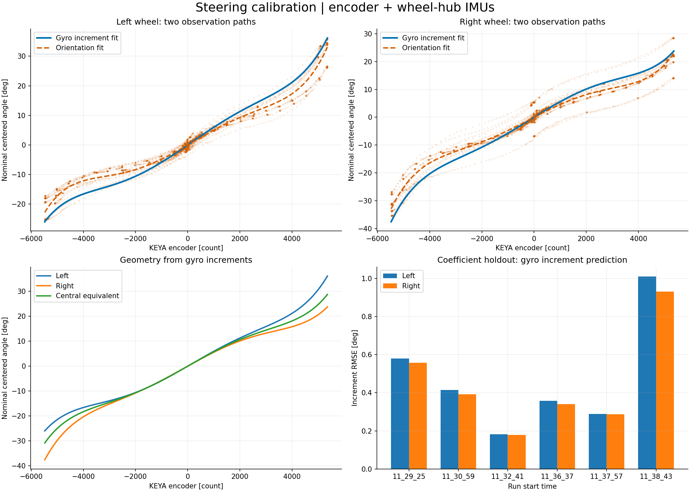

**읽는 법**: 위 두 그림은 왼쪽, 오른쪽 바퀴에서 자이로 적분(파랑)과 자세(주황 점선) 두 방법으로 구한 엔코더-각도 곡선이다. 왼쪽 아래는 양쪽 바퀴와 그 중앙 등가각, 오른쪽 아래는 run 하나씩 빼고 맞춘 뒤 뺀 run을 예측한 오차다.

**해석**: 양 끝으로 갈수록 곡선이 휘는 비선형 관계다. 왼쪽 바퀴가 +36°까지, 오른쪽이 −38°까지 가서 좌우가 비대칭이다(애커만 기하). 뺀 run의 0.5초 증분 예측 오차는 평균 왼쪽 0.458°, 오른쪽 0.429°다.

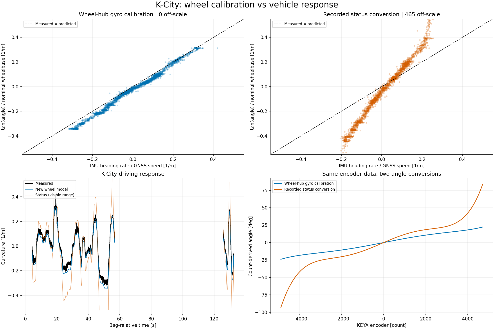

**읽는 법**: 위 두 그림의 가로축은 IMU yaw rate를 GNSS 속도로 나눈 실측 곡률, 세로축은 조향각에서 계산한 곡률이다. 점선 위에 있어야 맞다. 왼쪽이 새 보정, 오른쪽이 기존 변환이다. 오른쪽 아래는 같은 엔코더 값을 두 식으로 바꾼 각도다.

**해석**: 새 보정은 점선 바로 아래에 붙는다(기울기 0.974). 기존 변환은 기울기가 두 배쯤이고 465개 점이 그림 밖으로 나갔다. 엔코더 끝에서 기존 식은 93°를 주지만 실제는 24° 안팎이다. 곡률 RMSE는 0.032 1/m 대 133 1/m이다. 기존 식으로 맞춘 조향 모델은 모두 버렸다.

같은 기록에서 yaw 모델도 얻었다. 휠베이스 1.3 m의 자전거 모델에 작은 보정이 붙는다.

$$r \approx 0.9741 \cdot \frac{v \tan\delta}{1.3} + 0.01970\,v$$

학습 RMSE 0.0201 rad/s, 검증 bag 세 개에서 0.019, 0.0275, 0.018 rad/s였다.

### 4.2 조향 SYSID 데이터: 09-19의 8개 run

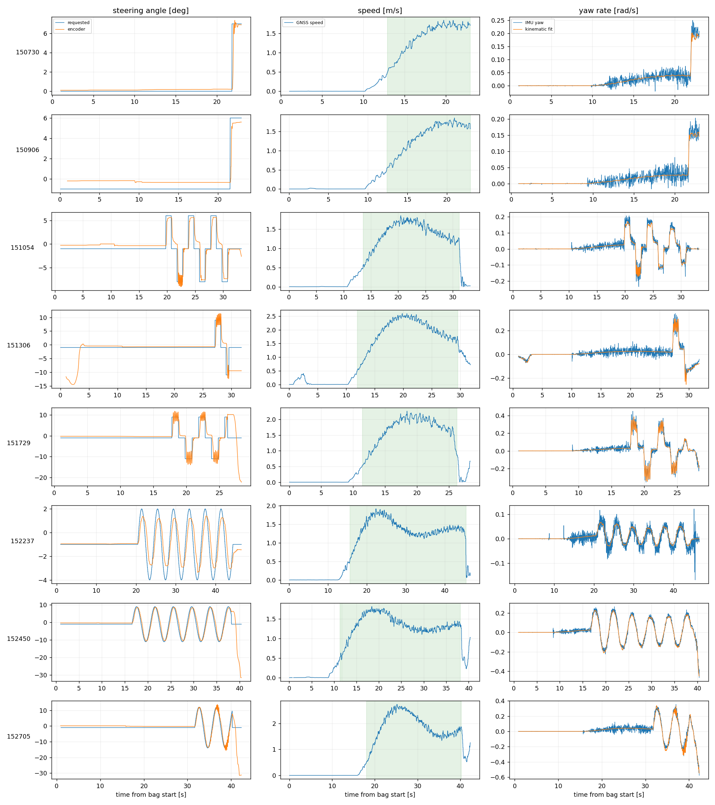

**읽는 법**: 한 줄이 run 하나다. 왼쪽은 요청 조향각(파랑)과 엔코더 조향각(주황), 가운데는 GNSS 속도, 오른쪽은 IMU yaw rate와 위 yaw 모델이다. 초록 칠한 구간이 학습에 쓴 AUTO 이동 구간이다.

**해석**: 스텝 run(151054, 151306, 151729)에서 PD가 목표에 닿은 뒤 6 Hz로 떤다. 사인 run(152237, 152450, 152705)은 매끄럽게 따라간다. 152237은 요청이 −4~+2°인데 실제는 −3~+1.3°로 진폭이 작다. 작은 명령에서는 마찰 때문에 모터가 덜 돈다. yaw 모델(오른쪽 주황)은 모든 run에서 IMU와 겹친다.

학습은 150730, 150906, 151306, 152237, 152705, 검증은 151054, 151729, 152450이다. 쓴 구간은 합쳐서 149.58초다.

### 4.3 모델을 두 개 만든 이유

같은 데이터에서 목적이 다른 모델 두 개를 맞췄다.

| 파일 | 맞춘 방법 | 쓰는 곳 |
|---|---|---|
| [`kaiev26_260919_8bags_mpc.yaml`](../../steering_mpc/config/kaiev26_260919_8bags_mpc.yaml) | 0.6초 다단계 출력 오차 | 조향 MPC의 예측 모델 |
| [`kaiev26_260919_8bags_plant.yaml`](../../steering_mpc/config/kaiev26_260919_8bags_plant.yaml) | 구간 전체 연속 재생 | 시뮬레이터의 조향 플랜트 |

MPC는 1초 앞까지만 보므로 짧은 구간의 응답이 중요하다. 플랜트는 몇십 초 동안 틀어지지 않고 굴러가야 한다. 목적이 다르니 가장 좋은 계수도 다르다.

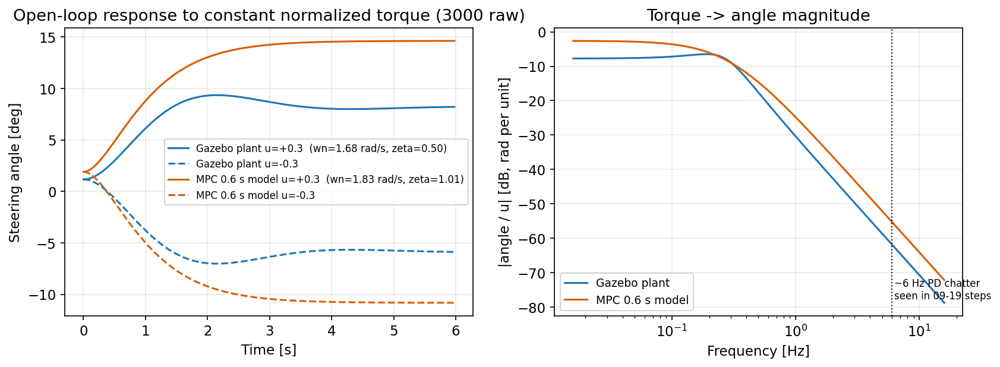

**읽는 법**: 왼쪽은 정규화 토크 ±0.3(raw ±3000)을 계속 줬을 때의 조향각, 오른쪽은 토크에서 조향각까지의 주파수 응답 크기다.

**해석**:

| | MPC 모델 | 플랜트 모델 |
|---|---:|---:|
| 고유진동수 | 1.83 rad/s | 1.68 rad/s |
| 감쇠비 | 1.01 | 0.50 |
| 정상상태 이득 | 42.4 °/u | 23.4 °/u |
| 토크 0일 때 멈추는 각 | 1.9° | 1.16° |

플랜트 모델은 감쇠비 0.5라 한 번 넘쳤다 돌아오고, MPC 모델은 넘치지 않는다. 0.3 Hz 위로는 두 모델이 비슷하고(오른쪽), 차이는 저주파와 정상상태에 몰려 있다. 2.6절대로 폐루프 PD 기록은 저주파 성질을 잘 드러내지 않는다. 이전의 스텝 가중 모델([`identified_step_weighted.yaml`](../../steering_mpc/config/identified_step_weighted.yaml))은 정상상태 이득이 10.6 °/u로, 같은 차에서 모델마다 네 배까지 다르다. 6 Hz PD 떨림(점선)에서는 두 모델 모두 −55 dB 이하라 그 주파수 성분은 조향각에 거의 나타나지 않는다.

### 4.4 검증: 현재값 유지보다 나은가

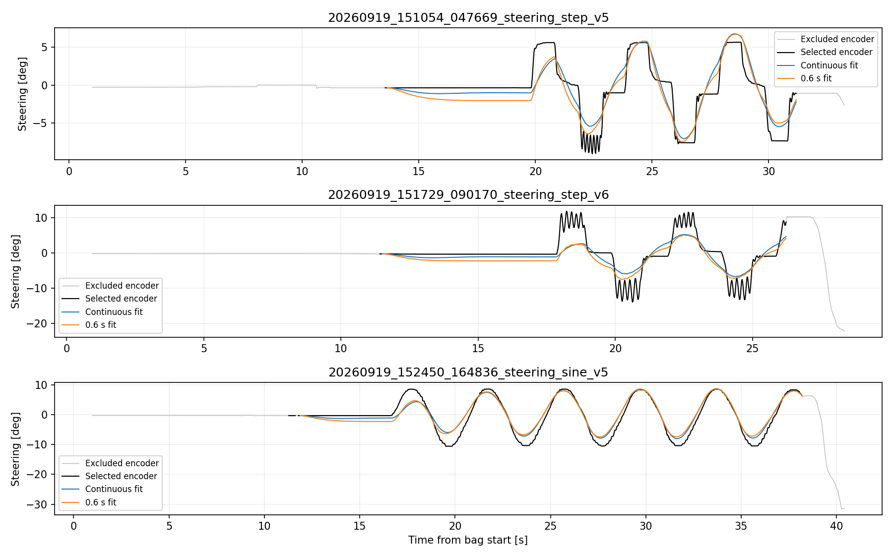

**읽는 법**: 학습에 쓰지 않은 세 run이다. 검정이 실측, 파랑이 플랜트 모델(연속 재생), 주황이 MPC 모델(연속 재생)이다.

**해석**: 사인(맨 아래)은 두 모델 모두 잘 겹치고, 음의 꼭짓점에서 실측이 −10°일 때 모델은 −7.5°로 조금 얕다. 스텝(위 두 줄)에서 실측은 목표에 닿은 뒤 6 Hz로 떨지만 모델은 매끄럽게 올라가 평균을 지나간다. 2상태 선형 모델로는 이 떨림을 만들 수 없다.

| 검증 run | 플랜트 연속 RMSE | MPC 0.6초 창 RMSE | 현재값 유지 |
|---|---:|---:|---:|
| 151054 (스텝) | 1.72° | 1.57° | 2.63° |
| 151729 (스텝, 떨림 큼) | 3.13° | 2.88° | 3.93° |
| 152450 (사인) | 2.03° | 0.60° | 3.35° |

세 run 모두 현재값 유지보다 낫다.

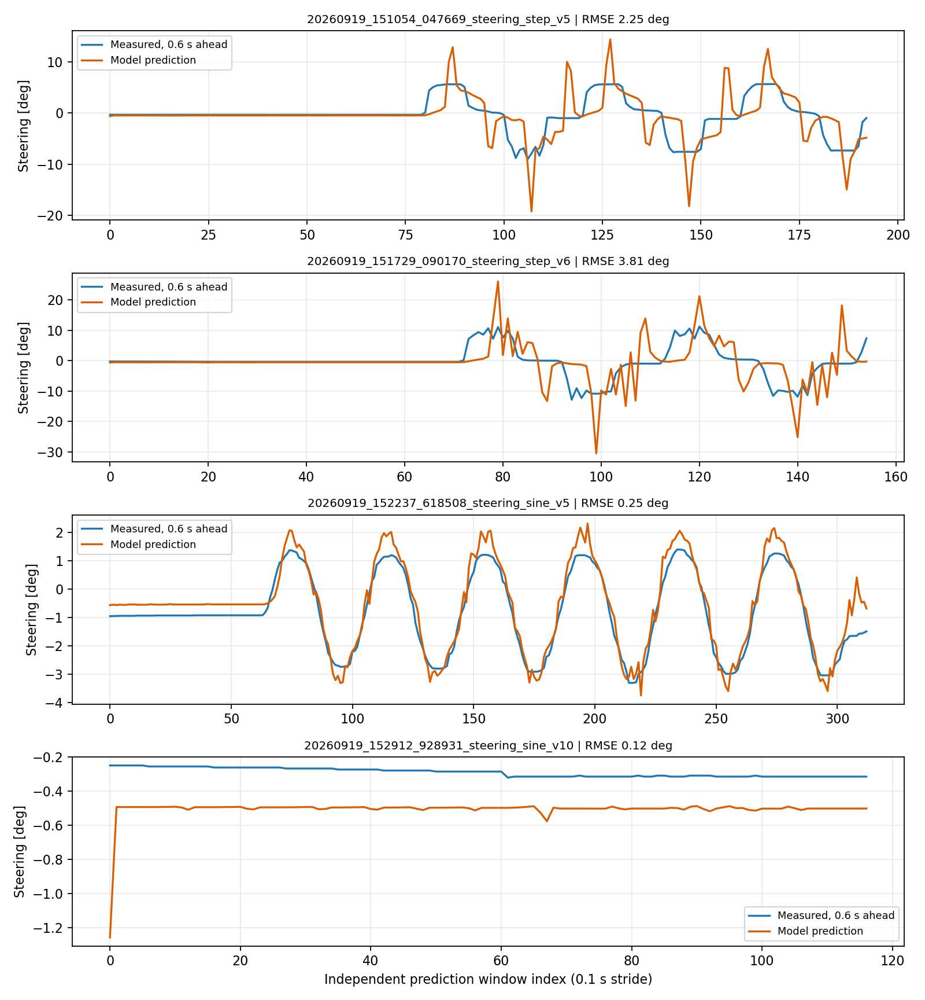

**읽는 법**: 8개 run 모델 이전에 쓰던 스텝 가중 모델의 0.6초 앞 예측이다. 가로축은 0.1초 간격 예측 창 번호다.

**해석**: 스텝 모서리마다 모델이 실측보다 두세 배 큰 봉우리를 예측한다(10° 스텝에 25°). 151729에서는 RMSE 3.81°로 현재값 유지(3.64°)보다 나빴다. 맨 아래 직진 run은 0.2° 어긋난 채 평행하게 간다. 중심 어긋남 계수가 이 run에 맞지 않았다. 이 모델을 버리고 8개 run 모델로 바꿨다.

---

## 5. 경로 모델: 조향각과 경로 오차

경로 MPC는 목표 조향각을 입력으로 받는 4상태 모델을 쓴다([9.2절](#92-4상태-모델)). 모델은 두 부분으로 나뉜다.

| 부분 | 식 | 실차 근거 |
|---|---|---|
| yaw | $r$이 $g_r \frac{v}{L}\delta$를 1차 지연으로 따라간다 | 09-19 yaw 모델 기울기 0.974 (4.1절) |
| 조향 응답 | 실제 조향각이 목표 조향각을 1차 지연으로 따라간다 | 없음. 조향 MPC를 켠 폐루프 응답이 필요하다 |

조향 응답은 "조향 MPC가 목표 조향각을 얼마나 빨리 따라가는가"이므로, 조향 MPC가 켜진 상태의 기록이 있어야 식별할 수 있다. 실차에서 조향 MPC를 켠 적이 없어서, 지금 모델 파일([`path_model_gazebo.yaml`](../../path_mpc/config/path_model_gazebo.yaml))은 Gazebo SITL에서 조향 MPC를 켠 기록(09-24 13:03)으로 맞췄다.

| 계수 | 값 | 비고 |
|---|---:|---|
| 조향 시정수 $\tau_\delta$ | 0.125 s | Gazebo 조향 MPC 폐루프의 응답 |
| 조향 이득 $g_\delta$ | 1.012 | |
| yaw 시정수 $\tau_r$ | 0.005 s | 기록 간격 20 ms보다 짧아 "지연 없음"으로 봐야 한다 |
| yaw 이득 $g_r$ | 1.044 | 실차 09-19는 0.974 |
| 휠베이스 $L$ | 1.2991 m | xacro 설계값 |
| 식별한 조향 목표 범위 | ±0.0524 rad (±3°) | 사인 시험 진폭 |
| 식별한 조향 속도 범위 | 0.103 rad/s | |

실차에 올리기 전에 yaw 부분은 실차 값으로 바꾸고, 조향 응답 부분은 실차 조향 MPC 폐루프 기록으로 다시 맞춰야 한다. 식별 범위(±3°, 0.103 rad/s)도 모델과 함께 파일에 남긴다. 이 범위가 MPC 제약이 된다([9.4절](#94-식별-범위를-지킨다)).

---

# 2부. MPC

## 6. MPC 기초와 공용 QP 라이브러리

### 6.1 MPC가 하는 일

MPC는 매 제어 주기마다 다음을 반복한다.

1. 지금 상태를 잰다.
2. 모델로 앞으로 N 스텝 동안의 상태를 입력의 함수로 예측한다.
3. "목표와의 차이 + 입력의 크기 + 입력 변화량"의 합이 가장 작아지는 입력 N개를 제약 안에서 고른다.
4. 그중 **첫 번째 입력만** 내보내고, 다음 주기에 1번부터 다시 한다.

4번을 **후퇴 지평(receding horizon)** 이라고 한다. 매번 새로 잰 상태에서 다시 계획하므로 모델이 조금 틀려도 오차가 계속 쌓이지는 않는다. 다만 모델이 틀린 만큼 계획도 틀린다.

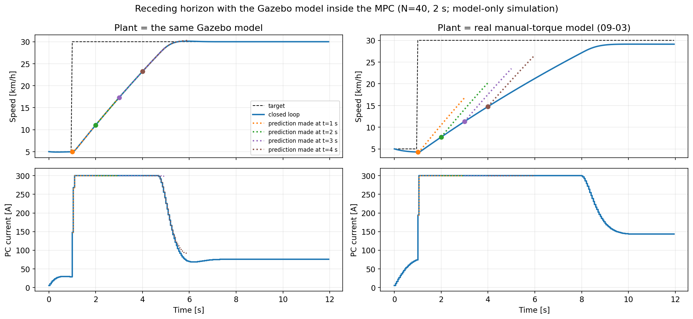

**읽는 법**: 종방향 MPC가 5 km/h에서 30 km/h 목표를 따라가는 모델 시뮬레이션이다. MPC 안에는 지금 설정 파일의 모델(2.8절)이 들어 있다. 파란 실선이 실제로 일어난 폐루프 궤적이고, 점선은 t=1, 2, 3, 4초에 MPC가 세운 2초짜리 계획이다. 왼쪽 열은 제어 대상이 MPC 안의 모델과 같은 경우, 오른쪽 열은 제어 대상을 실차 수동 토크 모델(3.1절)로 바꾼 경우다.

**해석**: 왼쪽은 계획과 실제가 겹친다. 모델이 정확하면 MPC는 계획대로 간다. 오른쪽은 매 계획이 실제보다 가파르다. MPC 안의 모델이 실차보다 전류당 가속을 크게 보기 때문이다. 계획이 틀려도 매 주기 다시 계획하므로 차는 결국 목표 근처로 가지만, 가속은 느리고 **29.12 km/h에서 멈춘다**. 목표보다 0.88 km/h 낮은 이 정상상태 오차는 MPC에 오차를 적분하는 장치가 없어서 생긴다([13.3절](#133-정상상태-오차를-없애는-장치가-없다)).

### 6.2 선형 MPC를 QP로 바꾸기

세 모델은 모두 다음 꼴의 이산 선형 모델이다.

$$x_{k+1} = A x_k + B u_k + c$$

$c$는 경사, 마찰, 조향 중심 어긋남 같은 상수 항이다. 지금 상태 $x_0$에서 N 스텝을 쌓으면 미래 상태 전체가 입력 벡터 $U=[u_0,\dots,u_{N-1}]$의 1차식이 된다.

$$X = F x_0 + G U + E c$$

$W$를 상태별 가중치, $D$를 이웃한 입력의 차를 만드는 행렬, $u_{-1}$을 직전에 실제로 보낸 입력이라 하면 비용은

$$J = (X-R)^\top W (X-R) + r_d \lVert DU - e\,u_{-1} \rVert^2 + r_u \lVert U - U_{eq} \rVert^2$$

전개하면 $U$에 대한 이차식 $\tfrac12 U^\top P U + q^\top U$가 되고, $P = 2(G^\top W G + r_d D^\top D + r_u I)$다. 제약은 세 가지다.

| 제약 | 식 | 의미 |
|---|---|---|
| 입력 범위 | $u_{min} \le u_k \le u_{max}$ | 전류 0~300 A, 토크 ±1, 조향각 ±한계 |
| 입력 변화량 | $\lvert u_k - u_{k-1} \rvert \le \Delta u_{max}$ | 전류 변화율, 조향 속도 |
| 상태 범위 | $x_{min} \le (FX_0+GU)_{i} \le x_{max}$ | 한 상태 성분만. 경로 MPC의 실제 조향각 |

이렇게 입력만 남기고 상태를 식에서 지운 형태를 **압축형(condensed)** QP라고 한다. 변수가 입력 N개뿐이라 작다. 상태까지 변수로 두는 **희소형(sparse)** 은 변수가 많지만 행렬이 희소하고 N에 선형으로 커진다. 여기서는 N이 40~50이고 상태가 2~4개라 압축형으로 충분하다.

### 6.3 OSQP와 warm start

QP는 [OSQP](https://osqp.org) 0.6.2의 C API로 푼다(ROS Humble의 `osqp_vendor`). OSQP는 ADMM이라는 1차 반복법으로 볼록 QP를 푼다. 행렬 분해를 한 번 해 두면 반복마다 싼 계산만 하므로, 같은 구조의 문제를 계속 푸는 MPC에 맞다.

- **행렬 재사용.** $P$와 제약 행렬은 모델이 바뀌지 않는 한 그대로다. 매 주기에는 $q$(목표와 현재 상태가 들어가는 선형 항)와 제약의 위아래 경계만 갱신한다.
- **warm start.** 직전 주기의 해를 시작점으로 쓴다. 후퇴 지평에서는 연속한 두 문제의 해가 비슷하므로 반복 횟수가 줄어든다.
- **근사해 허용.** OSQP가 `solved inaccurate`(허용오차는 못 채웠지만 해에 가까움)를 돌려주면 받아들이고 WARN을 남긴다. 처음에는 이를 실패로 보고 0 토크를 냈는데, 그 때문에 조향 토크가 순간적으로 끊겼다.
- **첫 입력 재확인.** 근사해는 제약을 조금 어길 수 있다. 내보내기 직전에 첫 입력을 입력 범위와 변화량 범위의 교집합 안으로 다시 자른다.
- **시간 제한.** 해를 못 찾거나, 시간 제한을 넘기거나, 실현 불가능하면 입력을 내지 않고 각 노드의 정지 처리로 넘긴다.

### 6.4 `mpc_common::LinearMpc`

[`linear_mpc.hpp`](../include/mpc_common/linear_mpc.hpp)는 조향 MPC와 경로 MPC가 함께 쓰는 클래스다.

```cpp
LinearMpc(int states, int horizon, int constrained_state,
          const Eigen::VectorXd &weights, double effort_weight,
          double change_weight, double time_limit);
void dynamics(const Eigen::MatrixXd &a, const Eigen::VectorXd &b);  // F, G, P 다시 계산
Solution solve(state, reference, offset, previous,
               input_limit, input_step, state_min, state_max);
```

`dynamics()`는 $F, G, P$와 제약 행렬을 다시 만들고, OSQP가 이미 준비돼 있으면 희소 구조를 유지한 채 값만 바꾼다(`osqp_update_P`, `osqp_update_A`). 조향 MPC는 모델이 고정이라 시작할 때 한 번 부른다. 경로 MPC는 모델에 차속이 들어가므로 매 주기 부른다. 지평은 200 스텝 이하로 제한한다. OSQP 설정은 절대/상대 허용오차 1e-4/1e-3, 최대 반복 2000, warm start 켜짐이다.

종방향 MPC는 이 라이브러리보다 먼저 만들어서 자기 QP 클래스 [`CurrentMPC`](../../longitudinal_mpc/include/longitudinal_mpc/current_mpc.hpp)를 따로 가진다. 구조는 같고, 정상상태 전류 $u_{eq}$ 항과 더 엄격한 허용오차(상대 1e-5, 최대 반복 4000, `solved`만 인정)가 다르다.

---

## 7. 종방향 MPC

### 7.1 비용과 제약

[`CurrentMPC`](../../longitudinal_mpc/src/current_mpc.cpp)는 50 ms마다 40 스텝(2초) 지평으로 아래 문제를 푼다.

$$\min_U \sum_{k=0}^{N-1} q_v (v_{k+1} - r)^2 + r_d (u_k - u_{k-1})^2 + r_u (u_k - u_{eq})^2$$

$$0 \le u_k \le 300\ \text{A}, \qquad -4800\,\Delta t \le u_k - u_{k-1} \le 2400\,\Delta t$$

- $q_v = 10$, $r_d = 0.002$, $r_u = 10^{-5}$ ([`controller.yaml`](../../longitudinal_mpc/config/controller.yaml))
- $u_{eq}$는 목표속도 $r$을 유지하는 데 필요한 정상상태 전류다. 모델의 평형식을 LU 분해로 풀어 얻는다. $r_u$ 항은 입력을 이 값 쪽으로 당긴다. PI는 적분이 차오를 때까지 이 전류를 모르지만, MPC는 모델에서 바로 안다.
- 전류는 **0 A 아래로 내려가지 않는다.** 감속은 전류를 0으로 내리고 굴러가는 것뿐이다. 정지와 급제동은 기존 브레이크 경로가 맡는다.
- 목표속도는 예측 지평 동안 **지금 값 그대로** 둔다. 미래 목표를 미리 보지 않는다.

### 7.2 차단 조건

[`controller_node.cpp`](../../longitudinal_mpc/src/controller_node.cpp)의 `Inhibit()`가 하나라도 걸리면 0 A를 낸다.

| 조건 | 내용 |
|---|---|
| 신선도 | 목표, 구동 상태, 차량 상태가 0.2초 안에, 설정 readback이 0.7초 안에 들어왔는가 |
| 모드 | STM_A가 외부 전류 모드이고 모터 제어 모드가 0인가 |
| 한계 | PC 한계 ≤ MCU에 적용된 한계인가 |
| 운전 상태 | AUTO이고, 정지 요청, 브레이크, fault가 없고, 측정이 유효한가 |
| 목표 | 목표속도 > 0이고 후진이 아닌가 |
| 발행자 | 전류 명령 토픽의 발행자가 정확히 하나인가 |

비교용 PI는 STM_A 펌웨어의 `longitudinal_controller.c`(`Long_Update`)를 호스트에서 그대로 빌드해 쓴다. PI와 MPC가 같은 전류 한계와 변화율 한계, 같은 차단 조건을 쓴다. 이 노드 아래에서 CAN 브리지와 STM_A가 E-stop과 명령 만료를 따로 처리한다.

### 7.3 가중치: 정착시간과 부드러움의 교환

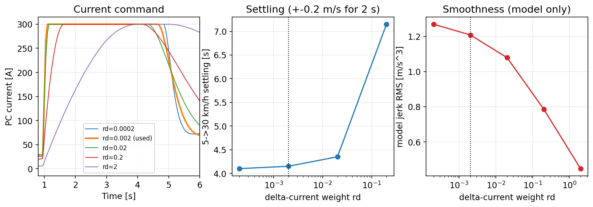

**읽는 법**: 설정 파일의 모델만으로 5→30 km/h 스텝을 풀었다. 왼쪽이 전류 명령, 가운데가 정착시간(±0.2 m/s를 2초 유지), 오른쪽이 모델 jerk RMS다. 점선이 지금 쓰는 $r_d = 0.002$다.

**해석**: $r_d$를 0.0002에서 0.02까지 키워도 정착시간은 4.10→4.35초로 거의 그대로다. 300 A 한계에 붙어 있는 시간이 길어서, 결과는 가중치보다 전류 한계가 정한다. 0.2부터는 7.15초로 느려지고, 2에서는 창 안에 정착하지 않는다. jerk는 1.27에서 0.45 m/s³로 꾸준히 준다. 지금 값은 빠른 쪽 끝이다. 실차 모델이 생기면 같은 스윕을 그 모델로 다시 하고, 승차감 기준에 맞춰 고른다.

### 7.4 실차 모델로 돌려 본 오프라인 MPC

3.1절의 수동 토크 모델로 Python(SLSQP) MPC를 오프라인으로 돌렸다. 0→5→10→0 km/h 목표에서 속도 RMSE 0.208 m/s, 계산 p95 1.30 ms였다.

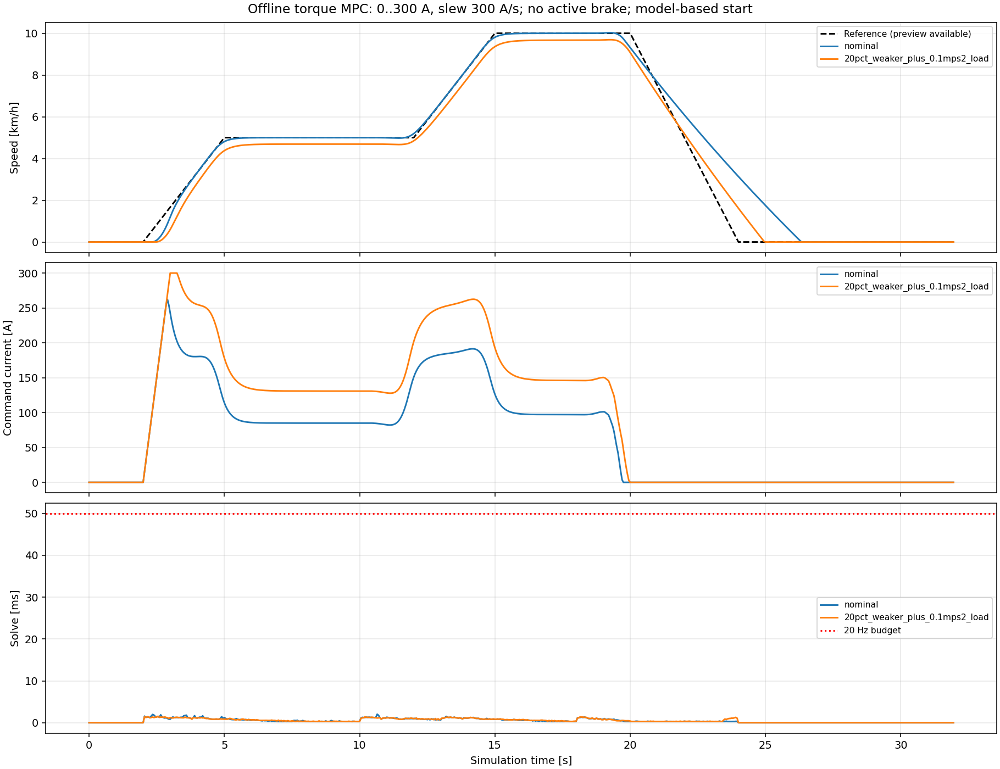

**읽는 법**: 파란 선은 모델 그대로, 주황 선은 토크를 20% 약하게 하고 저항 0.1 m/s²를 더한 차다. 맨 아래는 계산시간과 50 ms 예산(빨간 점선)이다.

**해석**: 약한 차는 목표보다 0.3 km/h 낮게 머문다. 모델이 틀리면 정상상태 오차가 남는 현상이 이때부터 보였다. 감속(20초 이후)은 전류를 0으로 내리는 것밖에 할 수 없어서, 목표가 0에 닿은 뒤에도 차가 2초 넘게 굴러간다. 같은 날 이 노드를 rclcpp와 OSQP C API로 다시 써서 실시간 경로에서 Python, NumPy, SciPy를 모두 뺐다.

---

## 8. 조향 MPC

[`steering_mpc.cpp`](../../steering_mpc/src/steering_mpc.cpp)는 `lateral_ctrl` 안에서 50 Hz로 돈다.

- 상태 $[\delta, \dot\delta]$, 입력은 raw 토크를 10000으로 나눈 값 $u \in [-1, 1]$
- 모델은 09-19 8개 run의 MPC용 모델(4.3절)
- 지평 50 스텝(1초)
- 가중치: 조향각 4000, 조향 속도 0.1, 입력 변화량 0.02, 입력 크기 0.01
- OSQP 시간 제한 16 ms (주기 20 ms)
- 모델에 지연 $d$ 스텝이 있으면 과거 입력 $d$개를 상태에 붙여(지연 증강) 푼다. 지금 두 모델은 지연 0이다.
- 한 주기 입력 변화 한계는 2.0이다. −1에서 +1까지 한 번에 갈 수 있어서 사실상 제한이 없고, 부드러움은 변화량 가중치가 정한다.

CAN 출력, Enable/Disable, E-stop, 피드백 만료, peak/sustained 토크 한계는 기존 `lateral_ctrl`이 그대로 맡는다. MPC는 PD 자리에 들어가 같은 안전 출력 경로를 쓴다.

조향각 가중치 4000에 비해 조향 속도 가중치 0.1이 작은 이유는, 모델의 감쇠비가 이미 1에 가까워 따로 감쇠를 더할 필요가 적어서다. 스텝 뒤 6 Hz 떨림은 모델에 없으므로 MPC가 그것을 억제한다고 기대할 근거는 없다. 6 Hz 성분은 모델 응답에서 −55 dB 아래라 MPC 입장에서는 보이지 않는 외란이다.

---

## 9. 경로 MPC

### 9.1 구조

```text
Decision ──/planning/target_path──▶ lateral_path_mpc (20 Hz) ──/control/lateral/target──▶ Decision ──▶ lateral_ctrl
                                         │   (목표 조향각)                                           (조향 MPC, 50 Hz)
/vehicle/state, /imu/data ───────────────┘
```

경로 MPC는 목표 **조향각**을 정하고, 조향 MPC가 그 각도를 **토크**로 만든다. 두 MPC가 계층으로 쌓인 구조다. 비교 대상인 Pure Pursuit(PP)도 같은 자리에서 목표 조향각을 낸다.

### 9.2 4상태 모델

상태는 횡오차 $e_y$, 방향 오차 $e_\psi$, yaw rate $r$, 실제 조향각 $\delta$이고, 입력은 목표 조향각 $\delta_{cmd}$다. 주기 $\Delta t = 0.05$ s, 지평 40 스텝(2초)이다.

$$
\begin{aligned}
e_{y,k+1} &= e_{y,k} + \Delta t\, v\, e_{\psi,k} \\
e_{\psi,k+1} &= e_{\psi,k} + \Delta t\, r_k - \Delta t\, v\,\kappa \\
r_{k+1} &= a_r r_k + (1-a_r)\left(g_r \frac{v}{L}\delta_k + b_r\right) \\
\delta_{k+1} &= a_\delta \delta_k + (1-a_\delta)\left(g_\delta\, \delta_{cmd,k} + b_\delta\right)
\end{aligned}
$$

$a = e^{-\Delta t/\tau}$이다. 차속 $v$와 경로 곡률 $\kappa$가 식에 들어가므로 매 주기 `dynamics()`로 행렬을 다시 만든다. 목표는 $e_y = e_\psi = 0$, $r = v\kappa$, $\delta = \arctan(L\kappa / g_r)$로, 곡선에서 필요한 조향각을 미리 넣는 곡률 앞먹임이다. 계수는 5장에 있다.

### 9.3 비용과 제약

| 항목 | 값 |
|---|---:|
| 가중치 $e_y$ / $e_\psi$ / $r$ / $\delta$ | 20 / 10 / 0.1 / 1 |
| 입력 크기 가중치 | 0.1 |
| 입력 변화량 가중치 | 200 |
| 조향각 한계 (입력과 상태 $\delta$ 모두) | min(0.4363 rad, 모델의 목표 범위) |
| 조향 속도 한계 | min(1.047 rad/s, 모델의 목표 속도) |
| OSQP 시간 제한 | 25 ms |

속도가 0.1 m/s 아래이거나 MANUAL이면 계산하지 않고 지금 조향각을 그대로 넘긴다. 예측 궤적은 `/control/lateral/mpc/trajectory`(MarkerArray)로, 진단은 `/control/lateral/diagnostics`로 낸다.

조향각 한계를 입력과 상태 $\delta$ 양쪽에 거는 이유는, 1차 지연 모델에서 입력이 한계 안이어도 상태가 한계를 넘을 수는 없지만, 오프셋 $b_\delta$와 이득 $g_\delta$ 때문에 둘이 조금 어긋나기 때문이다. 상태 제약은 `LinearMpc`의 `constrained_state` 하나로 처리한다.

### 9.4 식별 범위를 지킨다

조향 한계를 "모델의 목표 범위"와 차량 기계 한계 중 작은 쪽으로 두는 규칙은 실패에서 나왔다. 처음에는 기계 한계인 ±25°, 60°/s로 뒀고, Gazebo SITL에서 경로 MPC가 목표를 +25°와 −25° 사이에서 뒤집으며 좌우로 흔들렸다. 실제 조향은 토크 포화 때문에 ±8°에도 못 닿았다. 모델은 ±3° 사인에서 식별한 것이라 큰 목표에서도 0.125초 만에 따라온다고 믿었고, 예측이 틀리니 MPC가 과하게 꺾었다. 횡오차 RMSE 1.871 m였고, 한계를 ±3°로 줄이자 0.174 m가 됐다. 그림과 경과는 [Gazebo-in-the-loop 9.2절](../../../../../../docs/gazebo_in_the_loop.md#92-경로-mpc가-25에서-흔들렸다)에 있다.

지금 모델 파일의 두 범위는 K-City 주행을 위해 다시 25°, 60°/s로 넓혀 두었다(11.3절). 식별한 원래 값은 같은 파일의 `identified_steering_reference_*`에 남아 있다. 넓은 범위에서 쓰려면 큰 조향 진폭으로 경로 모델을 다시 식별하거나 토크 포화를 모델에 넣어야 한다.

### 9.5 예측 궤적 확인: 실차 기록 재생

경로 MPC가 세운 2초 계획이 실제로 말이 되는지 실차 기록에서 확인했다. 09-20 K-City PP+Stanley 주행 bag을 재생하고, 경로 MPC를 제어 없이 관측만 하게 돌렸다(이 관측 모드는 09-25에 코드에서 뺐다).

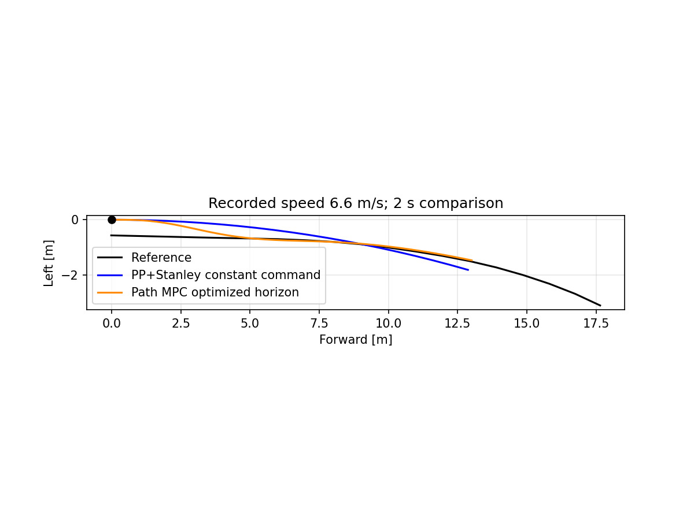

**읽는 법**: 6.6 m/s로 달리던 한 순간이다. 검정이 목표 경로, 파랑이 PP+Stanley의 지금 조향각을 2초 동안 유지했을 때의 궤적, 주황이 경로 MPC가 최적화한 2초 궤적이다.

**해석**: 차는 경로에서 0.6 m 왼쪽에 있다. PP+Stanley 조향을 유지하면 경로를 지나쳐 오른쪽으로 벗어나지만, 경로 MPC 계획은 5 m 안에 경로로 들어가 곡선을 따라간다. 한 순간을 고른 예시이며 성능 비교는 아니다.

---

## 10. 계산시간

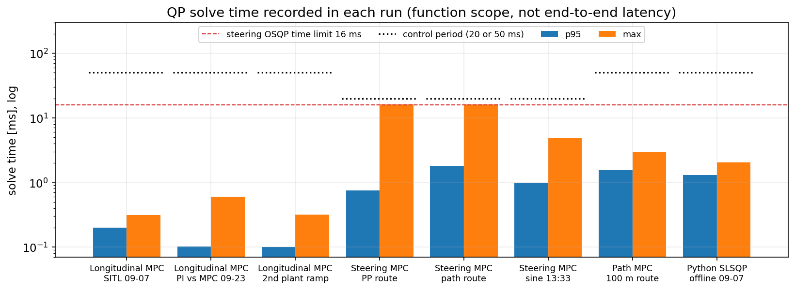

**읽는 법**: 각 주행에서 기록한 QP 계산시간의 p95(파랑)와 최대(주황), 로그 눈금이다. 점선은 제어 주기(종방향과 경로 50 ms, 조향 20 ms), 빨간 점선은 조향 OSQP 시간 제한 16 ms다. 모두 MPC 함수 안의 시간이며 센서 수신, DDS, CAN 지연은 들어 있지 않다. 측정은 개발 PC에서 Gazebo SITL을 돌리면서 했다.

**해석**:

| 제어기 | 주행 | p95 | 최대 | 실패 |
|---|---|---:|---:|---:|
| 종방향 | 09-07 SITL | 0.199 ms | 0.311 ms | 0 / 384 |
| 종방향 | 09-23 PI 대 MPC | 0.101 ms | 0.602 ms | 0 |
| 종방향 | 09-23 두 번째 차량 램프 | 0.100 ms | 0.316 ms | 0 |
| 조향 | PP+조향 MPC 경로 | 0.749 ms | 16.04 ms | 0 (근사해 3) |
| 조향 | 경로+조향 MPC 경로 | 1.804 ms | 16.03 ms | 0 (근사해 2) |
| 조향 | 13:33 사인 | 0.970 ms | 4.83 ms | 0 |
| 경로 | 100 m 경로 | 1.553 ms | 2.94 ms | 0 |

종방향은 변수 40개짜리 QP라 0.1 ms대다. 조향은 p95가 1~2 ms지만 **최대가 시간 제한 16 ms에 닿았다**. OSQP가 시간 안에 허용오차를 채우지 못하고 근사해를 낸 경우다. 주기 20 ms에 16 ms를 쓰면 나머지 처리에 4 ms만 남는다. 13:33 사인 시험에서 OSQP 반복 횟수는 p95 75, 최대 500이었다. Python SLSQP로 p95 1.30 ms이던 종방향 계산이 C++ OSQP에서 0.1~0.2 ms가 됐다.

---

## 11. 파라미터 사전

### 11.1 종방향 ([`controller.yaml`](../../longitudinal_mpc/config/controller.yaml))

| 파라미터 | 값 | 의미 |
|---|---:|---|
| `horizon` | 40 | 예측 스텝 수. 50 ms × 40 = 2초 |
| `speed_weight` ($q_v$) | 10 | 속도 오차 제곱의 가중치 |
| `delta_current_weight` ($r_d$) | 0.002 | 전류 변화량 제곱의 가중치. 키우면 부드럽고 느려진다 |
| `current_weight` ($r_u$) | 1e-5 | 정상 전류에서 벗어난 정도의 가중치. 거의 0 |
| `current_max_a` | 300 | 상전류 상한 [A] |
| `current_slew_up_a_s` | 2400 | 전류 상승률 한계 [A/s]. 한 주기 120 A |
| `current_slew_down_a_s` | 4800 | 전류 하강률 한계 [A/s]. 한 주기 240 A |
| `max_speed_mps` | 8.333 | 목표속도 상한 (30 km/h) |

### 11.2 조향 (`lateral_ctrl` 파라미터)

| 파라미터 | 값 | 의미 |
|---|---:|---|
| 지평 | 50 | 20 ms × 50 = 1초 |
| `mpc_angle_weight` | 4000 | 조향각 오차 가중치 |
| `mpc_rate_weight` | 0.1 | 조향 속도 가중치. 감쇠 역할 |
| `mpc_delta_torque_weight` | 0.02 | 정규화 토크 변화량 가중치 |
| 입력 크기 가중치 | 0.01 | 정규화 토크 크기 가중치 |
| `input_scale` | 10000 | raw 토크를 [−1, 1]로 바꾸는 배율 |
| 시간 제한 | 16 ms | OSQP 한 번의 상한 |
| `delay_steps` | 0 | 모델 입력 지연. 0~50 허용 |

### 11.3 경로 (`path_node.cpp`, [`path_model_gazebo.yaml`](../../path_mpc/config/path_model_gazebo.yaml))

| 파라미터 | 값 | 의미 |
|---|---:|---|
| 지평 | 40 | 50 ms × 40 = 2초 |
| 가중치 $e_y$, $e_\psi$, $r$, $\delta$ | 20, 10, 0.1, 1 | 상태별 오차 가중치 |
| 입력 크기 / 변화량 가중치 | 0.1 / 200 | 목표 조향각 크기와 변화량 |
| `max_steering_rad` | 0.4363 | 노드의 조향각 상한 (25°) |
| `steering_reference_limit_rad` | 0.4363 | 모델 파일의 조향각 범위. 식별값은 0.0524 |
| `steering_reference_rate_rad_s` | 1.047 | 모델 파일의 조향 속도 범위. 식별값은 0.103 |
| 시간 제한 | 25 ms | OSQP 한 번의 상한 |

---

## 12. 나쁜 결과는 왜 나빴나

### 12.1 수동 토크 모델이 날짜를 넘지 못했다

09-06 2초 예측은 가속도 유지 기준보다 나아지지 않았다. 사람의 브레이크와 경사가 기록되지 않았고, 모델의 상수 저항 0.356 m/s²가 그 모든 것을 한 숫자로 뭉쳐 들고 있었다. 날짜와 장소가 바뀌면 그 숫자가 달라진다. 입력도 페달 전류라서 MPC가 실제로 내보내는 PC 명령과 경로가 다르다.

### 12.2 스텝 가중 조향 모델이 현재값 유지 기준에 졌다

스텝 응답을 크게 가중해 맞췄더니 스텝 모서리에서 봉우리를 두세 배로 과장했고, 떨림이 큰 run 하나에서 현재값 유지보다 나빴다. 중심 어긋남 계수도 직진 run에 맞지 않았다. 가중을 빼고 8개 run을 고르게 쓰는 모델로 바꿨다.

### 12.3 경로 MPC가 ±25°에서 흔들렸다

9.4절대로 모델이 믿을 수 있는 범위(±3°) 밖에서 MPC를 돌렸다. 1차 지연 모델에는 토크 포화가 없으므로, 큰 목표에서 실제 조향이 느려지는 것을 예측하지 못했다.

### 12.4 조향 모델의 저주파 성질이 모델마다 달랐다

같은 차의 세 조향 모델이 정상상태 이득에서 10.6, 23.4, 42.4 °/u로 네 배 차이 난다. 폐루프 PD 기록만 썼기 때문이다(2.6절). 토크를 오래 일정하게 준 구간이 없으니 정상상태 이득을 정할 정보가 부족했다.

---

## 13. 약점과 한계

### 13.1 실차 MPC 주행이 없다

STM_A 외부 전류 모드 코드는 빌드했지만 보드에 올리지 않았고, 실차에서 종방향 MPC나 조향 MPC를 켠 적이 없다. 폐루프 결과는 모두 Gazebo SITL에서 나왔고, 그 결과는 연결 확인으로만 쓴다([Gazebo-in-the-loop 10장](../../../../../../docs/gazebo_in_the_loop.md#10-제어기-비교는-로직-확인으로만-읽는다)).

### 13.2 종방향 설정 파일에는 Gazebo 차량 모델이 들어 있다

지금 설정에 들어 있는 모델은 Gazebo 차량에서 식별한 것이다. 실차는 같은 전류로 28~36% 덜 가속하고 상수 저항이 3.7배 크다. 이 모델로 실차를 몰면 6.1절 오른쪽처럼 가속이 느리고 목표보다 낮게 머문다. 실차 외부 전류 모드 기록으로 다시 식별하기 전에는 실차에 쓰지 않는다.

### 13.3 정상상태 오차를 없애는 장치가 없다

세 MPC 모두 모델 오차나 외란을 추정하지 않는다. 모델이 틀리면 정상상태 오차가 남는다(6.1절 시뮬레이션 −0.88 km/h, 7.4절 −0.3 km/h). PI는 적분으로 이 오차를 없앤다. MPC에서는 외란 상태를 모델에 붙여 관측기로 추정하는 방법(offset-free MPC)이 표준이다.

### 13.4 앞을 보지 않는다, 뒤로 당기지 못한다

- 종방향 MPC는 목표속도를 지평 동안 일정하게 둔다. 램프 목표에서 한 박자 늦는다.
- 전류는 0 A 아래로 가지 않는다. 감속은 코스트다운뿐이라 목표를 빨리 내리면 따라가지 못한다. 회생 제동이나 브레이크를 입력으로 쓰려면 그 모델도 식별해야 한다.

### 13.5 경로 모델의 조향 응답은 실차에서 식별하지 않았다

5장대로 경로 모델의 조향 응답은 Gazebo SITL 기록에서 나왔고, yaw 이득도 1.044로 실차 값 0.974와 다르다. 경로 MPC 기본 설정의 조향 범위도 흔들렸던 설정(±25°)과 같다.

### 13.6 조향 모델은 하루치 폐루프 기록이다

09-19 하루, PD가 켜진 8개 run에서 나왔다. 스텝 뒤 6 Hz 떨림은 2상태 선형 모델로 재현하지 못한다. 마찰 같은 비선형이 원인일 가능성이 크다. 입력은 KEYA raw 명령을 10000으로 나눈 값으로, Nm도 A도 아니다. 모터 설정이나 펌웨어가 바뀌면 모델을 다시 식별해야 한다.

### 13.7 계산시간은 실시간 보장이 아니다

측정한 것은 MPC 함수 안의 시간이다. 운영체제 스케줄링, DDS, CAN 지연은 들어 있지 않다. 조향은 최대가 시간 제한 16 ms에 닿았다.

---

## 14. 다음에 할 일

1. **HIL 보드 확인.** micro-ROS 수신 → 토크 모드 CAN 비트 → 명령 만료 → 브레이크와 E-stop을 실제 STM_A에서 확인한다. 재부팅 뒤 기본 Speed 모드로 돌아간 상태에서 이전 목표속도가 다시 구동 명령이 되는 경로를 막는다.
2. **실차 외부 전류 모드 SYSID.** 시나리오 TUI로 전류 스텝과 코스트다운을 기록해 실차 모델을 만든다. 전류 0 A 구간을 충분히 넣고, 날짜를 바꾼 주행을 검증용으로 남긴다.
3. **offset-free MPC.** 속도 외란 상태를 모델에 붙이고 칼만 필터로 추정한다. 정상상태 오차가 사라지는지 실차 모델 플랜트로 먼저 확인한다.
4. **목표 미리보기.** Decision의 목표속도 프로파일을 지평에 넣는다.
5. **조향 개루프 시험.** PD 없이 토크 스텝과 처프를 줘서 정상상태 이득과 마찰을 따로 식별한다.
6. **큰 진폭 조향 SYSID.** 경로 MPC 범위를 넓히려면 ±10° 이상 조향 시험으로 경로 모델을 다시 만들거나, 토크 포화를 모델에 넣는다.
7. **경로 모델 실차 식별.** 조향 MPC를 실차에서 켠 뒤 그 폐루프 응답과 실차 yaw 이득으로 경로 모델을 다시 맞춘다.

---

## 15. 재현 방법과 산출물

### 15.1 식별

```bash
# 종방향: 전류 스텝, 코스트다운 기록에서
ros2 run longitudinal_mpc fit_longitudinal \
  --train <train1>/rosbag <train2>/rosbag \
  --validation <held_out>/rosbag --output <artifact>/identified

# 조향: 09-19 SYSID bag과 휠 허브 보정에서
ros2 run steering_mpc fit_lateral \
  --bags <SYSID_campaign> --calibration <steering_motor_calibration.yaml> \
  --output <artifact>/identified

# 경로: 조향 MPC를 켠 스텝, 사인 기록에서
ros2 run path_mpc fit_lateral_response \
  --actuator-bag <steering_MPC_bag> --vehicle-bags <yaw_fit_bags> \
  --validation-bag <separate_yaw_bag> --calibration <steering_motor_calibration.yaml> \
  --output <artifact>/path_model.yaml
```

### 15.2 평가

```bash
ros2 run longitudinal_mpc evaluate_longitudinal --pi <pi>/rosbag --mpc <mpc>/rosbag --output <dir>
ros2 run steering_mpc evaluate_lateral --pd <pd_bag> --mpc <mpc_bag> \
  --calibration <steering_motor_calibration.yaml> --output <dir>
ros2 run path_mpc evaluate_path --run PP_PD=<bag1> --run PP_MPC=<bag2> \
  --run MPC_MPC=<bag3> --route <route.yaml> --output <dir>
```

정착시간은 목표 ±0.2 m/s를 2초 유지한 첫 시점이다. 가속도와 jerk는 GNSS 차체 속도에 0.55초, 3차 Savitzky-Golay 필터를 써서 구한다. Gazebo에서 제어기를 띄우는 방법은 [Gazebo-in-the-loop 14장](../../../../../../docs/gazebo_in_the_loop.md#14-재현-방법)에 있다.

### 15.3 코드 위치

| 내용 | 위치 |
|---|---|
| 공용 QP (조향, 경로) | `mpc_common/src/linear_mpc.cpp` |
| 종방향 QP | `longitudinal_mpc/src/current_mpc.cpp` |
| 종방향 노드와 차단 조건 | `longitudinal_mpc/src/controller_node.cpp` (`Inhibit()`) |
| 종방향 식별 | `longitudinal_mpc/scripts/fit_longitudinal`, `model.py`, `bag_io.py` |
| 조향 MPC | `steering_mpc/src/steering_mpc.cpp` (`SteeringModel::load`, `SteeringMpc::solve`) |
| 조향 식별 | `steering_mpc/scripts/fit_lateral`, `lateral_data.py` |
| 경로 MPC 노드 | `path_mpc/src/path_node.cpp` |
| 경로 식별 | `path_mpc/scripts/fit_lateral_response` |

### 15.4 결과 원본

| 내용 | 위치 (`~/Storage/ROS2_Workspace_offload/` 아래) |
|---|---|
| 실차 수동 토크 모델, 오프라인 MPC | `vehicle_sysid_analysis/post480_pedal_mpc_20260907/` |
| 실차 기록의 전류당 가속 비교 | `longitudinal_mpc/20260924_real_bag_comparison/` |
| 조향 8개 run 식별 | `vehicle_sysid_analysis/20260924/eight_lateral_bags/` |
| 휠 허브 보정, yaw 모델 | `ros2_ws/src/vehicle_sysid_analysis/results/260919/` |
| 경로 모델, 계산시간 | `lateral_mpc/20260924/`, `longitudinal_mpc/20260923/` |

이 문서의 그림 중 `timeline`, `receding_horizon`, `weight_sweep`, `longitudinal_gain_compare`, `steering_models`, `solve_time`은 모델 YAML과 보고서 수치로 새로 그렸다. 나머지는 결과 원본의 그림을 복사했다.

---

## 16. 면접 대비 문답

**Q. MPC를 짧게 설명해 주세요.**  
모델로 앞으로 몇 초를 예측하고, 목표와의 차이와 입력의 크기, 변화량이 가장 작아지는 입력열을 제약 안에서 고른 뒤 첫 입력만 쓰는 제어입니다. 다음 주기에 새로 잰 상태에서 다시 풉니다. 제약을 직접 다룰 수 있고, 모델만 바꾸면 같은 코드로 다른 대상을 제어할 수 있다는 점이 PID와 다릅니다.

**Q. 왜 MPC가 필요했나요? PID로 충분하지 않았나요?**  
모터 컨트롤러의 Speed 모드가 실차에서 목표를 2 m/s 넘게 넘고 전류 부호가 뒤집히는 것을 봐서, 전류를 PC가 직접 정하는 구조로 바꿨습니다. 그러면 300 A 한계와 변화율 한계가 성능을 정하는데, PI는 한계에 걸리면 적분이 쌓였다가 늦게 풀리고, 목표를 유지하는 전류를 적분이 찰 때까지 모릅니다. MPC는 한계를 문제 안에 넣고 필요한 정상 전류를 모델에서 바로 계산합니다. 대신 모델이 틀리면 정상상태 오차가 남습니다.

**Q. 왜 선형 MPC인가요? 비선형 MPC는 고려했나요?**  
세 모델 모두 운용 범위 안에서 선형으로 충분히 맞았고, 선형이면 문제가 볼록 QP가 되어 전역 최적해를 1 ms 안팎에 안정적으로 구합니다. 비선형 MPC는 조향 포화나 큰 조향각을 다룰 수 있지만 계산시간과 수렴 보장이 문제입니다. 지금 가장 큰 오차 원인은 선형화보다 모델 계수 자체라서 그쪽을 먼저 고치는 게 맞다고 봤습니다.

**Q. OSQP를 고른 이유는요?**  
MPC처럼 같은 구조의 QP를 계속 푸는 데 맞습니다. 행렬 분해를 한 번 하고 매 주기 선형 항과 경계만 바꿀 수 있고, 직전 해로 warm start합니다. ROS Humble에 `osqp_vendor`로 이미 들어 있어서 의존성을 새로 추가하지 않아도 됐습니다. 처음 Python SLSQP로 p95 1.3 ms이던 것이 C++ OSQP에서 0.1~0.2 ms가 됐습니다.

**Q. condensed와 sparse 형식의 차이는요?**  
condensed는 상태를 입력의 식으로 바꿔 지우고 입력만 변수로 둡니다. 변수는 적지만 행렬이 조밀하고 지평의 제곱으로 커집니다. sparse는 상태도 변수로 두고 모델식을 등식 제약으로 넣습니다. 변수는 많지만 희소해서 지평에 선형으로 커집니다. 여기서는 지평 40~50, 상태 2~4개라 condensed가 충분히 작았습니다.

**Q. SYSID에서 한 스텝 예측 대신 여러 스텝 예측 오차로 맞춘 이유는요?**  
MPC는 1~2초 앞까지 자기 예측을 쌓아 쓰기 때문에, 한 스텝 오차가 작아도 쌓인 오차가 클 수 있습니다. 또 한 스텝 방식은 속도를 미분한 값이 들어가서 잡음에 약합니다. 첫 상태만 실측으로 넣고 기록된 입력으로 MPC 지평만큼 굴려서, 그 궤적과 실측의 차이를 줄였습니다.

**Q. 폐루프 데이터로 식별하면 어떤 문제가 있나요?**  
제어기가 오차를 보고 입력을 정하므로 입력과 잡음이 얽혀 계수가 치우칠 수 있습니다. 또 제어기가 출력을 목표 근처에 묶어 두니 정상상태 이득 같은 저주파 성질이 잘 안 드러납니다. 실제로 같은 조향계에서 모델 세 개의 정상상태 이득이 네 배까지 달랐습니다. PD 없이 토크 스텝이나 처프를 주는 개루프 시험을 다음에 하려고 합니다.

**Q. 모델이 좋은지는 어떻게 판단했나요?**  
세 가지를 봤습니다. 학습에 쓰지 않은 주행으로 검증했고, 주행 단위로 나눴습니다. "지금 값이 그대로 간다"는 가장 단순한 예측과 비교해서 이를 이기는지 봤습니다. 마지막으로 제어기가 실제로 쓰는 길이, 종방향 2초와 조향 0.6초로 예측 오차를 쟀습니다. 이전 조향 모델은 한 run에서 이 기준을 못 이겨서 버렸습니다.

**Q. 조향각 보정은 왜 새로 했나요?**  
조향 모델은 조향각이 정확하다는 전제 위에 있는데, 기존 엔코더-각도 변환은 근거가 없었습니다. 앞바퀴 허브에 IMU를 달아 엔코더와 바퀴 회전을 같이 기록했고, 새 보정으로 계산한 곡률은 IMU와 GNSS로 잰 곡률과 RMSE 0.032 1/m로 맞았습니다. 기존 식은 133 1/m로 어긋났고, 엔코더 끝에서 93°를 줬지만 실제는 24° 안팎이었습니다. 기존 식으로 맞춘 모델은 모두 버렸습니다.

**Q. 조향 모델을 두 개 쓴 이유는요?**  
MPC는 1초 앞만 보므로 짧은 구간 응답이 중요하고, 시뮬레이터 플랜트는 몇십 초를 연속으로 굴러가도 틀어지지 않아야 합니다. 목적이 달라서 맞추는 방법도 0.6초 창과 연속 재생으로 나눴습니다. 두 모델의 정상상태 이득이 두 배 가까이 다르다는 것 자체가 폐루프 데이터로는 저주파 성질을 정하기 어렵다는 증거이기도 합니다.

**Q. 정상상태 오차는 왜 생기고 어떻게 없애나요?**  
MPC는 모델이 맞다고 믿고 계획하니까, 모델이 전류당 가속을 크게 보면 필요한 것보다 적은 전류로 충분하다고 판단합니다. PI의 적분 같은 장치가 없어서 그 차이가 그대로 남습니다. 모델 시뮬레이션에서 실차 모델을 제어 대상으로 두면 30 km/h 목표에서 29.12 km/h에 멈췄습니다. 표준 해법은 모델에 상수 외란 상태를 붙이고 관측기로 추정해서 목표 계산에 반영하는 offset-free MPC입니다. 아직 구현하지 않았습니다.

**Q. 경로 MPC를 ±25°에서 돌렸을 때 흔들린 이유는요?**  
경로 모델은 ±3° 사인에서 식별해서 "목표 조향각을 주면 0.125초 만에 따라온다"고 믿습니다. 큰 목표에서는 조향 모터 토크가 포화돼서 실제로는 훨씬 느립니다. 예측이 틀리니 MPC가 과하게 꺾었고, 늦게 따라온 조향이 반대로 넘쳤습니다. 그 뒤로 조향 한계를 모델의 식별 범위와 기계 한계 중 작은 쪽으로 두게 했습니다.

**Q. 조향 MPC 계산시간 최대가 16 ms인데 50 Hz에서 괜찮나요?**  
16 ms는 제가 준 시간 제한이고, 거기 닿으면 OSQP가 그때까지의 근사해를 냅니다. 두 경로 주행에서 5번 있었고 실패는 0이었습니다. p95는 1~2 ms입니다. 다만 주기 20 ms에 16 ms를 쓰면 여유가 적습니다. 반복 횟수를 제한하거나 지평을 줄이는 방법을 검토해야 하고, 측정값은 함수 안 시간이라 실시간 보장은 아닙니다.

**Q. solver가 실패하면 어떻게 되나요?**  
해가 없거나 시간 초과, 실현 불가능이면 입력을 내지 않습니다. 종방향은 0 A를 내고, 조향과 경로는 기존 정지 처리로 넘깁니다. `solved inaccurate`는 받아들이되, 첫 입력을 입력 한계와 변화량 한계 안으로 다시 자릅니다. 처음에 근사해를 실패로 처리했을 때 조향 토크가 순간적으로 끊기는 문제가 있었습니다.

**Q. 제어기 밖의 안전 장치는요?**  
종방향 노드는 목표와 상태가 0.2초 안에 들어왔는지, 외부 전류 모드인지, 전류 한계가 MCU 한계 이하인지, AUTO이고 브레이크와 fault가 없는지, 전류 명령 발행자가 하나인지를 매 주기 확인하고 하나라도 어긋나면 0 A를 냅니다. 그 아래에서 CAN 브리지와 STM_A가 E-stop과 명령 만료를 따로 처리합니다. 조향 MPC는 기존 `lateral_ctrl`의 Enable, E-stop, 피드백 만료, 토크 한계 경로를 그대로 씁니다.

**Q. 실차에 바로 올리지 않은 이유는요?**  
Speed 모드에서 이미 과속과 전류 부호 반전을 봤기 때문에, 전류를 PC가 직접 정하는 경로는 안전 확인이 먼저입니다. 외부 전류 모드는 펌웨어, 메시지, 호스트를 함께 바꿔야 하고, 재부팅 뒤 이전 목표가 다시 구동 명령이 되는 경로도 막아야 합니다. 그리고 종방향은 아직 외부 전류 모드로 식별한 실차 모델이 없습니다. Gazebo SITL로 연결을 확인했고, HIL 보드와 실차 식별이 다음 순서입니다.

---

## 17. 용어 정리

| 용어 | 뜻 |
|---|---|
| MPC | 모델로 미래를 예측해 비용이 가장 작은 입력열을 고르고 첫 입력만 쓰는 제어 |
| 후퇴 지평 (receding horizon) | 매 주기 예측 창을 한 칸 밀어 새로 푸는 방식 |
| 지평 (horizon) | MPC가 예측하는 스텝 수 |
| QP | 이차 비용과 선형 제약을 가진 최적화 문제 |
| condensed / sparse | 상태를 지우고 입력만 변수로 두는 형식 / 상태도 변수로 두는 형식 |
| OSQP | ADMM으로 볼록 QP를 푸는 오픈소스 solver |
| ADMM | 문제를 나눠 번갈아 푸는 1차 반복 최적화 기법 |
| warm start | 직전 해를 시작점으로 쓰는 것 |
| 근사해 (`solved inaccurate`) | 허용오차는 못 채웠지만 해에 가까운 OSQP 결과 |
| offset-free MPC | 외란 상태를 추정해 정상상태 오차를 없애는 MPC |
| 지연 증강 | 입력 지연을 과거 입력을 상태에 붙여 표현하는 방법 |
| SYSID | 입력과 출력 기록에서 동적 모델을 구하는 일 |
| 회색 상자 모델 | 물리식의 꼴을 정하고 계수만 데이터로 맞춘 모델 |
| 식 오차 / 출력 오차 | 한 스텝 예측 오차 / 모델을 굴린 궤적의 오차 |
| 다단계 예측 | 첫 상태만 실측으로 넣고 입력으로 여러 스텝 굴리는 예측 |
| ZOH 이산화 | 한 주기 동안 입력이 일정하다고 보고 연속 모델을 이산 모델로 바꾸는 것 |
| 현재값 유지 기준 (persistence) | "지금 값이 그대로 간다"는 가장 단순한 예측 |
| 폐루프 식별 | 제어기가 켜진 상태의 기록으로 모델을 구하는 것. 계수가 치우칠 수 있다 |
| 코스트다운 | 구동을 끊고 굴러가며 감속하는 시험 |
| 정상상태 전류 $u_{eq}$ | 목표속도를 유지하는 데 필요한 전류 |
| 외부 전류 모드 | PC가 상전류를 정하고 STM_A가 토크 모드 CAN으로 바꿔 보내는 모드 |
| Speed 모드 | 모터 컨트롤러 안의 속도 제어기가 전류를 정하는 기존 모드 |
| 상전류 | 모터 권선에 흐르는 전류. 토크에 비례 |
| KEYA raw 토크 | 조향 모터에 보내는 ±10000 범위의 무단위 명령 |
| 휠 허브 보정 | 앞바퀴 허브 IMU로 엔코더 count와 바퀴 각도의 관계를 구한 것 |
| 중앙 등가각 | 좌우 바퀴 각도를 자전거 모델의 한 바퀴 각도로 바꾼 값 |
| 곡률 앞먹임 | 경로 곡률에서 필요한 조향각을 미리 계산해 목표에 넣는 것 |
| SITL | 실제 제어 소프트웨어를 시뮬레이터에 연결해 돌리는 시험 |
| HIL | 실제 제어 보드를 시뮬레이터나 모사기에 연결해 돌리는 시험 |
| 정착시간 | 목표 ±0.2 m/s를 2초 유지하기 시작한 시점까지의 시간 |
| jerk | 가속도의 변화율. 승차감 지표 |
| Savitzky-Golay 필터 | 구간마다 다항식을 맞춰 잡음을 줄이며 미분하는 필터 |
